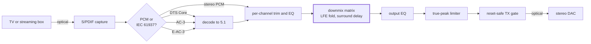

# Aius

Aius is a personal, non-commercial surround-to-stereo downmixer built on a
Teensy 4.1. It exists to fix unintelligible dialogue.

Smart TVs and streaming apps downmix 5.1 to stereo badly. Almost all the speech
in a film or programme is on the centre channel, and when that gets folded into
a stereo pair it ends up competing with music and effects that were mixed to sit
around it, not on top of it. You get dialogue you cannot follow and explosions
that make you reach for the remote, and the television gives you nothing to
correct it with beyond a volume control.

Aius takes the 5.1 stream before the television touches it and does the downmix
itself. The centre, surround and LFE levels and the EQ on each are yours to set,
so you can re-engineer the mix for your own room and speakers until speech is
intelligible at a volume that does not hurt.

The firmware runs on bench hardware today, taking a real optical source and
driving a real optical sink. Nearly all the engineering effort went into it.

## What the firmware does

- **Live downmix.** Six channels in, two out, every matrix coefficient editable
  while the audio plays. Lift the centre a few dB, pull the surrounds back, and
  speech comes forward.
- **Per-channel EQ.** A biquad cascade on each input channel and on the output.
- **LFE fold** with its own crossover, **surround decorrelation delay**, and a
  **true-peak limiter** on the output tail.
- **Edits apply at the next block boundary**, from a browser, with no restart.
- **Three decoders in one resident slot** — DTS Core over a vendored `dcadec`,
  AC-3 over a hardened liba52 fork, E-AC-3 over an FFmpeg fork. The pipeline
  classifies each burst and swaps decoders as the broadcast changes.
- **Output follows the source rate**: 32, 44.1 or 48 kHz.
- **Reset-safe transmitter.** A board that is booting or has faulted stays
  silent.
- **Served from SD** — the editor, status, replay and upgrade pages all come off
  the card.
- **Signed OTA upgrades**, staged and Ed25519-verified on the device.
- **PSRAM flight recorder** that can be triggered to capture the audio ring when
  something goes wrong.

## How it is built

- **The DSP is bit-identical between host and target.** The same portable C runs
  in host tests and on the Teensy, and the target build pins
  `-ffp-contract=off` so the ARM's fused multiply-add cannot round differently
  from the host. A golden vector that passes on a laptop also holds on the board.
- **Memory budgets are link-time asserts.** The linker script carries an OCRAM
  heap floor, an ITCM ceiling and a DTCM stack floor, so an addition that will
  not fit fails the build. Before those asserts existed, one bricked every boot
  instead.
- **Nothing runs unbounded on the audio path.** The runtime is a scheduler of
  bounded epochs with a per-checkpoint budget table, a fed watchdog, a retained
  boot ledger that survives reset, and a sticky recovery-safe mode.
- **Roughly twice as much test code as library code**, across host suites that
  need no hardware to run. Exact figures, and the commands behind them, are in
  [project scale](docs/reference/project-scale.md).

## Start here

- [User interface](docs/reference/user-interface.md) — screenshots of the
  editor where the mix is set, plus the status, replay and upgrade pages the
  device serves off its SD card.
- [Signal path](docs/reference/signal-path.md) — the audio chain stage by
  stage, with the buffers, budgets and rounding behaviour of each.
- [USB control protocol](docs/reference/usb-control-protocol.md), and the HTTP
  API as a committed OpenAPI document — the two
  control surfaces. HTTP is plain on port 80 with auth-gated control routes, and
  there is a UDP control socket on 4242 as well.
- [Open work register](docs/plans/aius-open-work-register.md) — the live
  backlog and defect log. Every defect carries its conviction narrative, and
  several carry retractions where the first verdict turned out to be wrong.
- [Project scale](docs/reference/project-scale.md) — how much work is in here
  and how each figure was measured.

[`firmware/README.md`](firmware/README.md) maps the code itself.
[`CONTRIBUTING.md`](CONTRIBUTING.md) covers building, testing, flashing and the
KiCad environment. Each directory under [`docs/`](docs/) carries its own index.

## Hardware, and what is next

The bench build is a socketed Teensy 4.1 wired to purchased TOSLINK modules on a
proto board ([wiring guide](docs/guides/proto-optical-wiring.md)). Every
measurement in this repository was taken on it.

A carrier board exists as a captured, ERC-clean KiCad schematic: Teensy socket,
optical in and out, the transmitter gate and a diagnostic bypass mux, native
Ethernet with a magjack, a single rear USB-C 5 V input, keyed expansion headers,
and a stock Hammond enclosure. It has not been laid out or ordered, and **no PCB
order is authorised by the current state of this repository**. Two layers is
still an assumption; it goes to four only if a documented electrical constraint
forces it.

What remains is two-layer feasibility against a real fabricator stackup, then
layout, then a prototype order.

## Licence and reuse

This is a personal project, published so the work can be read. It vendors
third-party decoder cores under their own licences — see each `NOTICE.md` under
`firmware/vendor/`. The evidence library holds public datasheets and reference
material retained for personal research; do not republish those bytes.
