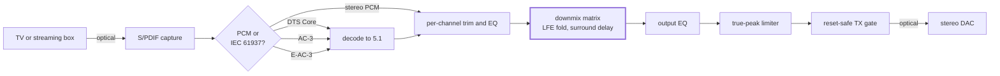

# Aius

Aius is a surround-to-stereo downmixer built on a Teensy 4.1. It exists to fix
unintelligible dialogue.

Smart TVs and streaming apps downmix 5.1 to stereo badly. Almost all speech is
on the centre channel; folded into a stereo pair, it competes with music and
effects mixed to sit around it, not on top of it. The television offers no
correction beyond a volume control.

Aius takes the 5.1 stream before the television does and downmixes it itself.
You set the centre, surround and LFE levels and the EQ on each, re-engineering
the mix for your room and speakers until speech is intelligible at a volume that
does not hurt.

The whole processing chain is editable from a browser while the audio plays:

The [user interface reference](docs/reference/user-interface.md) covers every
page.

The firmware is proven on bench hardware: a Teensy 4.1 with an SD card, wired to
a TOSLINK receiver and transmitter and to a magjack breakout for Ethernet
([wiring guide](docs/guides/proto-optical-wiring.md)). Every measurement in this
repository was taken on it. From there the project matures into the host carrier
board and the enclosure engineering around it.

## What the firmware does

- **Live downmix.** Six channels in, two out. Every matrix coefficient is
  editable from a browser and applies at the next block boundary, with no
  restart. Lift the centre a few dB, pull the surrounds back, and speech comes
  forward.
- **Per-channel EQ.** A biquad cascade on each input channel and on the output.
- **LFE fold** with its own crossover, **surround decorrelation delay**, and a
  **true-peak limiter** on the output tail.
- **Three decoders in one resident slot:** DTS Core over a vendored `dcadec`,
  AC-3 over a hardened liba52 fork, E-AC-3 over an FFmpeg fork. The pipeline
  classifies each burst and swaps decoders as the broadcast changes.
- **Output follows the source rate**: 32, 44.1 or 48 kHz.
- **Reset-safe transmitter.** A board that is booting or has faulted stays
  silent.
- **Served from SD.** The editor, status, replay and upgrade pages all come off
  the card.
- **Signed OTA upgrades**, staged and Ed25519-verified on the device.
- **PSRAM flight recorder** that can be triggered to capture the audio ring when
  something goes wrong.
- **Every audible fault class is counted and time-stamped**, posts to the event
  ring and can freeze a recorder capture, so a glitch heard in the room is read
  against a record rather than a lifetime total:
  - underrun episodes
  - governor and gate splices
  - clock trims
  - missed transmit fills
  - CRC-rejected frames

## How it is built

- **The DSP is bit-identical between host and target.** The same portable C runs
  in host tests and on the Teensy, and the target build pins
  `-ffp-contract=off` so the ARM's fused multiply-add cannot round differently
  from the host. A golden vector that passes on a laptop also holds on the board.
- **Memory budgets are link-time asserts.** The linker script carries an OCRAM
  heap floor, an ITCM ceiling and a DTCM stack floor, so an addition that will
  not fit fails the build. Before the asserts, one linked clean and dropped the
  board into recovery-safe mode on every boot.
- **Nothing runs unbounded on the audio path.** The runtime is a scheduler of
  bounded epochs with a per-checkpoint budget table, a fed watchdog, a retained
  boot ledger that survives reset, and a sticky recovery-safe mode.
- **Roughly twice as much test code as library code**, across host suites that
  need no hardware to run. Exact figures, and the commands behind them, are in
  [project scale](docs/reference/project-scale.md).

## Start here

- [User interface](docs/reference/user-interface.md): screenshots of the editor
  where the mix is set, plus the status, replay and upgrade pages the device
  serves off its SD card.
- [Signal path](docs/reference/signal-path.md): the audio chain stage by stage,
  with the buffers, budgets and rounding behaviour of each.
- [USB control protocol](docs/reference/usb-control-protocol.md) and the HTTP
  API as a committed OpenAPI document: the
  control surfaces. HTTP is plain on port 80 with auth-gated control routes; a
  UDP control socket listens on 4242.
- [Open work register](docs/plans/aius-open-work-register.md): the live backlog
  and defect log. Each defect records how it was proven, and several record
  retractions where the first verdict was wrong.
- [Project scale](docs/reference/project-scale.md): how much work is in here and
  how each figure was measured.

[`firmware/README.md`](firmware/README.md) maps the code itself.
[`CONTRIBUTING.md`](CONTRIBUTING.md) covers building, testing, flashing and the
KiCad environment. Each directory under [`docs/`](docs/) carries its own index.

## Hardware, and what is next

The carrier board is a routed, DRC/DFM-clean four-layer KiCad design in a stock
Hammond enclosure:

- Teensy socket
- optical in and out, with the transmitter gate and a diagnostic bypass mux
- native Ethernet with a magjack
- a single rear USB-C 5 V input
- keyed expansion headers

Two layers proved electrically infeasible for controlled-impedance USB/Ethernet
routing, so the board escalated to four
([H2/H3 manufacturing plan](docs/plans/aius-h2-h3-manufacturing.md)). Layout,
routing and the manufacturing package (Gerbers, drill, CPL, STEP, BOM,
fabrication drawing) are done. **Nothing in this repository authorises a PCB
order yet.**

The independent design review's mechanical closeout remains:

- the bench XY fit check
- the open-work register's footprint gate
- fabricator quotes

## Licence

**[GPL-3.0-or-later](LICENSE)**, by necessity. The AC-3 decoder is a liba52 fork
under GPL-2.0-or-later linked into the image, so the firmware must be GPL. The
FNET TCP/IP stack is Apache-2.0: incompatible with GPL-2.0, compatible with
GPL-3.0. liba52's "or later" lets the two coexist.

[`THIRD-PARTY.md`](THIRD-PARTY.md) inventories every third-party component that
reaches the image, its licence, and the obligations that come with it. Each
vendored tree keeps its own `NOTICE.md` recording its upstream revision and
every divergence, and modified files say so in their headers.

The [evidence library](evidence/) holds public datasheets and vendor reference
material retained for research. It is not ours to relicense; do not republish
those bytes.
