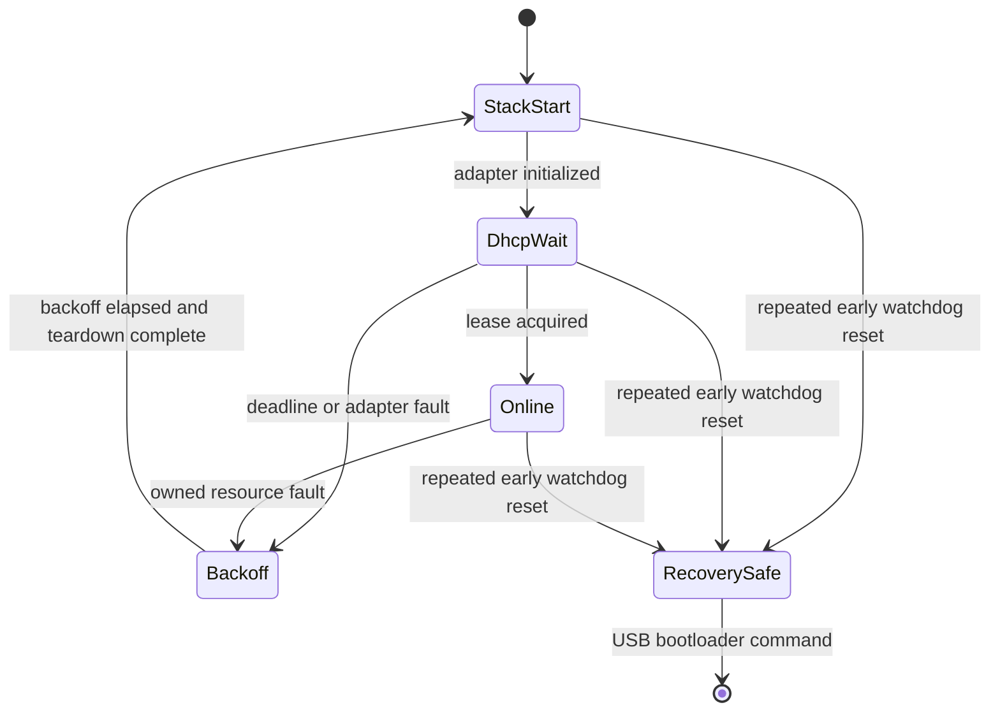

# Aius network and firmware recovery hardening

The existing hardening is not accepted. Repeated local fixes changed timing and
retry behaviour without proving that initialization, socket ownership, or
watchdog recovery is bounded. This plan replaces those claims with one explicit
firmware lifecycle, a button-free recovery invariant, and tests that exercise
the target code rather than only its codecs and host tools.

## Trusted fixture boundary

Treat the DHCP server, network routing, and USB-to-fibre extender as reliable
fixture components. A missing lease, unreachable service, failed software
bootloader transition, or post-flash mismatch is a firmware or firmware-tooling
failure until firmware evidence identifies a more specific cause.

- DHCP is the production address source. Remove the static fallback and its
  separate initialization path.
- Host routing is pre-provisioned fixture state. Do not add route repair or
  route diagnosis to firmware acceptance.
- USB CDC is the recovery control plane. A running or watchdog-recovered image
  must accept a software bootloader command without a Program-button press.
- HalfKay transfer over the USB-to-fibre path is trusted. A successful loader
  exit followed by the wrong application revision is a release failure.

This decision supersedes the DHCP/static-fallback requirements in
[`aius-optical-prototype.md`](aius-optical-prototype.md) for the deployed optical
image. UDP discovery remains useful for identity, but not as an alternative
addressing scheme.

## Clean-room findings

The current green tests and telemetry do not support the plan's earlier
hardening claims.

1. **TCP writes are not bounded.** `http_send_content()` checks elapsed time
   around `EthernetClient::write()` in
   `firmware/src/optical_main.cpp:1248`, but the pinned NativeEthernet
   implementation enters
   `while(socketSendAvailable(s) < len){}` inside that call. The caller's
   100 ms check cannot run while blocked. SD response writes reach the same
   call at `firmware/src/optical_main.cpp:578` and
   `firmware/src/optical_main.cpp:619`.
2. **Static fallback can deadlock.** NativeEthernet's static-address
   `Ethernet.begin()` ends in `while(!link_status){}`. The firmware reaches
   this path after its DHCP attempt accounting in
   `firmware/src/optical_main.cpp:2297`.
3. **Network ownership is split.** `start_network()` uses NativeEthernet to
   initialize the stack, while `ensure_dhcp_client()` releases and recreates
   FNET's DHCP client through private headers. NativeEthernet's link callback
   also owns that DHCP client. `g_ethernet_initialized` therefore describes
   application intent, not the actual FNET lifecycle.
4. **A network reset is not a stack reset.**
   `reset_network_service()` clears application flags and stops UDP, but does
   not stop the HTTP listener, unregister the server service, or deinitialize
   FNET. Calling `EthernetServer::begin()` again may allocate another socket
   and service registration. `http_server_rebinds` counts attempts, not
   successful leak-free recovery.
5. **The watchdog is unqualified.** It is fed at multiple points, including
   immediately before the secondary network service, and records only the raw
   reset-source bits. There is no retained last-progress checkpoint, no early
   reset-loop escape, and no target test proving recovery from each blocking
   boundary.
6. **The tests miss the failure surface.** The native `net` suite tests only
   UDP framing, `http` tests only parsing/formatting, and `net-runner` tests host
   Python against a localhost server. None compiles or drives
   `start_network()`, `reset_network_service()`, `service_http()`, the
   NativeEthernet adapter, or watchdog feeding.
7. **The optical flashing tool does not use the optical recovery channel.**
   `firmware/scripts/flash_optical.sh` requests software reboot only from the
   RawHID capability image (`16c0:0486`). The optical image exposes its
   bootloader command over CDC (`16c0:0483`), but the script falls through to a
   loader wait and therefore invites a manual button press.

The sequence of commits on 2026-07-23 confirms the patch pattern: DHCP
maintenance, DHCP restart, diagnostics, watchdog timing, link-state handling,
HTTP ordering, and listener rebinding were changed independently in the same
global state machine. Those changes are useful observations, not accepted
proof.

## Recovery contract

**The device must always reach either normal service or a USB-recoverable safe
mode without physical intervention.**

- `setup()` performs only reset-ledger capture, watchdog arming, safe audio
  output initialization, USB parser initialization, and construction of
  non-blocking service state. SD and network acquisition start incrementally
  from `loop()`.
- One top-level loop epoch calls every mandatory service once with a declared
  operation budget. No service function waits for a state change, buffer space,
  link state, lease, peer data, or peer close.
- The watchdog is fed exactly once, after the complete loop epoch returns.
  Before each service call, firmware writes a retained progress checkpoint.
- A watchdog reset before the healthy-loop checkpoint increments a retained
  early-reset count. Two consecutive early watchdog resets enter recovery-safe
  mode: Ethernet and SD mutation stay disabled, audio output stays safe, and
  USB CDC remains responsive for status and bootloader entry.
- Ten seconds of completed loop epochs clears the early-reset count. Recovery
  mode exits only after an explicit USB command or a new verified image.
- Every socket, DHCP client, listener, and stack instance has one owner and one
  generation. Teardown closes or invalidates all generation-owned resources
  before a new generation starts.
- DHCP success moves the supervisor online. A DHCP deadline expiry is recorded
  as a firmware fault and starts a bounded adapter restart after backoff; it
  does not select a static address or implicate the fixture.
- USB service precedes network work in every loop epoch. Network failure cannot
  remove the recovery control plane.

## Target design

Deepen the existing portable modules instead of adding more logic to
`optical_main.cpp`.

- **`aius_net`** owns a transport-independent network supervisor with explicit
  state, deadlines, resource generations, counters, and actions. A host fake
  and the Teensy adapter are its two real implementations.
- **`aius_http`** owns the one-client request/response transaction state,
  including partial reads, partial writes, stall deadlines, and SD transfer
  coordination. The public step function consumes a fixed operation budget and
  may return `progress`, `would_block`, `closed`, or `fault`; it never loops
  waiting for transport progress.
- **The Teensy network adapter** is the only code allowed to include
  NativeEthernet or FNET headers. It uses a repository-pinned, reviewable
  NativeEthernet source snapshot with the unbounded waits removed, explicit
  listener teardown, and one-shot send semantics. Application code does not
  manipulate FNET descriptors.
- **`optical_main.cpp`** becomes the composition root. It supplies time and
  snapshots, applies supervisor actions, and calls one bounded network step.
  The existing protocol codecs, DSP, replay, configuration, and audio modules
  remain independent.
- **The boot ledger** owns decoded reset cause, boot generation, last progress
  checkpoint, consecutive early watchdog resets, recovery-mode entry, and the
  build revision that produced them. Its retained-storage mechanism must be
  verified on the Teensy before it becomes authoritative.

## Proof strategy

Passing a build or observing one HTTP response is not acceptance. Each claim has
an oracle that distinguishes the expected firmware state from timeout or
fixture speculation.

### Host deterministic proof

- Exhaustively cover every supervisor state/event pair, including duplicate
  callbacks, adapter faults, deadline equality, counter saturation policy, and
  `millis()` wraparound.
- Generate long event sequences with a model oracle. Assert that at most one
  stack generation is live, every acquired resource is released once, no stale
  generation can publish readiness, and every state reaches `Online`,
  `Backoff`, or `RecoverySafe` within its declared step count.
- Inject `would_block`, zero-byte progress, partial read/write, peer close,
  listener loss, allocation failure, and teardown failure at every transport
  operation. Assert a fixed upper bound on calls and elapsed simulated time per
  step.
- Exercise HTTP and SD transactions through the public transaction interface,
  not parser internals. Cover partial headers and bodies at every byte boundary,
  response-buffer boundaries, disconnect at every state, and stalled writes.
- Add a source-level dependency guard for the pinned adapter: no target-facing
  operation may contain an unbounded wait or call an upstream operation whose
  boundedness is not documented by the adapter contract.

### Target recovery proof

- A fault-injection optical build can stall immediately before each mandatory
  service return. For every checkpoint, the hardware watchdog must reset the
  target within its specified window, the next boot must report watchdog cause
  and the injected checkpoint over USB, and repeated early failures must enter
  recovery-safe mode.
- The optical flashing script must discover the CDC application, issue `AIUS
  BOOTLOADER`, observe HalfKay, flash, wait for CDC re-enumeration, and verify
  the exact build revision. A Program-button press invalidates the run.
- Repeated normal boots must report monotonic boot generations, zero unexpected
  watchdog resets, a DHCP lease, a listening HTTP service, and the expected
  build revision. A lease or reachability failure is recorded against the
  firmware step/checkpoint where progress stopped.
- The soak runner records USB heartbeat, HTTP status, UDP status, boot
  generation, reset ledger, resource generation, service latency, and an
  independent optical audio continuity oracle in one evidence stream.

## Implementation phases

Before Phase 1 starts, run the repository's one-time clean-room adversarial
plan review against this document and the then-current code. The reviewer must
not receive prior implementation narratives. Amend and commit this plan before
the first implementer starts.

### Phase 1 — Pure network supervisor

**Outcome:** one explicit, transport-independent lifecycle replaces the current
boolean combination as the source of network state.

**Acceptance examples:**

- A lease received exactly at the deadline becomes `Online`.
- A late callback from generation N cannot activate generation N+1.
- Any initialization fault releases generation-owned resources and reaches
  `Backoff` in a bounded number of steps.
- Two retained early watchdog resets select `RecoverySafe` without attempting
  network initialization.

**Targeted proof:** native exhaustive transition table, generated event
sequences, wraparound cases, and resource-ownership assertions.

**Dependencies:** amended plan and clean-room plan review.

**unit:** `phase-task`

**seams:** supervisor state ↔ adapter actions; retained boot state ↔ recovery
decision

**contract-artifact:** `spec-only`; recovery contract and state diagram above

**fan-out:**

- **`agent-network-supervisor`**
  - owned paths: `firmware/lib/aius_net/include/aius_net.h`,
    `firmware/lib/aius_net/src/aius_net.c`,
    `firmware/test/net/`,
    `firmware/scripts/test.sh`

**review-intensity:** active; transition completeness, generation ownership,
deadline arithmetic, and recovery reachability

**commit-checkpoint:** `firmware/scripts/test.sh --environment
native --suite net` passes;
`firmware/scripts/build.sh teensy41-optical` remains buildable;
parent commits `test(aius): specify network supervisor recovery`

### Phase 2 — Bounded Teensy transport

**Outcome:** a single adapter owns initialization, DHCP, listeners, UDP, TCP,
and teardown, with no operation that waits for progress.

**Acceptance examples:**

- `try_write()` returns `would_block` immediately when send capacity is zero.
- Reopening HTTP after a listener fault closes the old generation before
  creating one listener for the new generation.
- Adapter teardown is idempotent after partial initialization.
- Production initialization has DHCP only and contains no static-address wait.

**Targeted proof:** fake-driver operation matrix, resource accounting, adapter
source guard, clean target build, and target-side timing probes for each adapter
operation.

**Dependencies:** Phase 1 committed.

**unit:** `phase-task`

**seams:** `aius_net` actions ↔ Teensy transport; patched NativeEthernet
one-shot calls ↔ adapter result codes

**contract-artifact:** `both`; committed adapter interface, fake-driver
fixtures, and pinned NativeEthernet source revision

**fan-out:**

- **`agent-bounded-transport`**
  - owned paths: `firmware/vendor/NativeEthernet/`,
    `firmware/src/aius_network_teensy.cpp`,
    `firmware/src/aius_network_teensy.h`,
    `firmware/test/network-transport/`,
    `firmware/platformio.ini`

**review-intensity:** active; every loop and vendor call, allocation lifetime,
callback ownership, socket teardown, and interrupt interaction

**commit-checkpoint:** transport tests and source guard pass;
`firmware/scripts/build.sh teensy41-optical` builds within
memory budgets;
parent commits `fix(aius): add bounded Teensy network transport`

### Phase 3 — Stateful bounded HTTP transactions

**Outcome:** `aius_http` owns request and response progress; all TCP and SD
transfer paths use one-shot transport operations.

**Acceptance examples:**

- A peer that never accepts response bytes is dropped at the transaction
  deadline while subsequent clients remain serviceable.
- Disconnect at every upload/download state releases the client and SD job
  exactly once.
- Partial writes resume from the correct offset without repeating bytes.
- No HTTP step exceeds its operation budget even at request/body boundaries.

**Targeted proof:** transaction-level state coverage with injected transport and
SD outcomes, every disconnect position, byte-boundary partitions, and maximum
buffer sizes.

**Dependencies:** Phase 2 committed.

**unit:** `phase-task`

**seams:** HTTP transaction ↔ one-shot transport; HTTP transaction ↔ bounded SD
job

**contract-artifact:** `both`; public transaction interface and failure matrix

**fan-out:**

- **`agent-http-transactions`**
  - owned paths: `firmware/lib/aius_http/include/aius_http.h`,
    `firmware/lib/aius_http/src/aius_http.c`,
    `firmware/test/http/`,
    `firmware/scripts/test.sh`

**review-intensity:** active; full control-flow, length arithmetic, partial
progress, cancellation, and idempotent cleanup

**commit-checkpoint:** `firmware/scripts/test.sh --environment
native --suite http` passes; optical target remains buildable; parent commits
`test(aius): model bounded HTTP transactions`

### Phase 4 — Runtime integration and deletion

**Outcome:** `optical_main.cpp` delegates lifecycle and transport to the new
modules; the old flags, raw FNET access, static fallback, rebind patch, and
blocking writes are deleted.

**Acceptance examples:**

- `setup()` reaches `loop()` without waiting for SD, link, DHCP, or a peer.
- One loop epoch services USB first and feeds the watchdog once after all
  mandatory services return.
- A socket or listener fault restarts only the owned network generation and
  preserves USB and audio service.
- The status surfaces supervisor state, resource generation, last fault, and
  boot-ledger fields from coherent snapshots.

**Targeted proof:** native `net`, `http`, `replay`, `usb-control`, and config
suites; target build; static search showing no FNET include or direct
NativeEthernet call in `optical_main.cpp`.

**Dependencies:** Phases 1–3 committed.

**unit:** `phase-task`

**seams:** composition loop ↔ supervisor/HTTP steps; status/USB ↔ coherent
recovery snapshot

**contract-artifact:** `both`; landed module interfaces and this deletion list

**fan-out:**

- **`agent-runtime-integration`**
  - owned paths: `firmware/src/optical_main.cpp`,
    `firmware/tools/net/aius_net_runner.py`,
    `firmware/test/net/test_net_runner.py`,
    `firmware/README.md`

**review-intensity:** active; old-path deletion, loop ordering, audio
interference, status compatibility, and no duplicated ownership

**commit-checkpoint:** declared native suites pass; optical target builds and
fits; owned-path search confirms forbidden calls are absent; parent commits
`refactor(aius): centralize the optical network lifecycle`

### Phase 5 — Watchdog recovery and button-free flashing

**Outcome:** retained diagnostics identify the last incomplete service,
repeated early resets enter recovery-safe mode, and the optical image can always
request HalfKay over CDC.

**Acceptance examples:**

- One induced stall resets and reports the exact last checkpoint.
- Two consecutive early stalls boot into USB-responsive recovery-safe mode
  without starting Ethernet.
- A healthy ten-second interval clears the early-reset count.
- The flash script transitions a normal or recovery-safe optical image to
  HalfKay and verifies the flashed revision without a button press.

**Targeted proof:** host boot-ledger transition tests, target watchdog
fault-injection matrix, CDC bootloader integration, and negative test for stale
post-flash revision.

**Dependencies:** Phase 4 committed.

**unit:** `phase-task`

**seams:** watchdog reset ↔ retained boot ledger; USB CDC ↔ HalfKay loader;
loader exit ↔ revision verification

**contract-artifact:** `both`; boot-ledger format, fault-injection checkpoint
catalogue, and flash evidence schema

**fan-out:**

- **`agent-recovery-channel`**
  - owned paths: `firmware/src/optical_main.cpp`,
    `firmware/lib/aius_boot/`,
    `firmware/test/boot/`,
    `firmware/lib/aius_usb_control/`,
    `firmware/test/usb-control/`,
    `firmware/scripts/flash_optical.sh`,
    `firmware/README.md`,
    `firmware/platformio.ini`

**review-intensity:** active; reset-register semantics, retained-state
integrity, reset-loop escape, USB ordering, loader process lifecycle, and exact
revision matching

**commit-checkpoint:** native USB and boot-ledger tests pass; normal and
fault-injection optical targets build; simulated flash-tool tests pass; parent
commits `fix(aius): guarantee button-free firmware recovery`

### Phase 6 — Hardware acceptance campaign

**Outcome:** machine-readable target evidence proves boot, service, watchdog,
recovery-safe, flash, and long-run behaviour on the deployed fixture.

**Acceptance gates:**

1. Ten consecutive optical-image flashes complete through CDC software
   bootloader entry with the exact expected revision and zero button presses.
2. One hundred software reboots acquire DHCP and serve USB, HTTP, and UDP
   status within declared deadlines with no unexpected watchdog reset.
3. Each injected mandatory-service stall is repeated ten times. Every run
   resets within the watchdog window, reports the correct checkpoint, and
   returns to normal service or recovery-safe mode without intervention.
4. Every adapter fault injection (`would_block`, listener loss, partial write,
   peer close, and teardown failure) reaches its specified state and keeps USB
   responsive.
5. An eight-hour combined HTTP/UDP/SD workload completes with zero unexpected
   resets, zero unexplained control outages, no leaked resource generations,
   and no discontinuity in the independent optical audio oracle.
6. The production image is restored through the same button-free workflow and
   its revision is recorded after the campaign.

**Targeted proof:** one append-only JSONL receipt plus loader transcripts,
firmware build metadata, and audio-oracle output. The receipt records every
attempt, including failures; rerunning does not erase a failed attempt.

**Dependencies:** Phase 5 committed and physical target available.

**unit:** `phase-task`

**seams:** fixture runner ↔ USB/HTTP/UDP observations; fault injection ↔ reset
ledger; optical source/sink ↔ audio continuity oracle

**contract-artifact:** `both`; acceptance script and versioned evidence schema

**fan-out:**

- **`agent-hardware-acceptance`**
  - owned paths: `firmware/tools/net/`,
    `firmware/scripts/`,
    `firmware/test/net/`,
    `docs/plans/aius-network-hardening.md`

**review-intensity:** active; oracle independence, attempt accounting,
deadline enforcement, revision identity, and removal of fixture-blame branches

**commit-checkpoint:** all six gates pass; the final clean-room delivery audit
compares this plan with code and raw evidence; this plan is marked shipped in
the same commit; parent commits `test(aius): prove firmware recovery on target`

## Deferred work

- TLS, production authentication policy, and NTP remain separate concerns.
- Audio decoding and DSP behaviour remain independent of Ethernet recovery.
- A dual-image application rollback scheme is not required for this hardening
  pass. HalfKay plus watchdog recovery-safe mode is the recovery boundary.

## Delivered evidence

No prior build, flash attempt, host parser test, or single live request satisfies
the revised acceptance gates. Record new evidence here only when it names the
exact firmware revision, test selector, target identity, observed reset/boot
generations, and pass/fail outcome.
