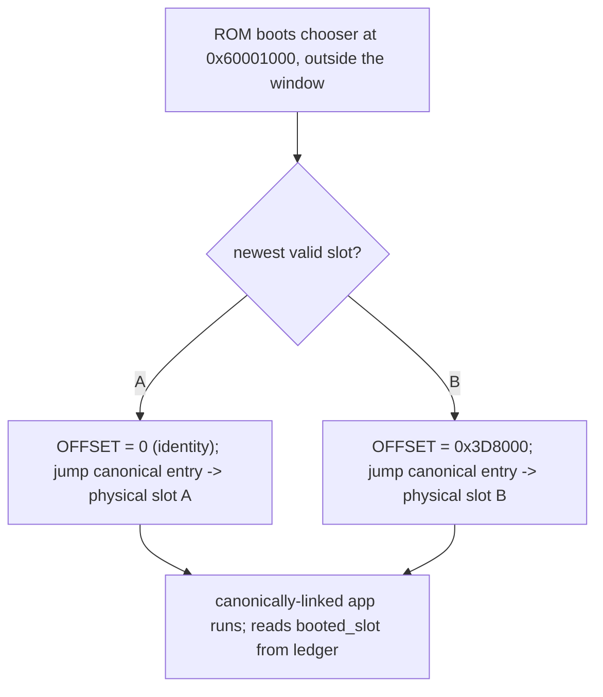

# Aius OTA slot-agnostic images — one build, one signature

The A/B scheme shipped by [aius-ota-resilience.md](aius-ota-resilience.md) Phase 3
links every release **twice** (slot-A base `0x60010000`, slot-B base
`0x603E8000`) and signs each build for the one slot it can execute from. The
device refuses any container whose signed `slot_id` tag is not its own inactive
slot. That doubles the build, the signature, and the release artifact, and it
forces the operator (or a future public OTA feed) to know each device's running
slot before it can offer an image. This plan removes the necessity: link once at
a canonical window, sign once, and let the first-stage chooser point the
hardware at whichever physical slot holds the image.

**This transition is not OTA-deployable.** It requires a new chooser, and the
chooser lives in the never-erased head region that OTA never writes
(`firmware/lib/aius_ab/include/aius_ab_layout.h:29`, `firmware/chooser/chooser.c:6`).
The cutover is a single physical HalfKay flash of a new `recovery.hex`; every
release *after* that is one image / one signature, deployed over OTA normally.
Because the chooser is HalfKay-recover-only, the whole change lands host-proven
and bench-proven on a spare board, and reaches the deployed device only at the
next physical visit.

## Status

Landed and cross-build-proven (Teensy toolchain), all inert on the deployed
board until a remap chooser is HalfKay-flashed:

- **Phase 1** — shared `lib/aius_ab` primitives, host suite green.
- **Phase 3** — runtime physical-slot identity + container acceptance gate in
  `ab_compose`, gated on `booted_slot`; all three envs build.
- **Phase 2** — remap-aware verify read (`ota_flash_read`), authored + compiled;
  BENCH-REQUIRED (register/SWRESET timing unvalidated off hardware; fail-safe).
- **Phase 4** — chooser programs the remap + always stamps `booted_slot`,
  authored + compiled freestanding; BENCH-REQUIRED.

Phases 2 & 4 passed an adversarial register review (no brick risk, no
false-verify; addresses/bits confirmed against `imxrt.h`). Its one substantive
finding — the flip left D-cache lines holding slot-A bytes aliased to canonical
addresses — is fixed (`arm_dcache_delete` after the restore). The only
remaining unknowns are inherently hardware: FlexSPI AHB prefetch/RX-buffer and
SWRESET/remap timing, settled only by the bench A→B→A + power-cut cycle.

Not started: Phase 5 (release build/signer glue — mostly already supported, see
the phase), Phase 6 (recovery.hex package + bench acceptance). No USB access to
the board, so nothing here is runtime- or bench-validated yet.

## Why it is per-slot today

The root cause is **XIP address-binding, not the signature**. The Teensy 4.1 /
i.MX RT1062 executes code directly from FlexSPI1 NOR at its linked absolute
address (`link/aius_teensy41.ld` origin `0x60000000`; no copy-to-RAM of `.text`,
no MMU relocation). An image linked for slot A has its vector table, `.text` and
`.rodata` absolute addresses baked at `0x60010000…`; the identical source linked
for slot B lives at `0x603E8000…`, and neither can run from the other's offset.
`scripts/gen_slot_ldscript.py` therefore rewrites the FLASH origin per slot. Two
differently-linked binaries have different `.text` bytes, hence different payload
digests, hence different signatures — so **no signature trick collapses two
dual-linked binaries to one signature**. One signature requires one binary; one
binary requires remap. The signed `slot_id` tag
(`lib/aius_ota/include/aius_ota.h:209`) is only the interlock that stops a device
flashing a wrong-linked binary into a slot; it is a symptom, not the cause.

## The mechanism: FlexSPI AHB address remap

The RT1062 FlexSPI controller has an **AHB address-remap** feature. The register
facts below are confirmed against the RT1060 reference manual (IOMUXC_GPR
chapter) and NXP AN12240 §3.2.1 / AN12255:

- `IOMUXC_GPR_GPR30/31/32` = remap **START / END / OFFSET**
  (`FLEXSPI_REMAP_ADDR_START/END/OFFSET`).
- Redirect formula is **`physical = addr + OFFSET`** (compared/added on bits
  [31:12]), active when `START[31:12] <= addr[31:12] < END[31:12]`.
- **END is exclusive**, **4 KB granularity** (bits [11:0] reserved-zero),
  **no enable bit** — the window is live whenever an address falls in range.
- Applies to **FlexSPI1** (`0x60000000`), which is where the flash lives.
- **The registers are cleared by every software/system reset.** Benign here only
  because the chooser sits *outside* the remapped window and the ROM runs it on
  every reset (see §Load-bearing invariants).

Applied here:

- **Link once** at a single canonical window = slot A's window
  `[0x60010000, 0x603E8000)` (`AIUS_AB_CANONICAL_BASE`). Sign once.
- The chooser decides which physical slot holds the newest valid image and
  programs the remap: `OFFSET = 0` for slot A (identity), or
  `OFFSET = AIUS_AB_SLOT_BYTES` (`0x3D8000`) for slot B
  (`0x60010000 + 0x3D8000 = 0x603E8000`). It then jumps to the canonical entry;
  every fetch and `.rodata` read resolves to the chosen physical slot.
- HalfKay recovery (`recovery.hex` = chooser + slot A) is unchanged: slot A links
  at `0x60010000`, `OFFSET = 0`.

## Load-bearing risks and invariants

These four came out of the pre-build adversarial review; each is a way the change
bricks a device or silently half-disables OTA. They shape the phases.

### The atomic-cutover interlock (brick)

`aius_ab_slot_ivt_sane` today validates a slot's IVT entry against the slot's
**own physical** window (`firmware/lib/aius_ab/src/aius_ab.c:319`;
`firmware/test/ab/test_ab.c:289`). A canonically-linked slot-B image has its
entry at `~0x60010xxx` (slot A's window), so:

- old chooser + new canonical B image → old check rejects B, and
- new (canonical) check + old dual-linked B image → new check rejects B.

If both physical slots hold images whose linkage the *installed chooser*
disagrees with, `chooser_main` finds both insane and parks in WFI
(`firmware/chooser/chooser.c:145`) — dead until HalfKay. Therefore the chooser,
the canonical images, the revised `ivt_sane`, and the ledger `booted_slot`
channel **must cut over together in one HalfKay `recovery.hex`**. No sub-part
ships independently to a live board.

### Verify reads are shadowed → silent OTA-disable from slot B (correctness)

The post-program verify reads memory-mapped through the XIP window
(`firmware/src/optical_main.cpp:3956` `memcpy(dest, (const void *)address, …)` in
`ota_flash_read`, at `window.base + offset`). When slot B is running with the
remap active, the inactive-slot A window `0x60010000` is *inside* `[START, END)`,
so the verify memcpy reads **physical B (the running image)**, not the freshly
programmed physical A. Installing a genuinely different image then fails verify
every time from slot B — a silent, asymmetric half-disable of OTA (works from A,
impossible from B), worse than the false-pass this plan first described.

Program/erase are safe: `eepromemu_flash_*` masks to a physical offset and issues
FlexSPI **IP** commands (`optical_main.cpp:3898`), remap-independent. The fix is
**not** "read the true physical address" (physical A has no AHB alias while B is
mapped) and **not** "disable the remap mid-verify" (the running image's own
`.rodata` lives in that window). The only sound fix is a **FlexSPI IP-read
primitive** — net-new FASTRUN driver code, since `ota_flash_read` is the only
read path and it is a plain memcpy today.

### A single build cannot observe its own physical slot (design hole)

Today the running image's ground truth is the compile-time `AIUS_AB_SLOT`
(`optical_main.cpp:82`), consumed by `ab_compose` to record which slot is active
and to compute the inactive slot to erase/program next
(`optical_main.cpp:3754`, `:87-90`). Under one canonical build there is no
compile-time slot, and the image **cannot read its physical slot from its own
address space** — every symbol and PC is canonical `0x6001xxxx` by the remap's
design. The chooser (which made the choice) must hand the booted physical slot to
the app. The carrier is the retained ledger, gaining a `booted_slot` field, which
the chooser writes on **every** boot (not only trials). Without this the app can
mistake the running slot for the inactive one and erase the live image.

### `booted_slot` presence gates the scheme — a safe migration path

The same channel doubles as the cutover selector: the **new** chooser stamps
`booted_slot`; the **old** chooser never does, so the app reads `NONE`. The app
therefore keys every scheme-dependent decision on it:

- `booted_slot == NONE` (old chooser) → legacy behaviour: physical slot from the
  compile-time `AIUS_AB_SLOT`, and enforce the container's slot tag against the
  inactive slot exactly as today.
- `booted_slot` set (new chooser) → slot-agnostic behaviour: physical slot from
  the ledger, and accept the untagged (`slot_id == NONE`) canonical container.

This makes one firmware correct under **both** choosers, so the cutover image can
ship to the deployed board over the existing dual-linked OTA path *first*
(behaving legacy), and only when the new chooser is HalfKay-flashed does the same
firmware flip to slot-agnostic. The change never has a flag day where the board
is between schemes with firmware that only understands one.

### Remap re-established every boot; hand-off needs an RX-buffer flush (invariant)

- **Every reset clears GPR30/31/32**, and the ROM re-enters the chooser, which
  re-programs the remap. No code path may assume the remap survives a reset
  without going through the chooser. The chooser's placement outside the window
  is what makes this benign; pin it with a test.
- **Chooser hand-off sequence is mandatory**: read the chosen slot's IVT at its
  *true physical* address (outside the window, order-independent) → write
  GPR30/31/32 → reset the FlexSPI AHB RX FIFO (SWRESET, as
  `optical_main.cpp:3951` already does; SWRESET does not touch the IOMUXC GPRs) →
  `__DSB; __ISB` → jump to the canonical entry. `__DSB` alone may leave a stale
  pre-remap prefetch line in the AHB RX buffer.

## Phases

### Phase 1 — shared A/B logic for slot-agnostic boot (host)

- outcome: `lib/aius_ab` gains (a) `aius_ab_remap_for_slot()` returning the
  `(start, end, offset)` remap inputs for a chosen physical slot against the
  canonical window (identity for A, `0x3D8000` for B); (b) `aius_ab_slot_ivt_sane`
  revised to validate the entry word against `AIUS_AB_CANONICAL_BASE` regardless
  of slot; (c) the retained ledger's new `booted_slot` field (codec + fail-closed
  decode), carved from the existing reserved bytes so it stays 32 bytes and old
  ledgers read `booted_slot = NONE`; (d) `aius_ab_choose` populates
  `choice.ledger.booted_slot`. The `ab` host suite pins all four. Pure logic,
  no target code, no flash. NOT independently deployable — part of the atomic
  cutover (see §The atomic-cutover interlock).
- seams: `lib/aius_ab/include/aius_ab_layout.h` (canonical constants),
  `lib/aius_ab/include/aius_ab.h`, `lib/aius_ab/src/aius_ab.c`,
  `firmware/test/ab/test_ab.c`.
- targeted-proof: `scripts/test.sh --environment native --suite ab`.
- unit: parent-only

### Phase 2 — FlexSPI IP-read verify primitive (target + host contract)

- outcome: a net-new freestanding FASTRUN FlexSPI IP-read that reads a physical
  flash offset independent of any active remap, coexisting with the IP
  erase/program usage. `ota_flash_read` (verify + self-test read paths) reroutes
  to it. A host row drives a fake flash whose canonical-window view and physical
  view diverge (the shadowing case) and asserts the verify reads the physical
  bytes.
- seams: a target FlexSPI IP-read shim, `ota_flash_read` in
  `src/optical_main.cpp`, the activation sequencer read seam
  (`lib/aius_ota/src/aius_ota_activate.c`), `firmware/test/ota`.
- targeted-proof: `scripts/test.sh --environment native --suite ota`; the driver
  itself bench-verified with the chooser change in Phase 4.
- unit: parent-only
- dependencies: Phase 1.

### Phase 3 — runtime slot identity from the chooser (app)

- outcome: the app reads `booted_slot` from the retained ledger as physical
  ground truth for the inactive/active decision in `ab_compose` and the
  `INSANE_OTHER` detection. When `booted_slot == NONE` (old chooser) it falls
  back to the compile-time `AIUS_AB_SLOT` exactly as today, so the current board
  is unaffected; when set, it overrides. The dual behaviour is what makes the
  cutover firmware safe under both choosers (see §`booted_slot` presence gates
  the scheme).
- seams: `src/optical_main.cpp` `ab_compose` and the expected-slot/inactive-slot
  wiring, `firmware/test/optical-app` or a focused host row.
- targeted-proof: `scripts/test.sh --environment native --suite ab` + the
  optical-app suite.
- unit: parent-only
- dependencies: Phase 1.

### Phase 4 — chooser programs the remap + hands off (target, bench-only)

- outcome: the chooser reads the chosen slot's physical IVT, programs GPR30/31/32
  via a tiny target shim behind `aius_ab_remap_for_slot()`, resets the FlexSPI
  AHB RX FIFO, `__DSB; __ISB`, and jumps to the canonical entry; it writes
  `booted_slot` into the ledger on every boot. A test pins the
  remap-re-established-every-boot invariant. Bench validation on a SPARE board
  first; never the deployed board before the acceptance cycle passes.
- seams: `firmware/chooser/chooser.c`, a target remap/RX-reset shim,
  `firmware/chooser/chooser.ld` (no-RAM-section rule preserved).
- targeted-proof: host suite over the pure primitive (Phase 1) + bench A→B→A, a
  deliberately corrupted offer, and a mid-window power cut, all recovering
  unaided.
- unit: parent-only
- dependencies: Phase 1, Phase 2, Phase 3, and owner go-ahead to flash a bench
  board.

### Phase 5 — collapse the build, signer, and container to one image

- outcome: the canonical release image is the existing slot-A-linked build
  (`teensy41-optical-slot-a` links at `0x60010000` = `AIUS_AB_CANONICAL_BASE`)
  signed WITHOUT `--slot`, i.e. the already-supported `slot_id == NONE` container
  — so "one build, one signature" needs almost no new build machinery, just
  choosing the slot-A image + agnostic signature for a release. The device's
  acceptance of an untagged container is gated on `booted_slot` (Phase 3's
  channel): the new-chooser firmware accepts it, the old-chooser firmware keeps
  refusing it. The dual-slot-B env and per-slot ldscript generation retire only
  at the cutover, once the new chooser is proven; until then both paths coexist
  so pre-cutover dual-linked releases keep working. `--slot` becomes optional
  with a deprecation note.
- seams: `platformio.ini` slot envs, `scripts/gen_slot_ldscript.py`,
  `scripts/build_ab.sh`, `tools/ota/aius_ota_sign.py`, `tools/ota/aius_ota_cli.c`,
  `aius_ota.h` slot tag, `src/optical_main.cpp` expected-slot wiring,
  `CLAUDE.md` §Device access and OTA. FCB extraction
  (`build_ab.sh:55`) and `merge_hex.py` disjointness survive unchanged.
- targeted-proof: `ota` + `ab` suites; a bench release-and-upgrade cycle.
- unit: parent-only
- dependencies: Phase 4 bench-proven.

### Phase 6 — atomic HalfKay cutover package + bench acceptance

- outcome: `recovery.hex` = new chooser + one canonical slot-A image, the
  one-shot physical cutover artifact. Full bench acceptance on a spare board:
  HalfKay flash → boot slot A → OTA a canonical image into slot B → chooser
  remaps and boots B → self-commit → OTA back to A; plus a corrupted offer and a
  mid-window power cut. Only after this passes is the deployed board a candidate,
  at its next physical visit.
- seams: `scripts/build_ab.sh`, `scripts/merge_hex.py`, the bench runbook.
- targeted-proof: the bench acceptance cycle above.
- unit: parent-only
- dependencies: Phases 1–5.

## Rejected alternative: position-independent code

Build the firmware ROPI/RWPI (`-fropi -frwpi`) so `.text`/`.rodata` run from any
base. Rejected: it needs every object and every Teensyduino/Arduino library
compiled position-independent, RWPI data fixups are brittle, and the failure mode
is a subtle wrong-address fault rather than a clean refusal. The remap route
touches a few hardware registers in the chooser and leaves the rest of the image
a normal XIP build. Only revisit if the FlexSPI remap turns out unusable.

## Open questions

- **Legacy containers.** Default is reject (rule 10). Confirm we want reject
  rather than accept-and-ignore for any tagged container built before the cutover.
- **FlexSPI2 remap.** The single remap window is shared across FlexSPI1 and
  FlexSPI2; using it for the slot window forecloses any future FlexSPI2 (PSRAM at
  `0x70000000`) remap while a slot remap is active. No conflict today; note for
  future PSRAM work.
</content>
