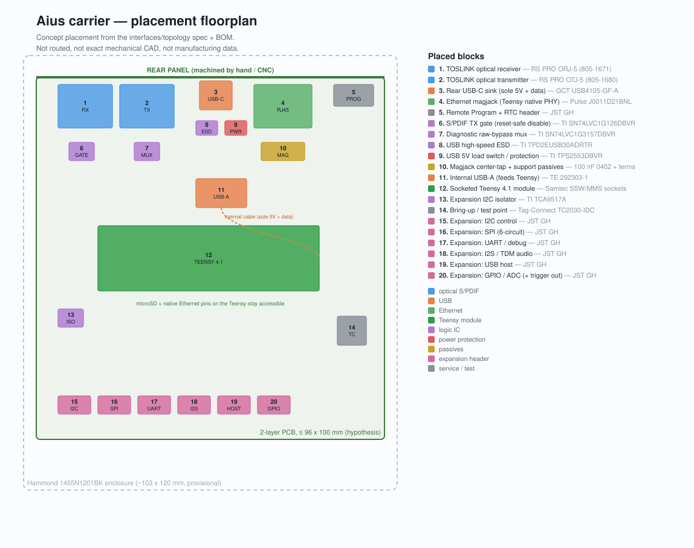

# Aius board floorplan

A concept placement of the Aius carrier board inside the Hammond 1455N1201BK
enclosure, showing where every connector, module, and support IC sits. It is
generated from [interfaces and states](interfaces-and-states.md),
[functional topology](functional-topology.md), and the
[`provisional-components.csv`](../../evidence/design/provisional-components.csv)
BOM by [`board-floorplan.py`](board-floorplan.py).

**This is a placement concept, not a routed board.** It is not exact mechanical
CAD, has no copper traces, and is not manufacturing data. Dimensions are
provisional pending the Hammond mechanical drawing. It exists so you can see the
physical arrangement of what is being built.

## What it shows

- **Rear panel** carries the two Cliff-class TOSLINK optical jacks (RX/TX; the
  purchased parts are RS PRO ORJ-5/OTJ-5), the rear USB-C (the sole 5 V + data
  entry), the Ethernet magjack, and the remote Program/RTC service header. Rear
  machining is done by hand or external CNC.
- **The socketed Teensy 4.1** sits centrally; its native Ethernet pins face the
  magjack and its microSD stays user-accessible.
- **The reset-safe optical path**: the S/PDIF TX gate and the diagnostic
  raw-bypass mux sit next to the optical jacks, defaulting to the processed path
  with the transmitter held disabled until firmware takes control.
- **One power source**: rear USB-C → ESD + load-switch protection → the internal
  USB-A receptacle → a short internal cable to the Teensy's micro-B. No second
  VIN/VUSB feed.
- **Keyed expansion headers** (I2C, SPI, UART, I2S/TDM, USB host, GPIO/ADC) along
  the front edge, plus a Tag-Connect bring-up point.

## What it is not (yet)

Turning this into an orderable PCB is the gated hardware work:

1. **Schematic (H1) — *done* (2026-07-19).** Captured as the generated,
   ERC-clean project in [`electronics/`](../../electronics/README.md)
   ([plan](../plans/aius-h1-schematic.md), shipped).
2. **Two-layer feasibility (H2)** — prove 90 Ω USB / 100 Ω Ethernet geometry and
   continuous return paths against the fabricator's stackup. Not started.
3. **Layout + route (H3)** — placement, impedance-controlled routing, ERC/DRC,
   manufacturing outputs, quote. Not started.

See the [hardware spec](../plans/aius-hardware-spec.md) for the full gate order.
Regenerate this figure with `python3 board-floorplan.py`.

Labels were re-synchronised with `evidence/design/provisional-components.csv` on
2026-08-04: the TX gate is a single `SN74LVC1G126` (active-high OE, no inverter)
after the H1 review, the optical modules are the purchased RS PRO ORJ-5/OTJ-5,
and the USB-C receptacle is the GCT `USB4105-GF-A`. Placement is unchanged — the
substituted parts are pin-compatible drop-ins in the same positions.
