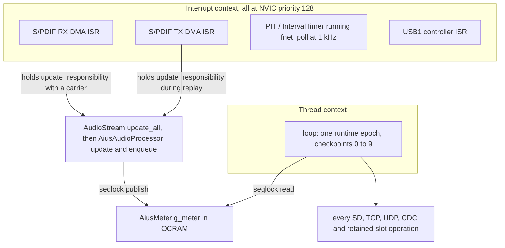

# Aius firmware I/O reference

Every I/O operation the `teensy41-optical` image performs, the buffers it owns, the
bank those buffers occupy, and the argument that it cannot disturb the audio path.
It is a companion to [`aius-network-hardening.md`](../plans/aius-network-hardening.md),
which decided most of what is recorded here; this document states the result and
cites the code that makes it true, so a reader can re-check rather than trust.

## How to read this

**Every claim carries a `path:line` citation.** Firmware paths are relative to
`firmware/` unless the path says otherwise. Line numbers are
correct as of this revision; the cited symbol name is the durable handle.

**Bank vocabulary.** `FLASH` is the 8 MiB program flash. `ITCM` and `DTCM` are the
two halves of the 512 KiB FlexRAM, partitioned at build time. `OCRAM` is RAM2 at
`0x20200000`, holding both `DMAMEM` statics and the `malloc`/`new` heap
(`tools/memory/mem_report.py:8`). Code with no `FLASHMEM` attribute lands in ITCM
and is taken straight out of the audio path's headroom
(`test/itcm-placement/verify_target.py:4`).

**Measured banks.** From `scripts/build.sh teensy41-optical` at repository revision
`9f5b8dee8767`, reported by the ELF-reading gate in `tools/memory/mem_report.py`:

```text
BANK           USED         FREE     CAPACITY    USED%   FREE%
FLASH        581632      7544832      8126464    7.16%   92.8%
ITCM         173580        23028       196608   88.29%   11.7%
DTCM         318400         9280       327680   97.17%    2.8%
FlexRAM      515008         9280       524288   98.23%    1.8%
OCRAM         91456       432832       524288   17.44%   82.6%

DTCM layout:
  0x20000000   134848B  .data
  0x20020ec0     9756B  NonCacheable      (FNET fnet_fec0_buf, orphan-placed)
  0x200234dc   173796B  .bss
  0x2004dbc0 ..........  free for locals (9280B) up to _estack
```

**The DTCM free-for-locals zone is the spine of this document**, 9,280 bytes at
the revision above. It is `_estack - _ebss`, and it is the entire stack — main
loop and audio ISR both (`README.md:201`).

**That 9,280 is a snapshot and is now the tightest of four historical values — do not
plan against it.** `-DFNET_CFG_TLS=0` alone returned 19,136 bytes of DTCM, and the
figure has since gone 9,280 → 17,152 → 25,376 → **43,328**. Every number in the table
above was correct when measured and none of them is current. The reasoning in this
document stands, and stands more comfortably, because every constraint it argues from
has loosened rather than tightened; only the arithmetic is stale. **Take the live
figure from `tools/memory/mem_report.py` against the linked ELF** — the one source
that cannot drift — and see
[`signal-path.md`](signal-path.md) for the progression and why a bare number in prose
is not usable evidence here.

**This figure moves with every commit that adds a static**, so treat the number
here as the order of magnitude and `scripts/build.sh teensy41-optical` as the
authority. It has already moved once since the table above: `c20a03c8e` added
seven `uint32_t` edge-detection statics and took it to **9,248**. That is the
point — a zone this small is measured, not remembered, which is why the gate that
reports it was the first thing fixed in this sequence. `AiusAudioProcessor::enqueue()` alone places about 4 kB of frame
in it from the audio interrupt path (`src/optical_main.cpp:662`), so roughly 45 % of
the true headroom belongs to one hot function. Every placement decision below
follows from that scarcity, and from §Deciding principle's rule that "memory that is
genuinely free is not an argument" — OCRAM is plentiful, DTCM is not
(`docs/plans/aius-network-hardening.md:47`).

**Do not trust older free-DTCM figures.** The memory gate over-reported DTCM by
9,756 bytes until it was rewritten to read the linked ELF rather than parse the
`teensy_size` summary, because FNET's `NonCacheable` buffer is orphan-placed inside
DTCM and was excluded from both the used and the free figure
(`tools/memory/mem_report.py:17`). Any source comment saying "~20 KB", "~22 kB",
"23 kB" or "24,412 bytes" free predates that fix — see
[§Contradictions found in the shipped code](#contradictions-found-in-the-shipped-code).

## Execution contexts

Four contexts perform work in this firmware. Only the first two touch audio.



- **The audio DMA ISR** runs the whole decode and DSP chain. Whichever S/PDIF
  peripheral holds `update_responsibility` calls `AudioStream::update_all()` from its
  DMA interrupt; the input claims it first because `g_spdif_in` is constructed above
  `g_spdif_out` (`src/optical_main.cpp:215`, `:854`), and
  `replay_clock_service()` hands it to the transmitter while a replay plays
  (`src/optical_main.cpp:2908`).
- **The FNET poll timer** is the one I/O actor outside the epoch loop.
  `Ethernet.beginNoWait()` starts an `IntervalTimer` calling `fnet_poll` every
  1,000 µs for the life of the network generation
  (`vendor/NativeEthernet/src/NativeEthernet.cpp:167`,
  `vendor/NativeEthernet/src/NativeEthernet.h:43`).
- **The USB1 controller ISR** moves CDC bytes between the host and the driver's
  ring; the firmware only ever reads and writes that ring from thread context.
- **The epoch loop** is `loop()`, which runs exactly one runtime epoch and nothing
  else (`src/optical_main.cpp:3150`). Every other I/O operation in this document
  happens here.

**Priorities are flat, and that matters.** Teensy's startup sets every interrupt to
priority 128 (`cores/teensy4/startup.c:136` in `framework-arduinoteensy`), the
S/PDIF DMA channel attaches without overriding it
(`evidence/source-snapshots/PJRC-SPDIF-RX-SOURCE/input_spdif3.cpp:67`), and
`IntervalTimer` defaults to 128 as well (`cores/teensy4/IntervalTimer.h:108`). Equal
priority means neither preempts the other: a `fnet_poll` already running delays the
audio block ISR by its own duration, and vice versa. At 48 kHz with 128-frame blocks
an audio block arrives every 2.67 ms and `fnet_poll` fires every 1 ms, so the two
interleave constantly. **The cost of one `fnet_poll` call has never been measured on
this board** — see [§Figures that need the device](#figures-that-need-the-device).

## The per-epoch budget

One epoch runs checkpoints 0 to 9 in order, records `EPOCH_COMPLETE`, and feeds the
watchdog exactly once; an epoch that does not complete does not feed, which is what
turns a wedged service into a bounded reset rather than a hang
(`src/optical_main.cpp:3137`). The budgets are compile-time constants in
`lib/aius_runtime/src/aius_runtime.c:22`:

| Checkpoint | Service | `max_calls` | `max_rx_bytes` | `max_tx_bytes` | Budget |
|---|---|---|---|---|---|
| `0 RESET_CAPTURE` | retained boot facts | 2 | 0 | 0 | 250 ms |
| `1 USB_RX` | CDC input | 64 | 64 | 0 | none |
| `2 USB_TX` | CDC output | 1 | 0 | 64 | 500 ms |
| `3 METRICS` | die-temperature sample | 1 | 0 | 0 | none |
| `4 NETWORK` | supervisor + adapter | 1 | 0 | 0 | none |
| `5 HTTP` | one transaction step | 1 | 256 | 512 | none |
| `6 UDP` | one datagram | 1 | 532 | 532 | 2 ms |
| `7 REPLAY` | SD lifecycle + replay refill | 1 | 2048 | 0 | none |
| `8 SD` | one SD job step | 1 | 512 | 512 | none |
| `9 EPOCH_COMPLETE` | ledger + watchdog feed | 0 | 0 | 0 | 8 s watchdog |

In recovery-safe mode the scheduler runs only `USB_RX` and `USB_TX` before
`EPOCH_COMPLETE` (`lib/aius_runtime/src/aius_runtime.c:71`), so no network, SD or
replay I/O happens at all.

## The five isolation mechanisms

Every entry below justifies itself against these five. They are the mechanisms the
hardening plan spent its phases establishing.

- **Services run in the epoch loop, never in the audio ISR.** The audio path reaches
  the processor through `AudioStream`'s interrupt and never through `loop()`
  (`src/optical_main.cpp:3147`). No I/O operation in this document is reachable from
  `update()` or `enqueue()`.
- **`FLASHMEM` on every cold definition, applied to the definition itself.** GCC does
  not merge a `section` attribute from a forward declaration, so a prototype-only
  attribute silently leaves the code in ITCM
  (`src/aius_sd_teensy.cpp:11`). ITCM belongs to code that genuinely runs per audio
  block (`docs/plans/aius-network-hardening.md:41`).
- **Large buffers live in `DMAMEM`, not in the DTCM free-for-locals zone.** OCRAM is
  17.44 % used; the DTCM stack zone is 9,280 bytes total.
- **At most one SD primitive per epoch, bounded by the watchdog rather than a false
  cooperative timeout.** The Teensy SD library is synchronous and offers no
  cancellable call, so a checkpoint performing two primitives doubles the worst-case
  wedge the 8 s watchdog must absorb (`src/aius_runtime_storage.h:8`). Three routes
  break this rule today — see
  [§Raw SD access outside the job engine](#raw-sd-access-outside-the-job-engine).
- **The meters snapshot crosses the ISR boundary through a seqlock, not a lock.** The
  writer takes no lock, tests no reader state and never retries; retry belongs
  entirely to the reader (`src/optical_main.cpp:298`).

## S/PDIF input — the receive half of the hot path

The optical receiver, and the clock master whenever a carrier is present.

**Buffers.**

- `spdif_rx_buffer[AUDIO_BLOCK_SAMPLES * 4]`, 2,048 B, `DMAMEM` (OCRAM), 32-byte
  aligned — the DMA landing area, half-filled per interrupt
  (`evidence/source-snapshots/PJRC-SPDIF-RX-SOURCE/input_spdif3.cpp:36`).
- Two `audio_block_t` from the shared pool per block pass, 260 B each
  (`cores/teensy4/AudioStream.h:72`), taken from `AudioMemory(24)` — 24 blocks,
  6,240 B, `DMAMEM` (`cores/teensy4/AudioStream.h:110`, allocated at
  `src/optical_main.cpp:3114`).
- `uint16_t words[AUDIO_BLOCK_SAMPLES * 2]`, 512 B, DTCM stack, inside `update()`
  (`src/optical_main.cpp:569`).

**Why this implementation.** The receiver is the PJRC `AudioInputSPDIF3` unit,
compiled from a checked-in source snapshot rather than the framework copy, so the
implementation boundary is a reviewable artifact
(`lib/aius_audio/src/aius_spdif_sources.cpp:4`). The block pass converts the
interleaved pair into IEC words and pushes them into the portable pipeline, which
classifies PCM against DTS and calls back with decoded blocks
(`src/optical_main.cpp:578`).

**Audio-path justification.** This *is* the audio path. Its execution context is the
receive DMA ISR, and the ITCM guard pins exactly the three sections that may live
there — `update`, `enqueue` and `consume_block` — so any fourth hot section, or a
`FLASHMEM` landing on one of these three, fails the link
(`test/itcm-placement/verify_target.py:97`). Its per-block work is bounded by
`AUDIO_BLOCK_SAMPLES` and by the decoder's fixed arena; a ring overflow increments
`overruns` rather than blocking (`src/optical_main.cpp:660`).

**Its DTCM cost is the reason everything else is in OCRAM.** The processor object is
an ordinary `.bss` static in DTCM (`src/optical_main.cpp:853`) holding a
2,048-frame stereo ring at 16,384 B (`:598`, `:605`) and a 12,288-byte input scratch
plane set (`:625`); the DTS decoder's static arena beside it is 131,072 B — 40 % of
the whole DTCM bank (`:599`, `:850`). What remains of DTCM after those is the 9,280
bytes of stack that `enqueue()`'s 4,096-byte frame is spent from.

## S/PDIF output — the transmit half of the hot path

The optical transmitter, and the clock master while a replay plays with no carrier.

**The path is 24-bit, and it does not go through `audio_block_t`.** This is the first
item of the audio-quality roadmap in
[`aius-dsp-config-api.md` §Audio-quality roadmap](../plans/aius-dsp-config-api.md#audio-quality-roadmap--accepted-2026-07-26).
`audio_block_t` is `int16_t data[AUDIO_BLOCK_SAMPLES]`
(`cores/teensy4/AudioStream.h:76`), so the engine capped everything the DSP did at a
~−93 dBFS floor — and the hardware never did: S/PDIF carries 24 bits, `SPDIF_STL` and
`SPDIF_STR` are 24-bit registers, and `SPDIF_tx_buffer` is `int32_t`. The retained
snapshot's ISR proved it in one line, `*dest++ = (*src_left++) << 8`
(`evidence/source-snapshots/PJRC-SPDIF-TX-SOURCE/output_spdif3.cpp:130`), which shifts
16-bit data back up into the 24-bit slot it was just reduced out of.

The chain is now:

```text
DSP (24-bit int, AIUS_DSP_SAMPLE_MAX = 2^23-1)
  -> aius_out_stage_run at AIUS_DSP_OUT_WIDTH_24   <- a copy; no dither, no rounding
  -> g_aius_spdif_tx24, int32 ring, DMAMEM
  -> AiusSpdifTx24Hook::isr, the transmit DMA interrupt
  -> SPDIF_tx_buffer (int32) -> SPDIF_STL / SPDIF_STR
```

**It is lossless from the DSP to the wire and needs no dither at all**, because the DSP
already produces 24-bit integers. That demotes dither from a correctness fix to a
refinement one output selection needs: `aius_out16_*` is not deleted, it is the 16-bit
arm of `aius_out_stage_run()` (`lib/aius_dsp/src/aius_dsp.c:755`), selected by
`AiusAudioProcessor::OUTPUT_WIDTH_BITS` (`src/optical_main.cpp:814`) and bypassed by
the shipped `AIUS_DSP_OUT_WIDTH_24`. The 16-bit arm reproduces the old wire words
exactly — `aius_out16_sample()` times `AIUS_DSP_OUT16_LSB`, which is the snapshot's
`<< 8`.

**No vendor patch.** `lib/aius_audio/` is a retained snapshot and stays byte-for-byte
what upstream shipped. Three properties made a sibling path possible instead:
`SPDIF_tx_buffer` is a *file static* of `output_spdif3.cpp` and that file is
`#include`d into `lib/aius_audio/src/aius_spdif_sources.cpp:3`, so the filler is
addressable from inside that translation unit; `dma`, `update_responsibility` and
`AudioStream::update_all()` are `protected static`, so a private-inheritance shim
reaches them exactly as `AiusSpdifOutputClock` already did
(`src/optical_main.cpp:3390`); and `DMAChannel::attachInterrupt()` only stores a
vector (`cores/teensy4/DMAChannel.h:513`), so redirecting the transmit interrupt after
`begin()` has run replaces the vendor ISR without editing it.
`test/optical-cutover/test_optical_cutover.py` asserts the snapshot still contains
that `<< 8` line, which is what keeps "unpatched" a fact rather than a claim.

**Buffers.**

- `SPDIF_tx_buffer[AUDIO_BLOCK_SAMPLES * 4]`, 2,048 B, `DMAMEM`, 32-byte aligned —
  double-buffered, one interrupt per `AUDIO_BLOCK_SAMPLES` frames
  (`evidence/source-snapshots/PJRC-SPDIF-TX-SOURCE/output_spdif3.cpp:44`).
- `g_aius_spdif_tx24`, an `AiusSpdifTx24Ring`, **16,396 B, `DMAMEM`** — the 24-bit
  playback ring: 2 × 2,048 `int32` planes plus three cursors
  (`lib/aius_audio/src/aius_spdif_sources.cpp:30`). 2,048 frames is unchanged from the
  `int16` ring it replaces, so `AIUS_NO_SPACE` and the meter's `queue_frames` keep
  their meaning.
- `AudioOutputSPDIF3::block_silent`, one `audio_block_t` (260 B), `DMAMEM` — now
  unreachable, because the vendor ISR that substituted it no longer owns the transmit
  interrupt (`evidence/source-snapshots/PJRC-SPDIF-TX-SOURCE/output_spdif3.cpp:46`).
- **No pool blocks.** `emit_block()` is gone, so the transmit half allocates and
  releases nothing per engine block, and `AudioOutputSPDIF3::update()` is never called
  — there is no `AudioConnection` into `g_spdif_out` (`src/optical_main.cpp:1096`).

**Why `DMAMEM` and not DTCM, which is the interesting placement decision here.** The
`int16` ring was 8,192 B in DTCM and the honest 24-bit one is 16,384 B, so keeping it
there would have spent the entire free-for-locals zone — which is the whole point of
§Deciding principle's "memory that is genuinely free is not an argument". Moving it to
OCRAM instead **returned** 8,224 B of DTCM and cost 16,416 B of a bank with 293 KB
free. The reason to think twice is that a DMA ISR reads it: OCRAM is slower than DTCM.
It is still the right call, and the arithmetic is small — the read is strictly
sequential, 256 words per interrupt, so each 32-byte OCRAM line fill amortises over
eight words: 32 line fills per interrupt at roughly 20–30 cycles is under 1,000 cycles,
against a 128-frame interrupt period of 1,600,000 cycles at 600 MHz.

**Packing three bytes per sample was considered and rejected.** It would save 4 KB of
OCRAM out of 293 KB free and cost three byte loads plus two shifts per sample in the
transmit ISR. The aligned word is also exactly what `SPDIF_STL` takes, which is what
makes the fill a straight copy (`lib/aius_audio/src/aius_spdif_tx24.h:101`).

**No cache maintenance on the ring, and that needs saying because `DMAMEM` normally
implies a flush.** Nothing DMAs the ring: both ends are CPU accesses through the same
write-back D-cache, so they are coherent by construction. `SPDIF_tx_buffer` is the
buffer the DMA actually reads, and the handler flushes it once per half — 1,024 bytes,
32-byte aligned, a multiple of 32 — rather than the snapshot's flush-every-32-bytes-as-
you-go. Same number of `DCCMVAC` operations, one call instead of 32, and provably early
enough: the filled half is the one the DMA is *not* reading, so it has a full 2.67 ms
before the transfer reaches it.

**Single producer, single consumer, no critical section — and the priorities are why
that had to change.** The producer is `enqueue()`, reached from the software interrupt
`update_all()` pends, at NVIC priority 208 (`cores/teensy4/AudioStream.cpp:424`); the
consumer is the transmit DMA interrupt at the startup default of 128
(`cores/teensy4/startup.c:136`). Lower number wins, so **the consumer can preempt the
producer mid-block**. The `int16` ring had both ends inside `update()` and could
therefore afford a plain `read`/`write`/`count` triple; that would be a race here. The
24-bit ring instead keeps two free-running 32-bit frame counters, each written by
exactly one side, with the level as their unsigned difference — correct across the
counters' own wrap, and single-copy atomic on the Cortex-M7. Staged frames become
visible only at `aius_spdif_tx24_commit()`, so a preempting consumer never observes a
half-written block (`lib/aius_audio/src/aius_spdif_tx24.h:153`).

**An underflow is now counted rather than merely heard.** The vendor path substituted
`block_silent` and advanced nothing, so a dry queue was inaudible *and* invisible; the
24-bit fill writes the same silence and advances `underruns` by the substituted frame
count. Transmit queue occupancy is likewise the ring's own level, with no vendor
two-deep block queue behind it to be unaccounted for — which is what
[`aius-sample-rate-following.md` §Interaction with the 24-bit output path](../plans/aius-sample-rate-following.md#interaction-with-the-24-bit-output-path)
asked for. Neither counter has a wire field yet; that is observability work for the
sample-rate item, not for this one.

**Cost.** The path is *cheaper* than the 16-bit one it replaces, which is the expected
direction: it removed work rather than adding it. Inside the DWT bracket, the 512-frame
block's output stage went from 1,024 `aius_out16_sample()` calls — a PRNG draw, a
fixed-point convert, a `vrintm`, two `vcmpe`/`vmrs` pairs and a convert back, about 45–60
cycles each — to a 6-instruction-per-frame copy loop plus the OCRAM write-allocate line
fills, so roughly 51,000 cycles became roughly 6,000–7,000. Outside the bracket, the
transmit interrupt is 228 bytes of ITCM with a 9-instruction inner loop
(`lib/aius_audio/src/aius_spdif_sources.cpp:57`) against the vendor ISR's per-sample
shift plus 32 separate `arm_dcache_flush()` calls, and `emit_block()`'s two `allocate()`
/ `release()` pairs and second full copy are gone outright.

**Why this implementation, and the alternative that was rejected.** The transmitter
can hold `update_responsibility` because its DMA is clocked by PLL4 through
`SPDIF0_CLK_ROOT` and not by the receiver: `SPDIF_SCR_TXSEL(5)` is normal transmit,
not feed-through, and the dependency in fact runs the other way — the receiver falls
back to `tx_clk` when its DPLL is unlocked
(`src/optical_main.cpp:2808`). Without the handover a replay reported `playing` and
processed exactly zero blocks, because with the input unsoldered the receive DMA ISR
never fires and `update_all()` is never called (`src/optical_main.cpp:2796`).

The rejected alternative was **a pair of pokes in `app_replay_start()` and
`app_replay_stop()`**. It was refused because start only publishes `PREBUFFERING` —
playback begins later and elsewhere — and because a replay ends in five different
ways (operator stop, EOF, decoder error, a cancelled job displaced by a new
selection, and a carrier arriving), all of which reach the same `source` field. One
derived reconciler covers every one; five call sites would each be a chance to leave
the clock behind (`src/optical_main.cpp:2899`).

**The transmit clock is 48 kHz, and it is pinned by a build flag.** `config_spdif3()`
derives the entire transmit clock tree from `AUDIO_SAMPLE_RATE_EXACT`
(`evidence/source-snapshots/PJRC-SPDIF-TX-SOURCE/output_spdif3.cpp:229`), which
`AudioStream.h` defaults to `44100.0f` behind an `#ifndef`. Left at that default the
board clocked 48 kHz material out 8.1 % slow — about 1.4 semitones flat — while
`GET /api/meters`, `GET /api/dsp/config` and the decoded blocks themselves all
reported 48,000. `teensy41-optical` therefore builds with
`-DAUDIO_SAMPLE_RATE_EXACT=48000.0f`, and `optical_main.cpp` `static_assert`s it equal
to `AIUS_OPTICAL_SAMPLE_RATE_HZ` so the flag and `config/optical_dsp.json` cannot
drift apart again.

48 kHz divides the clock tree exactly, so there is no fractional-divider residue:
PLL4 is 24 MHz × 28.672 = 688.128 MHz (`NUM`/`DENOM` = 6720/10000, an exact
fraction), `SPDIF0_CLK_ROOT` is that ÷ 8 = 86.016 MHz, and `TXCLK_DF` = 27 gives
86.016 MHz ÷ 28 = 3.072 MHz = 64 × 48,000 with zero remainder.

**Nothing in this path resamples.** The receiver DMAs words into audio blocks at the
incoming carrier's rate and the transmitter clocks them out at
`AUDIO_SAMPLE_RATE_EXACT`; the retained receive snapshot predates the upstream
asynchronous rate converter and the framework copy is byte-identical to it. No code
compares `block->sample_rate_hz` against the engine rate either, so a rate
disagreement is neither absorbed nor counted — the queue stays level, `overruns`
stays honestly zero, and the only symptom is pitch. That is why the equality is a
`static_assert` rather than a runtime check.

**Two block sizes, and every per-block figure names one of them.**
`AUDIO_BLOCK_SAMPLES` is 128 frames — the Teensy core default, which this build does
not override — and is the *engine* block: it sizes both DMA buffers, the
`audio_block_t` pool, `update()`'s word staging and the transmit interrupt's drain of
the 24-bit ring, so
`update()` runs 48000/128 = 375 times a second and moves 512 bytes each time (the
192,000 B/s the replay ring is sized for). 512 frames is the *decoded* block and is
what `blocks` counts: a DTS Core access unit reconstructs to 512 samples per channel
and PCM passthrough stages the same 512 (`AIUS_PIPELINE_PCM_BLOCK_FRAMES`), so
`enqueue()` runs once per four `update()`s, at 48000/512 = 93.75 blocks per second.
`enqueue()`'s `AUDIO_BLOCK_SAMPLES * 4` cap is exactly that 512, which couples the
two constants: changing the engine block changes the decoder block this file accepts.

**Audio-path justification.** The handover itself runs at checkpoint 7 in thread
context, not in either ISR, and costs two byte stores under one critical section
(`src/optical_main.cpp:2959`). The critical section exists so that no ISR can observe
the both-drive window (a double-processed block) or the neither-drives window (a
stalled one); it is shorter than the critical section `block_count()` already takes
(`src/optical_main.cpp:2942`). Keeping the
reconciler in thread context is also what keeps `pllLocked()` out of the audio ISR,
which is why the ITCM allowlist is still exactly three sections
(`src/optical_main.cpp:2905`).

The 24-bit path did not add a fourth. `optical_main.cpp`'s pinned audio-block set
*shrank* from 1,024 to 820 bytes when `emit_block()` left, and the new transmit handler
lives in `lib/aius_audio/src/aius_spdif_sources.cpp.o` — neither a declared cold object
nor the pinned hot one — so `test/itcm-placement/verify_target.py` does not police it,
correctly: it is 228 bytes of code that genuinely runs per audio block.

## Meter snapshot handover — audio ISR to HTTP

`GET /api/meters` serves a coherent snapshot published by the audio path.

**Buffers.**

- `g_meter`, an `AiusMeter`, about 1.4 kB, `DMAMEM` (`src/optical_main.cpp:316`). Its
  published snapshot alone is 676 bytes — six input peak/RMS pairs as doubles, a
  128-point `int32_t` waveform, and four telemetry words
  (`lib/aius_dsp/include/aius_dsp.h:291`).
- The reader's `AiusMeterSnapshot snapshot` copy, 676 B, DTCM stack inside
  `http_meters_json()` (`src/optical_main.cpp:1195`).
- The response body is written into the runtime's shared `app_body` buffer, capped at
  1,600 bytes by a `static_assert`-checked worst-case computation
  (`src/optical_main.cpp:1153`).

**Why this implementation, and the alternative that was rejected.** One writer, one
reader, no lock: the writer is `enqueue()` in ISR context and owns every accumulator,
both seqlock increments and the published snapshot; the reader only ever calls
`aius_meter_read()` (`src/optical_main.cpp:298`). **A lock the audio path could wait
on was rejected by construction** — the writer never tests reader state and never
retries. The two sides are not concurrent but nested: the interrupt preempts the main
thread, runs the publish to completion and returns, so a reader straddled by a
publish always sees `seq` advanced by two and retries
(`src/optical_main.cpp:304`).

The dBFS conversion is deliberately on the HTTP side, not in the tap: `log10(0)` is
`-Infinity`, which is not JSON, and silence is a meter's resting state rather than an
edge case — so the ~16 `log10` calls and 128 integer scalings are paid by a cold
`FLASHMEM` serializer (`src/optical_main.cpp:1124`).

**Audio-path justification.** The tap is the one genuinely hot addition in the
remaining work. When `features.meters` is false it costs exactly one `bool` test per
block (`src/optical_main.cpp:629`). When it is true, the accumulate helpers walk
`block->frames` once over caller-owned storage with no allocation, and the waveform
decimation writes at most 128 points (`src/optical_main.cpp:690`). The expensive part
— eight `sqrt` calls and the snapshot copy in `aius_meter_publish()` — runs once per
20 Hz window rather than per block (`src/optical_main.cpp:318`). The window is counted
in frames (48000/20 = 2,400) precisely so the decoder's framing cannot move it, which
means it keeps the cost off four `enqueue()` calls in every five at the 512-frame
decoded block, and off 18 blocks in every 19 were the block 128 frames. The `libm`
`log10` inside the limiter gain-reduction accessor is likewise sampled once per
window, not per block, because "a diagnostic field does not buy a `log10` in the block
callback" (`src/optical_main.cpp:714`).

**Written into an already-pinned ITCM section, deliberately.** The tap is inline in
`enqueue` rather than a helper, so it grew a pinned section from 424 to 600 bytes
instead of introducing a fourth allowlist name that GCC would probably have inlined
away (`test/itcm-placement/verify_target.py:86`).

**If the bound were violated** — an unbounded waveform, an allocation, or a publish
per block — the cost would land inside the block callback, and at 2.67 ms per block
an overrun becomes audible before it becomes visible in `overruns`.

## Bounded SD job engine and its Teensy adapter

Every legitimate card access goes through one portable state machine and one adapter.

**Buffers.**

- `sd_transfer[512]` — the job's transfer slice, and the `sd_capacity` reported to
  HTTP on `SD_STARTED`, `static_assert`-locked to `AIUS_HTTP_SD_CAPACITY_MAX`
  (`src/aius_runtime_storage.h:43`, `:48`).
- `sd_publish[12288]` — the publication accumulation buffer, sized for the largest
  file the application publishes, the DSP model JSON
  (`src/aius_runtime_storage.h:59`).
- Three 128-byte path buffers plus a directory path on the job itself
  (`docs/plans/aius-network-hardening.md:1288`).
- All of the above live inside `AiusRuntimeStorage`, which lives inside the
  `DMAMEM`-placed runtime object, so they cost OCRAM and leave DTCM untouched
  (`src/aius_runtime_storage.h:57`).
- The adapter holds exactly one `File` handle and its duration diagnostics
  (`src/aius_sd_teensy.h:17`).

**Why this implementation, and three rejected alternatives.**

- **Growing the transfer slice to the model size was rejected.** `job->capacity`
  sizes *every* transfer, downloads and upload input included, so 12,288 would make
  every SD primitive a 12 KB blocking call — directly against the
  one-primitive-per-epoch rule the service exists to enforce
  (`docs/plans/aius-network-hardening.md:4287`).
- **Incremental publish, so the application accumulates into a buffer it already
  owns, was proposed and withdrawn as wrong on its facts.** The application had no
  such buffer: the 12,288-byte array it appeared to own was a stack local inside the
  old blocking read, alive for one call and incapable of holding state across the ~24
  epochs a bounded job takes (`docs/plans/aius-network-hardening.md:4272`).
- **A queue for contending job requests was rejected in favour of refusal.** The
  service owns one job and one transfer buffer, so a queue would have to retain a
  second request including its three 128-byte paths, and a deferred start would owe
  an unbounded-latency promise; a refusal is retried by the caller's own next epoch
  at zero cost (`src/aius_runtime_storage.h:229`).

The honest cost is recorded with the decision: a 12,288-byte application-shaped
buffer now sits inside a portable, application-agnostic engine's consumer, for a file
read twice in a board's lifetime, and it breaks `AiusSdJob`'s "one job, one buffer"
invariant. That was accepted because the per-epoch primitive bound is a
watchdog-safety property and OCRAM is not scarce
(`docs/plans/aius-network-hardening.md:4309`).

**Audio-path justification.** The engine is pure state; the adapter is the only
caller of any SD primitive and executes exactly one per `aius_sd_teensy_execute()`
call, retaining its event for the next epoch
(`src/aius_sd_teensy.cpp:157`, `src/aius_runtime_storage.h:8`). Both the engine and
the adapter are declared cold objects, so the post-link guard fails the build if
either emits any ITCM at all (`test/itcm-placement/verify_target.py:44`). The
worst-case wedge is therefore one synchronous SD call, and it is bounded by the 8 s
watchdog and the retained `SD` checkpoint rather than by a cooperative timeout the
library cannot honour (`docs/plans/aius-network-hardening.md:476`).

**If the bound were violated** — two primitives in one checkpoint — the worst-case
wedge doubles against a fixed 8 s watchdog window, and the reset that follows is
attributed to whichever checkpoint the ledger last recorded rather than to the
offending call.

## Raw SD access outside the job engine

**Three routes reach the card directly, and only one of them is bounded and gated.**
This section exists because the shipped code does not match the "one SD primitive per
epoch, total" claim without it.

| Route | Call site | Bound | `sd_busy` gate |
|---|---|---|---|
| `GET /sd/<dir>/` | `app_read_directory`, `src/optical_main.cpp:1993` | 128 raw entry reads | yes |
| `GET /api/replays` | `http_replay_list_json`, `src/optical_main.cpp:1602` | none | no |
| `DELETE /api/replays` | `app_replay_delete`, `src/optical_main.cpp:1835` | 2 primitives | no |

**The directory index is the designed case.** The portable engine has no directory
job kind, so there is nothing bounded to drive; the dispatcher calls the callback
only after `sd_ready()` and `!sd_busy()`, and the scan stops at
`AIUS_OPTICAL_APP_INDEX_SCAN_MAX` (128) raw reads rather than walking a directory of
unknown size (`src/aius_optical_app.h:61`, `:213`). The gate is load-bearing rather
than cosmetic and is stated as such at the dispatch site
(`src/aius_optical_app.cpp:611`). The handle is never retained past the call
(`src/optical_main.cpp:1991`).

**The replay listing is neither bounded nor gated.** `http_replay_list_json` opens
`/aius/replays` and loops `openNextFile()` until the directory ends, calling
`entry.size()` and `entry.close()` per file, with no scan cap
(`src/optical_main.cpp:1617`). Its only guard is `g_sd_ready`
(`src/aius_optical_app.cpp:856`) — there is no `sd_busy` refusal on the `GET` arm,
where the `PUT`, `DELETE` and `/sd/` routes all have one. One epoch's checkpoint 5
can therefore spend an unbounded number of SD primitives, on a card that may already
be mid-job. The source acknowledges the shape ("Raw SD access, like
`http_replay_list_json` above it and for the same reason",
`src/optical_main.cpp:1982`) but not the missing bound or the missing gate.

**The replay delete spends two primitives, ungated.** `SD.exists()` followed by
`SD.remove()` (`src/optical_main.cpp:1844`), reached from the dispatcher's `DELETE`
arm with an `ACTIVE`/`NOT_FOUND` check but no `sd_busy` refusal
(`src/aius_optical_app.cpp:863`).

**Audio-path justification, honestly stated.** All three run at checkpoint 5 in
thread context, so none can extend a block callback, and all three are `FLASHMEM`
(`src/optical_main.cpp:1602`, `:1835`, `:1993`). What they do bound is the *watchdog*
argument, not the audio one: the epoch's worst case is no longer one synchronous SD
call but one call plus an unbounded directory walk, against a fixed 8 s window. On a
card with a large `/aius/replays` this is the most likely unexplained watchdog reset
in the image, and it has not been measured on hardware.

## Replay file reader

Playing a stored IEC file when no optical carrier is present.

**Buffers.**

- `g_replay_service`, `DMAMEM` — an 8,192-byte SPSC word ring (4,096 `uint16_t`) plus
  a 512-byte decode scratch, the selected id and the read offset
  (`src/optical_main.cpp:103`, `lib/aius_replay/include/aius_replay.h:139`).
- `g_replay_job`, an `AiusSdJob`, `DMAMEM`, and `g_replay_transfer[512]`, its own
  transfer slice — deliberately not shared with the storage service's, because
  sharing would couple two jobs that are only serialized, not merged
  (`src/optical_main.cpp:137`).
- `g_replay_path[96]`, DTCM `.bss` — the path the refill job opens, built once by
  `app_replay_start()` (`src/optical_main.cpp:104`).
- A `static_assert` keeps the transfer slice inside the service's delivery bound, so
  a widened slice is a compile error rather than a run-time `NO_SPACE` that faults the
  refill (`src/optical_main.cpp:147`).

**Why this implementation, and the alternative that was replaced.** The replay used
to own an SD `File` and read it synchronously inside the refill call. That was wrong
twice: it spent a second blocking SD primitive in an epoch whose contract is one, and
— worse — every portable job begins at `AIUS_SD_PHASE_BEGIN`, whose adapter action
calls `SD.begin(BUILTIN_SDCARD)` (`src/aius_sd_teensy.cpp:183`), so any config `PUT`,
download or probe re-mounted the volume underneath that open handle
(`src/optical_main.cpp:106`). **Refusing `POST /api/replays/start` outright was the
interim answer** and was itself an application of the deciding principle: refusing a
route is acceptable, risking a block callback is not
(`docs/plans/aius-network-hardening.md:37`, `:4552`).

Both problems are structural now rather than a question of ordering. The read
position is a byte offset held by the portable service, never a handle, and the read
is an `AIUS_SD_JOB_REPLAY_REFILL` job that opens and closes inside itself, through
the storage service's own adapter — the single owner of the only card handle in the
firmware (`src/optical_main.cpp:117`, `lib/aius_replay/include/aius_replay.h:126`).

**Audio-path justification.** The refill runs at checkpoint 7 and spends at most one
SD primitive, and only when the storage service is completely idle; a refusal is free
— the plan is abandoned and re-made next epoch
(`src/optical_main.cpp:2777`, `:2423`). The audio side touches only the ring:
`aius_replay_service_pop_words()` runs per block and is explicitly forbidden a lock,
a waiting branch or any refill work (`lib/aius_replay/include/aius_replay.h:224`); a
short pop is an underrun counter, not a stall (`src/optical_main.cpp:570`). The ring
is SPSC with atomic indices, so the producer in thread context and the consumer in
ISR context never share a lock (`lib/aius_replay/include/aius_replay.h:40`).

**If the bound were violated** — a refill that did not yield to a running job — the
adapter would refuse the `BEGIN` of whichever job arrived second, and a route already
admitted at checkpoint 5 would fail in-band at checkpoint 8.

## HTTP transaction over the bounded TCP adapter

One client, one transaction, one transport primitive per epoch.

**Buffers.**

- `http_request[13312]` and `http_response[8192]`, both inside `AiusRuntimeNetworkHttp`
  and therefore in OCRAM (`src/aius_runtime_network_http.h:54`,
  `lib/aius_http/include/aius_http.h:17`).
- `app_body[12288]` — the application response-body buffer, sized for the largest
  body any route serializes, `GET /api/dsp/config`'s effective model
  (`src/aius_runtime_teensy.h:48`).
- The dispatcher's `index_entries`, about 3 kB, and its three 128-byte path buffers,
  both in the same OCRAM object; the scratch lives there rather than on the stack
  precisely because the DTCM free-for-locals zone is the scarce bank
  (`src/aius_optical_app.h:252`).
- Per-epoch quotas are 256 bytes received and 512 sent
  (`lib/aius_runtime/src/aius_runtime.c:28`).

**Why this implementation, and two rejected alternatives.**

- **Raising `AIUS_HTTP_MAX_RESPONSE` from 8,192 to 12,544 so a large DSP model would
  fit was rejected.** It costs 4,352 B of OCRAM, forces a 12 KB `memcpy` and ~24.8 KB
  resident for one `GET`, and — decisively at the time — the same constant sized two
  legacy stack frames that would have grown from 8 KB to 12.5 KB inside the DTCM
  free-for-locals zone while the legacy path was still the only working one
  (`docs/plans/aius-network-hardening.md:4477`). Instead the transaction streams a
  large immediate body straight out of the application's own buffer, reusing the
  mechanism downloads already had.
- **Reusing `response_is_download` and `download_data` for that streaming was
  rejected**: both are load-bearing for SD download control flow, and an immediate
  response has no SD job, so either arm would be a protocol fault
  (`docs/plans/aius-network-hardening.md:4495`).

The transport adapter is the only application-level owner of a NativeEthernet or FNET
header, enforced by a source guard and asserted as an exact set by
`test/network-transport/test_vendor_source.py` (`src/optical_main.cpp:9`). Each
adapter call performs at most one underlying socket operation and returns:
`read_once()` is one `fnet_socket_recv`, `write_once()` one `EthernetClient::write`
that never waits, `close_once()` idempotent
(`src/aius_network_teensy.cpp:279`, `:298`, `:313`).

**Audio-path justification.** The whole transaction engine is a declared cold object
that must emit zero ITCM (`test/itcm-placement/verify_target.py:47`), it runs at
checkpoint 5 in thread context, and its work per epoch is one step plus at most one
transport primitive or one application dispatch
(`src/aius_runtime_network_http.h:90`). It performs no SD primitive and owns no SD
job; an SD-backed action is handed to the root and consumed at checkpoint 8
(`src/aius_runtime_network_http.h:27`).

**A note on what the bounded listener costs.** One client at a time means a
connection arriving before the previous one is fully released is dropped — observed
on hardware as one failure in ten sequential uploads, closing in 0.04 s. That was
fixed in the host tool with a bounded retry rather than by widening the firmware's
socket budget, which is deliberately small
(`docs/plans/aius-network-hardening.md:5037`).

## UDP discovery and control

The request/response control plane on port 4242.

**Buffers.** Three `DMAMEM` scratch buffers totalling 1,576 bytes — `g_udp_packet`
and `g_udp_frame` at `AIUS_NET_MAX_FRAME` (532 B each) and `g_udp_payload` at 512
(`src/optical_main.cpp:2116`, `lib/aius_net/include/aius_net.h:26`).

**Why this implementation.** They are in OCRAM rather than on the epoch stack because
the epoch call chain — scheduler to service to HTTP transaction to dispatcher — is
deeper than the legacy loop's, and 1,576 bytes is a sixth of the true DTCM stack zone
(`src/optical_main.cpp:2107`). `g_udp_packet` must additionally stay live while the
frame is encoded, because `AiusNetFrame::payload` points into it
(`src/optical_main.cpp:2114`).

Sends are peer-limited: the adapter latches the peer on every receive and sends back
to it (`src/aius_network_teensy.cpp:348`), which is why **there is no periodic UDP
status** — the firmware emits nothing unsolicited, and UDP status is strictly
pollable (`docs/plans/aius-network-hardening.md:5216`). One send attempt, no retry: a
`WOULD_BLOCK` is this epoch's answer, not something to wait out
(`src/optical_main.cpp:2124`).

**Audio-path justification.** Checkpoint 6, thread context, one datagram in and at
most one out, inside a 2 ms budget that is measured with `micros()` and counted as an
overrun rather than enforced by aborting (`src/optical_main.cpp:2286`, `:2301`).
Returning false from this callback would abort the epoch before the single watchdog
feed — that is, cause a reset — so no transport condition is allowed to produce it: a
quiet socket, a would-block send and a decode failure are all ordinary outcomes
(`src/optical_main.cpp:2269`).

**A network syslog sender was assessed and declined.** The event ring has only three
call sites, an absent collector is undetectable because neither ARP nor an off-subnet
gateway produces back-pressure, and the firmware has no RTC to timestamp a line with.
The recommendation was to spend the effort on `record_event` call sites instead; if
it is ever built it becomes a new I/O path this document must cover
(`docs/plans/aius-network-hardening.md:5192`).

## Ethernet stack background I/O — the FNET poll timer

**This is the one I/O path that is not in the epoch loop, and it was not in the
plan's coverage list.**

**Buffers.**

- `NonCacheable` (FNET's `fnet_fec0_buf`), 9,756 B, orphan-placed **inside DTCM**
  between `.data` and `.bss` at `0x20020ec0` — the FEC descriptor and frame buffers
  (`tools/memory/mem_report.py:17`, and the measured layout above).
- The FNET stack heap, 64 KiB, allocated with `new` and therefore taken from the
  OCRAM `malloc`/`new` heap rather than from `DMAMEM`
  (`vendor/NativeEthernet/src/NativeEthernet.cpp:90`,
  `vendor/NativeEthernet/src/NativeEthernet.h:42`). The 91,456-byte OCRAM figure in
  the bank report is the static high-water mark and does not include it.
- Per-socket buffers default to 2 KiB (`vendor/NativeEthernet/src/NativeEthernet.h:41`).

**Why this implementation.** The pinned NativeEthernet snapshot exists so that
`beginNoWait()` initialises the stack and callbacks once and returns without waiting
for link or DHCP, and so that `end()` can clean up a partially failed initialisation
— the patch list and its SHA-256 manifest are checked in
(`docs/plans/aius-network-hardening.md:1031`). The poll timer is upstream behaviour
the snapshot retains rather than a choice this project made.

**Audio-path justification, honestly stated.** `fnet_poll` runs in PIT interrupt
context at 1 kHz for the life of the network generation
(`vendor/NativeEthernet/src/NativeEthernet.cpp:167`), at the same NVIC priority 128
as the audio DMA ISR (`cores/teensy4/startup.c:136`,
`cores/teensy4/IntervalTimer.h:108`). Equal priority means it cannot preempt an audio
block callback that is already running — but it also means an audio block callback
cannot preempt it. Every microsecond `fnet_poll` spends is a microsecond the block
callback waits, and a block is 2.67 ms.

The mitigations are real but indirect: the DTCM cost is static and already counted in
the bank figures; the stack heap is on OCRAM; and no application code runs in that
interrupt — link and DHCP callbacks only append `{kind, generation, fault}` to a
four-entry FIFO that the epoch drains, performing no lifecycle work in callback
context (`docs/plans/aius-network-hardening.md:1019`).

**The duration of one `fnet_poll` call has never been measured on this board**, and
neither has its effect on the per-block budget. See
[§Figures that need the device](#figures-that-need-the-device).

## USB CDC recovery control plane

The channel that must keep working when everything else does not.

**Buffers.**

- `usb_rx[64]` — the staging buffer, exactly the portable RX quota
  (`src/aius_runtime_usb.h:61`, `lib/aius_usb_control/include/aius_usb_control.h:18`).
- `usb_response[320]`, `usb_verb[11]` and `usb_payload[257]` — distinct members so
  the portable step's span-disjointness precondition holds by layout
  (`src/aius_runtime_usb.h:53`).
- All inside the `DMAMEM` runtime object. A command is at most 127 bytes before its
  terminator (`lib/aius_usb_control/include/aius_usb_control.h:14`).

**Why this implementation, and the shape that was rejected.** Two tables,
deliberately: `AiusCdcTeensyPrimitives` is the raw driver seam tests replace, and
`AiusCdcTeensyOps` is the normalized seam the USB service calls. Only
`aius_cdc_teensy_serial_primitives()` mentions `Serial`
(`src/aius_cdc_teensy.h:9`, `src/aius_cdc_teensy.cpp:269`). `USB_RX` is the one
explicit exception to the one-adapter-event-per-service rule: it drains one byte per
primitive call up to the lesser of the budget quota and free staging space, and does
not call the portable step at all (`src/aius_runtime_usb.h:7`).

**Bootloader entry is the only op that blocks, and it blocks deliberately.**
Teensyduino's `Serial.write()` reports bytes *buffered*, not bytes *transmitted*, and
`_reboot_Teensyduino_()` halts the core, so entering the loader straight off a
full-length write races the in-flight transfer and usually loses. The op flushes,
then polls `available_for_write()` until the transmit ring returns to its idle free
space — a real host-side retirement signal, not a sleep — bounded at 500 ms, after
which it enters the loader anyway (`src/aius_cdc_teensy.h:49`,
`src/aius_cdc_teensy.cpp:133`). **A fixed sleep was rejected** in favour of that
retirement signal; a bounded block is acceptable here and nowhere else because the
action is terminal and the 8 s watchdog window comfortably covers it. Before this
fix, software bootloader entry failed 48 consecutive attempts; after it, five
consecutive trials succeeded first time
(`docs/plans/aius-network-hardening.md:69`).

**Audio-path justification.** Checkpoints 1 and 2, thread context, 64 bytes each way
per epoch (`lib/aius_runtime/src/aius_runtime.c:24`). In recovery-safe mode these are
the only two checkpoints that run, which is what makes a board looping on a wedged
service still re-flashable (`README.md:183`). The bootloader stall is terminal by
definition — the board is about to leave this image — so it cannot perturb an audio
path that is about to stop existing.

## Retained OCRAM boot slots and the watchdog

The ledger that survives a reset, and the register writes that arm and feed the
watchdog.

**Buffers.** `g_aius_boot_slots[2]`, 128 B total, `DMAMEM` and `used`, each 64-byte
element on its own 32-byte cache line (`src/aius_boot_teensy.cpp:209`,
`docs/plans/aius-network-hardening.md:770`).

**Why this implementation, and two rejected alternatives.** **DTCM was rejected
because startup clears it. Flash and EEPROM were rejected because a checkpoint write
occurs every epoch** (`docs/plans/aius-network-hardening.md:764`). OCRAM
`.dmabuffers` survives a watchdog reset and tolerates a per-epoch write; a post-link
check fails every production and fault build unless the linked symbol is 32-byte
aligned, occupies exactly 128 bytes, and ends below the core-reserved CrashReport area
at `0x2027ff80` (`docs/plans/aius-network-hardening.md:878`).

Double-slot with a committed marker written last, so a reset between any two writes
leaves the previous slot authoritative; the fake oracle injects a reset after every
call and every byte prefix of every write
(`docs/plans/aius-network-hardening.md:836`, `:859`).

**Per-epoch I/O.** One read at `setup()` — `SRC_SRSR` is read exactly once and the
bits read are cleared in the same call, so a repeat per epoch would report zero
(`src/optical_main.cpp:3045`). One slot commit before each service call, from
`platform_checkpoint()` (`src/optical_main.cpp:3010`). One watchdog service-register
write per complete epoch, from `platform_feed_watchdog()`, and it is the only place
this file writes that register at all (`src/optical_main.cpp:3017`). The interval is
the pinned 8 s (`WDOG_WCR_WT(15)`), replacing the legacy 16 s
(`docs/plans/aius-network-hardening.md:871`, `:4560`).

**Audio-path justification.** `src/aius_boot_teensy.cpp` is a declared cold object
that must emit zero ITCM (`test/itcm-placement/verify_target.py:51`). A commit is a
handful of stores plus two cache-line flushes and two `dsb` barriers, in thread
context, with no wait state and no bus contention with the audio DMA — the slots are
in OCRAM, not in the FlexRAM the audio path uses.

**If the feed bound were violated** — a second feed anywhere, or a feed reached
without a complete checkpoint trace — the watchdog would stop being a bound on a
wedged service, which is the mechanism every other entry in this document leans on.
The `optical-cutover` absence group asserts file-wide that no other watchdog write
exists (`src/optical_main.cpp:393`).

## Hardware metrics and one-shot register reads

- **Die temperature**, checkpoint 3: one `tempmonGetTemp()` sample, self-rate-limited
  to 1 Hz, values outside −40 °C to 150 °C discarded
  (`src/optical_main.cpp:398`). Thread context, one sample per epoch by budget
  (`lib/aius_runtime/src/aius_runtime.c:26`).
- **Fused MAC read**, once at `setup()`: `HW_OCOTP_MAC0..2` are read to derive the
  per-device auth token; memory only thereafter
  (`src/optical_main.cpp:3078`).
- **DWT cycle counter**, per block when metering is enabled: two volatile PPB loads
  bracketing the block body, so the device reports its own worst-case block cost
  through the snapshot it already publishes rather than the figure being an
  off-target estimate (`src/optical_main.cpp:680`).
- **Software reset**, on request only: `SCB_AIRCR` with interrupts disabled, gated
  on the HTTP transaction having drained to `AIUS_HTTP_TX_IDLE` and bounded at
  500 ms, after which it resets unacknowledged (`src/optical_main.cpp`
  `reset_application()`, `reboot_drain_complete()`, `service_reboot_request()`).
  **The reset is not "after the epoch that dispatched".** That epoch has only
  retained a pending application response: `format_response()` runs inside
  `accept_application()`, which executes only when the next step consumes that
  event, so at the end of the dispatching epoch not one byte of the 200 exists.
  With N the dispatching epoch, N+1 formats and performs the first ≤512-byte
  socket write, N+2 consumes its result, and the close plus `restart_idle()` are
  later still. Resetting at the end of epoch N is what made
  `POST /api/reboot` reset the board and never answer it. `AIUS_HTTP_TX_IDLE` is
  reached only through `restart_idle()`, which on the response path is strictly
  after the last write was accepted and the close completed, so it is a real
  drain signal rather than a buffered one — the same distinction as the
  bootloader-entry fix above, with the same 500 ms ceiling and the same "act
  anyway on expiry" rule.

## Codec control — what the firmware has and does not have

**There is no codec control bus in this firmware.** No `Wire`, I2C or SPI transaction
exists in `src/` at all; `aius_codec_api` is the portable decoder ABI
(`lib/aius_codec_api/include/aius_codec.h`), not a transport, and the DTS decoder
runs from the DTCM arena described under the S/PDIF input entry. The optical path
carries digital audio in and out over S/PDIF only, so nothing needs a register
interface to a converter.

What plays the role of "codec control" is the DSP model, and its transport is the
config path already documented: a validated `PUT /api/dsp/config` staged in RAM and
written as an `UPLOAD/REPLACE` job, or a boot-time `CONFIG_LOAD` of
`/aius/dsp.json`, with the audio-side apply happening at the block boundary in
`enqueue()` and nowhere else (`src/optical_main.cpp:2399`, `:645`). The model is
staged fully before the single `volatile` handoff flag is set, so the ISR never
observes a partially written model (`src/optical_main.cpp:269`). **A `PUT` that fails
its write never reaches the block boundary**: `g_dsp_apply_pending` is armed only from
the commit arm (`src/optical_main.cpp:1766`).

Also not in this image: the RawHID capability transport, which is a separate
`teensy41-capability` build with its own `main` and its own `DMAMEM` fragment buffer
(`platformio.ini:88`, `src/capability_main.cpp:24`).

## Figures that need the device

Stated plainly rather than estimated, per the plan's acceptance criterion that every
number comes from a real build or a real device.

- **The per-block DSP cost has been measured, over a replay rather than a carrier.**
  The DWT counters in `enqueue()` reported 398,591–431,995 cycles per *decoded*
  (512-frame) block. At 600 MHz that block's period is 512/48,000 = 10,667 µs =
  6,400,000 cycles, so the DSP occupies **6.2 %–6.8 % of the per-block budget**. The
  figures were first taken while the engine still ran at 44.1 kHz, where the same
  cycle counts were 5.7 %–6.2 % of a longer 11,610 µs period; the cycle counts
  themselves are per-frame work over a fixed 512 frames and do not move with the rate,
  only the denominator does. There is still no S/PDIF carrier — the optical input is
  unsoldered — so the live passthrough path remains unmeasured.
- **The cost of one `fnet_poll` call, and its effect on the block budget, is not
  measured.** Nothing in the repository records it. Until it is, the flat-priority
  interaction described above is a structural fact without a magnitude.
- **The worst-case duration of the unbounded replay listing is not measured**, on any
  card. Its bound today is the directory's size.
- **`sizeof(AiusRuntimeTeensy)` is not in the bank report.** The header's "roughly
  35 kB" (`src/aius_runtime_teensy.h:11`) predates the 12,288-byte publication buffer
  added by slice S3a, so treat it as a lower bound; the individual buffer sizes above
  are each read from their declaration.

## What enforces this document

- **`test/itcm-placement/verify_target.py`**, run by every optical build: declared
  cold objects must emit zero ITCM, a new object under a cold engine tree that nobody
  declared fails the build, and `optical_main.cpp` may contribute only its exact
  per-symbol allowlist of audio-block functions.
- **`tools/memory/mem_report.py`**, the gate `scripts/build.sh` fails a build on. It
  reads the linked ELF — the linker's own watermark symbols plus every `SHF_ALLOC`
  section falling in a bank's region — so an orphan section cannot hide from it again
  (`docs/plans/aius-network-hardening.md:5092`). The `memory` suite drives it over a
  committed reduction of a real optical image.
- **`test/network-transport/test_vendor_source.py`**, which asserts the exact set of
  application-level NativeEthernet and FNET owners.
- **`test/optical-cutover/`**, whose absence group asserts file-wide that no static
  network fallback, rebind globals, raw FNET access or extra watchdog feed exists.
- The component suites `sd`, `sd-target`, `runtime-target`, `http`, `net`, `replay`,
  `boot-target` and `usb-control`, run via
  `scripts/test.sh --environment native --suite <name>`.

## Contradictions found in the shipped code

Recorded here rather than smoothed over, because this document is the first check of
the plan's isolation claims against the linked image.

- **Three routes reach the card outside the job engine**, two of them ungated and one
  of them unbounded — see
  [§Raw SD access outside the job engine](#raw-sd-access-outside-the-job-engine). The
  normative "at most one SD primitive per epoch" holds for checkpoint 8; it does not
  hold for an epoch whose checkpoint 5 served `GET /api/replays` or
  `DELETE /api/replays`.
- **The FNET poll timer shares the audio ISR's interrupt priority.** Neither the plan
  nor the firmware README mentions the 1 kHz `fnet_poll` interrupt at all, and the
  audio-path argument everywhere else is framed as "epoch loop, not ISR" — which is
  true of the firmware's own code and untrue of the stack it links.
- **Five source comments still quote the pre-fix DTCM free figure.**
  `src/aius_runtime_teensy.h:17` says "~22 kB", `src/optical_main.cpp:77` says
  "24,412-byte", `:140` says "22 kB", `:292` says "23 kB", and `:2109` says
  "22,684-byte". The measured value is 9,280 bytes. Every placement decision those
  comments justify is still correct — more so, not less — but the arithmetic in them
  is wrong. `README.md:201` has been corrected; the source has not.

## Related documents

- [Aius network and firmware recovery hardening](../plans/aius-network-hardening.md) —
  the plan that decided nearly everything here.
- [Aius USB application control protocol](usb-control-protocol.md) — the wire format
  of the CDC control plane.
- [Aius functional topology](functional-topology.md) — modes, clock domains and
  latency boundaries.
- [`firmware/README.md`](../../firmware/README.md) — memory discipline, recovery
  behaviour and how to run the suites.
