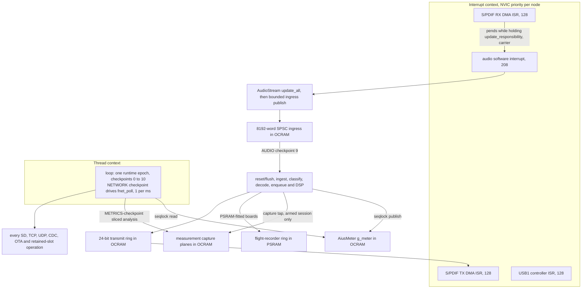

# Aius firmware I/O reference

Every I/O operation the `teensy41-optical` image performs, the buffers it owns, the
bank those buffers occupy, and the argument that it cannot disturb the audio path.
It is a companion to [`aius-network-hardening.md`](../plans/aius-network-hardening.md),
which decided most of what is recorded here; this document states the result and
cites the code that makes it true, so a reader can re-check rather than trust.

## How to read this

**Every claim carries a `path:line` citation.** Firmware paths are relative to
`firmware/` unless the path says otherwise. Line numbers are
correct as of this revision; the cited symbol name is the durable handle.

**Bank vocabulary.** `FLASH` is the 8 MiB program flash. `ITCM` and `DTCM` are the
two halves of the 512 KiB FlexRAM, partitioned at build time. `OCRAM` is RAM2 at
`0x20200000`, holding both `DMAMEM` statics and the `malloc`/`new` heap
(`tools/memory/mem_report.py:8`). Code with no `FLASHMEM` attribute lands in ITCM
and is taken straight out of the audio path's headroom
(`test/itcm-placement/verify_target.py:4`).

**Measured banks.** From `scripts/build.sh teensy41-optical` at repository revision
`9f5b8dee8767`, reported by the ELF-reading gate in `tools/memory/mem_report.py`:

```text
BANK           USED         FREE     CAPACITY    USED%   FREE%
FLASH        581632      7544832      8126464    7.16%   92.8%
ITCM         173580        23028       196608   88.29%   11.7%
DTCM         318400         9280       327680   97.17%    2.8%
FlexRAM      515008         9280       524288   98.23%    1.8%
OCRAM         91456       432832       524288   17.44%   82.6%

DTCM layout:
  0x20000000   134848B  .data
  0x20020ec0     9756B  NonCacheable      (FNET fnet_fec0_buf, orphan-placed)
  0x200234dc   173796B  .bss
  0x2004dbc0 ..........  free for locals (9280B) up to _estack
```

**The DTCM free-for-locals zone is the spine of this document**, 9,280 bytes at
the revision above. It is `_estack - _ebss`, and it is the entire stack — main
loop and audio ISR both (`README.md:201`).

**That 9,280 is a snapshot and is now the tightest of the historical values — do not
plan against it.** `-DFNET_CFG_TLS=0` alone returned 19,136 bytes of DTCM, and the
figure has since gone 9,280 → 17,152 → 25,376 → 43,328 → 47,552 → 36,608 → 31,040
(E-AC-3 phase 4) → **25,696** (canonical `teensy41-optical-slot-a` image at Phase 4e
start, the latest figure recorded in [`firmware/README.md`](../../firmware/README.md#memory-discipline);
the link-time floor is in `link/aius_teensy41.ld`). Every number in the table above was correct when measured
and none of them is current — the whole table also predates the E-AC-3 flash-pinning
rebalance, the 218,688 B decoder arena, the OTA slices and the decorrelator. The
reasoning in this document stands; only the arithmetic is stale. **Take the live
figure from `tools/memory/mem_report.py` against the linked ELF** — the one source
that cannot drift — and see
[`signal-path.md`](signal-path.md) for the progression and why a bare number in prose
is not usable evidence here.

**This figure moves with every commit that adds a static**, so treat the number
here as the order of magnitude and `scripts/build.sh teensy41-optical` as the
authority. It has already moved once since the table above: `c20a03c8e` added
seven `uint32_t` edge-detection statics and took it to **9,248**. That is the
point — a zone this small is measured, not remembered, which is why the gate that
reports it was the first thing fixed in this sequence. Before the Slice 2b3 cutover,
`AiusAudioProcessor::enqueue()` placed about 4 kB of frame on the interrupt stack.
That frame still exists, but now belongs to the bounded AUDIO checkpoint in thread
context (`src/optical_main.cpp:1126`). Every placement decision below
follows from that scarcity, and from §Deciding principle's rule that "memory that is
genuinely free is not an argument" — OCRAM is plentiful, DTCM is not
(`docs/plans/aius-network-hardening.md:47`).

**Do not trust older free-DTCM figures.** The memory gate over-reported DTCM by
9,756 bytes until it was rewritten to read the linked ELF rather than parse the
`teensy_size` summary, because FNET's `NonCacheable` buffer is orphan-placed inside
DTCM and was excluded from both the used and the free figure
(`tools/memory/mem_report.py:17`). Any source comment saying "~20 KB", "~22 kB",
"23 kB" or "24,412 bytes" free predates that fix — see
[§Contradictions found in the shipped code](#contradictions-found-in-the-shipped-code).

## Execution contexts

Four interrupt actors and one thread context perform work in this firmware. The
S/PDIF DMA ISRs own the wire clock, the software audio ISR publishes ingress, and the
epoch's checkpoints own everything else — **including, since the 2026-08-03
single-context cutover, the FNET stack poll**, which no longer runs in a PIT ISR.



- **The audio DMA ISRs** own the block clock, at the startup-default priority 128.
  Whichever S/PDIF peripheral holds `update_responsibility` pends the audio software
  interrupt from its DMA interrupt; the input claims it first because `g_spdif_in` is
  constructed above `g_spdif_out` (`src/optical_main.cpp:316`, `:1245`). The
  transmitter never holds it: the replay source that once handed it over was
  retired by
  [`aius-sample-rate-following.md`](../plans/aius-sample-rate-following.md) Phase 4i
  (2026-10-12).
- **The audio software interrupt** — pended by `update_all()`'s trigger, at NVIC
  priority 208 (`cores/teensy4/AudioStream.cpp:424`) — now does only the bounded
  `update()` ingress publish and releases its two pool blocks. It never classifies,
  decodes, enqueues, runs DSP, meters or records (`src/optical_main.cpp:1321`).
- **The FNET stack poll runs in the epoch since 2026-08-03**
  (`-DAIUS_NET_POLL_SINGLE_CONTEXT=1`, `platformio.ini:301`): no `IntervalTimer` is
  armed, and the NETWORK checkpoint's adapter poll drives
  `EthernetClass::pollProbed()` from thread context, rate-limited to once per
  millisecond (`src/aius_network_teensy.cpp:762`, `:1382`). The historic split model —
  the whole FNET service stack in a 1 kHz PIT ISR while main-loop code also called
  `fnet_poll` — was unsound with the port's no-op FNET mutexes and was convicted as
  the periodic DHCP-T1 watchdog wedge
  ([open-work register](../plans/aius-open-work-register.md), periodic-WDOG entry).
  Both settings retain the `AiusPollProbe` re-entry instrument, served as
  `poll_probe` on `GET /api/status` (`src/optical_main.cpp:2854`).
- **The USB1 controller ISR** moves CDC bytes between the host and the driver's
  ring; the firmware only ever reads and writes that ring from thread context.
- **The epoch loop** is `loop()`, which runs exactly one runtime epoch and nothing
  else. Its AUDIO checkpoint drains ingress and owns classify, decode, `enqueue()`,
  DSP, meter publication, measurement capture and recorder production
  (`src/optical_main.cpp:7039`). Every other I/O operation in this document also
  happens here.

**Priorities are tiered since 2026-07-26, and the tier order is deliberate.** Teensy's
startup sets every interrupt to priority 128 (`cores/teensy4/startup.c:136` in
`framework-arduinoteensy`) and the S/PDIF DMA channels stay there
(`evidence/source-snapshots/PJRC-SPDIF-RX-SOURCE/input_spdif3.cpp:67`), but the audio
*software* interrupt — the context that publishes ingress — sits at 208, so
`IntervalTimer`'s default of 128 (`cores/teensy4/IntervalTimer.h:108`) had `fnet_poll`
preempting that publisher a thousand times a second, not interleaving with it as this
section once claimed. `stack_start()` demotes
`IRQ_PIT` to 224 — one *implemented* level below 208 on this four-priority-bit M7, the
smallest demotion the hardware can express — re-applied after every `beginNoWait()`
because `IntervalTimer::beginCycles()` restores its own default on each `begin()`
(`src/aius_network_teensy.cpp:268`, `:292`). The DMA and software audio ISRs therefore
preempt network polling. **Since the 2026-08-03 single-context cutover the demotion is
a belt-and-braces vestige on the shipped image** — no `IntervalTimer` is armed at all,
so the only PIT user is whatever the flag-0 build would arm — but it stays applied and
`test/network-transport/test_poll_priority.py` still reads the framework's own
`IRQ_SOFTWARE` value rather than pinning 208, so a framework bump that inverted the
relationship cannot pass. The deferred AUDIO checkpoint is thread work; its separate
8 ms checkpoint timer measures the complete classify/decode/output service rather than
relying on any interrupt-priority argument (`src/optical_main.cpp:7039`). The
per-checkpoint wall-time maxima (`checkpoint_walltime_us`, `cw=` on `AIUS ID`) now
bound what the in-epoch poll costs — see
[§Figures that need the device](#figures-that-need-the-device).

## The per-epoch budget

One normal epoch runs checkpoints 0 through 7, then AUDIO checkpoint 9, then SD
checkpoint 8, records `EPOCH_COMPLETE` checkpoint 10, and feeds the watchdog exactly
once. AUDIO precedes SD so a blocking card primitive cannot defer already-published
ingress into the next epoch. An epoch that does not complete does not feed, which
turns a wedged service into a bounded reset rather than a hang
(`lib/aius_runtime/src/aius_runtime.c:82`). The budgets are compile-time constants in
`lib/aius_runtime/src/aius_runtime.c:22`:

| Checkpoint | Service | `max_calls` | `max_rx_bytes` | `max_tx_bytes` | Budget |
|---|---|---|---|---|---|
| `0 RESET_CAPTURE` | retained boot facts | 2 | 0 | 0 | 250 ms |
| `1 USB_RX` | CDC input | 64 | 64 | 0 | none |
| `2 USB_TX` | CDC output | 1 | 0 | 64 | 500 ms |
| `3 METRICS` | die-temperature sample + measurement epoch work | 1 | 0 | 0 | 1 ms |
| `4 NETWORK` | supervisor + adapter | 1 | 0 | 0 | none |
| `5 HTTP` | one transaction step | 1 | 256 | 512 | 2 ms |
| `6 UDP` | one datagram | 1 | 532 | 532 | 2 ms |
| `7 SERVICE` | SD lifecycle + platform services | 1 | 2048 | 0 | none |
| `9 AUDIO` | ingress drain + pipeline/output service | 1 | 0 | 0 | 8 ms |
| `8 SD` | one SD job step | 1 | 512 | 512 | none |
| `10 EPOCH_COMPLETE` | ledger + watchdog feed | 0 | 0 | 0 | 8 s watchdog |

**The METRICS and HTTP wall-clock budgets are declared bounds, not aborts.** The
METRICS row's 1 ms exists because the checkpoint now hosts the measurement loopback's
sliced analysis (256 samples per epoch through both channel accumulators, ~2 × 170 µs
worst case) beside the 1 Hz die-temperature sample, and "no epoch computes more than
its budget" must bind to something (`lib/aius_runtime/src/aius_runtime.c:26`); the
HTTP row's 2 ms carries the legacy `service_http()` overrun threshold forward
(`:35`). The composition root times each checkpoint against its budget and counts an
overrun rather than aborting — `g_metrics_service_overruns` inside
`platform_metrics()` (`src/optical_main.cpp:3178`, served on `GET /api/measure`) and
`g_http_service_overruns` between the HTTP stamp and the UDP checkpoint's arrival in
`platform_checkpoint()` (`src/optical_main.cpp:4083`, carried on the UDP status
payload).

In recovery-safe mode the scheduler runs only `USB_RX` and `USB_TX` before
`EPOCH_COMPLETE` (`lib/aius_runtime/src/aius_runtime.c:82`), so no network, audio,
or SD service happens at all.

## The five isolation mechanisms

Every entry below justifies itself against these five. They are the mechanisms the
hardening plan spent its phases establishing.

- **The software audio ISR publishes ingress only.** `update()` reserves and commits
  one exact 256-word slot, or records a bounded gap; the AUDIO checkpoint owns every
  later pipeline and output operation (`src/optical_main.cpp:1321`,
  `src/optical_main.cpp:7039`). No network, SD, CDC or retained-slot operation is
  reachable from `update()` or `enqueue()`.
- **`FLASHMEM` on every cold definition, applied to the definition itself.** GCC does
  not merge a `section` attribute from a forward declaration, so a prototype-only
  attribute silently leaves the code in ITCM
  (`src/aius_sd_teensy.cpp:11`). ITCM belongs to code that genuinely runs per audio
  block (`docs/plans/aius-network-hardening.md:41`).
- **Large buffers live in `DMAMEM`, not in the DTCM free-for-locals zone.** The
  per-env OCRAM free floors are pinned in `test/memory/verify_target.py`
  (`OCRAM_FREE_FLOORS`); the DTCM stack zone is about 25.7 kB on the canonical
  image ([`firmware/README.md`](../../firmware/README.md#memory-discipline)).
- **At most one SD primitive per epoch, bounded by the watchdog rather than a false
  cooperative timeout.** The SD library (vendored SdFat with DMA SDIO since Phase
  4e) offers no cancellable call, so a checkpoint performing two primitives doubles
  the worst-case wedge the 8 s watchdog must absorb
  (`src/aius_runtime_storage.h:8`). A wait inside an SD call runs the audio
  producer through the vendored SD-wait hook (`lib/aius_producer_yield`), so a
  card stall does not starve the transmit ring. One route breaks the
  one-primitive rule today; see
  [§Raw SD access outside the job engine](#raw-sd-access-outside-the-job-engine).
- **The meters snapshot crosses its producer/reader boundary through a seqlock, not a
  lock.** The AUDIO writer takes no lock, tests no reader state and never retries;
  retry belongs entirely to the HTTP reader (`lib/aius_dsp/include/aius_dsp.h`,
  `AiusMeter`).

## S/PDIF input — the receive half of the hot path

The optical receiver, and the clock master whenever a carrier is present.

**Buffers.**

- `spdif_rx_buffer[AUDIO_BLOCK_SAMPLES * 4]`, 2,048 B, `DMAMEM` (OCRAM), 32-byte
  aligned — the DMA landing area, half-filled per interrupt
  (`evidence/source-snapshots/PJRC-SPDIF-RX-SOURCE/input_spdif3.cpp:36`).
- Two `audio_block_t` from the shared pool per block pass, 260 B each
  (`cores/teensy4/AudioStream.h:72`), taken from `AudioMemory(24)` — 24 blocks,
  6,240 B, `DMAMEM` (`cores/teensy4/AudioStream.h:110`, allocated at
  `src/optical_main.cpp:3114`).
- `g_audio_ingress_words[8192]`, **16,384 B**, `DMAMEM` (OCRAM) — 32 exact
  256-word SPSC slots between the software audio ISR and AUDIO checkpoint
  (`src/optical_main.cpp:147`).

**Why this implementation.** The receiver is the PJRC `AudioInputSPDIF3` unit,
compiled from a checked-in source snapshot rather than the framework copy, so the
implementation boundary is a reviewable artifact
(`lib/aius_audio/src/aius_spdif_sources.cpp:4`). The block pass interleaves the
pair directly into a reserved ingress slot and commits that exact chunk. The
AUDIO checkpoint later drains the slot into the portable pipeline, which classifies
PCM against DTS and calls back with decoded blocks
(`src/optical_main.cpp:1321`, `lib/aius_audio_service/src/aius_audio_service.c:85`).

**Audio-path justification.** This *is* the interrupt-facing audio path. Its DMA
landing runs in the receive DMA ISR and its block pass in the software interrupt that
ISR pends ([§Execution contexts](#execution-contexts)). The post-link guard pins the
optical object to exactly `update()` and `audio_ingress_publish_live()` and the mixed
ingress object to its five producer entry points; all consumption, reset and
diagnostic entry points remain cold (`test/itcm-placement/verify_target.py:90`).
The sample walk is exactly `AUDIO_BLOCK_SAMPLES`; a full ingress records one dropped
chunk rather than blocking (`src/optical_main.cpp:1321`).

**Its storage moved to OCRAM, while decode remains in DTCM.** The exact 16 KiB ingress
absorbs interrupt-to-epoch jitter. The decoder/pipeline arena is 218,688 B in DTCM
since E-AC-3 phase 4 (instance + 32,768 B DSP staging carve + the 180,224 B codec
slot; it was 131,072 B before the slot grew past the DTS need), and the post-link
memory gate also proves the arena sum and that at least 131,232 B of OCRAM remains
free — a regression ratchet whose dated lowering history lives beside the constant
(`test/memory/verify_target.py:21`, `:46`).

**A complete-but-corrupt compressed burst is now refused, not decoded (2026-09-07).**
A DPLL micro-flap shorter than three epochs keeps the pipeline class, so the parser
hands over a full-length access unit with bit errors inside it. Neither liba52 nor the
vendored E-AC-3 fork validates a frame's own CRC, so that unit used to decode and play:
one 32 ms burst of full-scale crackle, counted by nothing and placed by nothing. Every
AC-3 and E-AC-3 access unit is now verified before decode by
`aius_ac3_crc_check()` (`lib/aius_pipeline/src/aius_pipeline.c`), one table-driven
CRC-16/0x8005 pass over at most 3,840 bytes with the 512-byte table in `.progmem` (that
is FLASH; the framework's link script copies every other `.rodata` into DTCM):

- **The spans.** crc2 is the CRC over `frame[2 .. size)` with init 0 and a zero
  residue — the trailing two bytes *are* the CRC, so including them makes it a
  residue test rather than a compare. crc1 (AC-3 only; an E-AC-3 syncframe's bytes
  2-3 are `strmtyp`/`frmsiz`) is the same accumulation stopped at
  `((size >> 2) + (size >> 4)) << 1`, i.e. 5/8 of the frame rounded DOWN to an even
  byte count. The rounding is load-bearing at 44.1 kHz, whose frame sizes are odd
  word counts: a 138-byte frame's exact 5/8 is 86.25 bytes and the encoder's boundary
  is 84. Because crc1's span is a byte-for-byte PREFIX of crc2's, one pass checks
  both — crc1 costs nothing on an accepted frame and short-circuits a header-corrupt
  one after 5/8 of the bytes. Both spans are pinned by the committed corpus rather
  than by prose: `test/pipeline/test_ac3_crc.c` walks every interior end offset of a
  real frame of each family and requires the residue to be zero at exactly those two
  ends for AC-3 and at the frame end alone for E-AC-3.
- **The substitution.** A rejected AC-3 unit is replaced by the six 256-frame blocks
  of zeros the decode would have produced, carrying the channel count, mask and rate
  of the last unit that DID decode — remembered rather than read from the corrupt
  frame's own header, which is precisely what crc1 may have failed. The class, the
  parser lock, the codec residency, the audio generation and the transmit ring's
  occupancy all survive; the decoder-reject path that abandons the unit and resets the
  class is far too heavy for a fault the source committed. Before any unit of that
  family has decoded there is no cadence to hold and no ring to protect, so the unit
  is simply dropped. The cut to zero is a hard step by design: a fade-out would need
  the previous block's tail, which is already committed and whose plane the decoder
  has reused, and the fade-in at the far end is not implementable without delaying the
  decoded stream by a block — so a ramp removes one of two clicks for real hot-path
  cost, and the downstream true-peak limiter reduces gain on peaks but has no floor
  behaviour to soften either step.
- **The record.** `pipeline_diag.crc_rejects` and `pipeline_diag.crc_reject_last_at_ms`
  on `GET /api/status`, event type 18 carrying the rejected frame's byte length, and
  the `crc_reject` flight-recorder trigger (§PSRAM flight recorder). The counter is
  the pipeline's; the stamp, the event and the recorder freeze are published by the
  producer's block tap on the first substituted block, because the pipeline is
  portable C with no wall clock and no event ring — the same division of labour the
  governor trim and the missed-fill witness use. A climbing `crc_rejects` with
  `decode_rejects` and `au_abandons` flat is a SOURCE fault, not a board one.

## S/PDIF output — the transmit half of the hot path

The optical transmitter. The receiver is the clock master (`clock.master` reads the constant `input`).

**The path is 24-bit, and it does not go through `audio_block_t`.** This is the first
item of the audio-quality roadmap in
[`aius-dsp-config-api.md` §Audio-quality roadmap](../plans/aius-dsp-config-api.md#audio-quality-roadmap--accepted-2026-07-26).
`audio_block_t` is `int16_t data[AUDIO_BLOCK_SAMPLES]`
(`cores/teensy4/AudioStream.h:76`), so the engine capped everything the DSP did at a
~−93 dBFS floor — and the hardware never did: S/PDIF carries 24 bits, `SPDIF_STL` and
`SPDIF_STR` are 24-bit registers, and `SPDIF_tx_buffer` is `int32_t`. The retained
snapshot's ISR proved it in one line, `*dest++ = (*src_left++) << 8`
(`evidence/source-snapshots/PJRC-SPDIF-TX-SOURCE/output_spdif3.cpp:130`), which shifts
16-bit data back up into the 24-bit slot it was just reduced out of.

The chain is now:

```text
DSP (24-bit int, AIUS_DSP_SAMPLE_MAX = 2^23-1)
  -> aius_out_stage_run at AIUS_DSP_OUT_WIDTH_24   <- a copy; no dither, no rounding
  -> g_aius_spdif_tx24, int32 ring, DMAMEM
  -> AiusSpdifTx24Hook::isr, the transmit DMA interrupt
  -> SPDIF_tx_buffer (int32) -> SPDIF_STL / SPDIF_STR
```

**It is lossless from the DSP to the wire and needs no dither at all**, because the DSP
already produces 24-bit integers. That demotes dither from a correctness fix to a
refinement one output selection needs: `aius_out16_*` is not deleted, it is the 16-bit
arm of `aius_out_stage_run()` (`lib/aius_dsp/src/aius_dsp.c:755`), selected by
`AiusAudioProcessor::OUTPUT_WIDTH_BITS` (`src/optical_main.cpp:814`) and bypassed by
the shipped `AIUS_DSP_OUT_WIDTH_24`. The 16-bit arm reproduces the old wire words
exactly — `aius_out16_sample()` times `AIUS_DSP_OUT16_LSB`, which is the snapshot's
`<< 8`.

**No vendor patch.** `lib/aius_audio/` is a retained snapshot and stays byte-for-byte
what upstream shipped. Three properties made a sibling path possible instead:
`SPDIF_tx_buffer` is a *file static* of `output_spdif3.cpp` and that file is
`#include`d into `lib/aius_audio/src/aius_spdif_sources.cpp:3`, so the filler is
addressable from inside that translation unit; `dma`, `update_responsibility` and
`AudioStream::update_all()` are `protected static`, so a private-inheritance shim
reaches them exactly as `AiusSpdifOutputClock` already did
(`src/optical_main.cpp:3390`); and `DMAChannel::attachInterrupt()` only stores a
vector (`cores/teensy4/DMAChannel.h:513`), so redirecting the transmit interrupt after
`begin()` has run replaces the vendor ISR without editing it.
`test/optical-cutover/test_optical_cutover.py` asserts the snapshot still contains
that `<< 8` line, which is what keeps "unpatched" a fact rather than a claim.

**Buffers.**

- `SPDIF_tx_buffer[AUDIO_BLOCK_SAMPLES * 4]`, 2,048 B, `DMAMEM`, 32-byte aligned —
  double-buffered, one interrupt per `AUDIO_BLOCK_SAMPLES` frames
  (`evidence/source-snapshots/PJRC-SPDIF-TX-SOURCE/output_spdif3.cpp:44`).
- `g_aius_spdif_tx24`, an `AiusSpdifTx24Ring`, **16,396 B, `DMAMEM`** — the 24-bit
  playback ring: 2 × 2,048 `int32` planes plus three cursors
  (`lib/aius_audio/src/aius_spdif_sources.cpp:30`). 2,048 frames is unchanged from the
  `int16` ring it replaces, so `AIUS_NO_SPACE` and the meter's `queue_frames` keep
  their meaning. Since 2026-08-03 every closed→open TX-gate edge trims the ring to
  `AIUS_TX_GATE_OPEN_TARGET_FRAMES` — code default 256, **128 on the shipped image**
  (`platformio.ini:310`) — a latency normalization recorded in
  [`aius-e2e-latency.md`](../plans/aius-e2e-latency.md) §Phase 3; the dropped frames
  were dark by construction.
- `AudioOutputSPDIF3::block_silent`, one `audio_block_t` (260 B), `DMAMEM` — now
  unreachable, because the vendor ISR that substituted it no longer owns the transmit
  interrupt (`evidence/source-snapshots/PJRC-SPDIF-TX-SOURCE/output_spdif3.cpp:46`).
- **No pool blocks.** `emit_block()` is gone, so the transmit half allocates and
  releases nothing per engine block, and `AudioOutputSPDIF3::update()` is never called
  — there is no `AudioConnection` into `g_spdif_out` (`src/optical_main.cpp:1096`).

**Why `DMAMEM` and not DTCM, which is the interesting placement decision here.** The
`int16` ring was 8,192 B in DTCM and the honest 24-bit one is 16,384 B, so keeping it
there would have spent the entire free-for-locals zone — which is the whole point of
§Deciding principle's "memory that is genuinely free is not an argument". Moving it to
OCRAM instead **returned** 8,224 B of DTCM and cost 16,416 B of a bank with 293 KB
free. The reason to think twice is that a DMA ISR reads it: OCRAM is slower than DTCM.
It is still the right call, and the arithmetic is small — the read is strictly
sequential, 256 words per interrupt, so each 32-byte OCRAM line fill amortises over
eight words: 32 line fills per interrupt at roughly 20–30 cycles is under 1,000 cycles,
against a 128-frame interrupt period of 1,600,000 cycles at 600 MHz.

**Packing three bytes per sample was considered and rejected.** It would save 4 KB of
OCRAM out of 293 KB free and cost three byte loads plus two shifts per sample in the
transmit ISR. The aligned word is also exactly what `SPDIF_STL` takes, which is what
makes the fill a straight copy (`lib/aius_audio/src/aius_spdif_tx24.h:101`).

**No cache maintenance on the ring, and that needs saying because `DMAMEM` normally
implies a flush.** Nothing DMAs the ring: both ends are CPU accesses through the same
write-back D-cache, so they are coherent by construction. `SPDIF_tx_buffer` is the
buffer the DMA actually reads, and the handler flushes it once per half — 1,024 bytes,
32-byte aligned, a multiple of 32 — rather than the snapshot's flush-every-32-bytes-as-
you-go. Same number of `DCCMVAC` operations, one call instead of 32, and provably early
enough: the filled half is the one the DMA is *not* reading, so it has a full 2.67 ms
before the transfer reaches it.

**Single producer, single consumer, no critical section — and the priorities are why
that had to change.** The producer is `enqueue()`, reached from the target's AUDIO
service checkpoint; the consumer is the transmit DMA interrupt at the startup
default of 128 (`cores/teensy4/startup.c:136`). The consumer can therefore preempt
the producer mid-block. The `int16` ring had both ends inside `update()` and could
therefore afford a plain `read`/`write`/`count` triple; that would be a race here. The
24-bit ring instead keeps two free-running 32-bit frame counters, each written by
exactly one side, with the level as their unsigned difference — correct across the
counters' own wrap, and single-copy atomic on the Cortex-M7. Staged frames become
visible only at `aius_spdif_tx24_commit()`, so a preempting consumer never observes a
half-written block (`lib/aius_audio/src/aius_spdif_tx24.h:153`).

**A measurement tap reads the committed words in the same AUDIO checkpoint.** Since
the audio-quality roadmap's item 3, `enqueue()` calls
`aius_measure_producer_block()`
immediately after `aius_spdif_tx24_commit()` and before anything else
(`src/optical_main.cpp:1029`): at the shipped 24-bit width the committed planes *are*
the wire words (the out stage is a copy), so capturing them captures the output, and
the tap latches this block's config generation and overrun count in the same
producer call that would have advanced them. Idle cost is one volatile load and compare
per decoded block. The buffers, the epoch driver and the state machine are
[§Measurement capture](#measurement-capture--audio-checkpoint-to-the-metrics-checkpoint).

**An underflow is now counted rather than merely heard.** The vendor path substituted
`block_silent` and advanced nothing, so a dry queue was inaudible *and* invisible; the
24-bit fill writes the same silence and advances `underruns` by the substituted frame
count. Transmit queue occupancy is likewise the ring's own level, with no vendor
two-deep block queue behind it to be unaccounted for — which is what
[`aius-sample-rate-following.md` §Interaction with the 24-bit output path](../plans/aius-sample-rate-following.md#interaction-with-the-24-bit-output-path)
asked for. Neither counter has a wire field yet; that is observability work for the
sample-rate item, not for this one.

**Every output glitch now carries a timestamp (2026-09-07).** A boot-lifetime total
says a glitch happened somewhere between two polls; it cannot place one the owner
heard. Four instruments close that, all served on the `clock` object of
`GET /api/status` and all posted to the event ring as they happen, so a poller can
order them against everything else:

- **`underrun_episodes[≤8]` + `underrun_episode_count`** — the gate-open underrun
  counter's advances, grouped into episodes with `start_ms`, `ms`, `frames` and
  `gate_open` (`lib/aius_audio/src/aius_underrun_episodes.h`, host-proven by the
  `underrun-episodes` suite). The decision-free state machine is stepped once per
  ACCEPTED producer block, beside the governor tap, and once more at the gate's
  closing edge; the block cadence (~10.7 ms) is deliberately coarser than the
  transmit ISR's 2.67 ms fill period, so one stall coalesces into one episode
  instead of fragmenting per fill. Event type 14 at each episode's end.
- **`governor_last_trim_at_ms` / `governor_last_trim_frames`, `gate_open_last_trim_at_ms`**
  — when the last audible skip happened and how big it was, beside the lifetime
  totals that could only say it happened at all. Event type 15 at the trim, which
  also freezes the flight recorder (§PSRAM flight recorder).
- **`tx_missed_fills` / `tx_missed_fill_frames` / `tx_missed_fill_at_ms` + three raw
  FlexSPI words** — the fault none of the ring's counters could see. The transmit DMA
  is circular, so an ISR serviced a whole period late finds the DMA has already
  re-transmitted the half it filled last time: an audible repeat that advances no
  underrun counter, and one `AUDIO_BLOCK_SAMPLES` of standing latency the governor
  would later cut with a second skip. The ISR detects it by filling the same half
  twice (an odd number of missed periods; an even number restores parity and stays
  invisible), rebases the ring's consumer cursor to undo the latency immediately, and
  snapshots `FLEXSPI_INTR` / `FLEXSPI2_INTR` / `FLEXSPI2_STS1` on the first miss of a
  burst so a bus hold is attributable. Hot-path cost is five instructions: one
  address load, one load, one store, one compare and a not-taken branch
  (`lib/aius_audio/src/aius_spdif_tx24.h`, host-proven by `tx-fill-witness`). Event
  type 17, posted from the producer's block tap.
- **`trim_last_at_ms` / `trim_applied_at_ms`** — the same-nominal PLL trim, at its
  request and at the TX boundary that actually wrote the numerator. Event type 16.

**Cost.** The path is *cheaper* than the 16-bit one it replaces, which is the expected
direction: it removed work rather than adding it. Inside the DWT bracket, the 512-frame
block's output stage went from 1,024 `aius_out16_sample()` calls — a PRNG draw, a
fixed-point convert, a `vrintm`, two `vcmpe`/`vmrs` pairs and a convert back, about 45–60
cycles each — to a 6-instruction-per-frame copy loop plus the OCRAM write-allocate line
fills, so roughly 51,000 cycles became roughly 6,000–7,000. Outside the bracket, the
transmit interrupt is 228 bytes of ITCM with a 9-instruction inner loop
(`lib/aius_audio/src/aius_spdif_sources.cpp:57`) against the vendor ISR's per-sample
shift plus 32 separate `arm_dcache_flush()` calls, and `emit_block()`'s two `allocate()`
/ `release()` pairs and second full copy are gone outright.

**The transmit DMA is clocked by PLL4 through `SPDIF0_CLK_ROOT`, not by the
receiver:** `SPDIF_SCR_TXSEL(5)` is normal transmit, not feed-through, and the
dependency in fact runs the other way: the receiver falls back to `tx_clk` when
its DPLL is unlocked (`src/optical_main.cpp:2808`). The `update_responsibility`
handover to the transmitter that once let a carrier-free replay run was retired
with replay
([`aius-sample-rate-following.md`](../plans/aius-sample-rate-following.md) Phase
4i, 2026-10-12).

**The transmitted validity flag is `SPDIF_SCR[VALCTRL]`, and its polarity is inverted
against its own name.** `ValCtrl = 1` means "outgoing validity always *clear*", i.e.
`V = 0` on the wire, which IEC 60958 defines as data suitable for conversion; `0`
transmits `V = 1`, the "do not convert" state a receiver may answer with a mute. PJRC's
boot configuration sets the bit and says so
(`evidence/source-snapshots/PJRC-SPDIF-TX-SOURCE/output_spdif3.cpp:265`), while their
`mute_PCM(true)` sets the same bit to mute (`:211`) — the two contradict each other, and
this firmware inherited the second reading until 2026-09-07: it named the bit "validity
invalid", set it to open a transition and cleared it to close one, so from the first
full apply onward the board transmitted `V = 1` permanently. The constant is now
`AIUS_AUDIO_CLOCK_VALCTRL_VALID_BIT` (`lib/aius_audio/include/aius_audio_clock.h`), a
dark transition clears it and the hold's last period sets it, and the `clock-target`
suite pins the steady-state register value rather than only the writes. Correction
record: [`aius-sample-rate-following.md`](../plans/aius-sample-rate-following.md)
§Correction 2026-09-07.

**A same-nominal trim no longer holds validity at all (2026-09-07).** The hold exists to
warn a receiver about a discontinuous clock change; a numerator step is
carrier-continuous (proven at +438 ppm, far beyond the tracker's ~10 ppm corrections),
so the four-period `V = 1` window it used to raise bought nothing and cost ≥ 10.67 ms of
possible DAC mute per trim. The TX boundary now writes `CCM_ANALOG_PLL_AUDIO_NUM` and
touches neither `VALCTRL` nor `invalid_periods_remaining`
(`lib/aius_audio/src/aius_spdif_sources.cpp`); `clock.invalid_windows` therefore counts
dark applies only. The dark full-apply and structural-replan paths keep the hold, where
the pad is closed anyway and the discontinuity is real.

**Boot is 48 kHz; live output follows the source at 32, 44.1 or
48 kHz.** `AUDIO_SAMPLE_RATE_EXACT=48000.0f` remains the bootstrap value used
by `config_spdif3()` and the config default. The `static_assert`
against `AIUS_OPTICAL_SAMPLE_RATE_HZ` keeps those two 48 kHz roles coherent.
Once a live carrier is accepted, checkpoint 7 plans PLL4 from the receiver's
`SPDIF_SRFM` millihertz measurement and applies the whole nominal rate before
opening the pad. Later same-structure corrections queue only
`CCM_ANALOG_PLL_AUDIO_NUM` for the next 128-frame TX boundary
(`lib/aius_audio/src/aius_audio_clock.cpp`,
`src/optical_main.cpp`, `lib/aius_clock/src/aius_clock.c`).

The pure planner uses a 1,000,000 denominator, a root predivider of 8 and TX
dividers 42, 30 and 28 for 32, 44.1 and 48 kHz respectively. A nominal change
closes the physical pad, marks validity invalid, flushes stale transmit words
without clearing lifetime underruns and waits for four complete 128-frame TX
periods after lock. A same-nominal integer-divider replan also closes the pad
and waits for the hold, but preserves the ring and decoder generation. A
same-nominal NUM trim keeps pin 14 and the ring running; only IEC validity is
invalid for those exact 512 frames.

**The channel-status message agrees with the active nominal clock.** The retained snapshot
initializes neither `SPDIF_STCSCH` nor `SPDIF_STCSCL`, so their reset-zero message
advertised 44.1 kHz with copyright asserted while the generated carrier ran at
48 kHz. Permissive DACs ignored the contradiction; a CM6206 receiving the same
real payload substituted exact digital silence. `aius_spdif_tx24_begin()` now writes
`0x00200000` / `0x00400000`: consumer PCM, copyright not asserted, bootstrap
48 kHz. A live whole-rate apply preserves the copyright word and maps
`STCSCL[23:22]` to `0x00000000`, `0x00400000` or `0x00c00000` for 44.1, 48 or
32 kHz. The
packing follows the i.MX RT1060 reference manual §40.3.2.2.1: chronological channel
status starts at register bit 23, so consumer byte 0 bit 2 maps to `STCSCH[21]` and
byte 3's sample-frequency code maps to `STCSCL[23:22]`. The
`optical-cutover` suite pins both register words, and a 2026-07-29 physical
CM6206 → Teensy → CM6206 glass loop captured the 997 Hz stimulus on both channels at
`−41.06 dBFS` peak, matching the Teensy input/output meters.

**Nothing in this path resamples.** The receiver DMAs words into audio blocks at the
incoming carrier's rate and the transmitter clocks them out at
the applied carrier-following target. The retained receive snapshot predates
the upstream asynchronous rate converter and the framework copy is
byte-identical to it. `enqueue()` compares every PCM/decoder block's nominal
rate with the accepted carrier and applied plan before staged config or DSP
advances. A real mismatch is counted, refused and holds the physical pad dark;
an intentional four-period clock transition returns backpressure so decoded
output is retained rather than dropped.

**Two block sizes, and every per-block figure names one of them.**
`AUDIO_BLOCK_SAMPLES` is 128 frames — the Teensy core default, which this build does
not override — and is the *engine* block: it sizes both DMA buffers, the
`audio_block_t` pool, the ingress chunk and the transmit interrupt's drain of the
24-bit ring, so `update()` runs at the active rate divided by 128 (375 times/s
at 48 kHz) and publishes 512 bytes each time. 512 frames is the
*decoded* block and is what `blocks` counts: a DTS Core access unit reconstructs to
512 samples per channel and PCM passthrough stages the same 512
(`AIUS_PIPELINE_PCM_BLOCK_FRAMES`), so AUDIO reaches `enqueue()` once per four
published chunks on a continuous stream, at the active rate divided by 512
(93.75 blocks/s at 48 kHz).
`enqueue()`'s `AUDIO_BLOCK_SAMPLES * 4` cap is exactly that 512, which couples the
two constants: changing the engine block changes the decoder block this file accepts.

**Audio-path justification.** The handover itself runs at checkpoint 7 in thread
context, not in either ISR, and costs two byte stores under one critical section
(`src/optical_main.cpp:2959`). The critical section exists so that no ISR can observe
the both-drive window (a double-processed block) or the neither-drives window (a
stalled one); it is shorter than the critical section `block_count()` already takes
(`src/optical_main.cpp:2942`). Keeping the
reconciler in thread context is also what keeps `pllLocked()` out of the audio ISR.

The Slice 2b3 cutover reduced `optical_main.cpp`'s pinned ISR-hot set to exactly two
sections: `update()` and the live interleave helper, **316 B total** in the 2026-07-29
target link. `enqueue()` and `consume_block()` now link in FLASH, while the 228-byte
transmit handler remains in `lib/aius_audio/src/aius_spdif_sources.cpp.o` because it
genuinely runs in the DMA ISR. The post-link test independently proves zero ITCM in
cold objects, the five allowed ingress-producer sections, and those two optical
sections (`test/itcm-placement/verify_target.py:48`).

## Meter snapshot handover — AUDIO checkpoint to HTTP

`GET /api/meters` serves a coherent snapshot published by the audio path.

**Buffers.**

- `g_meter`, an `AiusMeter`, **9,584 B**, `DMAMEM` (`src/optical_main.cpp:438`). Its
  published snapshot is about 4.7 kB: six input peak/RMS pairs, a 128-point waveform,
  a 1,024-sample analysis window and telemetry
  (`lib/aius_dsp/include/aius_dsp.h:1106`).
- The reader's `AiusMeterSnapshot snapshot` copy is also a `DMAMEM` static, not a
  DTCM automatic (`src/optical_main.cpp:2049`).
- The response body is written into the runtime's shared `app_body` buffer, capped at
  10,880 bytes by a `static_assert`-checked worst-case computation
  (`src/optical_main.cpp:1940`).

**Why this implementation, and the alternative that was rejected.** One writer, one
reader, no lock: `enqueue()` at the AUDIO checkpoint owns every accumulator, both
seqlock increments and the published snapshot; the HTTP side only ever calls
`aius_meter_read()`. The target now serializes those services in one runtime epoch,
but the portable seqlock contract still guarantees a coherent copy without letting a
reader protocol enter the per-block writer (`lib/aius_dsp/include/aius_dsp.h`,
`AiusMeter`).

The dBFS conversion is deliberately on the HTTP side, not in the tap: `log10(0)` is
`-Infinity`, which is not JSON, and silence is a meter's resting state rather than an
edge case — so the ~16 `log10` calls and 128 integer scalings are paid by a cold
`FLASHMEM` serializer (`src/optical_main.cpp:1124`).

**Audio-path justification.** The tap is the one genuinely hot addition in the
remaining work. When `features.meters` is false it costs exactly one `bool` test per
block (`src/optical_main.cpp:629`). When it is true, the accumulate helpers walk
`block->frames` once over caller-owned storage with no allocation, and the waveform
decimation writes at most 128 points (`src/optical_main.cpp:690`). The expensive part
— eight `sqrt` calls and the snapshot copy in `aius_meter_publish()` — runs once per
20 Hz window rather than per block (`src/optical_main.cpp:318`). The window is counted
in frames (48000/20 = 2,400) precisely so the decoder's framing cannot move it, which
means it keeps the cost off four `enqueue()` calls in every five at the 512-frame
decoded block, and off 18 blocks in every 19 were the block 128 frames. The `libm`
`log10` inside the limiter gain-reduction accessor is likewise sampled once per
window, not per block, because "a diagnostic field does not buy a `log10` in the block
callback" (`src/optical_main.cpp:714`).

**The whole producer moved out of the ISR-hot object set.** The tap remains inline in
`enqueue()` but that function now links in FLASH and runs at AUDIO. The optical
post-link allowlist contains only the two ingress-publisher sections
(`test/itcm-placement/verify_target.py:90`).

**If the bound were violated** — an unbounded waveform, an allocation, or a publish
per block — the cost would land inside the block callback, and at 2.67 ms per block
an overrun becomes audible before it becomes visible in `overruns`.

## Measurement capture — AUDIO checkpoint to the METRICS checkpoint

`GET /api/measure` serves quality figures the device measured on its own output —
the audio-quality roadmap's item 3 (design:
[`aius-dsp-config-api.md` §Item 3 design](../plans/aius-dsp-config-api.md#item-3-design--the-measurement-loopback-software-tap-first);
the measured figures and their stimulus floors:
[`signal-path.md` §Measured output quality](signal-path.md#measured-output-quality--the-loopback-figures)).

**Buffers.**

- `g_measure_capture_l`/`_r`, 2 × 65,536 B = **131,072 B, `DMAMEM`** — the capture
  planes: 16,384 frames of committed 24-bit stereo, exactly 32 512-frame decoded
  blocks so a capture always retires on a block boundary
  (`src/optical_main.cpp:451`, `lib/aius_dsp/include/aius_measure.h:70`). Like the
  transmit ring they need no init: analysis reads only `captured` buffers, and
  captured means all 16,384 frames were written. The first large `DMAMEM` addition
  since the retained-ledger carve-out; the linker pin held and `boot_generation`
  survived the flash.
- `g_measure_capture`, the control state, **DTCM `.bss` deliberately** — `.bss.dma`
  is NOLOAD and the boot ROM scribbles OCRAM at reset, and this struct must read as
  idle before the first arm (`src/optical_main.cpp:453`).
- `g_measure_analysis_l`/`_r`, ~600 B each, `DMAMEM` — epoch-only accumulators
  re-initialised by `aius_measure_analysis_init()` before every use, so the no-init
  hazard cannot reach them (`src/optical_main.cpp:2880`).
- `g_measure_session`, ~600 B, DTCM `.bss` — parameters and published figures;
  `GET /api/measure` reads it before any session ever starts, so it must read "none"
  on a cold boot, which `.bss` zeroing guarantees (`src/optical_main.cpp:2900`).

**The producer side is the tap in `enqueue()`** described under
[§S/PDIF output](#spdif-output--the-transmit-half-of-the-hot-path):
`aius_measure_producer_block()` re-checks the arm-time latches — config generation and
overrun count — at every block boundary, retiring the capture to `failed` on a
mismatch *without* copying, because either splice inside a window is exactly the seam
artifact the loop-coherent stimulus paid to remove; otherwise it copies the committed
planes and retires to `captured` when they are full
(`lib/aius_dsp/src/aius_measure.c:61`). It is the one function in `aius_measure.c`
with no `FLASHMEM`, so it lives in ITCM like the tx24 hook — genuinely per-block code
in an object the ITCM guard does not police (`lib/aius_dsp/include/aius_measure.h:181`).

**The epoch side runs at the METRICS checkpoint inside its declared 1 ms budget.**
`platform_metrics()` calls `measure_epoch_service()` beside the 1 Hz die-temperature
sample (`src/optical_main.cpp:3169`, `:2973`). One epoch advances exactly one of: the
**wall-clock stall watch** — only the epoch can time out a capture the producer provably
is not feeding, cancelling after 10 s armed (the operator gap between
`POST /api/measure/start` and the U24 `aplay` stimulus reaching the gate), 2 s
capturing (the stimulus stopped underneath the capture), and reclaiming an unacknowledged cancel after a
further 1 s of the block counter unchanged (`src/optical_main.cpp:2909`) — or **one
256-frame analysis slice** through both channel accumulators (~2 × 170 µs worst
case; a full 8,192-frame window completes in 32 epochs). Overruns of the budget land
in `g_metrics_service_overruns` (`src/optical_main.cpp:2916`), served on
`GET /api/measure`; nothing aborts on one.

**Why this implementation: one writer per transition, no lock.** The portable machine
distinguishes producer and controller transitions even though the target now runs both
serially in the epoch. The dual-terminal cancel edge remains benign for portable
callers because both sides store the same terminal value, and the documented
check-then-store interleaving can lose only that capture, never corrupt it
(`lib/aius_dsp/include/aius_measure.h`, `AiusMeasureCapture`).

**Interlocks with the rest of the control surface.**

- **An audio reset request (a relock, for one) advances a monotonic audio-reset sequence.** At the
  next AUDIO checkpoint the service briefly masks interrupts only while it flushes
  queued ingress and acknowledges the matching ingress generations, then unmasks
  before calling `aius_pipeline_reset()` (`src/optical_main.cpp:611`,
  `lib/aius_audio_service/src/aius_audio_service.c:45`). The sequence cannot lose two
  requests to a boolean clear, and `update()` remains an ingress-only publisher.
- **`POST /api/clear` retires a live capture rather than clearing under it.**
  Clearing zeroes `g_overruns`, the baseline the arm-time latch compares by
  *equality*, so a clear during capture could mask a real overrun's 512-frame seam
  (latched 0, one overrun, clear restores 0); `app_clear_counters()` cancels the
  capture instead and `GET /api/measure` says why (`src/optical_main.cpp:2457`).
- **`measure_start()` refuses while a capture is live, before touching the
  accumulators** an in-flight analysis is using; parameters are validated before the
  machine moves, so a bad f0 or probe list leaves a retired session's figures intact
  (`src/optical_main.cpp:2934`).

**Audio-path justification.** The tap is bounded, allocation-free and lock-free: idle
cost is one volatile load and compare per decoded block, and a capturing block adds a
2 × 512-word copy into OCRAM planes. Everything else — the stall watch, the sliced
analysis, the JSON — is `FLASHMEM` epoch work at checkpoint 3, inside a declared
budget with an overrun counter as the evidence. The measured acceptance is in
[`signal-path.md`](signal-path.md#measured-output-quality--the-loopback-figures):
`dsp_cycles_max` distributions with captures armed and unarmed are indistinguishable
inside the block-to-block spread.

## PSRAM flight recorder — AUDIO checkpoint producer, SERVICE checkpoint drain

Always-on capture of the committed output words into fitted PSRAM, so a transient
defect (an impulse, an underrun, a carrier drop) is inspectable after the fact
(`aius-optical-prototype.md` §PSRAM flight recorder; prebuild-gated 2026-07-27).
Absent PSRAM the whole feature costs one `bool` test per block
(`g_recorder_present`, `src/optical_main.cpp:682`).

**Buffers.**

- Staging: the first 32 KiB of fitted PSRAM — 8 planar 512-frame slots, sized so
  AUDIO's maximum burst of eight output steps after SERVICE has already drained is
  gap-free (`RECORDER_STAGING_BYTES`, `src/optical_main.cpp:673`).
- Ring: the remainder of PSRAM at a power-of-two byte capacity, beginning after
  staging (`aius_recorder_ring_bytes_after_staging`, `src/optical_main.cpp:1704`).
- Control state stays in DTCM. **No `EXTMEM` static exists anywhere in this firmware
  and the extmem heap is banned outright** (`test/recorder/test_no_extmem_heap.py`) —
  an `EXTMEM` array links silently wrong on an 8 MB board.
- OTA activation borrows the PSRAM *above* the recorder's claim for its staged-image
  copy; the two regions are disjoint by construction (`src/optical_main.cpp:3629`).

**Why this implementation.** The producer is `aius_recorder_producer_block()` in
`enqueue()`, immediately beside the measurement tap so both cover exactly the
committed frames (`src/optical_main.cpp:1612`); it stages into the PSRAM slots and
never touches the ring. The drain rides the SERVICE checkpoint's budget row, after
`tx_gate_service()` by contract so trigger evaluation consumes this epoch's latched
gate and carrier: at most 32 KiB per epoch, ~2× the 384 KiB/s fill rate, so a
post-stall backlog clears (`src/optical_main.cpp:7029`). Both producer and drain are
serial epoch work — nothing DMAs the PSRAM, so there is deliberately no cache
maintenance. Event triggers (overrun, underrun, carrier loss, limiter gain reduction,
governor trim, missed fill, CRC reject) are a configurable mask mirrored against the
recorder's own bits by `static_assert` (`src/optical_main.cpp:773`).

**The three producer-posted triggers (2026-09-07) freeze on a fault the audio itself
carries.** `governor_trim`, `missed_fill` and `crc_reject` are set through one entry
point, `aius_recorder_note_producer_event()`, by the caller that detected the fault —
the governor at its trim, the block tap at the ISR's missed fill, the block tap again
at the pipeline's CRC reject — rather than being re-evaluated inside the recorder: the
caller is the one that made the splice, lost the period, or refused the access unit.
The token is consumed by the very next producer block, so the capture ends at the
damaged block with the history before it intact, exactly as an underrun freeze does.
All three default to enabled and are wire-configurable as `governor_trim` /
`missed_fill` / `crc_reject` in `PUT /api/recorder/config`.

**HTTP surface.** `GET /api/recorder` (state), `POST /api/recorder/freeze` / `thaw`,
`PUT /api/recorder/config` (mask + GR threshold), and
`GET /api/recorder/data?offset=&length=&generation=` — a bounded three-parameter
reader, the events cursor's rigidity rather than a query engine
(`lib/aius_http/src/aius_http.c:171`). All run at checkpoint 5 in thread context.

**Audio-path justification.** Per-block cost on a PSRAM board is the staging copy of
the committed planes; the ring write, trigger evaluation and HTTP serving are epoch
work. The producer's one hot section is allowlisted by name in the ITCM guard
(`test/itcm-placement/verify_target.py:149`, `RECORDER_COLD_SECTIONS` pins the rest
cold).

## Bounded SD job engine and its Teensy adapter

Every legitimate card access goes through one portable state machine and one adapter.

**Buffers.**

- `sd_transfer[512]` — the job's transfer slice, and the `sd_capacity` reported to
  HTTP on `SD_STARTED`, `static_assert`-locked to `AIUS_HTTP_SD_CAPACITY_MAX`
  (`src/aius_runtime_storage.h:43`, `:48`).
- `sd_publish[12288]` — the publication accumulation buffer, sized for the largest
  file the application publishes, the DSP model JSON
  (`src/aius_runtime_storage.h:59`).
- Three 128-byte path buffers plus a directory path on the job itself
  (`docs/plans/aius-network-hardening.md:1288`).
- All of the above live inside `AiusRuntimeStorage`, which lives inside the
  `DMAMEM`-placed runtime object, so they cost OCRAM and leave DTCM untouched
  (`src/aius_runtime_storage.h:57`).
- The adapter holds exactly one `File` handle and its duration diagnostics
  (`src/aius_sd_teensy.h:17`).

**Why this implementation, and three rejected alternatives.**

- **Growing the transfer slice to the model size was rejected.** `job->capacity`
  sizes *every* transfer, downloads and upload input included, so 12,288 would make
  every SD primitive a 12 KB blocking call — directly against the
  one-primitive-per-epoch rule the service exists to enforce
  (`docs/plans/aius-network-hardening.md:4287`).
- **Incremental publish, so the application accumulates into a buffer it already
  owns, was proposed and withdrawn as wrong on its facts.** The application had no
  such buffer: the 12,288-byte array it appeared to own was a stack local inside the
  old blocking read, alive for one call and incapable of holding state across the ~24
  epochs a bounded job takes (`docs/plans/aius-network-hardening.md:4272`).
- **A queue for contending job requests was rejected in favour of refusal.** The
  service owns one job and one transfer buffer, so a queue would have to retain a
  second request including its three 128-byte paths, and a deferred start would owe
  an unbounded-latency promise; a refusal is retried by the caller's own next epoch
  at zero cost (`src/aius_runtime_storage.h:229`).

The honest cost is recorded with the decision: a 12,288-byte application-shaped
buffer now sits inside a portable, application-agnostic engine's consumer, for a file
read twice in a board's lifetime, and it breaks `AiusSdJob`'s "one job, one buffer"
invariant. That was accepted because the per-epoch primitive bound is a
watchdog-safety property and OCRAM is not scarce
(`docs/plans/aius-network-hardening.md:4309`).

**Audio-path justification.** The engine is pure state; the adapter is the only
caller of any SD primitive and executes exactly one per `aius_sd_teensy_execute()`
call, retaining its event for the next epoch
(`src/aius_sd_teensy.cpp:157`, `src/aius_runtime_storage.h:8`). Both the engine and
the adapter are declared cold objects, so the post-link guard fails the build if
either emits any ITCM at all (`test/itcm-placement/verify_target.py:44`). The
worst-case wedge is therefore one synchronous SD call, and it is bounded by the 8 s
watchdog and the retained `SD` checkpoint rather than by a cooperative timeout the
library cannot honour (`docs/plans/aius-network-hardening.md:476`).

**If the bound were violated** — two primitives in one checkpoint — the worst-case
wedge doubles against a fixed 8 s watchdog window, and the reset that follows is
attributed to whichever checkpoint the ledger last recorded rather than to the
offending call.

## Raw SD access outside the job engine

**One route reaches the card directly, and it is bounded and `sd_busy`-gated.** This
section exists because the shipped code does not match the "one SD primitive per
epoch, total" claim without it: an epoch whose checkpoint 5 serves it spends up to
128 raw reads, not one job primitive. When this document first recorded the direct
routes, two were ungated and one unbounded; the Phase 14d audit closed both gaps
(open defect 6), and Phase 4i removed the two replay routes.

| Route | Call site | Bound | `sd_busy` gate |
|---|---|---|---|
| `GET /sd/<dir>/` | `app_read_directory`, `src/optical_main.cpp:2590` | 128 raw entry reads | yes — 503 `sd_busy` |

**The directory index is the designed case.** The portable engine has no directory
job kind, so there is nothing bounded to drive; the dispatcher calls the callback
only after `sd_ready()` and `!sd_busy()`, and the scan stops at
`AIUS_OPTICAL_APP_INDEX_SCAN_MAX` (128) raw reads rather than walking a directory of
unknown size (`src/aius_optical_app.h:71`, `:225`). The gate is load-bearing rather
than cosmetic and is stated as such at the dispatch site
(`src/aius_optical_app.cpp:838`). The handle is never retained past the call.

**The replay listing and delete that once shared this table left with replay**
(Phase 4i, 2026-10-12).

**Audio-path justification.** The directory read runs at checkpoint 5 in thread
context, so it cannot extend a block callback, and is `FLASHMEM`. What they bound is
the *watchdog* argument, not the audio one: the epoch's worst case at checkpoint 5 is
now one call plus a 128-entry directory walk against the fixed 8 s window, rather
than an unbounded one. The per-entry cost of a raw `openNextFile()` has not been
measured on hardware — see
[§Figures that need the device](#figures-that-need-the-device).

## Replay file reader: retired

The replay file reader (ring, refill job, source and routes) was retired by
[`aius-sample-rate-following.md`](../plans/aius-sample-rate-following.md) Phase 4i
(2026-10-12); live input is the only audio source. The SD job kind it used (6,
`REPLAY_REFILL`) is retired and never reused.

## OTA staged upgrade — SD staging, PSRAM copy, dark-window flash

The staged-upgrade surface (`-DAIUS_OTA=1`, `platformio.ini:287`;
[`aius-ota-upgrade.md`](../plans/aius-ota-upgrade.md)). The core (`lib/aius_ota`) is
pure logic — it never touches flash, SD, HTTP or a clock — and is `FLASHMEM`
throughout with vendored TweetNaCl pinned to flash by the ldscript; every effect
lives in the composition root (`src/optical_main.cpp:3186`).

**I/O it performs, checkpoint by checkpoint.**

- **Chunk staging (HTTP checkpoint → SD checkpoint).** `PUT /api/ota/image` writes
  each container chunk (at most 4,096 bytes) to `/aius/ota-staged.img` through the existing
  bounded SD job engine, through the `APPEND_PART` upload
  (`src/optical_main.cpp:3194`). The session hashes each chunk synchronously at
  dispatch while the durable write is asynchronous; a chunk whose SD write fails
  leaves the hash ahead of the card, which the pre-activation re-digest catches, so a
  hole faults activation before any flash write. A chunk arriving while a root SD job
  holds the volume answers **503 `sd_busy`** — the retryable vocabulary every other SD
  route speaks — since the defect-2 conviction (2026-08-04, `6816a506e`; it answered
  507 `ota_storage` before that, which made resuming clients fail on a phantom
  storage error). 507 remains the genuine storage refusals.
- **Verification.** `SHA-256` over the staged bytes plus an Ed25519 signature check
  against the compiled-in public key — generated at build time from the committed
  `config/ota-home-signing-key.pub`, the standing home deployment key by owner
  decision 2026-08-04 (`src/optical_main.cpp:3234`).
- **Activation (operator-latched).** Before the dark window the whole image is copied
  SD → PSRAM, into the region above the flight recorder's claim, and the digest and
  signature are re-run over that copy. The dark window then programs boot flash from
  PSRAM (FlexSPI2, independent of the boot flash on FlexSPI1) via the RAM-resident
  sequencer (`src/optical_main.cpp:3197`). The runtime activation latch starts false
  and only `POST /api/ota/enable-activation` flips it, so `/api/ota/activate` answers
  409 until that deliberate act (`src/optical_main.cpp:3211`).

**Routes:** `GET /api/ota`, `PUT /api/ota/image`, and `POST /api/ota/` `arm` /
`verify` / `abort` / `activate` / `enable-activation` / `self-test-flash` /
`rehearse` / `rehearse-fault` / `boot-other`
(`lib/aius_http/src/aius_http.c:146` to `:167`), dispatched through the dispatcher's
separate OTA table (`src/aius_optical_app.cpp:1847`).

**Audio-path justification.** Staging rides the same one-SD-primitive-per-epoch job
engine as every other card write; verification is sliced epoch work; and the dark
window — the one deliberate audio outage in the firmware — happens only inside an
operator-latched activation, after which the board reboots into the new image. A
reboot mid-staging comes up disarmed (the session does not persist), so the orphaned
staging file is inert until a fresh offer overwrites it.

## HTTP transaction over the bounded TCP adapter

One client, one transaction, one transport primitive per epoch.

**Buffers.**

- `http_request[13312]` and `http_response[8192]`, both inside `AiusRuntimeNetworkHttp`
  and therefore in OCRAM (`src/aius_runtime_network_http.h:54`,
  `lib/aius_http/include/aius_http.h:17`).
- `app_body[16384]`: the application response-body buffer, sized for the largest
  body any route serializes, `GET /api/status`
  (`AIUS_RUNTIME_TEENSY_STATUS_BODY`, `src/aius_runtime_teensy.h:51`; the DSP model
  JSON fits under it).
- The dispatcher's `index_entries`, about 3 kB, and its three 128-byte path buffers,
  both in the same OCRAM object; the scratch lives there rather than on the stack
  precisely because the DTCM free-for-locals zone is the scarce bank
  (`src/aius_optical_app.h:252`).
- Per-epoch quotas are 256 bytes received and 512 sent
  (`lib/aius_runtime/src/aius_runtime.c:28`).

**Why this implementation, and two rejected alternatives.**

- **Raising `AIUS_HTTP_MAX_RESPONSE` from 8,192 to 12,544 so a large DSP model would
  fit was rejected.** It costs 4,352 B of OCRAM, forces a 12 KB `memcpy` and ~24.8 KB
  resident for one `GET`, and — decisively at the time — the same constant sized two
  legacy stack frames that would have grown from 8 KB to 12.5 KB inside the DTCM
  free-for-locals zone while the legacy path was still the only working one
  (`docs/plans/aius-network-hardening.md:4477`). Instead the transaction streams a
  large immediate body straight out of the application's own buffer, reusing the
  mechanism downloads already had.
- **Reusing `response_is_download` and `download_data` for that streaming was
  rejected**: both are load-bearing for SD download control flow, and an immediate
  response has no SD job, so either arm would be a protocol fault
  (`docs/plans/aius-network-hardening.md:4495`).

The transport adapter is the only application-level owner of a NativeEthernet or FNET
header, enforced by a source guard and asserted as an exact set by
`test/network-transport/test_vendor_source.py` (`src/optical_main.cpp:9`). Each
adapter call performs at most one underlying socket operation and returns:
`read_once()` is one `fnet_socket_recv`, `write_once()` one `EthernetClient::write`
that never waits, `close_once()` idempotent
(`src/aius_network_teensy.cpp:279`, `:298`, `:313`).

**Two measurement routes joined the surface with item 3.** `GET /api/measure` is a
public read serving the capture state machine, the published figures with their
stimulus floors, and `metrics_service_overruns`
(`lib/aius_http/src/aius_http.c:148`, `src/optical_main.cpp:3098`).
`POST /api/measure/start` is auth-gated: it is the **fifth** route in
`route_is_control()` — beside start, stop, counter clear and reboot —
because arming a capture mutates the running system without touching the card, which
is exactly that gate's definition; the gate runs once before the dispatch switch, so
no control route can individually forget it (`src/aius_optical_app.cpp:1187`,
`:1209`). The body parser refuses 0 Hz at parse time — 400 `measure_body`, matching
the schema's `minimum: 1` — rather than passing it to the analysis' 409
(`src/aius_optical_app.cpp:469`); a refused arm (live capture, or f0/probe outside
(0, fs/2)) answers 409 and `GET /api/measure` says which
(`src/aius_optical_app.cpp:570`).

**Audio-path justification.** The whole transaction engine is a declared cold object
that must emit zero ITCM (`test/itcm-placement/verify_target.py:47`), it runs at
checkpoint 5 in thread context, and its work per epoch is one step plus at most one
transport primitive or one application dispatch
(`src/aius_runtime_network_http.h:90`). It performs no SD primitive and owns no SD
job; an SD-backed action is handed to the root and consumed at checkpoint 8
(`src/aius_runtime_network_http.h:27`).

**Three later layers sit on this transaction**, each described in
[`firmware/README.md`](../../firmware/README.md): HTTP is best-effort during
playback (a costly route answers `503 audio_busy` while live input owns the ring,
Phase 4f); the web app is served from a PSRAM cache as gzip bundles
(`lib/aius_web_cache`, Phase 4g); and settings saves land in a PSRAM write-behind
overlay flushed to the card later (`lib/aius_sd_overlay`, Phase 4h).

**A note on what the bounded listener costs.** One client at a time means a
connection arriving before the previous one is fully released is dropped — observed
on hardware as one failure in ten sequential uploads, closing in 0.04 s. That was
fixed in the host tool with a bounded retry rather than by widening the firmware's
socket budget, which is deliberately small
(`docs/plans/aius-network-hardening.md:5037`).

## UDP discovery and control

The request/response control plane on port 4242.

**Buffers.** Three `DMAMEM` scratch buffers totalling 1,576 bytes — `g_udp_packet`
and `g_udp_frame` at `AIUS_NET_MAX_FRAME` (532 B each) and `g_udp_payload` at 512
(`src/optical_main.cpp:2116`, `lib/aius_net/include/aius_net.h:26`).

**Why this implementation.** They are in OCRAM rather than on the epoch stack because
the epoch call chain — scheduler to service to HTTP transaction to dispatcher — is
deeper than the legacy loop's, and 1,576 bytes is a sixth of the true DTCM stack zone
(`src/optical_main.cpp:2107`). `g_udp_packet` must additionally stay live while the
frame is encoded, because `AiusNetFrame::payload` points into it
(`src/optical_main.cpp:2114`).

Sends are peer-limited: the adapter latches the peer on every receive and sends back
to it (`src/aius_network_teensy.cpp:348`), which is why **there is no periodic UDP
status** — the firmware emits nothing unsolicited, and UDP status is strictly
pollable (`docs/plans/aius-network-hardening.md:5216`). One send attempt, no retry: a
`WOULD_BLOCK` is this epoch's answer, not something to wait out
(`src/optical_main.cpp:2124`).

**Audio-path justification.** Checkpoint 6, thread context, one datagram in and at
most one out, inside a 2 ms budget that is measured with `micros()` and counted as an
overrun rather than enforced by aborting (`src/optical_main.cpp:2286`, `:2301`).
Returning false from this callback would abort the epoch before the single watchdog
feed — that is, cause a reset — so no transport condition is allowed to produce it: a
quiet socket, a would-block send and a decode failure are all ordinary outcomes
(`src/optical_main.cpp:2269`).

**A network syslog sender was assessed and declined.** The event ring has only three
call sites, an absent collector is undetectable because neither ARP nor an off-subnet
gateway produces back-pressure, and the firmware has no RTC to timestamp a line with.
The recommendation was to spend the effort on `record_event` call sites instead; if
it is ever built it becomes a new I/O path this document must cover
(`docs/plans/aius-network-hardening.md:5192`).

## Ethernet stack service — the FNET poll

**Single-context since 2026-08-03: the stack poll is epoch work, not a timer ISR.**
`-DAIUS_NET_POLL_SINGLE_CONTEXT=1` (`platformio.ini:301`) arms no `IntervalTimer`;
the NETWORK checkpoint's `aius_network_teensy_poll()` drives
`EthernetClass::pollProbed(AIUS_POLL_CTX_NETWORK_JOB)` from thread context, at most
once per millisecond (`src/aius_network_teensy.cpp:762`, `:1382`). The server's
accept spin still polls inline, but from this same context, so `fnet_poll` can no
longer re-enter and the port's no-op FNET mutexes are sound again. The split model
below is retained as history: it was convicted (by reasoning plus a 25+-death
campaign delta; in-poll instrumentation was unobtainable because the probe's
serialization sat at the race site) as the periodic DHCP-T1 watchdog wedge — the
conviction chain lives in the
[open-work register](../plans/aius-open-work-register.md)'s periodic-WDOG entry.
Both settings retain the `AiusPollProbe` depth/re-entry instrument (`poll_probe` on
`GET /api/status`).

**Buffers.**

- `NonCacheable` (FNET's `fnet_fec0_buf`), 9,756 B, orphan-placed **inside DTCM**
  between `.data` and `.bss` at `0x20020ec0` — the FEC descriptor and frame buffers
  (`tools/memory/mem_report.py:17`, and the measured layout above).
- The FNET stack heap, 64 KiB, allocated with `new` and therefore taken from the
  OCRAM `malloc`/`new` heap rather than from `DMAMEM`
  (`vendor/NativeEthernet/src/NativeEthernet.cpp:90`,
  `vendor/NativeEthernet/src/NativeEthernet.h:42`). The 91,456-byte OCRAM figure in
  the bank report is the static high-water mark and does not include it.
- Per-socket buffers default to 2 KiB (`vendor/NativeEthernet/src/NativeEthernet.h:41`).

**Why this implementation.** The pinned NativeEthernet snapshot exists so that
`beginNoWait()` initialises the stack and callbacks once and returns without waiting
for link or DHCP, and so that `end()` can clean up a partially failed initialisation
— the patch list and its SHA-256 manifest are checked in
(`docs/plans/aius-network-hardening.md:1031`). The poll timer is upstream behaviour
the snapshot retains rather than a choice this project made.

**Audio-path justification.** On the shipped image the whole stack service is thread
work at the NETWORK checkpoint, so it cannot extend any audio ISR at all; what it can
extend is the epoch, which the 8 ms AUDIO diagnostic, the 25 ms complete-epoch
diagnostic and the per-checkpoint wall-time maxima (`checkpoint_walltime_us`) bound
and attribute. **History of the timer model:** until 2026-08-03 `fnet_poll` ran in PIT
interrupt context at 1 kHz for the life of the network generation
(`vendor/NativeEthernet/src/NativeEthernet.cpp`). Until 2026-07-26 that timer ran at
the startup-default priority 128 and preempted the software-interrupt DSP chain a
thousand times a second; `stack_start()` then demoted `IRQ_PIT` to 224, one
implemented level below the software audio interrupt at 208, re-applied after every
`beginNoWait()` (`src/aius_network_teensy.cpp:268`, `:292`). The demotion remains
applied (a vestige while single-context holds) and is enforced three ways —
`test/network-transport/test_poll_priority.py` against the framework's own
`IRQ_SOFTWARE` value, a fake-NVIC behaviour test that the demotion survives a
teardown and restart, and `fake-fidelity` registration of `IRQ_PIT`.

The mitigations are real but indirect: the DTCM cost is static and already counted in
the bank figures; the stack heap is on OCRAM; and no application code runs in
callback context — link and DHCP callbacks only append `{kind, generation, fault}` to
a four-entry FIFO that the epoch drains, performing no lifecycle work there
(`docs/plans/aius-network-hardening.md:1019`).

**The duration of one `fnet_poll` call has never been measured in isolation on this
board**; since single-context it lands inside the NETWORK checkpoint's wall-time
maximum rather than stealing invisible interrupt time. See
[§Figures that need the device](#figures-that-need-the-device).

## USB CDC recovery control plane

The channel that must keep working when everything else does not.

**Buffers.**

- `usb_rx[64]` — the staging buffer, exactly the portable RX quota
  (`src/aius_runtime_usb.h:61`, `lib/aius_usb_control/include/aius_usb_control.h:18`).
- `usb_response[320]`, `usb_verb[11]` and `usb_payload[257]` — distinct members so
  the portable step's span-disjointness precondition holds by layout
  (`src/aius_runtime_usb.h:53`).
- All inside the `DMAMEM` runtime object. A command is at most 127 bytes before its
  terminator (`lib/aius_usb_control/include/aius_usb_control.h:14`).

**Why this implementation, and the shape that was rejected.** Two tables,
deliberately: `AiusCdcTeensyPrimitives` is the raw driver seam tests replace, and
`AiusCdcTeensyOps` is the normalized seam the USB service calls. Only
`aius_cdc_teensy_serial_primitives()` mentions `Serial`
(`src/aius_cdc_teensy.h:9`, `src/aius_cdc_teensy.cpp:269`). `USB_RX` is the one
explicit exception to the one-adapter-event-per-service rule: it drains one byte per
primitive call up to the lesser of the budget quota and free staging space, and does
not call the portable step at all (`src/aius_runtime_usb.h:7`).

**Bootloader entry is the only op that blocks, and it blocks deliberately.**
Teensyduino's `Serial.write()` reports bytes *buffered*, not bytes *transmitted*, and
`_reboot_Teensyduino_()` halts the core, so entering the loader straight off a
full-length write races the in-flight transfer and usually loses. The op flushes,
then polls `available_for_write()` until the transmit ring returns to its idle free
space — a real host-side retirement signal, not a sleep — bounded at 500 ms, after
which it enters the loader anyway (`src/aius_cdc_teensy.h:49`,
`src/aius_cdc_teensy.cpp:133`). **A fixed sleep was rejected** in favour of that
retirement signal; a bounded block is acceptable here and nowhere else because the
action is terminal and the 8 s watchdog window comfortably covers it. Before this
fix, software bootloader entry failed 48 consecutive attempts; after it, five
consecutive trials succeeded first time
(`docs/plans/aius-network-hardening.md:69`).

**Audio-path justification.** Checkpoints 1 and 2, thread context, 64 bytes each way
per epoch (`lib/aius_runtime/src/aius_runtime.c:24`). In recovery-safe mode these are
the only two checkpoints that run, which is what makes a board looping on a wedged
service still re-flashable (`README.md:183`). The bootloader stall is terminal by
definition — the board is about to leave this image — so it cannot perturb an audio
path that is about to stop existing.

## Retained OCRAM boot slots and the watchdog

The ledger that survives a reset, and the register writes that arm and feed the
watchdog.

**Buffers.** `g_aius_boot_slots[2]`, 128 B total, in `.aius_retained` and `used`,
each 64-byte element on its own 32-byte cache line
(`src/aius_boot_teensy.cpp:209`, `docs/plans/aius-network-hardening.md:770`).

**Why this implementation, and two rejected alternatives.** **DTCM was rejected
because startup clears it. Flash and EEPROM were rejected because a checkpoint write
occurs every epoch** (`docs/plans/aius-network-hardening.md:764`). OCRAM survives a
reset and tolerates a per-epoch write, but *which* OCRAM matters — see
[§Retained OCRAM](#retained-ocram--which-addresses-actually-survive-a-reset). The
slots are pinned to `ORIGIN(RAM)` = `0x20200000` by `link/aius_teensy41.ld`, with
link-time `ASSERT`s on the address and on the headroom to the boot ROM's scratch, and
a post-link check that fails every production and fault build unless the linked
symbol is 32-byte aligned, occupies exactly 128 bytes, sits in
`.bss.aius_retained` at exactly that address, stays below the core-reserved
CrashReport area at `0x2027ff80`, and lies outside every measured boot-ROM run
(`test/boot-target/verify_target.py`).

Double-slot with a committed marker written last, so a reset between any two writes
leaves the previous slot authoritative; the fake oracle injects a reset after every
call and every byte prefix of every write
(`docs/plans/aius-network-hardening.md:836`, `:859`).

**Per-epoch I/O.** One read at `setup()` — `SRC_SRSR` is read exactly once and the
bits read are cleared in the same call, so a repeat per epoch would report zero
(`src/optical_main.cpp:3045`). One slot commit before each service call, from
`platform_checkpoint()` (`src/optical_main.cpp:3010`). One watchdog service-register
write per complete epoch, from `platform_feed_watchdog()`, and it is the only place
this file writes that register at all (`src/optical_main.cpp:3017`). The interval is
the pinned 8 s (`WDOG_WCR_WT(15)`), replacing the legacy 16 s
(`docs/plans/aius-network-hardening.md:871`, `:4560`).

**Audio-path justification.** `src/aius_boot_teensy.cpp` is a declared cold object
that must emit zero ITCM (`test/itcm-placement/verify_target.py:51`). A commit is a
handful of stores plus two cache-line flushes and two `dsb` barriers, in thread
context, with no wait state and no bus contention with the audio DMA — the slots are
in OCRAM, not in the FlexRAM the audio path uses.

**If the feed bound were violated** — a second feed anywhere, or a feed reached
without a complete checkpoint trace — the watchdog would stop being a bound on a
wedged service, which is the mechanism every other entry in this document leans on.
The `optical-cutover` absence group asserts file-wide that no other watchdog write
exists (`src/optical_main.cpp:393`).

## Retained OCRAM — which addresses actually survive a reset

**The i.MX RT1062 boot ROM runs on every reset and uses OCRAM as its own scratch, so
"OCRAM is retained" is false as stated.** Three runs come back overwritten before the
first instruction of `startup_early_hook`, and they are the same for a `SYSRESETREQ`
(`SRC_SRSR=0x02`) and for a WDOG1 timeout (`SRC_SRSR=0x10`):

| Range | Bytes |
|---|---|
| `0x20200C60`..`0x20201100` | 1,184 |
| `0x20201B80`..`0x20201C40` | 192 |
| `0x20203A60`..`0x20207F60` | 17,664 |

Everything else from `0x20200000` to `0x2027F800` survives both. Retained state must
live outside those runs *and* outside the malloc/new heap, which starts at
`_heap_start` (the end of `.bss.dma`) and grew to about `0x20255000` in the measured
image.

**How it was measured**, so it can be repeated on a different chip or bootloader:
fill `0x20200000`..`0x2027F800` with a self-describing pattern (word at address `A` =
`A ^ 0x5A5A5A5A`), record a phase marker in a scratch page above the filled range,
flush the D-cache, reset, and scan the same window from an overridden
`startup_early_hook` — the earliest C in the image, before `memory_clear()`, before
the cache is configured and before the C++ constructors — recording contiguous runs
of mismatching 32-byte blocks. Snapshotting the retained slots at
`startup_early_hook`, `startup_middle_hook`, `startup_late_hook` and again inside
`aius_boot_storage_teensy_load()` showed byte-identical corruption at all four, which
is what rules out the Teensy startup path and this firmware as the writer.

**Why this bit once.** `g_aius_boot_slots` was `DMAMEM`, so it floated inside
`.bss.dma`, packed in object order behind every DMA buffer declared ahead of it. At
`0x20201120` it happened to land in the 2,688-byte hole between the first two runs and
`boot_generation` incremented across resets; the 24-bit S/PDIF output ring added 16 KiB
ahead of it, moved it to `0x20205140` — inside the third run — and every reset produced
a fresh generation-1 ledger, which also made recovery-safe mode unreachable because
`early_watchdog_resets` could never reach two. The address was never chosen either
time. It is now: `link/aius_teensy41.ld` places `.bss.aius_retained` immediately
before `.bss.dma`, which pins it to `ORIGIN(RAM)` by construction and below
`_heap_start` by construction.

## Hardware metrics and one-shot register reads

- **Die temperature**, checkpoint 3: one `tempmonGetTemp()` sample, self-rate-limited
  to 1 Hz, values outside −40 °C to 150 °C discarded
  (`src/optical_main.cpp:587`). Thread context, one sample per epoch by budget
  (`lib/aius_runtime/src/aius_runtime.c:33`). The checkpoint also hosts the
  measurement session's epoch work inside the same declared 1 ms budget — see
  [§Measurement capture](#measurement-capture--audio-checkpoint-to-the-metrics-checkpoint).
- **Fused MAC read**, once at `setup()`: `HW_OCOTP_MAC0..2` are read to derive the
  per-device auth token; memory only thereafter
  (`src/optical_main.cpp:3078`).
- **DWT cycle counter**, per block when metering is enabled: two volatile PPB loads
  bracketing the block body, so the device reports its own worst-case block cost
  through the snapshot it already publishes rather than the figure being an
  off-target estimate (`src/optical_main.cpp:680`).
- **Software reset**, on request only: `SCB_AIRCR` with interrupts disabled, gated
  on the HTTP transaction having drained to `AIUS_HTTP_TX_IDLE` and bounded at
  500 ms, after which it resets unacknowledged (`src/optical_main.cpp`
  `reset_application()`, `reboot_drain_complete()`, `service_reboot_request()`).
  **The reset is not "after the epoch that dispatched".** That epoch has only
  retained a pending application response: `format_response()` runs inside
  `accept_application()`, which executes only when the next step consumes that
  event, so at the end of the dispatching epoch not one byte of the 200 exists.
  With N the dispatching epoch, N+1 formats and performs the first ≤512-byte
  socket write, N+2 consumes its result, and the close plus `restart_idle()` are
  later still. Resetting at the end of epoch N is what made
  `POST /api/reboot` reset the board and never answer it. `AIUS_HTTP_TX_IDLE` is
  reached only through `restart_idle()`, which on the response path is strictly
  after the last write was accepted and the close completed, so it is a real
  drain signal rather than a buffered one — the same distinction as the
  bootloader-entry fix above, with the same 500 ms ceiling and the same "act
  anyway on expiry" rule.

## Codec control — what the firmware has and does not have

**There is no codec control bus in this firmware.** No `Wire`, I2C or SPI transaction
exists in `src/` at all; `aius_codec_api` is the portable decoder ABI
(`lib/aius_codec_api/include/aius_codec.h`), not a transport, and the compressed
decoders run from the DTCM arena described under the S/PDIF input entry. The optical path
carries digital audio in and out over S/PDIF only, so nothing needs a register
interface to a converter.

What plays the role of "codec control" is the DSP model, and its transport is the
config path already documented: a validated `PUT /api/dsp/config` staged in RAM and
written as an `UPLOAD/REPLACE` job, or a boot-time `CONFIG_LOAD` of
`/aius/dsp.json`, with the AUDIO-side apply happening at the block boundary in
`enqueue()` and nowhere else (`src/optical_main.cpp:2399`, `:645`). The model is
staged fully before the single `volatile` handoff flag is set, so AUDIO never
observes a partially written model (`src/optical_main.cpp:269`). **A `PUT` that fails
its write never reaches the block boundary**: `g_dsp_apply_pending` is armed only from
the commit arm (`src/optical_main.cpp:1766`).

Also not in this image: the RawHID capability transport, which is a separate
`teensy41-capability` build with its own `main` and its own `DMAMEM` fragment buffer
(`platformio.ini:119`, `src/capability_main.cpp:24`).

## Figures that need the device

Stated plainly rather than estimated, per the plan's acceptance criterion that every
number comes from a real build or a real device.

- **The per-block DSP cost has been measured, over a retired replay source rather than a carrier.**
  The DWT counters in `enqueue()` reported 398,591–431,995 cycles per *decoded*
  (512-frame) block. At 600 MHz that block's period is 512/48,000 = 10,667 µs =
  6,400,000 cycles, so the DSP occupies **6.2 %–6.8 % of the per-block budget**. The
  figures were first taken while the engine still ran at 44.1 kHz, where the same
  cycle counts were 5.7 %–6.2 % of a longer 11,610 µs period; the cycle counts
  themselves are per-frame work over a fixed 512 frames and do not move with the rate,
  only the denominator does. Later whole-path figures — 534,411/565,024 cycles, and
  ≈281 k p50 on the PCM passthrough path during the item 3 loopback session — are
  recorded in [`signal-path.md`](signal-path.md#the-per-block-budget), which is the
  authority for the current number. That evidence predates the Slice 2b3
  interrupt-to-AUDIO cutover. A 2026-07-29 CM6206 → Teensy → CM6206 physical PCM
  loop has since confirmed carrier and payload in both directions; the current
  cutover image still requires its own timed live-carrier gate.
- **The cost of one `fnet_poll` call is not measured in isolation.** Since the
  single-context cutover it runs inside the NETWORK checkpoint, so its magnitude is
  bounded and attributed by `checkpoint_walltime_us` (the `cw=` instrument) and the
  25 ms complete-epoch diagnostic rather than stolen as invisible interrupt time —
  but no one has published a per-call figure.
- **The worst-case duration of a 128-entry raw directory walk is not measured**, on
  any card. `GET /sd/<dir>/` bounds the *entry count*; the
  per-entry cost of `openNextFile()` on this library is not a number anyone has
  taken.
- **`sizeof(AiusRuntimeTeensy)` is not in the bank report.** The header's "roughly
  35 kB" (`src/aius_runtime_teensy.h:11`) predates the 12,288-byte publication buffer
  added by slice S3a, so treat it as a lower bound; the individual buffer sizes above
  are each read from their declaration.

## What enforces this document

- **`test/itcm-placement/verify_target.py`**, run by every optical build: declared
  cold objects must emit zero ITCM, a new object under a cold engine tree that nobody
  declared fails the build, and `optical_main.cpp` may contribute only its exact
  per-symbol allowlist of audio-block functions.
- **`tools/memory/mem_report.py`**, the gate `scripts/build.sh` fails a build on. It
  reads the linked ELF — the linker's own watermark symbols plus every `SHF_ALLOC`
  section falling in a bank's region — so an orphan section cannot hide from it again
  (`docs/plans/aius-network-hardening.md:5092`). The `memory` suite drives it over a
  committed reduction of a real optical image.
- **`test/network-transport/test_vendor_source.py`**, which asserts the exact set of
  application-level NativeEthernet and FNET owners; its sibling
  `test_poll_priority.py` asserts the `IRQ_PIT` demotion below the framework's own
  audio software-interrupt priority, per network generation.
- **`test/optical-cutover/`**, whose absence group asserts file-wide that no static
  network fallback, rebind globals, raw FNET access or extra watchdog feed exists.
- The component suites `sd`, `sd-target`, `runtime-target`, `http`, `net`,
  `boot-target`, `usb-control`, `measure`, `optical-app`, `recorder`, `ota` and the
  codec suites, run via `scripts/test.sh --environment native --suite <name>`.

## Contradictions found in the shipped code

Recorded here rather than smoothed over, because this document is the first check of
the plan's isolation claims against the linked image.

- **Three routes reach the card outside the job engine** — see
  [§Raw SD access outside the job engine](#raw-sd-access-outside-the-job-engine).
  Since the Phase 14d hardening all three are bounded and `sd_busy`-gated, so what
  remains of the original finding is the exception itself: the normative "at most one
  SD primitive per epoch" holds for checkpoint 8 and reads "at most 128 bounded raw
  reads" for an epoch whose checkpoint 5 served a directory listing.
- **~~The FNET poll timer shares the audio ISR's interrupt priority.~~ Closed
  2026-07-26, and the timer itself is gone since 2026-08-03.** Before the Slice 2b3
  cutover, 128-vs-128 was the relationship with the S/PDIF *DMA* ISRs, while the DSP
  ran in the software audio interrupt at 208 and `fnet_poll` preempted it a thousand
  times a second; the `IRQ_PIT` demotion to 224 fixed that. The single-context cutover
  then removed the timer entirely — the poll is NETWORK-checkpoint thread work — see
  [§Ethernet stack service](#ethernet-stack-service--the-fnet-poll).
- **Five source comments still quote the pre-fix DTCM free figure.**
  `src/aius_runtime_teensy.h:17` says "~22 kB", `src/optical_main.cpp:77` says
  "24,412-byte", `:140` says "22 kB", `:292` says "23 kB", and `:2109` says
  "22,684-byte". The measured value is 9,280 bytes. Every placement decision those
  comments justify is still correct — more so, not less — but the arithmetic in them
  is wrong. `README.md:201` has been corrected; the source has not.

## Related documents

- [Aius network and firmware recovery hardening](../plans/aius-network-hardening.md) —
  the plan that decided nearly everything here.
- [Aius USB application control protocol](usb-control-protocol.md) — the wire format
  of the CDC control plane.
- [Aius functional topology](functional-topology.md) — modes, clock domains and
  latency boundaries.
- [`firmware/README.md`](../../firmware/README.md) — memory discipline, recovery
  behaviour and how to run the suites.
