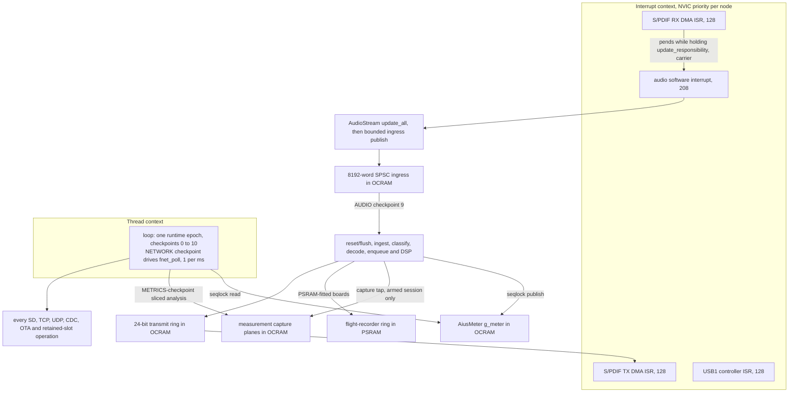

# Aius firmware I/O reference

Every I/O operation the `teensy41-optical` image performs, the buffers it owns, the
bank those buffers occupy, and the argument that it cannot disturb the audio path.
Most of it was decided by [`aius-network-hardening.md`](../plans/aius-network-hardening.md);
this document states the result and cites the code that makes it true.

## How to read this

**Every claim carries a `path:line` citation.** Firmware paths are relative to
`firmware/` unless the path says otherwise. Line numbers are
correct as of this revision; the cited symbol name is the durable handle.

**Bank vocabulary.**

- **`FLASH`**: the 8 MiB program flash.
- **`ITCM` / `DTCM`**: the two halves of the 512 KiB FlexRAM, partitioned at build time.
  Code with no `FLASHMEM` attribute lands in ITCM and is taken straight out of the
  audio path's headroom (`test/itcm-placement/verify_target.py:4`).
- **`OCRAM`**: RAM2 at `0x20200000`, holding both `DMAMEM` statics and the
  `malloc`/`new` heap (`tools/memory/mem_report.py:8`).

**Bank snapshot.** The canonical `teensy41-optical-slot-a` image from
`scripts/build_ab.sh` at aius `2823549ad9bb` (gcc 15.2.1, PlatformIO 6.1.16), reported
by `tools/memory/mem_report.py`:

```text
BANK           USED         FREE     CAPACITY    USED%   FREE%
FLASH        681984      7444480      8126464    8.39%   91.6%
ITCM         183308        13300       196608   93.24%    6.8%
DTCM         300224        27456       327680   91.62%    8.4%
OCRAM        259552       264736       524288   49.51%   50.5%

DTCM layout:
   31424B  .data
    9756B  NonCacheable      (FNET fnet_fec0_buf, orphan-placed)
  259044B  .bss
   27456B  free for locals up to _estack
```

**The DTCM free-for-locals zone is the spine of this document.** It is
`_estack - _ebss`, and it is the entire stack: main loop and audio ISR both
(`firmware/README.md:366-376`). The link refuses a zone under 24,352 B
(`link/aius_teensy41.ld:286`).

**The figures are a dated measurement, not a constant.** They move with every commit
that adds a static, so **take the live figure from `tools/memory/mem_report.py` against
the linked ELF**, the one source that cannot drift; [`signal-path.md`](signal-path.md)
explains why a bare number in prose is not usable evidence. Figures below labelled with
another rev were not re-measured at `2823549ad9bb`. The zone has been as low as 9,280 B
(rev `9f5b8dee8767`). History: `c20a03c8e` then added seven `uint32_t`
edge-detection statics and took the zone to 9,248 B, which is why a zone this small is
measured, not remembered. `-DFNET_CFG_TLS=0` alone returned 19,136 B of DTCM, which is why
TLS is off.

Every placement decision below follows from that scarcity and from the plan's rule that
"memory that is genuinely free is not an argument": OCRAM is plentiful, DTCM is not
(`docs/plans/aius-network-hardening.md:47`). `AiusAudioProcessor::enqueue()` places
about 4 kB of frame on the stack, in the bounded AUDIO checkpoint in thread context,
not the interrupt stack (`src/optical_main.cpp`).

**Do not trust older free-DTCM figures.** The memory gate over-reported DTCM by
9,756 bytes until it read the linked ELF rather than the `teensy_size` summary, because
FNET's `NonCacheable` buffer is orphan-placed inside DTCM and was excluded from both
used and free (`tools/memory/mem_report.py:17`). Source comments now quote 25,824 B
free (`src/aius_runtime_teensy.h:17`, `src/optical_main.cpp:206`, `:676`, `:7630`), an
earlier link's figure; the reasoning they carry holds.

## Execution contexts

Four interrupt actors and one thread context perform work. The S/PDIF DMA ISRs own the
wire clock, the software audio ISR publishes ingress, and the epoch's checkpoints own
everything else, including the FNET stack poll.



| Context | Priority | Does |
|---|---|---|
| S/PDIF RX / TX DMA ISRs | 128 (startup default, `cores/teensy4/startup.c:136`; `evidence/source-snapshots/PJRC-SPDIF-RX-SOURCE/input_spdif3.cpp:67`) | Own the block clock. Whichever peripheral holds `update_responsibility` pends the software interrupt; the input claims it first because `g_spdif_in` is constructed above `g_spdif_out` (`src/optical_main.cpp`). The transmitter never holds it (its replay source was retired by [`aius-sample-rate-following.md`](../plans/aius-sample-rate-following.md) Phase 4i). |
| Audio software interrupt | 208 (`cores/teensy4/AudioStream.cpp:424`) | Pended by `update_all()`'s trigger. Only the bounded `update()` ingress publish and release of its two pool blocks; never classifies, decodes, enqueues, runs DSP, meters or records (`src/optical_main.cpp`). |
| USB1 controller ISR | 128 | Moves CDC bytes between host and driver ring; the firmware touches that ring only from thread context. |
| Epoch loop (`loop()`) | thread | Exactly one runtime epoch. AUDIO owns classify, decode, `enqueue()`, DSP, meter publication, measurement capture and recorder production (`src/optical_main.cpp`); the NETWORK checkpoint drives `fnet_poll` (see [§Ethernet stack service](#ethernet-stack-service-the-fnet-poll)); every other I/O operation here also happens in the epoch. |

The deferred AUDIO checkpoint is thread work; its 8 ms checkpoint timer measures the
complete classify/decode/output service rather than relying on any interrupt-priority
argument (`src/optical_main.cpp`). Per-checkpoint wall-time maxima
(`checkpoint_walltime_us`, `cw=` on `AIUS ID`) bound what the in-epoch poll costs; see
[§Figures that need the device](#figures-that-need-the-device).

## The per-epoch budget

One normal epoch runs checkpoints 0 through 7, then AUDIO 9, then SD 8, records
`EPOCH_COMPLETE` 10, and feeds the watchdog exactly once. **AUDIO precedes SD** so a
blocking card primitive cannot defer already-published ingress into the next epoch.
**An epoch that does not complete does not feed**, turning a wedged service into a
bounded reset rather than a hang (`lib/aius_runtime/src/aius_runtime.c:82`). Budgets
are compile-time constants (`lib/aius_runtime/src/aius_runtime.c:22`):

| Checkpoint | Service | `max_calls` | `max_rx_bytes` | `max_tx_bytes` | Budget |
|---|---|---|---|---|---|
| `0 RESET_CAPTURE` | retained boot facts | 2 | 0 | 0 | 250 ms |
| `1 USB_RX` | CDC input | 64 | 64 | 0 | none |
| `2 USB_TX` | CDC output | 1 | 0 | 64 | 500 ms |
| `3 METRICS` | die-temperature sample + measurement epoch work | 1 | 0 | 0 | 1 ms |
| `4 NETWORK` | supervisor + adapter | 1 | 0 | 0 | none |
| `5 HTTP` | one transaction step | 1 | 256 | 512 | 2 ms |
| `6 UDP` | one datagram | 1 | 532 | 532 | 2 ms |
| `7 SERVICE` | SD lifecycle + platform services | 1 | 2048 | 0 | none |
| `9 AUDIO` | ingress drain + pipeline/output service | 1 | 0 | 0 | 8 ms |
| `8 SD` | one SD job step | 1 | 512 | 512 | none |
| `10 EPOCH_COMPLETE` | ledger + watchdog feed | 0 | 0 | 0 | 8 s watchdog |

**The METRICS and HTTP wall-clock budgets are declared bounds, not aborts.** METRICS's
1 ms binds the measurement loopback's sliced analysis (256 samples per epoch through
both channel accumulators, ~2 × 170 µs worst case) beside the 1 Hz die-temperature
sample (`lib/aius_runtime/src/aius_runtime.c:26`); HTTP's 2 ms carries the legacy
`service_http()` overrun threshold forward (`:35`). The composition root counts an
overrun instead of aborting: `g_metrics_service_overruns` in `platform_metrics()`
(`src/optical_main.cpp`, served on `GET /api/measure`) and
`g_http_service_overruns` between the HTTP stamp and the UDP checkpoint's arrival in
`platform_checkpoint()` (`src/optical_main.cpp:10770`, carried on the UDP status
payload).

**Recovery-safe mode runs only `USB_RX` and `USB_TX` before `EPOCH_COMPLETE`**
(`lib/aius_runtime/src/aius_runtime.c:82`): no network, audio or SD service at all.

## The five isolation mechanisms

Every entry below justifies itself against these five.

1. **The software audio ISR publishes ingress only.** `update()` reserves and commits
   one exact 256-word slot, or records a bounded gap; AUDIO owns every later pipeline
   and output operation (`src/optical_main.cpp`). No network, SD, CDC
   or retained-slot operation is reachable from `update()` or `enqueue()`.
2. **`FLASHMEM` on every cold definition, applied to the definition itself.** GCC does
   not merge a `section` attribute from a forward declaration, so a prototype-only
   attribute silently leaves the code in ITCM (`src/aius_sd_teensy.cpp:11`). ITCM
   belongs to code that genuinely runs per audio block
   (`docs/plans/aius-network-hardening.md:41`).
3. **Large buffers live in `DMAMEM`, not in the DTCM free-for-locals zone.** Per-env
   OCRAM free floors are pinned in `test/memory/verify_target.py:54`
   (`OCRAM_FREE_FLOORS`, 264,736 B for slot-a); the DTCM stack zone is 27,456 B on the
   canonical image at `2823549ad9bb`.
4. **At most one SD primitive per epoch, bounded by the watchdog rather than a false
   cooperative timeout.** The SD library (vendored SdFat) offers no cancellable call,
   so two primitives in one checkpoint double the worst-case wedge the 8 s watchdog
   must absorb (`src/aius_runtime_storage.h:8`). A wait inside an SD call runs the
   audio producer through the vendored SD-wait hook (`lib/aius_producer_yield`), so a
   card stall does not starve the transmit ring. Three sites break the one-primitive
   rule; see [§Raw SD access outside the job engine](#raw-sd-access-outside-the-job-engine).
5. **The meter snapshot crosses its producer/reader boundary through a seqlock, not a
   lock.** The AUDIO writer takes no lock, tests no reader state and never retries;
   retry belongs to the HTTP reader (`lib/aius_dsp/include/aius_dsp.h`, `AiusMeter`).

## S/PDIF input: the receive half of the hot path

The optical receiver, and the clock master whenever a carrier is present.

**Buffers.**

| Buffer | Size | Bank | Note |
|---|---|---|---|
| `spdif_rx_buffer[AUDIO_BLOCK_SAMPLES * 4]` | 2,048 B | `DMAMEM`, 32-byte aligned | DMA landing area, half-filled per interrupt (`evidence/source-snapshots/PJRC-SPDIF-RX-SOURCE/input_spdif3.cpp:36`) |
| Two `audio_block_t` per block pass | 260 B each (`cores/teensy4/AudioStream.h:72`) | `DMAMEM` | From `AudioMemory(24)`: 24 blocks, 6,240 B by declaration (`cores/teensy4/AudioStream.h:110`, allocated at `src/optical_main.cpp:10951`; the pool symbol was not measured at `2823549ad9bb`) |
| `g_audio_ingress_words[8192]` | **16,384 B** | `DMAMEM` | 32 exact 256-word SPSC slots between the software ISR and AUDIO; absorbs interrupt-to-epoch jitter (`src/optical_main.cpp:244`) |

**Why this implementation.** The receiver is PJRC `AudioInputSPDIF3`, compiled from a
checked-in source snapshot rather than the framework copy, so the implementation
boundary is a reviewable artifact (`lib/aius_audio/src/aius_spdif_sources.cpp:4`). The
block pass interleaves the pair directly into a reserved ingress slot and commits that
exact chunk; AUDIO later drains it into the portable pipeline, which classifies PCM
against DTS and calls back with decoded blocks (`src/optical_main.cpp`,
`lib/aius_audio_service/src/aius_audio_service.c:85`).

**Audio-path justification.** This *is* the interrupt-facing audio path: DMA landing in
the receive DMA ISR, block pass in the software interrupt it pends. The post-link guard
pins the optical object to exactly `update()` and `audio_ingress_publish_live()` and the
mixed ingress object to its five producer entry points; all consumption, reset and
diagnostic entry points remain cold (`test/itcm-placement/verify_target.py:90`). The
sample walk is exactly `AUDIO_BLOCK_SAMPLES`; a full ingress records one dropped chunk
rather than blocking (`src/optical_main.cpp`).

**Decode stays in DTCM.** The decoder/pipeline arena is 218,688 B in DTCM since E-AC-3
phase 4 (instance + 32,768 B DSP staging carve + the 180,224 B codec slot;
`src/optical_main.cpp:2247`). The post-link memory gate proves the arena sum
(`test/memory/verify_target.py:21`) and that OCRAM free stays at or above the env's own
floor (264,736 B slot-a, `:54`), a regression ratchet; the safety line is the link-time
heap floor of 131,040 B (`link/aius_teensy41.ld:272`). The floors replaced a single
constant (131,232 B for most of its life, 131,040 B last), whose funded lowering history
lives beside them (`:38`).

### Compressed-frame CRC check

**A complete-but-corrupt compressed burst is refused, not decoded.** A DPLL micro-flap
shorter than three epochs keeps the pipeline class, so the parser hands over a
full-length access unit with bit errors inside. Neither liba52 nor the vendored E-AC-3
fork validates a frame's CRC, so such a unit would play as one 32 ms burst of
full-scale crackle, counted and placed by nothing. Every AC-3 and E-AC-3 access unit is
verified before decode by `aius_ac3_crc_check()` (`lib/aius_pipeline/src/aius_pipeline.c`):
one table-driven CRC-16/0x8005 pass over at most 3,840 bytes, with the 512-byte table
in `.progmem` (FLASH; the framework's link script copies every other `.rodata` into
DTCM).

- **The spans.** crc2 covers `frame[2 .. size)` with init 0 and a zero residue: the
  trailing two bytes *are* the CRC, so it is a residue test, not a compare. crc1 (AC-3
  only; an E-AC-3 syncframe's bytes 2-3 are `strmtyp`/`frmsiz`) is the same
  accumulation stopped at `((size >> 2) + (size >> 4)) << 1`, i.e. 5/8 of the frame
  rounded DOWN to an even byte count. The rounding is load-bearing at 44.1 kHz, whose
  frame sizes are odd word counts: a 138-byte frame's exact 5/8 is 86.25 bytes and the
  encoder's boundary is 84. crc1's span is a prefix of crc2's, so one pass checks both:
  free on an accepted frame, and a header-corrupt one short-circuits after 5/8 of the
  bytes. `test/pipeline/test_ac3_crc.c` pins both spans by walking every interior end
  offset of a real frame of each family, requiring a zero residue at exactly those two
  ends for AC-3 and at the frame end alone for E-AC-3.
- **The substitution.** A rejected AC-3 unit becomes the six 256-frame blocks of zeros
  the decode would have produced, carrying the channel count, mask and rate of the last
  unit that DID decode (remembered, because the corrupt header is what crc1 may have
  failed). Class, parser lock, codec residency, audio generation and transmit-ring
  occupancy all survive; the decoder-reject path that resets the class is too heavy
  for a source fault. Before any unit of that family has decoded, the unit is simply
  dropped (no cadence to hold, no ring to protect). **The cut to zero is a hard step by
  design**: a fade-out needs the previous block's tail, already committed with its plane
  reused; a fade-in needs a one-block delay of the decoded stream; so a ramp removes one
  of two clicks for real hot-path cost, and the downstream true-peak limiter has no
  floor behaviour to soften either step.
- **The record.** `pipeline_diag.crc_rejects` and `pipeline_diag.crc_reject_last_at_ms`
  on `GET /api/status`, event type 18 carrying the rejected frame's byte length, and the
  `crc_reject` flight-recorder trigger. The counter is the pipeline's; stamp, event and
  recorder freeze are published by the producer's block tap on the first substituted
  block, because the pipeline is portable C with no wall clock and no event ring (the
  same split the governor trim and missed-fill witness use). **A climbing `crc_rejects`
  with `decode_rejects` and `au_abandons` flat is a SOURCE fault, not a board one.**

## S/PDIF output — the transmit half of the hot path

The optical transmitter. The receiver is the clock master (`clock.master` reads the
constant `input`).

**The path is 24-bit and does not go through `audio_block_t`.** It is the first item of
the audio-quality roadmap in
[`aius-dsp-config-api.md` §Audio-quality roadmap](../plans/aius-dsp-config-api.md#audio-quality-roadmap--accepted-2026-07-26).
`audio_block_t` is `int16_t data[AUDIO_BLOCK_SAMPLES]` (`cores/teensy4/AudioStream.h:76`),
which capped the DSP at a ~−93 dBFS floor, while the hardware carries 24 bits:
`SPDIF_STL`/`SPDIF_STR` are 24-bit registers and `SPDIF_tx_buffer` is `int32_t`. The
snapshot's ISR shifts 16-bit data back up with `*dest++ = (*src_left++) << 8`
(`evidence/source-snapshots/PJRC-SPDIF-TX-SOURCE/output_spdif3.cpp:130`).

```text
DSP (24-bit int, AIUS_DSP_SAMPLE_MAX = 2^23-1)
  -> aius_out_stage_run at AIUS_DSP_OUT_WIDTH_24   <- a copy; no dither, no rounding
  -> g_aius_spdif_tx24, int32 ring, DMAMEM
  -> AiusSpdifTx24Hook::isr, the transmit DMA interrupt
  -> SPDIF_tx_buffer (int32) -> SPDIF_STL / SPDIF_STR
```

**Lossless from DSP to wire, with no dither**, because the DSP already produces 24-bit
integers. `aius_out16_*` remains as the 16-bit arm of `aius_out_stage_run()`
(`lib/aius_dsp/src/aius_dsp.c:755`), selected by
`AiusAudioProcessor::OUTPUT_WIDTH_BITS` (`src/optical_main.cpp:2245`) and bypassed by the
shipped `AIUS_DSP_OUT_WIDTH_24`; it reproduces the old wire words exactly
(`aius_out16_sample()` times `AIUS_DSP_OUT16_LSB` is the snapshot's `<< 8`).

**No vendor patch.** `lib/aius_audio/` stays byte-for-byte upstream. A sibling path is
possible because:

- `SPDIF_tx_buffer` is a file static of `output_spdif3.cpp`, which is `#include`d into
  `lib/aius_audio/src/aius_spdif_sources.cpp:3`, so the filler can address it;
- `dma`, `update_responsibility` and `AudioStream::update_all()` are `protected static`,
  reachable by a private-inheritance shim as `AiusSpdifOutputClock` does
  (`src/optical_main.cpp:444`);
- `DMAChannel::attachInterrupt()` only stores a vector (`cores/teensy4/DMAChannel.h:513`),
  so redirecting the transmit interrupt after `begin()` replaces the vendor ISR
  without editing it.

`test/optical-cutover/test_optical_cutover.py` asserts the snapshot still contains the
`<< 8` line, which keeps "unpatched" a fact.

**Buffers.**

| Buffer | Size | Bank | Note |
|---|---|---|---|
| `SPDIF_tx_buffer[AUDIO_BLOCK_SAMPLES * 4]` | 2,048 B | `DMAMEM`, 32-byte aligned | Double-buffered, one interrupt per `AUDIO_BLOCK_SAMPLES` frames (`evidence/source-snapshots/PJRC-SPDIF-TX-SOURCE/output_spdif3.cpp:44`) |
| `g_aius_spdif_tx24` (`AiusSpdifTx24Ring`) | **16,404 B** | `DMAMEM` | 2 × 2,048 `int32` planes plus five 32-bit words: `written`, `consumed`, `underruns`, `fills`, `gate_open` (`lib/aius_audio/src/aius_spdif_tx24.h:103`, instance `lib/aius_audio/src/aius_spdif_sources.cpp:62`). 2,048 frames, so `AIUS_NO_SPACE` and the meter's `queue_frames` keep their meaning. |
| `AudioOutputSPDIF3::block_silent` | 260 B | `DMAMEM` | Unreachable: the vendor ISR that used it no longer owns the interrupt (`output_spdif3.cpp:46`) |
| Pool blocks | none | | `AudioOutputSPDIF3::update()` is never called; there is no `AudioConnection` into `g_spdif_out` (`src/optical_main.cpp:2914`) |

**Every closed to open TX-gate edge sets the ring to `AIUS_TX_GATE_OPEN_TARGET_FRAMES`**,
padding with silence or trimming as the level demands, plus the pending DMA half when a
period boundary is pending, in one masked `set_level` (`tx_gate_execute_open()`,
`src/optical_main.cpp:3058`, target applied `:3070`): code default 256 (`:1768`),
**128 on the shipped image** (`platformio.ini:325`), a latency normalization recorded
in [`aius-e2e-latency.md`](../plans/aius-e2e-latency.md) §Phase 3. Trimmed frames were
dark by construction; padded ones count in `gate_open_padded_frames` and
`gate_open_pending_padded_frames`, trimmed ones in `gate_open_trimmed_frames`.

**Why `DMAMEM` and not DTCM.** A 16,404 B ring in DTCM would spend most of the 27,456 B
free-for-locals zone; in OCRAM it is 16,404 B of a bank with 264,736 B free. A DMA ISR
reads it and OCRAM is slower, but the read is strictly sequential, 256 words per
interrupt, so each 32-byte line fill amortises over eight words: 32 fills at roughly
20 to 30 cycles is under 1,000 cycles against a 128-frame interrupt period of 1,600,000
cycles at 600 MHz.

**Packing three bytes per sample was rejected.** It would save 4 KB of 264,736 B free OCRAM
and cost three byte loads plus two shifts per sample in the ISR; the aligned word is
exactly what `SPDIF_STL` takes, so the fill is a straight copy
(`lib/aius_audio/src/aius_spdif_tx24.h:101`).

**No cache maintenance on the ring.** Nothing DMAs it: both ends are CPU accesses through
the same write-back D-cache. `SPDIF_tx_buffer`, which the DMA does read, is flushed once
per half (1,024 bytes, 32-byte aligned) rather than every 32 bytes: same number of
`DCCMVAC` operations, one call instead of 32, and early enough because the filled half is
the one the DMA is *not* reading, a full 2.67 ms before the transfer reaches it.

**Single producer, single consumer, no critical section.** The producer is `enqueue()`
at AUDIO; the consumer is the transmit DMA interrupt at 128, which can preempt the
producer mid-block. The ring therefore keeps two free-running 32-bit frame counters,
each written by one side, with the level as their unsigned difference: correct across
wrap and single-copy atomic on the Cortex-M7. Staged frames become visible only at
`aius_spdif_tx24_commit()`, so the consumer never sees a half-written block
(`lib/aius_audio/src/aius_spdif_tx24.h:153`).

**A measurement tap reads the committed words in the same AUDIO checkpoint.** `enqueue()`
calls `aius_measure_producer_block()` immediately after `aius_spdif_tx24_commit()`
(`src/optical_main.cpp:2620`): at 24-bit the committed planes *are* the wire words, and
the tap latches this block's config generation and overrun count in the same call that
would advance them. Idle cost is one volatile load and compare per decoded block. See
[§Measurement capture](#measurement-capture-audio-checkpoint-to-the-metrics-checkpoint).

**Underflow is counted.** The fill writes silence and advances `underruns` by the
substituted frame count; queue occupancy is the ring's own level, with no vendor
two-deep block queue behind it, as
[`aius-sample-rate-following.md` §Interaction with the 24-bit output path](../plans/aius-sample-rate-following.md#interaction-with-the-24-bit-output-path)
asked. Neither counter has a wire field yet.

**Every output glitch carries a timestamp.** All four instruments are on the `clock`
object of `GET /api/status` and posted to the event ring as they happen:

| Instrument | What | Event |
|---|---|---|
| `underrun_episodes[≤8]` + `underrun_episode_count` | Gate-open underrun advances grouped into episodes with `start_ms`, `ms`, `frames`, `gate_open` (`lib/aius_audio/src/aius_underrun_episodes.h`, suite `underrun-episodes`). Stepped once per ACCEPTED producer block beside the governor tap and once at the gate's closing edge; the ~10.7 ms block cadence is deliberately coarser than the 2.67 ms fill period, so one stall is one episode. | 14, at episode end |
| `governor_last_trim_at_ms` / `governor_last_trim_frames`, `gate_open_last_trim_at_ms` | When the last audible skip happened and its size, beside the lifetime totals. | 15, at the trim; freezes the flight recorder |
| `tx_missed_fills` / `tx_missed_fill_frames` / `tx_missed_fill_at_ms` + three raw FlexSPI words | The transmit DMA is circular, so an ISR serviced a whole period late re-transmits the half it filled last time: an audible repeat advancing no underrun counter, plus one `AUDIO_BLOCK_SAMPLES` of standing latency. The ISR detects it by filling the same half twice (an odd number of missed periods; an even number stays invisible), rebases the consumer cursor to undo the latency, and snapshots `FLEXSPI_INTR` / `FLEXSPI2_INTR` / `FLEXSPI2_STS1` on a burst's first miss so a bus hold is attributable. Hot-path cost: five instructions, one address load, one load, one store, one compare and a not-taken branch (`lib/aius_audio/src/aius_spdif_tx24.h`, suite `tx-fill-witness`). | 17, from the producer's block tap |
| `trim_last_at_ms` / `trim_applied_at_ms`, `fill_trim_last_at_ms` / `fill_applied_at_ms` | Same-nominal PLL trim, CENTRE and FILL kinds, at request and at the TX boundary that wrote the numerator; each pair brackets at most one 128-frame period of queueing (`lib/aius_audio/src/aius_spdif_sources.cpp:194`). | 16 |

**Cost.** The 24-bit path removed work. Inside the DWT bracket, the 512-frame block's
output stage went from 1,024 `aius_out16_sample()` calls (PRNG draw, fixed-point
convert, `vrintm`, two `vcmpe`/`vmrs` pairs and a convert back, about 45 to 60 cycles
each, roughly 51,000 cycles) to a 6-instruction-per-frame copy plus OCRAM
write-allocate fills, roughly 6,000 to 7,000 cycles. The transmit interrupt is 496 bytes (`2823549ad9bb`; 228 at 2026-07-29)
of ITCM with a 9-instruction inner loop (`lib/aius_audio/src/aius_spdif_sources.cpp:57`),
replacing the vendor ISR's per-sample shift and 32 `arm_dcache_flush()` calls.

### Clock, validity and channel status

**The transmit DMA is clocked by PLL4 through `SPDIF0_CLK_ROOT`, not by the receiver.**
`SPDIF_SCR_TXSEL(5)` is normal transmit, not feed-through; the dependency runs the other
way: the receiver falls back to `tx_clk` when its DPLL is unlocked
(`src/optical_main.cpp`).

**`SPDIF_SCR[VALCTRL]` polarity is inverted against its name.** `ValCtrl = 1` means
outgoing validity always *clear*, i.e. `V = 0` on the wire (IEC 60958: suitable for
conversion); `0` transmits `V = 1`, which a receiver may answer with a mute. PJRC's boot
configuration sets the bit for valid
(`evidence/source-snapshots/PJRC-SPDIF-TX-SOURCE/output_spdif3.cpp:265`) while their
`mute_PCM(true)` sets the same bit to mute (`:211`); this firmware once followed the
second reading and transmitted `V = 1` permanently. The constant is
`AIUS_AUDIO_CLOCK_VALCTRL_VALID_BIT` (`lib/aius_audio/include/aius_audio_clock.h`): a
dark transition clears it and the hold's last period sets it, and the `clock-target`
suite pins the steady-state register value. Record:
[`aius-sample-rate-following.md`](../plans/aius-sample-rate-following.md) §Correction 2026-09-07.

**A same-nominal trim does not hold validity.** A numerator step is carrier-continuous
(proven at +438 ppm, far beyond the tracker's ~10 ppm corrections), so a four-period
`V = 1` window would cost ≥ 10.67 ms of possible DAC mute per trim for nothing. The TX
boundary writes `CCM_ANALOG_PLL_AUDIO_NUM` and touches neither `VALCTRL` nor
`invalid_periods_remaining` (`lib/aius_audio/src/aius_spdif_sources.cpp:176`), so
`clock.invalid_windows` counts dark applies only and no frame goes out invalid. Dark
full-apply and structural-replan paths keep the hold (`:206`).

**Boot is 48 kHz; live output follows the source at 32, 44.1 or 48 kHz.**
`AUDIO_SAMPLE_RATE_EXACT=48000.0f` is the bootstrap value used by `config_spdif3()` and
the config default; a `static_assert` against `AIUS_OPTICAL_SAMPLE_RATE_HZ` keeps the two
coherent. Once a live carrier is accepted, checkpoint 7 plans PLL4 from the receiver's
`SPDIF_SRFM` millihertz measurement and applies the whole nominal rate before opening the
pad. Later same-structure corrections queue only `CCM_ANALOG_PLL_AUDIO_NUM` for the next
128-frame TX boundary (`lib/aius_audio/src/aius_audio_clock.cpp`, `src/optical_main.cpp`,
`lib/aius_clock/src/aius_clock.c`).

The planner uses a 1,000,000 denominator, root predivider 8 and TX dividers 42, 30 and
28 for 32, 44.1 and 48 kHz.

| Change | Pad | Ring / decoder | Validity |
|---|---|---|---|
| Nominal rate change | closed | stale words flushed (lifetime underruns kept); waits four complete 128-frame TX periods after lock | marked invalid |
| Same-nominal integer-divider replan | closed, waits for the hold | ring and decoder generation preserved | held |
| Same-nominal NUM trim | pin 14 and ring keep running | preserved | untouched: stays valid |

**The channel-status message agrees with the active clock.** The snapshot initializes
neither `SPDIF_STCSCH` nor `SPDIF_STCSCL`; their reset-zero message advertised 44.1 kHz
with copyright asserted, which a CM6206 answered with exact digital silence.
`aius_spdif_tx24_begin()` writes `0x00200000` / `0x00400000`: consumer PCM, copyright not
asserted, bootstrap 48 kHz. A live whole-rate apply preserves the copyright word and maps
`STCSCL[23:22]` to `0x00000000`, `0x00400000` or `0x00c00000` for 44.1, 48 or 32 kHz.
Packing follows the i.MX RT1060 reference manual §40.3.2.2.1: chronological channel
status starts at register bit 23, so consumer byte 0 bit 2 maps to `STCSCH[21]` and
byte 3's sample-frequency code to `STCSCL[23:22]`. The `optical-cutover` suite pins both
words; a physical CM6206 → Teensy → CM6206 glass loop captured the 997 Hz stimulus on
both channels at `−41.06 dBFS` peak, matching the Teensy meters.

**Nothing in this path resamples.** The receiver DMAs at the incoming carrier's rate and
the transmitter clocks out at the applied carrier-following target. The receive snapshot
predates the upstream asynchronous rate converter and the framework copy is
byte-identical. `enqueue()` compares every PCM/decoder block's nominal rate with the
accepted carrier and applied plan before staged config or DSP advances: a real mismatch
is counted, refused and holds the pad dark; an intentional four-period clock transition
returns backpressure so decoded output is retained, not dropped.

### Block sizes and ITCM placement

**Two block sizes; every per-block figure names one.**

- **Engine block, `AUDIO_BLOCK_SAMPLES` = 128 frames** (Teensy core default, not
  overridden): sizes both DMA buffers, the `audio_block_t` pool, the ingress chunk and
  the transmit interrupt's ring drain. `update()` runs at rate/128 (375 times/s at
  48 kHz), publishing 512 bytes each time.
- **Decoded block, 512 frames**, what `blocks` counts: a DTS Core access unit
  reconstructs to 512 samples per channel and PCM passthrough stages the same
  (`AIUS_PIPELINE_PCM_BLOCK_FRAMES`). AUDIO reaches `enqueue()` once per four chunks, at
  rate/512 (93.75 blocks/s at 48 kHz). `enqueue()`'s `AUDIO_BLOCK_SAMPLES * 4` cap is
  that 512, so changing the engine block changes the decoder block accepted.

**Audio-path justification.** The `update_responsibility` handover runs at checkpoint 7
in thread context and costs two byte stores under one critical section
(`src/optical_main.cpp`), so no ISR can observe the both-drive window (a
double-processed block) or the neither-drives window (a stalled one); it is shorter than
the one `block_count()` takes (`src/optical_main.cpp`). Thread context also keeps
`pllLocked()` out of the audio ISR.

`optical_main.cpp`'s pinned ISR-hot set is exactly two sections, `update()` and the live
interleave helper, **268 B total** in the `2823549ad9bb` (316 B in the 2026-07-29 link). `enqueue()` and
`consume_block()` link in FLASH; the 496-byte transmit handler (228 B at 2026-07-29) stays in
`lib/aius_audio/src/aius_spdif_sources.cpp.o` because it runs in the DMA ISR. The
post-link test proves zero ITCM in cold objects, the five allowed ingress-producer
sections and those two optical sections (`test/itcm-placement/verify_target.py:48`).

## Meter snapshot handover: AUDIO checkpoint to HTTP

`GET /api/meters` serves a coherent snapshot published by the audio path.

**Buffers.**

- `g_meter` (`AiusMeter`), **9,584 B**, `DMAMEM` (`src/optical_main.cpp:691`). Its
  published snapshot is about 4.7 kB: six input peak/RMS pairs, a 128-point waveform, a
  1,024-sample analysis window and telemetry (`lib/aius_dsp/include/aius_dsp.h:1106`).
- The reader's `AiusMeterSnapshot snapshot` copy is a `DMAMEM` static, not a DTCM
  automatic (`src/optical_main.cpp:3657`).
- The body goes into the shared `app_body` buffer, capped at 10,880 bytes by a
  `static_assert`-checked worst case (`src/optical_main.cpp`).

**One writer, one reader, no lock.** `enqueue()` at AUDIO owns every accumulator, both
seqlock increments and the published snapshot; HTTP only calls `aius_meter_read()`. The
target serializes both in one epoch, but the portable seqlock contract still guarantees
a coherent copy without letting a reader protocol into the per-block writer.

**dBFS conversion is on the HTTP side.** `log10(0)` is `-Infinity`, which is not JSON,
and silence is a meter's resting state, so the ~16 `log10` calls and 128 integer
scalings are paid by a cold `FLASHMEM` serializer (`src/optical_main.cpp`).

**Audio-path justification.** With `features.meters` false the tap costs one `bool` test
per block (`src/optical_main.cpp`). With it true, the accumulate helpers walk
`block->frames` once over caller-owned storage with no allocation, and waveform
decimation writes at most 128 points (`src/optical_main.cpp`). Eight `sqrt` calls and
the snapshot copy in `aius_meter_publish()` run once per 20 Hz window
(`src/optical_main.cpp`), counted in frames (48000/20 = 2,400) so decoder framing
cannot move it: off four `enqueue()` calls in five at 512 frames, off 18 in 19 at 128.
The limiter gain-reduction accessor's `libm` `log10` is likewise sampled once per window,
because "a diagnostic field does not buy a `log10` in the block callback"
(`src/optical_main.cpp`). The tap is inline in `enqueue()`, which links in FLASH; the
optical post-link allowlist holds only the two ingress-publisher sections
(`test/itcm-placement/verify_target.py:90`).

**If the bound were violated** (unbounded waveform, an allocation, a publish per block),
the cost lands inside the block callback, and at 2.67 ms per block an overrun becomes
audible before it shows in `overruns`.

## Measurement capture: AUDIO checkpoint to the METRICS checkpoint

`GET /api/measure` serves quality figures the device measured on its own output (design:
[`aius-dsp-config-api.md` §Item 3 design](../plans/aius-dsp-config-api.md#item-3-design--the-measurement-loopback-software-tap-first);
figures and stimulus floors:
[`signal-path.md` §Measured output quality](signal-path.md#measured-output-quality--the-loopback-figures)).

**Buffers.**

| Buffer | Size | Bank | Why |
|---|---|---|---|
| `g_measure_capture_l` / `_r` | 2 × 65,536 B = **131,072 B** | `DMAMEM` | 16,384 frames of committed 24-bit stereo, exactly 32 decoded blocks, so a capture retires on a block boundary (`src/optical_main.cpp:719`, `lib/aius_dsp/include/aius_measure.h:70`). No init needed: analysis reads only `captured` buffers, and captured means all frames were written. |
| `g_measure_capture` (control) | | **DTCM `.bss` deliberately** | `.bss.dma` is NOLOAD and the boot ROM scribbles OCRAM at reset; this must read idle before the first arm (`src/optical_main.cpp:721`) |
| `g_measure_analysis_l` / `_r` | 760 B each (`2823549ad9bb`) | `DMAMEM` | Re-initialised by `aius_measure_analysis_init()` before every use (`src/optical_main.cpp:7795`) |
| `g_measure_session` | ~600 B | DTCM `.bss` | Read before any session starts, so must read "none" on cold boot (`src/optical_main.cpp:7815`) |

**Producer: the tap in `enqueue()`.** `aius_measure_producer_block()` re-checks the
arm-time latches (config generation and overrun count) at every block boundary and
retires the capture to `failed` on a mismatch *without* copying, because a splice inside
a window is exactly the seam artifact the loop-coherent stimulus removes; otherwise it
copies the committed planes and retires to `captured` when full
(`lib/aius_dsp/src/aius_measure.c:61`). It is the one function in `aius_measure.c` with
no `FLASHMEM`, so it lives in ITCM like the tx24 hook, in an object the ITCM guard does
not police (`lib/aius_dsp/include/aius_measure.h:181`).

**Epoch side: the METRICS checkpoint, inside its 1 ms budget.** `platform_metrics()`
calls `measure_epoch_service()` beside the die-temperature sample
(`src/optical_main.cpp`). One epoch advances exactly one of:

- **the stall watch** (only the epoch can time out a capture the producer is not
  feeding): cancel after 10 s armed (operator gap between `POST /api/measure/start` and
  the U24 `aplay` stimulus reaching the gate), 2 s capturing (stimulus stopped), and
  reclaim an unacknowledged cancel after a further 1 s of unchanged block counter
  (`src/optical_main.cpp`);
- **one 256-frame analysis slice** through both channel accumulators (~2 × 170 µs worst
  case; an 8,192-frame window completes in 32 epochs).

Overruns land in `g_metrics_service_overruns` (`src/optical_main.cpp:7831`), served on
`GET /api/measure`; nothing aborts.

**One writer per transition, no lock.** The portable machine distinguishes producer and
controller transitions though the target runs both serially. The dual-terminal cancel
edge is benign because both sides store the same terminal value, and the documented
check-then-store interleaving can lose only that capture, never corrupt it
(`lib/aius_dsp/include/aius_measure.h`, `AiusMeasureCapture`).

**Interlocks.**

- **An audio reset request (a relock, for one) advances a monotonic audio-reset
  sequence.** At the next AUDIO checkpoint the service masks interrupts only while it
  flushes queued ingress and acknowledges the matching ingress generations, then unmasks
  before `aius_pipeline_reset()` (`src/optical_main.cpp`,
  `lib/aius_audio_service/src/aius_audio_service.c:45`). A sequence cannot lose two
  requests to a boolean clear, and `update()` stays ingress-only.
- **`POST /api/clear` retires a live capture.** Clearing zeroes `g_overruns`, the
  baseline the latch compares by *equality*, so a clear during capture could mask a real
  overrun's 512-frame seam; `app_clear_counters()` cancels the capture and
  `GET /api/measure` says why (`src/optical_main.cpp`).
- **`measure_start()` refuses while a capture is live, before touching the
  accumulators**; parameters are validated before the machine moves, so a bad f0 or
  probe list leaves a retired session's figures intact (`src/optical_main.cpp`).

**Audio-path justification.** Idle cost is one volatile load and compare per decoded
block; a capturing block adds a 2 × 512-word copy into OCRAM. The stall watch, sliced
analysis and JSON are `FLASHMEM` epoch work at checkpoint 3. Measured acceptance
([`signal-path.md`](signal-path.md#measured-output-quality--the-loopback-figures)):
`dsp_cycles_max` distributions with captures armed and unarmed are indistinguishable
inside the block-to-block spread.

## PSRAM flight recorder: AUDIO checkpoint producer, SERVICE checkpoint drain

Always-on capture of the committed output words into fitted PSRAM, so a transient defect
(impulse, underrun, carrier drop) is inspectable afterwards (`aius-optical-prototype.md`
§PSRAM flight recorder). Absent PSRAM it costs one `bool` test per block
(`g_recorder_present`, `src/optical_main.cpp:759`).

**Buffers.**

- **Staging**: the first 32 KiB of PSRAM, 8 planar 512-frame slots, so AUDIO's maximum
  burst of eight output steps after SERVICE drained is gap-free
  (`RECORDER_STAGING_BYTES`, `src/optical_main.cpp:747`).
- **Ring**: the rest of PSRAM at a power-of-two capacity after staging
  (`aius_recorder_ring_bytes_after_staging`, `src/optical_main.cpp:2732`).
- **Control state** in DTCM. **No `EXTMEM` static exists and the extmem heap is banned**
  (`test/recorder/test_no_extmem_heap.py`): an `EXTMEM` array links silently wrong on an
  8 MB board.
- OTA activation borrows the PSRAM *above* the recorder's claim; the regions are
  disjoint by construction (`src/optical_main.cpp`).

**Why this implementation.** The producer, `aius_recorder_producer_block()` in
`enqueue()`, sits beside the measurement tap so both cover exactly the committed frames
(`src/optical_main.cpp`); it stages into PSRAM slots and never touches the ring. The
drain rides the SERVICE budget row, after `tx_gate_service()` by contract so trigger
evaluation sees this epoch's latched gate and carrier: at most 32 KiB per epoch, ~2× the
384 KiB/s fill rate, so a post-stall backlog clears (`src/optical_main.cpp`). Both
are serial epoch work and nothing DMAs the PSRAM, so there is deliberately no cache
maintenance. Triggers (overrun, underrun, carrier loss, limiter gain reduction, governor
trim, missed fill, CRC reject) are a configurable mask mirrored against the recorder's
bits by `static_assert` (`src/optical_main.cpp`).

**Producer-posted triggers.** `governor_trim`, `missed_fill` and `crc_reject` are set via
`aius_recorder_note_producer_event()` by the caller that detected the fault (the
governor at its trim, the block tap at a missed fill or a CRC reject), because that
caller made the splice, lost the period or refused the unit. The token is consumed by
the next producer block, so the capture ends at the damaged block with history intact,
as an underrun freeze does. All three default enabled and are configurable in
`PUT /api/recorder/config`.

**HTTP surface.** `GET /api/recorder` (state), `POST /api/recorder/freeze` / `thaw`,
`PUT /api/recorder/config` (mask + GR threshold), and
`GET /api/recorder/data?offset=&length=&generation=`, a bounded reader with an optional
trailing `&slot=` (`lib/aius_http/src/aius_http.c:176`). Every recorder route, GETs
included, needs the SD auth token (`dispatch_recorder()`,
`src/aius_optical_app.cpp:761`). All run at checkpoint 5 in thread context.

**Audio-path justification.** Per-block cost on a PSRAM board is the staging copy;
ring write, trigger evaluation and HTTP are epoch work. The producer's one hot section is
allowlisted by name in the ITCM guard (`test/itcm-placement/verify_target.py:149`;
`RECORDER_COLD_SECTIONS` pins the rest cold).

## Bounded SD job engine and its Teensy adapter

Every legitimate card access goes through one portable state machine and one adapter.

**Buffers** (all inside `AiusRuntimeStorage`, inside the `DMAMEM` runtime object, so
OCRAM; `src/aius_runtime_storage.h:57`):

- `sd_transfer[512]`: the transfer slice, and the `sd_capacity` reported on
  `SD_STARTED`, `static_assert`-locked to `AIUS_HTTP_SD_CAPACITY_MAX`
  (`src/aius_runtime_storage.h:43`, `:48`).
- `sd_publish[12288]`: publication accumulation buffer, sized for the largest published
  file, the DSP model JSON (`src/aius_runtime_storage.h:59`).
- Three 128-byte path buffers plus a directory path on the job
  (`docs/plans/aius-network-hardening.md:1288`).
- The adapter holds exactly one `File` handle and its duration diagnostics
  (`src/aius_sd_teensy.h:17`).

**Rejected alternatives.**

- **Growing the transfer slice to the model size**: `job->capacity` sizes *every*
  transfer, so 12,288 would make every SD primitive a 12 KB blocking call, against the
  one-primitive-per-epoch rule (`docs/plans/aius-network-hardening.md:4287`).
- **Incremental publish into an application-owned buffer**: no such buffer existed; the
  apparent one was a stack local of the old blocking read, unable to hold state across
  the ~24 epochs a bounded job takes (`docs/plans/aius-network-hardening.md:4272`).
- **A queue for contending job requests**: a queue would retain a second request with
  its three 128-byte paths and owe an unbounded-latency start; a refusal is retried by
  the caller's next epoch at zero cost (`src/aius_runtime_storage.h:229`).

**Accepted cost**: a 12,288-byte application-shaped buffer inside a portable engine's
consumer, for a file read twice in a board's lifetime, breaking `AiusSdJob`'s "one job,
one buffer" invariant; accepted because the per-epoch primitive bound is a
watchdog-safety property and OCRAM is not scarce
(`docs/plans/aius-network-hardening.md:4309`).

**SD job kind 6 (`REPLAY_REFILL`) is retired and never reused**; the replay file reader
(ring, refill job, source and routes) was retired by
[`aius-sample-rate-following.md`](../plans/aius-sample-rate-following.md) Phase 4i, and
live input is the only audio source. **Kind 7 is `CACHE_FILL`**, one read-only job per
web-cache file, one chunk per READ/OUTPUT primitive pair (`lib/aius_sd/include/aius_sd.h:39`).
`USAGE_REFRESH` scans free clusters in resumable chunks of 32 FAT or exFAT-bitmap sectors
per primitive (`:48`). A due settings flush preempts a running scan, or a fill when the
FIFO is not short (`src/optical_main.cpp`). An OPEN the card refuses with no driver
error (not found) is a miss: `open_misses` counts it and the mount is kept, not a driver
fault (`src/aius_sd_teensy.cpp:155`). Fault 19 (`AIUS_SD_FAULT_VERIFY`, a read-back size
or CRC-32 mismatch) is the last fault the HTTP transaction accepts and answers 500
(`lib/aius_http/src/aius_http_transaction.c:403`, `:1065`).

**Transfer mode: the card boots in FIFO; DMA SDIO is opt-in at runtime.**
`AIUS_SD_BOOT_DMA` defaults to 0 (`src/aius_sd_teensy.h:21`), a build switch so an A/B
rollback lands on its own image's mode. `POST /api/sd/mode` (token-gated) selects
`fifo` or `dma` in memory only, not persisted; it answers 503 `sd_busy` while a file is
open, otherwise drops the mount so the next storage BEGIN remounts in the new mode
(`app_sd_set_mode()`, `src/optical_main.cpp:7538`; dispatch
`src/aius_optical_app.cpp:908`). `sd_diag.sd_mode` reports the mounted volume's mode
(`none` unmounted), `sd_diag.sd_mode_requested` the next mount's
(`src/aius_runtime_storage.cpp:1208`); `GET /api/sd` answers `{"ready":true}` or 503
`sd_unavailable`. **In DMA mode the SDHC may DMA only into DTCM** (never D-cached, so no
cache maintenance): any other buffer, the OCRAM `sd_transfer` included, goes sector by
sector through a 512 B aligned stack copy (`vendor/SdFat/src/SdCard/SdioTeensy.cpp:216`,
`:932`, `:1088`). Sizes of the DMA-path buffers were not measured at `2823549ad9bb`.

**Audio-path justification.** The engine is pure state; the adapter is the only caller of
any SD primitive and executes exactly one per `aius_sd_teensy_execute()` call, retaining
its event for the next epoch (`src/aius_sd_teensy.cpp:157`, `src/aius_runtime_storage.h:8`).
Both are declared cold objects, so the post-link guard fails the build on any ITCM
(`test/itcm-placement/verify_target.py:44`). The worst-case wedge is one synchronous SD
call, bounded by the 8 s watchdog and the retained `SD` checkpoint
(`docs/plans/aius-network-hardening.md:476`).

**If the bound were violated** (two primitives in one checkpoint), the worst-case wedge
doubles against the fixed 8 s window, and the reset is attributed to whichever checkpoint
the ledger last recorded rather than the offending call.

## Raw SD access outside the job engine

**Three sites reach the card directly, each bounded; so "at most one SD primitive per
epoch" holds for checkpoint 8, and an epoch that runs one of these spends up to 128 raw
directory reads (or, once, the OTA copy) instead.** The engine has no directory job kind.

| Site | Call site | Bound | Gate | SD wait window |
|---|---|---|---|---|
| `GET /sd/<dir>/` listing | `app_read_directory()`, `src/optical_main.cpp:7462` | 128 raw entry reads, 64 listed | `sd_ready()` and `!sd_busy()`: 503 `sd_busy` (`src/aius_optical_app.cpp:1388`) | yes |
| Web-cache fill walk | `web_cache_fill_next()`, `src/optical_main.cpp:9755`, `:9778` | one `app_read_directory()` scan per call | cache present, card ready, volume idle, hold lapsed, FIFO-defer gate | yes |
| OTA activation copy | `ota_copy_staged_to_psram()`, `src/optical_main.cpp:5775` | the staged image, 4,096 B per read, watchdog fed between reads | operator-latched activation, epoch loop stopped | no, the accepted unwindowed root (`:337`) |

The listing scan stops at `AIUS_OPTICAL_APP_INDEX_SCAN_MAX` (128) raw reads and keeps
`AIUS_OPTICAL_APP_INDEX_MAX_ENTRIES` (64) entries rather than walking a directory of
unknown size (`src/aius_optical_app.h:86`, `:93`); the handle is never retained past the
call. A directory the fill has wholly published (`presets/`) lists from the web-cache
manifest with no card read (`src/aius_optical_app.cpp:1381`). A card-reading GET holds
dispatch while admission cancels any running fill, so `sd_busy()` is never true because
of a fill (`:1342`). The gate is load-bearing and stated as such at the dispatch site.

**Audio-path justification.** The listing runs at checkpoint 5 in thread context and is
`FLASHMEM`, so it cannot extend a block callback; the fill walk is likewise `FLASHMEM`
epoch work. The bound serves the *watchdog* argument: checkpoint 5's worst case is one
call plus a 128-entry walk against the 8 s window. The OTA copy runs only before the dark
window of an operator-latched activation. Per-entry `openNextFile()` cost is unmeasured;
see [§Figures that need the device](#figures-that-need-the-device).

## OTA staged upgrade: SD staging, PSRAM copy, dark-window flash

`-DAIUS_OTA=1` (`platformio.ini:302`; [`aius-ota-upgrade.md`](../plans/aius-ota-upgrade.md)).
The core (`lib/aius_ota`) is pure logic, never touching flash, SD, HTTP or a clock, and is
`FLASHMEM` throughout with vendored TweetNaCl pinned to flash by the ldscript; every
effect lives in the composition root (`src/optical_main.cpp`).

- **Chunk staging (HTTP → SD checkpoint).** `PUT /api/ota/image` writes each container
  chunk (at most 4,096 bytes) to `/aius/ota-staged.img` via the bounded SD job engine's
  `APPEND_PART` upload (`src/optical_main.cpp`). Each chunk is hashed synchronously
  at dispatch while the write is asynchronous; a failed write leaves the hash ahead of
  the card, which the pre-activation re-digest catches before any flash write. A chunk
  arriving while a root SD job holds the volume answers **503 `sd_busy`**, the retryable
  vocabulary of every SD route (507 `ota_storage` there made resuming clients fail on a
  phantom storage error); 507 remains for genuine storage refusals.
- **Verification.** `SHA-256` over the staged bytes plus an Ed25519 check against the
  compiled-in public key, generated at build time from the committed
  `config/ota-home-signing-key.pub`, the standing home deployment key
  (`src/optical_main.cpp`).
- **Activation (operator-latched).** The image is copied SD → PSRAM above the recorder's
  claim and digest and signature are re-run over the copy. The dark window then programs
  boot flash from PSRAM (FlexSPI2, independent of boot flash on FlexSPI1) via the
  RAM-resident sequencer (`src/optical_main.cpp`). The activation latch starts false
  and only `POST /api/ota/enable-activation` flips it, so `/api/ota/activate` answers
  409 until then (`src/optical_main.cpp`).

**Routes:** `GET /api/ota`, `PUT /api/ota/image`, and `POST /api/ota/` `arm` / `verify` /
`abort` / `activate` / `enable-activation` / `self-test-flash` / `rehearse` /
`rehearse-fault` / `boot-other` (`lib/aius_http/src/aius_http.c:146` to `:167`), through
the dispatcher's separate OTA table (`src/aius_optical_app.cpp:1847`).

**Audio-path justification.** Staging rides the one-SD-primitive-per-epoch engine;
verification is sliced epoch work; the dark window, the one deliberate audio outage in
the firmware, happens only inside an operator-latched activation, followed by a reboot
into the new image. A reboot mid-staging comes up disarmed (the session does not
persist), so the orphaned staging file is inert until a fresh offer overwrites it.

## HTTP transaction over the bounded TCP adapter

One client, one transaction, one transport primitive per epoch.

**Buffers** (OCRAM):

- `http_request[13312]` and `http_response[8192]` inside `AiusRuntimeNetworkHttp`
  (`src/aius_runtime_network_http.h:54`, `lib/aius_http/include/aius_http.h:17`).
- `app_body[16384]`, sized for the largest body, `GET /api/status`
  (`AIUS_RUNTIME_TEENSY_STATUS_BODY`, `src/aius_runtime_teensy.h:51`; the DSP model JSON
  fits under it).
- The dispatcher's `index_entries` (~3 kB) and three 128-byte path buffers, in OCRAM
  rather than on the stack because DTCM is the scarce bank (`src/aius_optical_app.h:252`).
- Per-epoch quotas: 256 bytes received, 512 sent (`lib/aius_runtime/src/aius_runtime.c:28`).

**Rejected alternatives.**

- **Raising `AIUS_HTTP_MAX_RESPONSE` from 8,192 to 12,544** for a large DSP model: 4,352 B
  more OCRAM, a 12 KB `memcpy`, ~24.8 KB resident for one `GET`, and the constant also
  sized two legacy stack frames that would have grown from 8 KB to 12.5 KB in DTCM
  (`docs/plans/aius-network-hardening.md:4477`). The transaction instead streams a large
  immediate body straight from the application's buffer, reusing the download mechanism.
- **Reusing `response_is_download` / `download_data` for that streaming**: both are
  load-bearing for SD download control flow, and an immediate response has no SD job
  (`docs/plans/aius-network-hardening.md:4495`).

**The transport adapter is the only application-level owner of a NativeEthernet or FNET
header**, enforced by a source guard and asserted as an exact set by
`test/network-transport/test_vendor_source.py` (`src/optical_main.cpp:9`). Each call does
at most one socket operation: `read_once()` is one `fnet_socket_recv`, `write_once()` one
non-waiting `EthernetClient::write`, `close_once()` idempotent
(`src/aius_network_teensy.cpp:279`, `:298`, `:313`).

**Measurement routes.** `GET /api/measure` is a public read of the capture state, figures
with stimulus floors and `metrics_service_overruns` (`lib/aius_http/src/aius_http.c:148`,
`src/optical_main.cpp`). `POST /api/measure/start` is auth-gated, one of the
**six** routes in `route_is_control()` (start, stop, counter clear, reboot, measure start,
`POST /api/sd/mode`), because arming mutates the running system without touching the
card; the gate runs once before the dispatch switch, so no control route can forget it
(`src/aius_optical_app.cpp:3074`, `:3115`). The parser refuses 0 Hz with 400 `measure_body`, matching the schema's
`minimum: 1` (`src/aius_optical_app.cpp:469`); a refused arm (live capture, or f0/probe
outside (0, fs/2)) answers 409 and `GET /api/measure` says which
(`src/aius_optical_app.cpp:570`).

**Audio-path justification.** The transaction engine is a declared cold object with zero
ITCM (`test/itcm-placement/verify_target.py:47`), runs at checkpoint 5 in thread context,
and does one step plus at most one transport primitive or one application dispatch per
epoch (`src/aius_runtime_network_http.h:90`). It performs no SD primitive; an SD-backed
action is handed to the root and consumed at checkpoint 8
(`src/aius_runtime_network_http.h:27`).

**Three later layers sit on this transaction**, described in
[`firmware/README.md`](../../firmware/README.md): HTTP is best-effort during playback (a
costly route answers `503 audio_busy` while live input owns the ring, Phase 4f); the web
app is served from a PSRAM cache as gzip bundles (`lib/aius_web_cache`, Phase 4g);
settings saves land in a PSRAM write-behind overlay flushed later (`lib/aius_sd_overlay`,
Phase 4h).

**The bounded listener drops a connection arriving before the previous one is fully
released** (observed as one failure in ten sequential uploads, closing in 0.04 s). The
host tool retries boundedly; the firmware's socket budget stays deliberately small
(`docs/plans/aius-network-hardening.md:5037`).

## UDP discovery and control

The request/response control plane on port 4242.

**Buffers.** Three `DMAMEM` scratch buffers totalling 1,576 bytes: `g_udp_packet` and
`g_udp_frame` at `AIUS_NET_MAX_FRAME` (532 B each) and `g_udp_payload` at 512
(`src/optical_main.cpp`, `lib/aius_net/include/aius_net.h:26`). They are in OCRAM
because the epoch call chain (scheduler, service, HTTP transaction, dispatcher) is deep
and 1,576 bytes is about 6 % of the 27,456 B DTCM stack zone (`src/optical_main.cpp:7630`).
`g_udp_packet` stays live while the frame is encoded, because `AiusNetFrame::payload`
points into it (`src/optical_main.cpp`).

**There is no periodic UDP status.** The adapter latches the peer on every receive and
replies to it (`src/aius_network_teensy.cpp:348`); the firmware emits nothing unsolicited
(`docs/plans/aius-network-hardening.md:5216`). One send attempt, no retry: a
`WOULD_BLOCK` is this epoch's answer (`src/optical_main.cpp`).

**Audio-path justification.** Checkpoint 6, thread context, one datagram in and at most
one out, inside a 2 ms budget measured with `micros()` and counted as an overrun, not
enforced by aborting (`src/optical_main.cpp`). Returning false would abort
the epoch before the watchdog feed and cause a reset, so a quiet socket, a would-block
send and a decode failure are all ordinary outcomes (`src/optical_main.cpp`).

**A network syslog sender was declined**: an absent collector is undetectable (neither
ARP nor an off-subnet gateway gives back-pressure) and there is no RTC for timestamps
(`docs/plans/aius-network-hardening.md:5192`). The effort went to `record_event` call
sites instead: the event ring had three when syslog was assessed and has 19 now
(`src/optical_main.cpp:1682`, callers from `:1428` to `:11172`). If built, syslog becomes
a new I/O path this document must cover.

## Ethernet stack service: the FNET poll

**The stack poll is epoch work, not a timer ISR.** `-DAIUS_NET_POLL_SINGLE_CONTEXT=1`
(`platformio.ini:316`) arms no `IntervalTimer`; the NETWORK checkpoint's
`aius_network_teensy_poll()` drives `EthernetClass::pollProbed(AIUS_POLL_CTX_NETWORK_JOB)`
from thread context, at most once per millisecond (`src/aius_network_teensy.cpp:762`,
`:1382`). The server's accept spin polls inline from the same context, so `fnet_poll`
cannot re-enter and the port's no-op FNET mutexes are sound. **Why**: the former split
model (the whole FNET stack in a 1 kHz PIT ISR while main-loop code also called
`fnet_poll`) was unsound with those no-op mutexes and was convicted as the periodic
DHCP-T1 watchdog wedge ([open-work register](../plans/aius-open-work-register.md),
periodic-WDOG entry). The split model still builds with
`AIUS_NET_POLL_SINGLE_CONTEXT=0`, the vendored default
(`vendor/NativeEthernet/src/NativeEthernet.cpp:31`); both settings keep the
`AiusPollProbe` depth/re-entry instrument, served as `poll_probe` on `GET /api/status`
(`src/optical_main.cpp`).

**`IRQ_PIT` stays demoted to 224, a vestige while single-context holds.** Startup sets
every interrupt to 128 and `IntervalTimer` defaults to 128
(`cores/teensy4/IntervalTimer.h:108`), which let a PIT poll preempt the audio software
interrupt at 208. `stack_start()` demotes `IRQ_PIT` to 224, one *implemented* level below
208 on this four-priority-bit M7 (the smallest expressible demotion), re-applied after
every `beginNoWait()` because `IntervalTimer::beginCycles()` restores its default on each
`begin()` (`src/aius_network_teensy.cpp:268`, `:292`). Enforced three ways:
`test/network-transport/test_poll_priority.py` against the framework's own
`IRQ_SOFTWARE` value (not a pinned 208, so a framework bump that inverts the relationship
cannot pass), a fake-NVIC test that the demotion survives teardown and restart, and
`fake-fidelity` registration of `IRQ_PIT`.

**Buffers.**

- `NonCacheable` (FNET's `fnet_fec0_buf`), 9,756 B, orphan-placed **inside DTCM** between
  `.data` and `.bss`: the FEC descriptor and frame buffers
  (`tools/memory/mem_report.py:17`).
- The FNET stack heap, 64 KiB, allocated with `new`, so from the OCRAM heap rather than
  `DMAMEM` (`vendor/NativeEthernet/src/NativeEthernet.cpp:90`,
  `vendor/NativeEthernet/src/NativeEthernet.h:42`). The bank report's OCRAM figure is the
  static high-water mark and excludes it.
- Per-socket buffers default to 2 KiB (`vendor/NativeEthernet/src/NativeEthernet.h:41`).

**Why the pinned NativeEthernet snapshot.** `beginNoWait()` initialises the stack and
callbacks once and returns without waiting for link or DHCP, and `end()` can clean up a
partially failed initialisation; the patch list and its SHA-256 manifest are checked in
(`docs/plans/aius-network-hardening.md:1031`). The poll timer is upstream behaviour the
snapshot retains, not a project choice.

**Audio-path justification.** On the shipped image the stack service is thread work, so
it cannot extend an audio ISR; it can extend the epoch, which the 8 ms AUDIO diagnostic,
the 25 ms complete-epoch diagnostic and `checkpoint_walltime_us` bound and attribute. The
DTCM cost is static and counted in the bank figures, the heap is in OCRAM, and no
application code runs in callback context: link and DHCP callbacks only append
`{kind, generation, fault}` to a four-entry FIFO the epoch drains
(`docs/plans/aius-network-hardening.md:1019`). One `fnet_poll` call's duration is
unmeasured in isolation; see [§Figures that need the device](#figures-that-need-the-device).

## USB CDC recovery control plane

The channel that must keep working when everything else does not.

**Buffers** (inside the `DMAMEM` runtime object):

- `usb_rx[64]`: staging, exactly the portable RX quota (`src/aius_runtime_usb.h:61`,
  `lib/aius_usb_control/include/aius_usb_control.h:18`).
- `usb_response[320]`, `usb_verb[11]`, `usb_payload[257]`: distinct members so the
  portable step's span-disjointness precondition holds by layout
  (`src/aius_runtime_usb.h:53`).
- A command is at most 127 bytes before its terminator
  (`lib/aius_usb_control/include/aius_usb_control.h:14`).

**Two tables, deliberately.** `AiusCdcTeensyPrimitives` is the raw driver seam tests
replace; `AiusCdcTeensyOps` is the normalized seam the USB service calls. Only
`aius_cdc_teensy_serial_primitives()` mentions `Serial` (`src/aius_cdc_teensy.h:9`,
`src/aius_cdc_teensy.cpp:269`). `USB_RX` is the one exception to the
one-adapter-event-per-service rule: it drains one byte per primitive call up to the
lesser of the quota and free staging space, and does not call the portable step
(`src/aius_runtime_usb.h:7`).

**Bootloader entry is the only op that blocks, deliberately.** `Serial.write()` reports
bytes *buffered*, not transmitted, and `_reboot_Teensyduino_()` halts the core, so
entering the loader straight after a full-length write races the transfer and usually
loses. The op flushes, then polls `available_for_write()` until the transmit ring returns
to idle free space (a real host-side retirement signal; **a fixed sleep was rejected**),
bounded at 500 ms, then enters the loader anyway (`src/aius_cdc_teensy.h:49`,
`src/aius_cdc_teensy.cpp:133`). A bounded block is acceptable only here: the action is
terminal and the 8 s watchdog covers it. Before the fix, software bootloader entry failed
48 consecutive attempts; after it, five consecutive trials succeeded first time
(`docs/plans/aius-network-hardening.md:69`).

**Audio-path justification.** Checkpoints 1 and 2, thread context, 64 bytes each way per
epoch (`lib/aius_runtime/src/aius_runtime.c:24`). In recovery-safe mode they are the only
checkpoints that run, which keeps a board looping on a wedged service re-flashable
(`firmware/README.md:348-355`). The bootloader stall is terminal, so it cannot perturb an audio path
about to stop existing.

## Retained OCRAM boot slots and the watchdog

**Buffers.** `g_aius_boot_slots[2]`, 128 B total, in `.aius_retained` and `used`, each
64-byte element on its own 32-byte cache line (`src/aius_boot_teensy.cpp:209`,
`docs/plans/aius-network-hardening.md:770`). The whole `.bss.aius_retained` carve-out at
`0x20200000` measured 320 B at `2823549ad9bb`.

**Placement.** **DTCM was rejected because startup clears it; flash and EEPROM because a
checkpoint write occurs every epoch** (`docs/plans/aius-network-hardening.md:764`). OCRAM
survives a reset and tolerates per-epoch writes, but only some of it; see
[§Retained OCRAM](#retained-ocram-which-addresses-actually-survive-a-reset). The slots are
pinned to `ORIGIN(RAM)` = `0x20200000` by `link/aius_teensy41.ld`, with link-time
`ASSERT`s on the address and headroom to the boot ROM's scratch, and a post-link check
failing every production and fault build unless the symbol is 32-byte aligned, exactly
128 bytes, in `.bss.aius_retained` at that address, below the core-reserved CrashReport
area at `0x2027ff80`, and outside every measured boot-ROM run
(`test/boot-target/verify_target.py`).

**Double-slot with a committed marker written last**, so a reset between any two writes
leaves the previous slot authoritative; the fake oracle injects a reset after every call
and every byte prefix of every write (`docs/plans/aius-network-hardening.md:836`, `:859`).

**Per-epoch I/O.**

- One `SRC_SRSR` read at `setup()`; the bits read are cleared in the same call, so a
  repeat would report zero (`src/optical_main.cpp`).
- One slot commit before each service call, from `platform_checkpoint()`
  (`src/optical_main.cpp`).
- One watchdog service-register write per complete epoch, from
  `platform_feed_watchdog()`, the only writer of that register
  (`src/optical_main.cpp`). Interval: the pinned 8 s (`WDOG_WCR_WT(15)`), replacing
  the legacy 16 s (`docs/plans/aius-network-hardening.md:871`, `:4560`).

**Audio-path justification.** `src/aius_boot_teensy.cpp` is a declared cold object with
zero ITCM (`test/itcm-placement/verify_target.py:51`). A commit is a handful of stores,
two cache-line flushes and two `dsb` barriers in thread context, with no wait state and
no bus contention with audio DMA (the slots are in OCRAM, not FlexRAM).

**If the feed bound were violated** (a second feed, or a feed without a complete
checkpoint trace), the watchdog would stop bounding a wedged service, the mechanism every
other entry leans on. The `optical-cutover` absence group asserts file-wide that no other
watchdog write exists (`src/optical_main.cpp`).

## Retained OCRAM: which addresses actually survive a reset

**The i.MX RT1062 boot ROM runs on every reset and uses OCRAM as scratch, so "OCRAM is
retained" is false as stated.** Three runs are overwritten before the first instruction
of `startup_early_hook`, identically for `SYSRESETREQ` (`SRC_SRSR=0x02`) and a WDOG1
timeout (`SRC_SRSR=0x10`):

| Range | Bytes |
|---|---|
| `0x20200C60`..`0x20201100` | 1,184 |
| `0x20201B80`..`0x20201C40` | 192 |
| `0x20203A60`..`0x20207F60` | 17,664 |

Everything else from `0x20200000` to `0x2027F800` survives both. Retained state must live
outside those runs *and* outside the malloc/new heap, which starts at `_heap_start` (end
of `.bss.dma`) and reached about `0x20255000` in the measured image.

**How to re-measure** (different chip or bootloader): fill `0x20200000`..`0x2027F800` with
a self-describing pattern (word at `A` = `A ^ 0x5A5A5A5A`), record a phase marker in a
scratch page above the range, flush the D-cache, reset, and scan the window from an
overridden `startup_early_hook` (the earliest C in the image, before `memory_clear()`,
cache configuration and C++ constructors), recording contiguous runs of mismatching
32-byte blocks. Snapshots of the slots at `startup_early_hook`, `startup_middle_hook`,
`startup_late_hook` and inside `aius_boot_storage_teensy_load()` were byte-identical,
ruling out the Teensy startup path and this firmware as the writer.

**Why the address is pinned.** As a `DMAMEM` static the slots floated inside `.bss.dma`
in object order; the 24-bit output ring moved them into the third run, so every reset
produced a fresh generation-1 ledger and recovery-safe mode became unreachable
(`early_watchdog_resets` could never reach two). `link/aius_teensy41.ld` now places
`.bss.aius_retained` immediately before `.bss.dma`, pinning it to `ORIGIN(RAM)` and below
`_heap_start` by construction.

## Hardware metrics and one-shot register reads

- **Die temperature**, checkpoint 3: one `tempmonGetTemp()` sample, self-rate-limited to
  1 Hz, values outside −40 °C to 150 °C discarded (`src/optical_main.cpp`); one
  sample per epoch by budget (`lib/aius_runtime/src/aius_runtime.c:33`). The checkpoint
  also hosts measurement epoch work in the same 1 ms budget.
- **Fused MAC read**, once at `setup()`: `HW_OCOTP_MAC0..2` derive the per-device auth
  token; memory only thereafter (`src/optical_main.cpp`).
- **DWT cycle counter**, per block when metering is enabled: two volatile PPB loads
  bracketing the block body, so the device reports its own worst-case block cost through
  the snapshot (`src/optical_main.cpp`).
- **Software reset**, on request only: `SCB_AIRCR` with interrupts disabled, gated on the
  HTTP transaction draining to `AIUS_HTTP_TX_IDLE`, bounded at 500 ms, then reset
  unacknowledged (`src/optical_main.cpp` `reset_application()`,
  `reboot_drain_complete()`, `service_reboot_request()`). **The reset is not "after the
  epoch that dispatched"**: that epoch only retains a pending response, because
  `format_response()` runs inside `accept_application()`, which executes when the next
  step consumes the event. With N the dispatching epoch, N+1 formats and does the first
  ≤512-byte write, N+2 consumes its result, and close plus `restart_idle()` come later;
  resetting at the end of N made `POST /api/reboot` reset without answering.
  `AIUS_HTTP_TX_IDLE` is reached only through `restart_idle()`, strictly after the last
  write was accepted and the close completed, so it is a real drain signal (the same
  distinction, 500 ms ceiling and act-on-expiry rule as bootloader entry).

## Codec control: what the firmware has and does not have

**There is no codec control bus.** No `Wire`, I2C or SPI transaction exists in `src/`;
`aius_codec_api` is the portable decoder ABI (`lib/aius_codec_api/include/aius_codec.h`),
not a transport, and the decoders run from the DTCM arena (see S/PDIF input). Audio moves
over S/PDIF only, so nothing needs a converter register interface.

The DSP model plays that role. Its transport: a validated `PUT /api/dsp/config` staged
in RAM and written as an `UPLOAD/REPLACE` job, or a boot-time `CONFIG_LOAD` of
`/aius/dsp.json`. Exactly two arms apply it: the block boundary in `enqueue()`, and
`dsp_idle_apply_service()` when no block has reached the DSP for 100 ms
(`src/optical_main.cpp`). The model is staged fully before the single `volatile`
handoff flag is set, so AUDIO never sees a partial model. **A `PUT` whose write fails
never reaches an apply arm**: without the PSRAM overlay, `g_dsp_apply_pending` is armed
only from the SD commit arm (`src/optical_main.cpp`); with it, the flag is set when
the overlay accepts the put (`:7204`), so a 200 means accepted into the overlay, not yet
durable on the card.

Not in this image: the RawHID capability transport, a separate `teensy41-capability`
build with its own `main` and `DMAMEM` fragment buffer (`platformio.ini:119`,
`src/capability_main.cpp:24`).

## Figures that need the device

Stated rather than estimated: every number must come from a real build or device.

- **Per-block DSP cost was measured over a retired replay source, not a carrier.** DWT
  counters in `enqueue()` reported 398,591 to 431,995 cycles per decoded (512-frame)
  block: at 600 MHz and 48 kHz that block's period is 10,667 µs = 6,400,000 cycles, so
  **6.2 % to 6.8 % of the budget** (cycle counts are per-frame work and do not move with
  rate; at 44.1 kHz the same counts were 5.7 % to 6.2 % of 11,610 µs). Later whole-path
  figures (534,411/565,024 cycles; ≈281 k p50 on PCM passthrough in the item 3 loopback
  session) are in [`signal-path.md`](signal-path.md#the-per-block-budget), the authority
  for the current number. That evidence predates the Slice 2b3 interrupt-to-AUDIO
  cutover; a physical CM6206 → Teensy → CM6206 PCM loop has confirmed carrier and payload
  both ways, but the cutover image still requires its own timed live-carrier gate.
- **One `fnet_poll` call is not measured in isolation.** It runs inside NETWORK, bounded
  and attributed by `checkpoint_walltime_us` (`cw=`) and the 25 ms complete-epoch
  diagnostic, but no per-call figure exists.
- **A 128-entry raw directory walk's worst case is unmeasured** on any card: `GET /sd/<dir>/`
  bounds the entry count, not the per-entry `openNextFile()` cost.
- **`sizeof(AiusRuntimeTeensy)` is not in the bank report.** The header's "roughly 35 kB"
  (`src/aius_runtime_teensy.h:11`) predates the 12,288-byte publication buffer, so it is
  a lower bound; individual buffer sizes above are read from their declarations.

## What enforces this document

- **`test/itcm-placement/verify_target.py`**, every optical build: declared cold objects
  emit zero ITCM, an undeclared new object under a cold engine tree fails the build, and
  `optical_main.cpp` may contribute only its exact per-symbol allowlist.
- **`tools/memory/mem_report.py`**, the gate `scripts/build.sh` fails on: reads the
  linked ELF (linker watermark symbols plus every `SHF_ALLOC` section in a bank's region)
  so an orphan section cannot hide (`docs/plans/aius-network-hardening.md:5092`). The
  `memory` suite drives it over a committed reduction of a real optical image.
- **`test/network-transport/test_vendor_source.py`** asserts the exact set of
  NativeEthernet and FNET owners; its sibling `test_poll_priority.py` asserts the
  `IRQ_PIT` demotion below the framework's audio software-interrupt priority, per network
  generation.
- **`test/optical-cutover/`**: its absence group asserts file-wide that no static network
  fallback, rebind globals, raw FNET access or extra watchdog feed exists.
- Component suites `sd`, `sd-target`, `runtime-target`, `http`, `net`, `boot-target`,
  `usb-control`, `measure`, `optical-app`, `recorder`, `ota` and the codec suites, via
  `scripts/test.sh --environment native --suite <name>`.

## Contradictions found in the shipped code

Recorded rather than smoothed over: this document is the first check of the plan's
isolation claims against the linked image.

- **Three sites reach the card outside the job engine**, so "at most one SD primitive per
  epoch" is a checkpoint 8 rule, not an epoch one; the bounds and gates are in
  [§Raw SD access outside the job engine](#raw-sd-access-outside-the-job-engine).

## Related documents

- [Aius network and firmware recovery hardening](../plans/aius-network-hardening.md):
  the plan that decided nearly everything here.
- [Aius USB application control protocol](usb-control-protocol.md): wire format of the
  CDC control plane.
- [Aius functional topology](functional-topology.md): modes, clock domains and latency
  boundaries.
- [`firmware/README.md`](../../firmware/README.md): memory discipline, recovery behaviour
  and how to run the suites.
