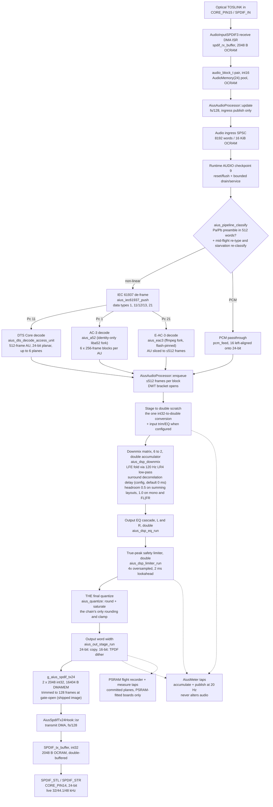

# Aius audio signal path

What the audio path of the `teensy41-optical` image is: every stage from the optical
receiver to the S/PDIF transmit register, with its implementing function, buffers and
bank, arithmetic domain and share of the per-block budget. The companion
[`firmware-io.md`](firmware-io.md) covers what I/O exists and why it cannot disturb the
audio path; that isolation argument is not restated here.

This is the record the audio-quality roadmap in
[`aius-dsp-config-api.md` §Audio-quality roadmap](../plans/aius-dsp-config-api.md#audio-quality-roadmap--accepted-2026-07-26)
attaches to: **every roadmap item updates this document in the commit that ships it.**

## How to read this

**Every claim carries a `path:line` citation, and every number says where it came
from.** Firmware paths are relative to `firmware/` unless stated. Line
numbers are correct as of this revision; the cited symbol is the durable handle. The
2026-08-04 audit re-verified the structural claims (E-AC-3 route, one-quantize chain,
LFE fold, decorrelator, gate-open trim). Bank figures and the object sizes marked
`2823549ad9bb` were re-measured at that revision (2026-11-03); per-function ITCM sizes
are from the 2026-07-29 link and have not been re-measured since.

Numbers come from one of three sources, always named:

- **Linked image**: `.pio/build/teensy41-optical/firmware.elf`. Historical tables name
  their revision; the current bank and object figures name `2823549ad9bb`, the per-function ITCM figures the 2026-07-29 link.
  `tools/memory/mem_report.py --elf` and the post-link verifiers are the authorities.
- **Device**: the DWT cycle counters published through `GET /api/meters` (build
  `f76baa87c67d`), and the loopback quality figures from `GET /api/measure` (build
  `b5f9a1351adf`, [§Measured output quality](#measured-output-quality--the-loopback-figures)).
- **Derived from source**: a struct size or period computed from cited constants, marked
  *derived*. Every unmeasured figure is listed in
  [§Figures that are not measured](#figures-that-are-not-measured).

**Bank vocabulary** matches [`firmware-io.md` §How to read this](firmware-io.md#how-to-read-this):
`FLASH` is program flash, `ITCM`/`DTCM` are the two halves of the 512 KiB FlexRAM,
`OCRAM` is RAM2 holding both `DMAMEM` statics and the `malloc`/`new` heap.

## The three things called a block

**Conflating these hid the 44.1 kHz defect for months.** The comment at `optical_main.cpp:1719` carries
the same distinction beside the code.

| Name | Size | Defined by | Rate at 48 kHz |
|---|---|---|---|
| Engine block | 128 frames | `AUDIO_BLOCK_SAMPLES`, Teensy core default, not overridden. Sizes both DMA buffers, the `audio_block_t` pool, the ingress chunk and the TX ISR's ring drain | `AiusAudioProcessor::update()` at fs/128, **375/s** (`src/optical_main.cpp:2155`), publishing 256 IEC words = 512 B each |
| Decoded block (the budget unit) | 512 frames on DTS/PCM | DTS Core AU with `npcmblocks = 16` gives 16 × 32 = 512 samples/channel (`vendor/dcadec-core/core_decoder.c:962`); PCM stages `AIUS_PIPELINE_PCM_BLOCK_FRAMES` = 512 (`lib/aius_pipeline/include/aius_pipeline.h:135`) | `enqueue()` once per four chunks, fs/512, **93.75/s**. This is what `blocks` counts and the DWT bracket measures |
| `queue_frames` (meters) | variable | `aius_spdif_tx24_level()`, TX ring occupancy at the publish instant | see [§Stages 11 and 12](#stages-11-and-12-the-transmit-ring-and-the-wire) |

The Dolby routes divide differently: an AC-3 AU emits six independent 256-frame blocks
(`AIUS_A52_BLOCK_SAMPLES`, `lib/aius_a52/include/aius_a52.h:55`); an E-AC-3 AU (1 to 6 ×
256 frames) is sliced to at most `AIUS_PIPELINE_MAX_OUTPUT_FRAMES` = 512
(`aius_pipeline.h:136`). So `blocks` counts 512-frame units on DTS/PCM and smaller units
on Dolby.

**Three IEC 61937 families are supported end to end: DTS Core burst type I, AC-3, and
E-AC-3.** `enqueue()` rejects `block->frames > AUDIO_BLOCK_SAMPLES * 4` (exactly 512)
with `AIUS_INVALID_ARG` (`src/optical_main.cpp:2338`). The parser de-frames data types 1
(AC-3), 11/12/13 (DTS Core burst types I/II/III) and 21 (E-AC-3)
(`lib/aius_iec61937/include/aius_iec61937.h:34`); the pipeline routes Pc 1 to the AC-3
decoder, 11 to dcadec and 21 to the E-AC-3 fork (`lib/aius_pipeline/src/aius_pipeline.c:55`).
A DTS type II or III burst decodes to 1,024 or 2,048 samples/channel and is refused one
stage later. The constants are coupled: changing the engine block changes the decoder
block `enqueue()` accepts.

## The chain



Dotted edges are diagnostic taps, not audio. The one output is the optical S/PDIF
transmitter on `CORE_PIN14`. **There is no analogue output on this board**; the
acceptance criterion's "analogue and digital output" describes an intent the hardware
does not carry, and the wire is the last stage the firmware owns.

## Stage inventory

| # | Stage | Implementation | Arithmetic | Buffers, bank |
|---|---|---|---|---|
| 1 | Optical receive | `AudioInputSPDIF3::isr` | int32 subframe → int16 | `spdif_rx_buffer` 2,048 B OCRAM |
| 2a | Engine ingress publish | `AiusAudioProcessor::update` | int16 → uint16 words | direct to `g_audio_ingress_words`, 16,384 B OCRAM |
| 2b | Deferred audio service | `aius_audio_service_run` | integer control | bounded AUDIO checkpoint, cold service object |
| 3 | Classify + re-type | `aius_pipeline_classify`, re-type/starve counters | integer compare | `clsbuf[512]` 1,024 B, DTCM arena |
| 4a | IEC 61937 de-frame | `aius_iec61937_push` | integer | 4,096 B payload, DTCM arena |
| 4b | Compressed decode (one resident) | `aius_dts_decode_access_unit` / `aius_a52_*` / `aius_eac3_*` | codec-native → int32, 24-bit scale | 180,224 B codec slot, DTCM arena |
| 4c | PCM passthrough | `pcm_feed` | int16 → int32, left-aligned onto 24-bit | `pcm_l`/`pcm_r` 4,096 B, DTCM arena |
| 5 | Stage to double + input trim/EQ | `stage_input` → `aius_dsp_input_run` → `run_cascade` | int32 → double, then double | arena double staging, 32,768 B DTCM carve |
| 6 | Downmix matrix + LFE fold + decorrelation | `aius_dsp_downmix` | double | `AiusLfeFold` + `AiusSurroundDelay` state in `g_dsp_runtime` |
| 7 | Output EQ | `aius_dsp_eq_run` → `run_cascade` | double | `g_eq_state` in `g_dsp_runtime`, DTCM |
| 8 | True-peak limiter | `aius_dsp_limiter_run` | double | `AiusLimiter` ≈4,200 B DTCM (*derived*) |
| 9 | Final quantize | `aius_dsp_process` tail, `aius_quantize` | double → int32, round + saturate | writes the caller's output planes |
| 10 | Output word width | `aius_out_stage_run` | int32 copy (24-bit arm) | writes the ring in place |
| 11 | Transmit ring | `aius_spdif_tx24_stage`/`_commit` | int32, no arithmetic | `g_aius_spdif_tx24` 16,404 B OCRAM |
| 12 | Transmit interrupt | `AiusSpdifTx24Hook::isr` | int32 copy | `SPDIF_tx_buffer` 2,048 B OCRAM |

`run_cascade` is the shared core of stages 5 and 7, and `biquad_step`
(`lib/aius_dsp/src/aius_dsp.c:61`) is the one biquad recurrence shared by input EQ,
output EQ and the LFE crossover, so the three cannot diverge in arithmetic order.
Stages 5 to 9 form the one-quantize chain described in
[§Fixed-point and floating-point boundaries](#fixed-point-and-floating-point-boundaries).

### Stage 1: optical receive and the IEC 60958 words

`AudioInputSPDIF3`, compiled from the snapshot at
`evidence/source-snapshots/PJRC-SPDIF-RX-SOURCE/input_spdif3.cpp`, DMAs receiver words
into `spdif_rx_buffer[AUDIO_BLOCK_SAMPLES * 4]` (2,048 B, `DMAMEM`, 32-byte aligned,
`:37`) and its ISR narrows each subframe into an `audio_block_t`:

```c
*dest_left++  = (*src++) >> 8;   /* input_spdif3.cpp:118, dest_left is int16_t * */
*dest_right++ = (*src++) >> 8;
```

**That `>> 8` into an `int16_t` is the input-side ceiling** (see
[§Open at this revision](#open-at-this-revision)). Harmless for DTS: 16-bit IEC 61937
packing puts the burst payload in the top 16 bits of the 24-bit subframe. For 24-bit
linear PCM it discards the low 8 bits before the DSP sees them.

The pool is `AudioMemory(24)`: 24 blocks of 260 B, 6,240 B in `DMAMEM`
(`src/optical_main.cpp:10951`, `cores/teensy4/AudioStream.h:110`). Two blocks are taken
and released per engine block.

### Stage 2: ingress publish and deferred AUDIO service

`AiusAudioProcessor::update()` (`src/optical_main.cpp:2155`, 280 B ITCM in the
2026-07-29 link) reserves one exact 256-word ingress slot and interleaves the two `int16`
planes directly into it: no intermediate stack array, and no classify, decode, DSP,
meter, recorder or ring production in the software audio ISR. It releases the two pool
blocks after committing the slot or recording a bounded gap. **Live input is the only
audio source** (the SD replay source was retired by
[`aius-sample-rate-following.md`](../plans/aius-sample-rate-following.md) Phase 4i).

At runtime AUDIO checkpoint 9, `aius_audio_service_run()` first applies any monotonic
reset or ingress-generation discontinuity, then drains at most 4,096 input words and
performs at most eight pipeline output steps inside the declared 8 ms allowance
(`lib/aius_audio_service/src/aius_audio_service.c:85`). Classification, decode,
`enqueue()`, DSP, meter publication, transmit commit, measurement capture and recorder
production all run in this thread-context service. The transmit DMA ISR consumes the
committed ring independently.

### Stage 3: classification

`aius_pipeline_classify` scans up to `AIUS_PIPELINE_CLASSIFY_MAX_WORDS` = 512 words (in
`clsbuf[512]`, 1,024 B) for the preamble pair `Pa` = `0xF872`, `Pb` = `0x4E1F` in either
wire byte order (`lib/aius_pipeline/include/aius_pipeline.h:102`, `src/aius_pipeline.c:242`).

| Outcome | Classification |
|---|---|
| Preamble within the window | non-linear, `AIUS_PIPELINE_DTS` (names the whole IEC 61937 class) |
| 512 words, no preamble | linear PCM |
| Fewer than 512 words, none yet | `AIUS_PIPELINE_UNKNOWN` |

**Classification self-heals both ways.**

- **PCM to non-linear**: two same-form preamble pairs with plausible burst spacing
  (`AIUS_PIPELINE_RETYPE_MIN/MAX_SPACING_WORDS`, 512 to 8,192, `aius_pipeline.h:120`)
  re-type the stream; staged pass-through frames are dropped at that instant so raw
  burst words never reach the wire.
- **Non-linear to re-classify**: 16,384 words consumed with no parser burst outcome
  (`AIUS_PIPELINE_DTS_STARVE_WORDS`, `:132`) re-classifies the next words.
- PCM emission is withheld for the first `AIUS_PIPELINE_PCM_CONFIRM_WORDS` = 8,192 words
  while the re-type detector runs (`:191`).

Both transitions are counted as `retype_count` / `reclassify_count` on `GET /api/status`,
whose `state` renders the classification: 2 unlocked or unclassified, 3 PCM, 4
non-linear.

### Stage 4a: IEC 61937 de-framing

`aius_iec61937_push` unwraps one burst per call into the fixed
`AIUS_IEC61937_MAX_PAYLOAD` = 4,096 B payload buffer, normalised to canonical big-endian
regardless of wire byte order (`lib/aius_iec61937/include/aius_iec61937.h:44`). Byte
order is auto-detected per burst from `Pa`; payload packing is create-time configuration
and the optical image selects `AIUS_IEC61937_PACK_16` (`src/optical_main.cpp:2843`).

A per-burst fault (error flag, invalid length, over-long length code) is non-fatal: the
burst is skipped, the stream re-locks and the status is recorded
(`aius_pipeline.h:105`). Nothing stalls on a corrupt burst.

### Stage 4b: compressed decode, DTS Core, AC-3, E-AC-3

**One decoder is resident at a time**, created lazily from the codec sub-arena on a
family's first completed burst and swapped on a family change
(`lib/aius_pipeline/src/aius_pipeline.c:55`, `:76`):

| Family | Implementation | Behaviour |
|---|---|---|
| DTS Core (Pc 11/12/13) | `aius_dts_decode_access_unit` (`lib/aius_dts/src/aius_dts.c:53`), vendored dcadec with `DCADEC_FLAG_CORE_ONLY \| DCADEC_FLAG_CORE_BIT_EXACT` | Decoder-owned planar PCM: `block->frames = core->npcmsamples`, `block->sample_rate_hz = core->output_rate`, planes in `AIUS_CH_*` order packed to `channels`. Wider than 5.1 refused with `AIUS_UNSUPPORTED` |
| AC-3 (Pc 1) | `aius_a52_*` (`lib/aius_a52/include/aius_a52.h:21`), identity-only liba52 fork | One call arms an AU; six next-calls emit its 256-frame blocks, stamped with the accepted AU rate |
| E-AC-3 (Pc 21, `-DAIUS_PIPELINE_EAC3=1`) | `aius_eac3_*` (`lib/aius_eac3/include/aius_eac3.h:20`), vendored ffmpeg-eac3 fork, text and rodata flash-pinned by `link/aius_teensy41.ld` | AU decodes to 1 to 6 × 256 frames; output sliced to ≤ 512 (`PENDING_EAC3_OUTPUT`, `aius_pipeline.c:49`) |

**All three emit 24-bit range sign-extended into `int32`** (`AIUS_PCM_SAMPLE_BITS`,
`lib/aius_codec_api/include/aius_codec.h`), the unit of every later magnitude, threshold
and meter value.

**The decoder's memory lives in the DTCM arena.** `AiusAudioProcessor::g_arena_memory`
is **218,688 B** (ELF-measured at aius `2823549ad9bb`; composed of instance bound 5,632 +
32,768 B DSP staging carve + `AIUS_PIPELINE_CODEC_SLOT_BYTES` = 180,224 + 64 slack,
`src/optical_main.cpp:2227`, array at `:2247`),
about two thirds of DTCM; `begin_pipeline()` creates the pipeline through
`aius_pipeline_create_arena`.

| Decoder | Arena high-water |
|---|---|
| E-AC-3 | 179,232 B (sizes the slot, rounded up to 4 KiB) |
| DTS 5.1 core | 62,560 B |
| AC-3 | 27,024 B |

(`lib/aius_pipeline/include/aius_pipeline.h:138` to `:158`.) The slot growth was funded
inside DTCM by pinning the fork's text and cold rodata to flash (−99,328 B of DTCM
`.data`), with a link-time `ASSERT` flooring the stack/locals zone at 24,352 B
(`link/aius_teensy41.ld:286`); [`aius-eac3-support.md`](../plans/aius-eac3-support.md)
phase 4 carries the arithmetic and why growing or relocating the arena is not free.
Arena allocation depends on the `--wrap` link-time shim
(`lib/aius_dts/src/aius_alloc_shim.c`), live for `[env:teensy41-optical]`
(`platformio.ini:104`). Before 2026-07-28 the wrap set was `build_unflags`'d and
decoders allocated from the OCRAM heap, so any measurement predating that date rests on
the older state. No heap is used on the process path, and that held throughout.

### Stage 4c — PCM passthrough

`pcm_feed` treats the words as interleaved L,R and left-aligns each onto the
`AiusPcmBlock` sample scale:

```c
const int32_t wire = (int32_t)(int16_t)word;              /* sign-extend 16 -> 32 */
return (int32_t)((uint32_t)wire << PCM_WIRE_SHIFT);       /* left-align onto 24 bits */
```

The shift goes through `uint32_t` because left-shifting a negative `int` is undefined
(C17 6.5.7p4) and the host suites build with UBSan; the two's-complement result is
identical.

Blocks are emitted at `AIUS_PIPELINE_PCM_BLOCK_FRAMES` = 512 frames. Their sample rate
defaults to 48,000 Hz, then follows the tracker-accepted 32, 44.1 or 48 kHz carrier
through `aius_pipeline_set_pcm_sample_rate()`; the value survives pipeline resets, so a
carrier-loss reset keeps the last accepted rate.

**Both branches enter the DSP at the same full scale, enforced at the contract.**
`aius_codec.h` §SAMPLE SCALE declares `AIUS_PCM_SAMPLE_BITS` = 24 plus `_MAX`/`_MIN`;
`aius_dsp.h` derives `AIUS_DSP_SAMPLE_MAX`/`_MIN` from it, and `aius_dsp.c` and
`aius_pipeline.c` bind to it with `_Static_assert`. Without a declared scale each
producer picks its own: PCM once entered at 16-bit magnitude against DTS's 24-bit, a
48.16 dB step, and a shift at one call site would leave the next producer free to repeat
it. `test/pipeline/test_pipeline.c`'s `pcm-scale` check is written purely in contract
terms (a full-scale wire word must reach full scale, no mention of 16 bits, a shift
count or the producer's expression); reverting the fix fails it at −48.16 dB, while the
older check that mirrors `pcm_feed`'s own expression stays green.

**A PCM-only regression moves no committed golden.** The `dsp-vectors` suite decodes DTS
vectors only (`firmware/scripts/test.sh:632`, goldens in `tools/dts_vectors/golden`), so
the PCM scale defect left them byte-unchanged and the only test that moved was
the pass-through's own, which had asserted the block against a copy of the producer's
expression. A defect that changes real behaviour while touching no golden is a sign the
corpus does not cover that branch, not that the change was small.

### Stage 5: staging to double, input trim and EQ

`stage_input` (`lib/aius_dsp/src/aius_dsp.c:631`) is **the one int32 → double boundary
of the chain**: every present plane is convert-copied into the double scratch
unconditionally (staging *is* the conversion). `aius_dsp_input_run` (`:599`) then
applies the channel's linear trim and EQ cascade in double with **no quantize**: the
trim is folded into the biquad input as `run_cascade`'s `pregain`.

The scratch is the arena's 32,768 B DSP staging carve (six 512-frame double input planes
plus the stereo work pair), carved from `g_arena_memory` in `begin_pipeline()`
(`src/optical_main.cpp:2714`, `DSP_CARVE_BYTES` at `:2226`). Coefficients and state live
in `AiusDspRuntimeConfig` (`lib/aius_dsp_runtime_config/include/aius_dsp_runtime_config.h`).

**With the shipped default the trim/EQ pass is skipped.** `config/optical_dsp.json` sets
`features.input_eq: true` with every channel at `gain_db: 0` and `eq: []`.
`aius_dsp_runtime_config_apply` (`lib/aius_dsp_runtime_config/src/aius_dsp_runtime_config.c:116`)
binds `dsp.input` only if some channel would change a sample; unity gain with no
sections is an identity, so `stage_input` only convert-copies. Unity is tested exactly
because `aius_db_to_linear(0.0)` is `pow(10, 0) == 1.0`. A present-but-*bypassed* EQ
section is deliberately not an identity: `eq_sections` counts what the cascade walks.

### Stage 6: the downmix matrix, LFE fold-in and surround decorrelation

`aius_dsp_downmix` (`lib/aius_dsp/src/aius_dsp.c:307`; 1,254 B ITCM in the pre-change
link, the largest DSP function) is mask-driven: routing follows `in->channel_mask`, so
mono, stereo, 3.0, 4.0, 5.0 and 5.1 need no layout flag. The headroom pad is resolved
once per block from the mask by `resolve_headroom` (`:295`). Double in, double out;
nothing rounds or clamps. Two sub-stages live inside the accumulation:

- **LFE fold-in (audio-quality item 2, landed 2026-07-26, `72bb041a5`).** The LFE plane is low-passed by a 4th-order
  Linkwitz-Riley crossover (two cascaded Butterworth biquads via `biquad_step`) at the
  configured corner (shipped 120 Hz), scaled by `lfe` (shipped −10 dB) and summed into
  L and R (`lfe_fold_sample`, `aius_dsp.c:127`; rationale at
  `lib/aius_dsp/include/aius_dsp.h:190`). One term in the same accumulator: no
  requantisation, no latency. Misconfiguration fails *closed*: a missing state pointer
  skips the LFE (BS.775's own default); an unfiltered fold is unreachable by omission
  (`aius_dsp.h:384`).
- **Surround decorrelation delay (audio-quality item 4).** SL and SR are delayed
  symmetrically by `surround_delay_ms` before their fold gain (`surround_delay_step`,
  `aius_dsp.c:210`), bounded at 12 ms / 576 samples per side
  (`AIUS_DSP_SURROUND_DELAY_MAX_MS`, `aius_dsp.h:271`). The ring is float deliberately:
  24-bit-origin content fits a float mantissa, error floor ≈ −150 dBFS, far beneath
  the fold gain. **Shipped `surround_delay_ms: 0`** (`config/optical_dsp.json:29`) is
  the pre-feature path bit for bit; the ring is never touched. Misconfiguration fails
  *open*: a null ring folds the surrounds undelayed (`aius_dsp.h:421`). Landed and verified
  sample-exact on hardware 2026-08-04 (`fd65a5303`, `5efdce47d`).

Routing rules: [§Channel layout and downmix rules](#channel-layout-and-downmix-rules).

### Stage 7: output EQ

`aius_dsp_eq_run` runs `run_cascade` over L then R with channel-major state (all L
section states, then all R, `src/aius_dsp.c:572`), in double, no per-stage quantize.
Sections are Direct Form I biquads, `a0` normalised to 1, RBJ audio-EQ-cookbook
coefficients. State lives in `AiusDspRuntimeConfig.output_eq_state`, carried across
blocks so boundaries are seamless.

**The shipped default runs no output EQ.** `output_eq` is empty in
`config/optical_dsp.json`, so `eq_sections` is 0 and `aius_dsp_process` skips the stage
(`src/aius_dsp.c:1388`). RBJ biquads are minimum-phase, so group delay varies with
frequency; a linear-phase FIR is deliberately unscheduled in
[`aius-dsp-config-api.md` §Noted for later](../plans/aius-dsp-config-api.md#noted-for-later-deliberately-not-scheduled).

### Stage 8: the true-peak safety limiter

`aius_dsp_limiter_run` (`lib/aius_dsp/src/aius_dsp.c:796`; 764 B ITCM as `.part.0` in
the pre-change link, plus `truepeak_push` 156 B) is the last processing stage before the
final quantize, double in and out. Shipped defaults (`config/optical_dsp.json`, pinned
in `lib/aius_dsp/include/aius_dsp.h`):

| Parameter | Default |
|---|---|
| enabled | yes |
| threshold | −1.0 dBFS |
| attack | 0.5 ms |
| release | 100 ms |
| lookahead | 2.0 ms |

**True-peak per ITU-R BS.1770-4 Annex 2.** The detector 4×-oversamples with the
standard's 4-phase, 12-tap polyphase FIR. Every coefficient is an exact multiple of
2⁻¹⁴, spelled as its integer numerator over 16384, so the table is bit-identical on host
and target (`aius_dsp.c:422`). The 384 B table lands in DTCM `.data` (measured), because
Teensy copies `.rodata` to fast RAM at boot.

Two conservative deviations, recorded at `aius_dsp.h:283`:

- **The standard's 12.04 dB pre-attenuation is omitted.** It guards fixed-point overflow
  inside the filter; this one is double.
- **The reported peak is `max(|x[n]|, |interpolated|)`**; why is in
  [§Decisions recorded](#decisions-recorded-with-their-alternatives).

**Cost is bounded rigorously.** 4 phases × 12 taps is 48 MACs per sample per channel.
The largest phase has an ℓ1 norm of exactly 33142/16384, so a 12-sample window where
every `|x| <= threshold / (33142/16384)` provably cannot interpolate above threshold.
Below that gate the FIR is skipped with no chance of missing an over; above it, it runs
for the whole window the loud sample participates in (`aius_dsp.c:532`, `:569`). Quiet
material pays **one compare per sample**; only material within about 6.1 dB of threshold
pays the full 48 taps. The `dsp` suite checks the constant against the table, because
the gate's soundness depends on it (`aius_dsp.h:341`).

**The FIR history is primed, not zeroed.** A zeroed history makes the first sample a
step from silence, with a genuine inter-sample overshoot of about +0.6 dB; since limiter
state is zeroed on every config apply (`aius_dsp_runtime_config.c:48`), that would put a
~0.6 dB gain dip, decaying over a release constant, into the audio on every control
change. The detector contributes only `|x[n]|` until the 12-sample window has filled
since reset: 229 µs at 48 kHz (`aius_dsp.h:305`).

**Lookahead leads the reduction.** The peak follower reads the incoming sample while gain
applies to the *delayed* sample, so `lookahead_ms` is exactly the lead
(`aius_dsp.c:602`). 2.0 ms against a 0.5 ms attack is four attack time constants: gain is
within e⁻⁴ = 1.8 % of target when its sample is emitted. The residual is a bounded
overshoot: a peak 3 dB over threshold emerges about 0.065 dB over it, near −0.93 dBFS,
and the final quantize's saturation is the last-ditch clamp.

Buffers: `AiusLimiter` ≈ **4,200 B in DTCM** (*derived*: config 40 B, `buf_l`/`buf_r`
240 doubles each at 3,840 B (double since the one-quantize chain,
`aius_dsp.h:887`), `tp_l`/`tp_r` 16 doubles each at 256 B, scalars). Lookahead lines are
fixed at `AIUS_DSP_LIMITER_MAX_LOOKAHEAD` = 240 samples (5 ms at 48 kHz), so the process
path never allocates (`aius_dsp.h:281`). The configured unit is milliseconds and the
sample count is derived from the `fs` passed in. The interpolation history is
**persistent state, not stack**: the detector needs only the maximum, so no oversampled
buffer exists and the stack frame stays flat inside the bounded AUDIO checkpoint
(`aius_dsp.h:396`).

**Latency added: 2 ms, 96 samples at 48 kHz** (*derived*). Output frame count equals
input; the last `delay` samples stay in the ring as bounded latency.

### Stage 9: the final quantize

The tail of `aius_dsp_process` (`lib/aius_dsp/src/aius_dsp.c:1401`) is **the chain's
only rounding and only clamp**: one `aius_quantize` per output sample (round to nearest,
ties away from zero, then saturate, `:76`), converting double work planes into the
caller's 24-bit `int32` output planes. An input-EQ boost that overshoots full scale
upstream is absorbed by the downmix headroom pad instead of clipping at a cascade
boundary.

### Stage 10: the output word width

`aius_out_stage_run` (`lib/aius_dsp/src/aius_dsp.c:1059`; 192 B ITCM) is the one
boundary that cares about the transmit word, and is deliberately outside
`aius_dsp_process`: the 24-bit block is the DSP output, and word width belongs to the
consuming engine (`aius_dsp.h:45`).

- **`AIUS_DSP_OUT_WIDTH_24`, shipped.** A plain copy: no dither, rounding or saturation,
  since the final quantize already put it in range. The width test is hoisted, so one
  branch per call then a straight copy.
- **`AIUS_DSP_OUT_WIDTH_16`, a real selection.** `aius_out16_sample()` per sample (TPDF
  dither, round to nearest ties away from zero, saturate), scaled back by
  `AIUS_DSP_OUT16_LSB` = 256. That multiply is bit-for-bit the `<< 8` of the retained
  snapshot's ISR (`evidence/source-snapshots/PJRC-SPDIF-TX-SOURCE/output_spdif3.cpp:130`),
  so this arm reproduces the pre-24-bit wire words exactly.

The selection is the `constexpr` `AiusAudioProcessor::OUTPUT_WIDTH_BITS`
(`src/optical_main.cpp:2245`; why not config: [§Decisions recorded](#decisions-recorded-with-their-alternatives)).
`aius_out_stage_run` is not inlined across translation units, so the 16-bit arm and
`aius_out16_sample` (188 B ITCM, measured) are **linked but never executed**.

**Dither is deterministic and bypassed**; it belongs to the 16-bit selection only
(`aius_dsp.h:482`):

- TPDF spanning ±1 LSB of the 16-bit target, the difference of two independent uniform
  draws: decorrelates error from signal and makes error power signal-independent (no
  noise modulation).
- Generator xoshiro128++ 1.0: integer only, bit-identical on x86-64 and Cortex-M7 with
  no FPU, libc, locale or rounding mode involved; period 2¹²⁸−1 (2.2 × 10²⁶ years at
  48 kHz), so nothing repeats tonally.
- Both draws come from the high and low halves of one 32-bit output, a bijection onto the
  2³² square, so the pair is exactly as uniform as the word.
- L and R are independent streams seeded from eight consecutive SplitMix32 outputs;
  correlated dither would image as phantom-centre hiss.
- Seeded **once** in `begin_pipeline()`, deliberately not in `apply_config()`
  (`src/optical_main.cpp:2718`), so output depends on sample index, not config history.

### Stages 11 and 12: the transmit ring and the wire

`g_aius_spdif_tx24` is an `AiusSpdifTx24Ring`: 2 × 2,048 `int32` planes plus five
32-bit words (`written`, `consumed`, `underruns`, `fills`, `gate_open`), **16,404 B in
`DMAMEM`** (16,396 B in the 2026-07-29 ELF; defined at
`lib/aius_audio/src/aius_spdif_sources.cpp:62`). `enqueue()` stages into it with at most
one wrap and publishes the block with a single `aius_spdif_tx24_commit()`
(`src/optical_main.cpp:2569` to `:2600`). `AiusSpdifTx24Hook::isr` (496 B ITCM, `2823549ad9bb`; 228 B at 2026-07-29,
`aius_spdif_sources.cpp:255`) drains 128 frames per interrupt into the half of
`SPDIF_tx_buffer` the DMA is not reading, flushes that half once, then pends the graph
if it holds `update_responsibility`.

**Every closed→open TX-gate edge sets the ring to `AIUS_TX_GATE_OPEN_TARGET_FRAMES`**,
padding with silence or trimming as the level demands, plus the pending DMA half when a
period boundary is pending, in one masked `set_level` (`tx_gate_execute_open()`,
`src/optical_main.cpp:3058`, target applied `:3070`); trimmed frames were dark by
construction, padded ones count in `gate_open_padded_frames` and
`gate_open_pending_padded_frames`, trimmed ones in `gate_open_trimmed_frames`. Code default 256
(`:1769`); **the shipped image pins 128** (`-DAIUS_TX_GATE_OPEN_TARGET_FRAMES=128`,
`platformio.ini:325`). Steady occupancy then re-forms through each session's own refill
equilibrium. The measured effect is tail elimination (the 128 to 1,792-frame per-session
ring lottery is impossible by construction), not a large mean shift: the mean moved ~15
frames when the target halved. Trim events and trimmed frames are served on the clock
document; detail in
[`aius-e2e-latency.md` §Phase 3](../plans/aius-e2e-latency.md#phase-3-tx-ring-gate-open-normalization-and-dhcp-schedule-visibility).

Buffer sizes, placement, cache maintenance, priority inversion and the underrun counter
are in [`firmware-io.md` §S/PDIF output](firmware-io.md#spdif-output--the-transmit-half-of-the-hot-path).
The ring's two signal-path decisions are in
[§Decisions recorded](#decisions-recorded-with-their-alternatives).

### The meter taps: deliberately not stages

Metering is caller-driven and **not** a field of `AiusDspConfig`
(`lib/aius_dsp/include/aius_dsp.h:767`): the caller taps around `aius_dsp_process`, so
meter code is not linked into the hot function until the adapter wires it. Audio is
bit-identical with or without a meter.

`enqueue()` accumulates input and output peak/RMS after a successful process, so one
window covers the same blocks on both sides (`src/optical_main.cpp:2432`), and publishes a
coherent snapshot behind a seqlock once per meter window =
`rate / AIUS_METER_PUBLISH_HZ` (2,400 frames at 20 Hz).

- **ITCM cost** (pre-cutover): `aius_meter_accumulate_input` 168 B,
  `accumulate_output` 212 B, `decimate` 254 B, `publish` 344 B, `set_telemetry` 18 B,
  `set_limiter_gr` 8 B. `g_meter` is 9,584 B OCRAM at `2823549ad9bb` (unchanged since the 2026-07-29 link), its snapshot
  including the 1,024-sample analysis window.
- **Gain reduction is sampled once per window**, not per block, because it takes a
  `log10` (`:961`); the value is the *instantaneous* reduction at publish, not the
  window peak.
- **`estimated_latency_us` costs no division**: microseconds per frame is resolved to
  Q16.16 by `apply_config()`, so the field is one 32×32 multiply and a shift (`:968`).

## Measured output quality — the loopback figures

**The instrument** (audio-quality item 3; design:
[`aius-dsp-config-api.md` §Item 3 design](../plans/aius-dsp-config-api.md#item-3-design--the-measurement-loopback-software-tap-first))
is a software tap in `enqueue()` after the tx24 commit. At 24-bit width the committed
words are the wire's, so the capture spans stimulus input through the whole DSP chain to
the transmit register, on one sample grid with the stimulus (immune to physical clock
error by construction; the clock/content *ratio* surface needs a physical loop, see
[§Open](#open-at-this-revision)). Analysis (`lib/aius_dsp/include/aius_measure.h`,
served by `GET /api/measure`): IEEE 1057 3-parameter sine fit at the declared f0 (THD+N;
SNR also excludes harmonics 2 to 10) plus Hann-windowed Goertzel (harmonics, FR probes)
over the last 8,192 frames of a 16,384-frame capture.

**Conditions:** 2026-07-27, build `b5f9a1351adf`, boot generation 250 to 252, loop-coherent
16-bit PCM stimulus corpus (`tools/measure_vectors/`), shipped SD config (headroom 0.5,
limiter on at −1 dBFS, bypass EQ) except where stated. A 16-bit vector bottoms THD+N/SNR
near its own quantization floor, so a figure at the floor reads "at least this good".

**Levels are pre-change.** Every vector is stereo FL|FR pass-through, which no longer
takes the headroom pad ([§Channel layout and downmix rules](#channel-layout-and-downmix-rules)),
so the fundamentals read 6.02 dB below what the same run reads today, and `pcm440_full`
no longer needs raised headroom to reach the limiter. Distortion, noise and flatness are
level-relative and stand.

| Vector, channel | Fundamental | THD+N | SNR | THD (2nd to 10th) | Stimulus floor at this level |
|---|---|---|---|---|---|
| `pcm440_m6`, L | −12.04 dBFS @ 440 Hz | **−91.7 dB** | 91.8 dB | −107.9 dBc | ≈ −92.1 dB |
| `pcm440_m6`, R | −12.04 dBFS @ 440 Hz | **−91.7 dB** | 91.8 dB | −107.9 dBc | ≈ −92.1 dB |
| `pcm440_660_split`, L | −12.04 dBFS @ 440 Hz | −91.7 dB | 91.8 dB | −108.0 dBc | ≈ −92.1 dB |
| `pcm440_660_split`, R | −18.06 dBFS @ 660 Hz | −86.0 dB | 86.1 dB | −103.8 dBc | ≈ −86.1 dB |
| `pcm440_full` + headroom 1.0, L/R | −1.01 dBFS @ 440 Hz (limited) | −95.6 dB | 95.7 dB | −109.2 dBc | ≈ −98.1 dB |
| `pcm_fr_multitone`, 40 Hz to 16 kHz | seven probes, both channels | n/a | n/a | n/a | n/a |

What they show:

- **Transparent to the stimulus floor.** THD+N within 0.4 dB of the 16-bit stimulus floor
  at every level (−91.7 vs ≈ −92.1 at −6 dBFS stimulus; −86.0 vs ≈ −86.1 at −12 dBFS).
  The chain's own floor is below 16-bit resolution and stays host-proven
  ([§Figures that are not measured](#figures-that-are-not-measured)).
- **Levels are arithmetic-exact.** Every fundamental read stimulus level minus the then
  6.02 dB pad to the hundredth of a dB, and L/R on identical stimulus agree to the last
  printed digit (bit-identical DSP). The exactness is the durable claim; the 6.02 dB term
  is not.
- **Frequency response flat to 0.01 dB, 40 Hz to 16 kHz** (all seven multitone probes at
  −24.08 dBFS, both channels, bypass EQ).
- **Limiter steady-state gain reduction is distortion-free at this floor**: with headroom
  1.0 it held the full-scale tone at −1.01 dBFS (threshold plus the e⁻⁴ residual,
  [stage 8](#stage-8-the-true-peak-safety-limiter)) at THD+N −95.6 dB. A *transient*
  limiter-distortion figure needs a modulated hot vector; deliberately not scheduled.
- **Arm-time latches work live**: the first run retired `failed (generation)` because
  arming preceded the board's first audio block, whose block-boundary config apply bumped
  the generation, the splice the latch exists to refuse.
- **The tap's cost is invisible in the block-to-block spread** (meters on, 10 s windows):
  `dsp_cycles_max` 322,215 unarmed vs 309,236 armed back-to-back (delta −13.0 k against a
  ±30 k gate); `dsp_cycles_last` p50 280,696 vs 280,657. That p50 is the first measured
  per-block DSP cost with audio flowing: ≈ 281 k cycles ≈ 4.4 % of the block budget, PCM
  passthrough path, replay looping (replay since retired), zero overruns over a
  20,492-block session.

## Channel layout and downmix rules

**This is the authoritative statement; nothing else in this document restates it.**

Channel order is `AIUS_CH_*` bit order: FL, FR, FC, LFE, SL, SR
(`lib/aius_codec_api/include/aius_codec.h:38`), planes tightly packed to `channels` in
that order as the decoder emits them. The same ordinal indexes the input stage's
per-channel config and the meter's per-input arrays.

The matrix, per ITU-R BS.775 / ATSC A/52 "Lo/Ro" (`lib/aius_dsp/include/aius_dsp.h:107`):

```text
L' = pad * (FL + center*FC + surround*delay(SL) + lfe*LR4(LFE))
R' = pad * (FR + center*FC + surround*delay(SR) + lfe*LR4(LFE))

LR4  = 4th-order Linkwitz-Riley low-pass at lfe_crossover_hz (identity when lfe = 0)
delay = surround_delay_ms pre-fold delay (identity at the shipped 0 ms)
pad  = headroom  when the layout SUMS  (channels > 1 and any of FC, LFE, SL, SR)
pad  = 1.0       otherwise             (mono, and stereo FL|FR)
```

| Coefficient | Shipped value | Source |
|---|---|---|
| `center` | 0.70710678118654752440 (1/√2, −3.01 dB) | `aius_dsp.h:111`, `optical_dsp.json:22` |
| `surround` | 0.70710678118654752440 (1/√2, −3.01 dB) | `aius_dsp.h:111`, `optical_dsp.json:23` |
| `lfe` | 0.316228 (−10 dB), folded in through the LR4 low-pass | `aius_dsp.h:186`, `optical_dsp.json:24` |
| `lfe_crossover_hz` | 120 (LR4 corner; config-bounded to [20, 500]) | `aius_dsp.h:242`, `optical_dsp.json:25` |
| `headroom` | 0.5 (−6.02 dB) **on summing layouts only**; 1.0 elsewhere | `aius_dsp.h:354`, `optical_dsp.json:26` |
| `clipfree` | false | `optical_dsp.json:27` |
| `layout_aware` | true (absent in a PUT body also reads true) | `optical_dsp.json:28`, `aius_dsp_config.h:60` |
| `surround_delay_ms` | 0 (decorrelation off, the bit-exact pre-feature fold) | `optical_dsp.json:29`, `aius_dsp_config.h:68` |

- **1/√2 on centre and surround is the standard default**: mixing FC and each surround
  down 3 dB preserves acoustic power when the summed sources are uncorrelated.
- **Coefficients are symmetric by design.** `center` is the shared FC-to-L/R coefficient,
  `surround` the shared SL-to-L / SR-to-R one. Independent SL/SR gains are excluded
  because they would shift image balance rather than control blend.
- **LFE at −10 dB through a 120 Hz LR4 is the shipped fold-in** (audio-quality item 2,
  landed 2026-07-26, `72bb041a5`). BS.775 and A/52 exclude
  LFE from the default stereo downmix, which on two speakers discards the bottom octave
  of film content. The fold ships at `AIUS_DSP_LFE_GAIN_MINUS10DB`, 20 dB below BS.775's
  +10 dB reference (the standard small-stereo compromise), band-limited because the DTS
  core does not band-limit its LFE plane (`aius_dsp.h:117` to `:255` has the level and
  filter-shape rationale). `lfe = 0.0` is the exact negative control. This is LFE bass
  management only; there is no main-channel crossover.
- **Narrower inputs need no mode flag.** Mono copies the lone plane to both channels at
  unity and takes no pad, whichever mask bit it carries; stereo FL|FR is an exact unity
  passthrough with no pad; absent channels contribute nothing.
- **The headroom pad applies only to layouts that sum**, resolved per block from the
  input mask alone (`resolve_headroom`). FC and the LFE fold land on both outputs and
  SL/SR on one each, so a layout carrying any of them can overshoot; mono and FL|FR route
  1:1, and ≤ full scale through a unity route stays ≤ full scale, so the pad there bought
  nothing and cost 6.02 dB. The mask is the only input (not plane pointers, not gains),
  so an LFE plane at `lfe_gain_linear = 0` still pads and stays bit-for-bit the same
  block without it. `matrix.layout_aware` (default on, absent reads on) turns the rule
  off and restores the uniform pad on every layout, mono included.
- **Headroom 0.5 is an evidenced product decision for the summing case**
  ([§Decisions recorded](#decisions-recorded-with-their-alternatives)). Re-measured after
  the LFE fold-in: 0.5 still clears the corpus, the binding vector
  (`surround51_impulse`) at −0.790 dBFS, 0.79 dB spare (`aius_dsp.h:317` to `:338`).
  `aius_downmix_clipfree_headroom()` returns the theoretical
  `1/(1 + center + surround + |lfe|)`, at the shipped fold 1/2.730335 = 0.366
  (−8.72 dB; 0.414214 / −7.66 dB without the fold), selectable via `clipfree`, at which
  point a caller may reasonably turn the limiter off. Neither applies to a pass-through
  layout.

The two sensible configurations are **(modest headroom + limiter on)** and **(clip-free
headroom + limiter off)**. The shipped one is the first.

## Fixed-point and floating-point boundaries

**The chain enters as 24-bit signed integer, travels the DSP as IEEE-754 double, and is
quantized exactly once at the end.** The one integer sample unit is the decoders' 24-bit
range, `AIUS_DSP_SAMPLE_MAX` = 2²³−1 and `AIUS_DSP_SAMPLE_MIN` = −2²³, derived from
`AIUS_PCM_SAMPLE_BITS` (`lib/aius_dsp/include/aius_dsp.h:104`); every magnitude,
threshold, peak and RMS in the DSP and `GET /api/meters` uses it. dBFS =
`20*log10(v / AIUS_DSP_SAMPLE_MAX)`.

| Boundary | Direction | Function | Note |
|---|---|---|---|
| Receiver → engine | int32 subframe → int16 | `input_spdif3.cpp:118` | `>> 8`, truncating; the input ceiling |
| Engine → pipeline | int16 → uint16 words | `AiusAudioProcessor::update` | reinterpret, no arithmetic |
| DTS decode → DSP | dcadec fixed point → int32 | `aius_dts.c` | 24-bit range, sign-extended |
| AC-3 decode → DSP | liba52 float → int32 | `aius_a52.c` | same 24-bit scale |
| E-AC-3 decode → DSP | fork float → int32 | `aius_eac3.c` | same 24-bit scale |
| PCM → DSP | int16 → int32 | `pcm_wire_to_sample` | sign-extend then left-align onto `AIUS_PCM_SAMPLE_BITS` |
| Staging | int32 → double | `stage_input`, `aius_dsp.c:631` | the one widening conversion |
| Input stage, downmix, EQ, limiter | double → double | `aius_dsp.c` | **no rounding, no clamping** |
| Final quantize | double → int32 | `aius_dsp.c:1401` | the chain's only rounding and clamp |
| Output stage, 24-bit | int32 → int32 | `aius_dsp.c:1059` | **no conversion at all** |
| Output stage, 16-bit | int32 → double → int32 | `aius_dsp.c:1013` | dither, round, saturate, × 256 |
| Ring → wire | int32 → int32 | `aius_spdif_tx24.h` | copy into `SPDIF_STL`/`STR` |

**One quantize (`aius_dsp.h:34` §ONE QUANTIZE, fixed 2026-07-28 as the inter-stage
clipping defect).** No stage between the staging conversion and the final quantize rounds
or clamps, so the limiter sees true unclipped peaks and the 24-bit wire ceiling exists
only at stage 9. Per-stage rounding (≈ −140 dBFS per step) was inaudible; the defect was
per-stage *saturation*: downmix and EQ clamped upstream of the limiter, which could then
never see the over it exists to catch.

**Double over fixed point, deliberately.** A biquad's feedback path is precision
sensitive, double keeps design headroom trivial, and every 24-bit sample is represented
exactly (`aius_dsp.h:47`). The Cortex-M7 has a hardware double FPU, so there is no
emulation cost.

**The one quantizer rule is `aius_quantize`: round to nearest, ties away from zero, then
saturate** (`lib/aius_dsp/src/aius_dsp.c:76`). `aius_out16_sample` uses the identical
rule, so the two quantizers cannot disagree at a boundary (`:1013`).

### `-ffp-contract=off` is load-bearing, not cosmetic

**The DSP's contract is bit-identical host and target output, and this flag is what makes
it true on the target.** GCC defaults to `-ffp-contract=fast` under `-std=gnu++17`;
without the flag, `aius_dsp.c.o` contained **25 `vfma.f64` instructions** (in
`truepeak_push`, `run_cascade`, `aius_dsp_downmix`, `aius_dsp_limiter_run`) where the
host emitted separate `vmul` and `vadd`. A fused multiply-add **rounds once where the host
rounds twice**, so downmix and EQ diverged, with the 48-tap true-peak FIR the largest
source. The flag is pinned in `[common] build_flags` with a do-not-remove note
(`platformio.ini:77`), matching `scripts/test.sh` for the `dsp` and `dsp-vectors` suites;
it makes every `dsp` golden vector a statement about this image, not only the host.

One contraction is benign by construction: the `vfma` in `aius_out16_sample` multiplies an
exact integer by a power of two, so fused and unfused agree bit-for-bit.

## The clock

**Boot is exactly 48 kHz; live output follows 32, 44.1 or 48 kHz input, including its
oscillator error.** `AUDIO_SAMPLE_RATE_EXACT=48000.0f` still supplies the bootstrap clock
and the generated config default; the `static_assert` keeps those two roles coherent and
no longer defines the live rate.

At checkpoint 7 the tracker reads the receiver's `SPDIF_SRFM` measurement in millihertz,
accepts one of the three nominal rates after eight consistent locked samples, and asks
the pure planner for PLL4 integer/fractional fields, root dividers, TX divider and IEC
channel status.

| Change | Action |
|---|---|
| Whole-rate or structural | close the pad, apply the complete plan with a 1,000 µs lock deadline |
| Same-structure correction | queue only `CCM_ANALOG_PLL_AUDIO_NUM` for the next TX boundary; carrier and ring stay continuous, IEC validity untouched: stays valid (`lib/aius_audio/src/aius_spdif_sources.cpp:176` writes the numerator and nothing else) |

Two writers feed the trim: CENTRE, from the carrier measurement, and FILL, a PI loop on
the transmit-ring fill statistic holding the ring at its gate-open occupancy
([`aius-sample-rate-following.md`](../plans/aius-sample-rate-following.md) Phase 4).
`clock.fill_trims` counts FILL writes, `clock.centre_writes` CENTRE writes. There is no
resampler and no intermediate requantisation (`lib/aius_clock/src/aius_clock.c`,
`lib/aius_audio/src/aius_audio_clock.cpp`).

**Runtime replans leave `CCM_CCGR5_SPDIF` enabled.** That gate stops the live receiver
DMA as well as the transmitter; it is safe in `config_spdif3()` before RX starts, but
gating it after boot caused persistent missing-live gaps and transmit starvation. The
closed physical pad and invalid IEC status are the runtime quiescence boundary while PLL4
and the TX root move.

The receiver is the clock master (`clock.master` reads the constant `input`). The
transmit half is in
[`firmware-io.md` §S/PDIF output](firmware-io.md#spdif-output--the-transmit-half-of-the-hot-path).

## Memory by bank

**Measured banks**, `build_ab.sh` at aius `2823549ad9bb` (gcc 15.2.1, PlatformIO 6.1.16),
2026-11-03:

| Bank | Used | Free | Note |
|---|---|---|---|
| FLASH | 681,984 B | n/a | |
| ITCM | 183,308 B | 13,300 B | |
| DTCM | 300,224 B | 27,456 B for locals | `.data` 31,424, `NonCacheable` 9,756, `.bss` 259,044 |
| OCRAM | 259,552 B | 264,736 B | |

The earlier 2026-07-29 table (sample-rate-following Phase 2 tree: DTCM free 36,608 B, OCRAM
free 131,456 B, ITCM free 5,060 B) predates E-AC-3 phase 4 (about 99 KiB of rodata plus the
fork's text pinned to flash, arena grown to 218,688 B), the OTA slices and the decorrelator,
and is superseded. Take later values from `tools/memory/mem_report.py` against the linked
ELF and state the revision beside any copied number.

- **DTCM free-for-locals**, the entire budget for every thread and interrupt stack:
  **27,456 B** at `2823549ad9bb`, against the link-time floor of 24,352 B
  (`link/aius_teensy41.ld:286`, [`aius-eac3-support.md`](../plans/aius-eac3-support.md)).
  Figures in other documents are snapshots of earlier links, not contradictions. History:
  9,280 B (the pre-`FNET_CFG_TLS=0` table) → 17,152 → 25,376 → 43,328 → 47,552 → 36,608 →
  31,040 (E-AC-3 phase 4) → 25,696 → 27,456 at `2823549ad9bb`.
- **OCRAM free**: 264,736 B at `2823549ad9bb`. The post-link memory gate holds OCRAM free at
  or above the env's own floor (264,736 B for `teensy41-optical-slot-a` and `-slot-b`,
  264,768 B for the plain and fault envs; `test/memory/verify_target.py:56`), a regression
  ratchet. The safety line is the link-time heap floor of 131,040 B
  (`link/aius_teensy41.ld:272`). The floors replaced a single constant (131,424 B in the
  2026-07-29 link, 131,232 B for most of its life, 131,040 B last), whose funded lowering
  history lives beside them (`test/memory/verify_target.py:38`).

Every audio-path object, with its size and bank:

| Object | Size | Bank | Citation |
|---|---|---|---|
| `AiusAudioProcessor::g_arena_memory` | 218,688 B (ELF-measured at `2823549ad9bb`; 131,072 B in the 2026-07-29 ELF) | DTCM `.bss` | `optical_main.cpp:2247` |
| of which DSP scratch, six input + two work double planes | 32,768 B | DTCM arena | `optical_main.cpp:2227` |
| of which the codec slot (one resident decoder) | 180,224 B | DTCM arena | `aius_pipeline.h:145` |
| of which pipeline, parser and PCM staging | ≤ 5,632 B instance bound | DTCM arena | `aius_pipeline.h:166` |
| `g_audio_processor` | 10,432 B (`2823549ad9bb`; 5,784 B in the 2026-07-29 ELF, before the LFE fold and decorrelator state) | DTCM `.bss` | `optical_main.cpp:2902` |
| of which `g_limiter` (*derived*) | ≈4,200 B | DTCM | `aius_dsp.h`, `AiusLimiter` |
| `k_truepeak` | 384 B | DTCM `.data` | `aius_dsp.c:422` |
| `processed_left`/`_right` in `enqueue()` | 4,096 B | DTCM stack | `optical_main.cpp:2398` |
| `g_audio_ingress_words` | 16,384 B | OCRAM `DMAMEM` | `optical_main.cpp:244` |
| `g_aius_spdif_tx24` | 16,404 B (`2823549ad9bb`; 16,396 B in the 2026-07-29 ELF) | OCRAM `DMAMEM` | `aius_spdif_sources.cpp:62` |
| `g_meter` | 9,584 B | OCRAM `DMAMEM` | `optical_main.cpp:691` |
| `g_measure_capture_l`/`_r` | 131,072 B | OCRAM `DMAMEM` | `optical_main.cpp:719` |
| `g_active_model` | 672 B (`2823549ad9bb`; 656 B earlier) | OCRAM `DMAMEM` | `optical_main.cpp:609` |
| `g_pending_dsp_model` | 672 B (`2823549ad9bb`; 656 B earlier) | OCRAM `DMAMEM` | `optical_main.cpp:658` |
| `spdif_rx_buffer` | 2,048 B | OCRAM `DMAMEM` | `input_spdif3.cpp:37` |
| `SPDIF_tx_buffer` | 2,048 B | OCRAM `DMAMEM` | `output_spdif3.cpp:44` |
| `AudioMemory(24)` pool | 6,240 B | OCRAM `DMAMEM` | `optical_main.cpp:10951` |
| recorder sample staging | 32,768 B | first fitted PSRAM | `optical_main.cpp:747` |
| `g_recorder_staging_frames` | 32 B | DTCM `.bss` | `optical_main.cpp:752` |
| `AIUS_OPTICAL_CONFIG` | 672 B (`2823549ad9bb`; 656 B earlier) | FLASH `PROGMEM` | generated header |

Per-function ITCM for the audio path (2026-07-29 link, not re-measured at `2823549ad9bb`):

| Function | ITCM | Note |
|---|---|---|
| `aius_dsp_downmix.part.0` | 1,338 B | largest in the DSP |
| `aius_dsp_limiter_run.part.0` | 828 B | + `truepeak_push` 156 B |
| `aius_pipeline_ingest.part.0` | 590 B | AUDIO checkpoint |
| `aius_pipeline_service_one` | 578 B | AUDIO checkpoint |
| `aius_iec61937_push` | 580 B | AUDIO checkpoint |
| `aius_dsp_process` | 540 B | AUDIO checkpoint |
| `aius_recorder_producer_block` | 470 B | AUDIO checkpoint |
| `aius_dts_decode_access_unit` | 296 B | AUDIO checkpoint |
| `AiusAudioProcessor::update` | 232 B (`2823549ad9bb`; 280 B at 2026-07-29) | pinned ISR-hot section |
| `AiusSpdifTx24Hook::isr` | 496 B (`2823549ad9bb`; 228 B at 2026-07-29) | not policed by the ITCM guard |
| `aius_out_stage_run` | 192 B | both arms linked |
| `aius_out16_sample` | 188 B | linked, never executed |
| `aius_measure_producer_block` | 168 B | AUDIO checkpoint |
| `run_cascade` | 152 B | shared by input stage and output EQ |
| `aius_quantize` | 112 B | |
| `aius_dsp_input_run` | 56 B | |
| `audio_ingress_publish_live` | 36 B | pinned ISR-hot section |

The optical object's two pinned ISR-hot sections total **268 B** (`2823549ad9bb`:
`update()` 232 B plus `audio_ingress_publish_live` 36 B; 316 B at 2026-07-29). The mixed
ingress object contributes exactly five producer sections, 316 B at 2026-07-29 (not
re-measured); nine declared cold objects
contribute zero owned ITCM. `enqueue()` (3,016 B, `2823549ad9bb`; 808 B at
2026-07-29), `consume_block()` (8 B) and
`aius_audio_service_run()` (588 B, `2823549ad9bb`; 534 B at 2026-07-29) link in **FLASH** and execute at AUDIO
(`test/itcm-placement/verify_target.py:48`).

**Check the retained-slot guard after any `DMAMEM` addition.** Adding the 16,396 B ring at
`0x20200000` pushed `g_aius_boot_slots` from `0x20201120` to `0x20205140` and invalidated
the retained ledger. The retained region is now carved out ahead of `.bss.dma` (320 B at
`0x20200000` at `2823549ad9bb`, so the old `0x20201120` address is gone): the
128 KiB capture planes were the first large `DMAMEM` addition after the carve-out, and
`boot_generation` survived (247 → 250 across three flashes and a reboot).

## The per-block budget

**The unit is the 512-frame decoded block: 10,666.67 µs, or 6,400,000 cycles at 600 MHz**
(*derived*: 512 / 48,000 × 600 × 10⁶). The 128-frame engine block (2,666.67 µs =
1,600,000 cycles) is used only for the transmit interrupt.

**The DWT bracket** covers the whole per-block body of `enqueue()` (DSP, both meter
accumulates, the ring write, any publish) and reports through `GET /api/meters`
(`src/optical_main.cpp:2421`, `:2685`); two volatile PPB loads per block are the whole
instrumentation cost.

**Pre-cutover device measurement** (before Slice 2b3), build `f76baa87c67d`, 20 s of
replay (since retired) at 93.3 to 94.5 blocks/s, zero overruns and underruns:

| Figure | Cycles | Share of 6,400,000 |
|---|---|---|
| `dsp_cycles_last` | **534,411** | 8.35 % |
| `dsp_cycles_max` | **565,024** | 8.83 % |

That chain used 8.4 to 8.8 % and left about 91 % free. This is dated evidence, not proof
of the cutover build; the loopback session's p50 of ≈ 281 k cycles (4.4 %, PCM path) is in
[§Measured output quality](#measured-output-quality--the-loopback-figures).

**Current image (Slice 2b3 hardware gate):** the DWT bracket plus a timer around the
whole AUDIO checkpoint. The service must drain/classify/decode/output inside 8 ms, and the
complete normal epoch must stay inside 25 ms; status exposes both maxima and overrun
counters (serialised beside `service_max_step_us`, `src/optical_main.cpp:3891`).
`audio_diag` also serves `service_max_step_us` and
`service_max_ingest_us` (`src/optical_main.cpp:3891`, defect 35 substep attribution), so a
single pathological decode step (measured 118.8 ms on a mid-burst source cut, ingest never
above 48 µs) is attributed on sight; that bounded silent overrun per source discontinuity
is an accepted residual ([open-work register #35](../plans/aius-open-work-register.md)).

### There is no per-stage breakdown, and this document will not invent one

**No stage inside `enqueue()` is separately measured, and no instrumentation exists to
separate them.** A per-stage figure needs a second bracket. What is known are two
whole-path differences between builds and one estimate:

| Change | Before | After | Delta | Provenance |
|---|---|---|---|---|
| Dither + headroom 0.5 + true-peak limiter + `-ffp-contract=off`, together | 398,591 | 607,086 | **+208,495** | device, both builds |
| 16-bit output stage → 24-bit output stage | 607,086 | 534,411 | **−72,675** | device, both builds |
| The output stage's own cost, 16-bit vs 24-bit | ~51,000 | ~6,000 to 7,000 | n/a | **estimated** by instruction counting |

- Row 1 is four changes together and **cannot be attributed to any one.** Its predicted
  bracket was 6.6 to 7.1 % quiet and 10.0 to 13.0 % worst case; the measured 9.5 to
  10.0 % fell between, consistent with cinematic material opening the true-peak gate
  often.
- Row 2 isolates one stage: the whole saving comes from removing 1,024
  `aius_out16_sample()` calls per block, each about 45 to 60 cycles of xoshiro, two
  `vcmpe`/`vmrs` pairs and a `vrintm`. The prediction was ~560,000 / ~590,000 cycles; the
  device came in better on both.
- Row 3 is the same change costed by hand, the only estimate here; it under-predicted the
  measured saving, so the measurement leads.

### Latency

| Contributor | Frames | Time at 48 kHz | Provenance |
|---|---|---|---|
| Limiter lookahead | 96 | 2.00 ms | *derived* from `lookahead_ms` |
| Transmit ring, gate-open trim target | 128 (shipped image; code default 256) | 2.67 ms | `platformio.ini:325`, `optical_main.cpp:1769` |
| Transmit ring, capacity | 2,048 | 42.67 ms | *derived* from the ring size |
| Whole physical loop, PCM (ESI U24 XL → board → U24 XL) | 926 | 19.29 ms | device, e2e-latency Phase 3 |
| of which board share (loop minus adapter baseline) | 836 | 17.4 ms | device, e2e-latency Phase 3 |

The end-to-end decomposition, per-session determinism and levers live in
[`aius-e2e-latency.md`](../plans/aius-e2e-latency.md). `estimated_latency_us` in the meter
snapshot is the ring contribution only (`queue_frames × 10⁶ / fs`), excluding limiter
lookahead and the decoder's block latency.

## Decisions recorded, with their alternatives

**Headroom 0.5, not unity.** The default was chosen when the downmix and EQ saturated per
stage, so a downstream limiter could not recover an over the matrix had destroyed. Since
the one-quantize chain ([§Fixed-point and floating-point boundaries](#fixed-point-and-floating-point-boundaries))
"unity headroom, let the limiter catch the overs" is no longer ruled out, but 0.5 stays:
the corpus evidence below still supports it, the power-of-two multiply is bit-exact, and
the pad gives an input-EQ boost working room before the wire ceiling (`aius_dsp.h:280`).

**Why 0.5 and not 1.0, and not the clip-free 0.414214.** Unity clipped: `dsp-vectors`
reported `surround51_impulse … out_peak=8388607/8388607`, exactly `AIUS_DSP_SAMPLE_MAX`.
Corpus peaks through the matrix at unity headroom (4 vectors × 5,120 frames,
`lib/aius_dsp/include/aius_dsp.h:117`):

| Vector | Sample peak | p50 | p99.9 | Samples over full scale |
|---|---|---|---|---|
| `stereo_tones` | −22.50 dBFS | −26.33 | −22.50 | 0 |
| `surround51_tones` | −17.17 dBFS | −26.34 | −17.17 | 0 |
| `stereo_impulse` | −2.05 dBFS | −100.86 | −33.46 | 0 |
| `surround51_impulse` | +5.23 dBFS | −86.31 | −20.81 | **10 of 10,240** |

The one clipping vector is the synthetic all-channel full-scale impulse, and 99.9 % of it
sits below −20 dBFS. Paying the theoretical −7.66 dB for 10 samples would make the device
audibly quiet against every other source. **0.5 clears the corpus** (worst case
−0.79 dBFS, 0.79 dB spare), costs 6.02 dB rather than 7.66, and as an exact power of two
the multiply is an exponent decrement with no rounding, bit-exact on host and target. It
is deliberately not clip-free: a fully correlated full-scale 5.1 input reaches
2.4142 × 0.5 = +1.63 dBFS, which is why the limiter ships enabled.

**Why the pad is layout-aware, and why that is not unity headroom by another name.** The
evidence above is a summing argument: every over comes from FC, surrounds and LFE landing
on the fronts. Stereo pass-through sums nothing, so it paid 6.02 dB for protection it
could not need (the operator's report: PCM pass-through was quiet). The rejected
alternative, `headroom` 1.0 globally, is what the evidence rules out for 5.1. Resolving
per block from the mask keeps 5.1 exactly as measured (both 5.1 vector goldens
byte-identical across the change) and gives non-summing layouts their level back. Accepted
trade: an EQ boost on hot stereo now reaches the limiter, or the wire ceiling with the
limiter off, instead of pad room.

**Why the true-peak detector folds in the raw sample.** Phase 0 of the BS.1770-4 filter
has a 0.9722 centre tap, so a literal 4× meter can read an isolated impulse about 0.2 dB
*below* its own sample value. `max(|x[n]|, |interpolated|)` makes the detector a strict
superset of a sample-peak detector, whether the skip gate is open or shut and whether the
history has primed. For a safety stage, reading below the sample peak is not defensible.

**Why noise shaping was declined for the 16-bit stage** (`lib/aius_dsp/include/aius_dsp.h:490`).
It would buy the usual 10 to 15 dB of perceived SNR for two doubles of error-feedback state
and a couple of multiplies per sample, which is affordable. Declined because flat TPDF
already puts the floor near −93 dBFS, below the DTS Core source and any DAC this feeds;
the feedback path would need defined behaviour at saturation (unshaped clamps, shaped can
wind up), new contract on a safety path; and its state would need clearing on reset,
reintroducing the settling transient this stage avoids. It was the hedge had the 24-bit
path proved too invasive (it did not); revisit only if measurement shows the 16-bit floor
is the limit.

**Why the transmit ring lives in `DMAMEM`, not DTCM.** The 24-bit ring is 16,404 B at `2823549ad9bb` (16,384 B of planes), which
in DTCM would have spent the entire free-for-locals zone of the time. In OCRAM it returned
8,224 B of the scarcest bank (the `int16` ring had been 8,192 B in DTCM) and cost 16,416 B
of a bank then 293 kB free. The DMA ISR read is strictly sequential, 256 words per
interrupt, so each 32-byte OCRAM line fill amortises over eight words: 32 line fills at
roughly 20 to 30 cycles is under 1,000 cycles (*estimated*) against a 1,600,000-cycle
interrupt period.

**Why the ring is stage/commit rather than a read/write/count triple.** Producer and
consumer are different contexts: `enqueue()` runs in thread context at AUDIO, the TX DMA
interrupt at the startup-default NVIC priority 128 (`cores/teensy4/startup.c:136`), so
**the consumer can preempt the producer mid-block**, and a plain count would race. The
ring keeps two free-running 32-bit frame counters, each written by exactly one side, with
the level as their unsigned difference: correct across counter wrap and single-copy atomic
on the Cortex-M7. Staged frames become visible only at `aius_spdif_tx24_commit()`, so a
preempting consumer never sees a half-written block (`lib/aius_audio/src/aius_spdif_tx24.h:68`).

**Why 24 bits is not a config field.** The sink is a 24-bit `SPDIF_STL` register either
way, so selecting 16 could only discard 8 bits. Promoting `OUTPUT_WIDTH_BITS` to
`AiusOpticalConfig` is a config-surface change for whoever next widens that model
(`src/optical_main.cpp:2245`).

**Why the 16-bit arm is bypassed rather than deleted.** A 16-bit sink downstream is a real
case, the arm reproduces the old wire words bit-exactly as a regression reference, and the
`dsp` suite still pins its per-sample rule. Deleting it would make the 24-bit path
unfalsifiable against the board's own history.

**Matrix bypass means FL→L, FR→R at unity.** The downmix cannot simply not run (six planes
must become two), so `features.matrix` bypass is defined as zero centre, surround and LFE
with unity headroom, exactly what `aius_dsp_process`'s accumulate loop reduces to with
those values, so no second code path exists. The rejected alternative, substituting the
*default* matrix, would make the flag mean "ignore my settings" rather than "remove this
stage" and leave no way to hear the stereo pair without the fold. `features.output_eq`
bypass selects zero sections. All five bypass flags are live in `apply_config()`
(`AiusAudioProcessor::apply_config()`, `src/optical_main.cpp:2861`); they exist "for latency and diagnostic
comparisons".

## Open at this revision

- **The input side is the remaining ceiling.** The chain is lossless from
  `aius_dsp_process` to `SPDIF_STL`, but `AudioInputSPDIF3` stages through `int16`
  (`input_spdif3.cpp:118`), so a 24-bit linear-PCM carrier loses 8 bits on the way in. DTS
  is unaffected (16-bit IEC 61937 packing occupies exactly the bits the `>> 8` keeps). The
  fix mirrors the transmit side: a sibling receive path beside the retained snapshot, not a
  vendor patch. No plan owns it. **Do not fix it by widening the limiter threshold**, the
  tempting wrong answer.
- **Physical clock/content loop.** The software tap shares the transmit register's sample
  grid, so the clock/content *ratio* surface (where the 1.4-semitone pitch error lived)
  needs a physical loop from the S/PDIF output back to the input. Owned by the optical
  bench bring-up: [`proto-optical-wiring.md`](../guides/proto-optical-wiring.md) step 5
  patches the OTJ-5 to the ORJ-5 across real glass and re-runs the item 3 flow.
- **Also absent:** no DC blocker; no main-channel bass management or crossover (the LFE
  LR4 band-limits only the LFE plane); no DTS dialnorm/DRC handling (`core_decoder.h:61`
  parses `drc_present` and the dynamic-range data is read and discarded, so loudness
  varies between sources). Surround decorrelation exists
  ([stage 6](#stage-6-the-downmix-matrix-lfe-fold-in-and-surround-decorrelation)) but
  ships at `surround_delay_ms` 0, undelayed until an operator sets it.

## Figures that are not measured

Every number here not read from the linked image or the device:

- **Block period, 10,666.67 µs / 6,400,000 cycles**: *derived* from 512 frames, 48,000 Hz
  and 600 MHz.
- **Block rates, 375/s and 93.75/s**: *derived* the same way.
- **`AiusLimiter` ≈ 4,200 B, the decorrelator ring 4,608 B, and the arena's 218,688 B
  total**: `AiusLimiter` and the ring are *derived* from struct members and compile-time
  constants; the arena total is ELF-measured at `2823549ad9bb`. The containing
  `g_audio_processor` is 10,432 B ELF-measured there; its 5,784 B was a 2026-07-29
  measurement predating the LFE fold and decorrelator state.
- **Pipeline, IEC parser and dcadec `ta` subdivision inside the 218,688-byte arena**: not
  measured individually. They are arena allocations; `aius_dts_get_metrics().arena_high_water`
  would report decoder use but is not surfaced on a wire field.
- **`enqueue()`'s total stack frame**: the two output planes are 4,096 B of it (declared
  size); the frame's true depth is not measured. `firmware-io.md` states 4,096 B, which is
  the arrays, not the frame.
- **The output stage's isolated 16-bit vs 24-bit cost, ~51,000 → ~6,000 to 7,000 cycles**:
  *estimated* by instruction counting; the measured whole-path delta of −72,675 cycles
  supersedes it.
- **OCRAM line-fill cost in the transmit ISR, under 1,000 cycles per interrupt**:
  *estimated* from 32 line fills at 20 to 30 cycles.
- **Priming window 229 µs, lookahead 96 samples, ring capacity 42.67 ms**: *derived* at
  48 kHz.
- **The 48.16 dB PCM-vs-DTS level step**: *derived* as `20*log10(2^23 / 2^15)`.
- **The −140 dB inter-stage requantisation floor**: historical (the per-stage rounding the
  one-quantize chain removed), host-proven only (`scripts/test.sh --suite measure`'s
  pure-sine canary read the analysis floor near −140 dB on 24-bit synthesis). No 16-bit
  stimulus can verify the chain's floor on-device, so the loopback figures bottom out at
  the stimulus floor by design.

Everything else (every bank figure, object size, ITCM function size, and both DWT cycle
counts) comes from the ELF or the board.

## Contradictions found against the plans

Open places where another checked-in document disagrees with the source. All are stale
*documents*, not stale source.

1. **`aius-dsp-config-api.md` §Budget for all of it is stale within its own document.** It
   states "Measured 398,591–431,995 cycles … 6.2–6.8 % used" and "DTCM at **9,248 bytes**",
   superseded by the tables above it in that document (534,411 / 565,024 cycles and DTCM
   free 25,376 at that document's revision). Planning against it under-counts both budget
   spent and DTCM available.

## What a future maintainer must update here

**Every audio-quality item updates this document in the commit that ships it:**

- **Stage inventory and mermaid diagram**: a new stage gets a row and a node (module,
  function, arithmetic domain, buffer bank). A bypassed stage stays listed and is marked
  bypassed, as the 16-bit output arm is.
- **[§The per-block budget](#the-per-block-budget)**: re-read `dsp_cycles_last` and
  `dsp_cycles_max` off the device and add a whole-path difference row. Never replace a
  measurement with a prediction.
- **[§Memory by bank](#memory-by-bank)**: re-run `tools/memory/mem_report.py --elf` and
  `arm-none-eabi-nm -S`, refresh both tables including DTCM free-for-locals and OCRAM free,
  and check the retained-slot guard after any `DMAMEM` addition.
- **[§Channel layout and downmix rules](#channel-layout-and-downmix-rules)**: the single
  authoritative statement; never duplicate it.
- **[§Fixed-point and floating-point boundaries](#fixed-point-and-floating-point-boundaries)**:
  any new stage adds a row.
- **[§Decisions recorded](#decisions-recorded-with-their-alternatives)**: record the
  alternative *not* taken and why, or the decision gets re-litigated.
- **[§Open at this revision](#open-at-this-revision)**: strike what the item closes.
- **[§Figures that are not measured](#figures-that-are-not-measured)**: keep the edge of
  the evidence in one place.
- **[§How to read this](#how-to-read-this)**: update the ELF revision and device build
  revision, or the document becomes a rumour.

## Related documents

- [`firmware-io.md`](firmware-io.md): every I/O operation, its buffers and bank, and why
  none can disturb this path.
- [`aius-dsp-config-api.md`](../plans/aius-dsp-config-api.md): the config surface, bounds,
  meter schema, and the audio-quality roadmap this document records.
- [`aius-sample-rate-following.md`](../plans/aius-sample-rate-following.md): the delivered
  runtime-rate, PLL-following and hardware-acceptance contract.
- [`aius-network-hardening.md`](../plans/aius-network-hardening.md): the phase sequence
  this document lands in, and the live-hardware session that will re-measure it.
- [`aius-replay-manager.md`](../plans/aius-replay-manager.md): the retired replay source
  (history).
