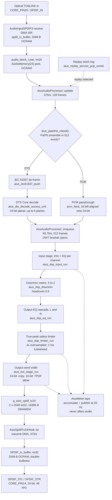

# Aius audio signal path

What the audio path of the `teensy41-optical` image actually is: every stage from the
optical receiver to the S/PDIF transmit register, the module and function that
implements it, its buffers and their memory bank, its arithmetic domain, and its share
of the per-block time budget. It is the companion to
[`firmware-io.md`](firmware-io.md), which answers "what I/O exists and why it cannot
disturb the audio path"; this answers what the audio path *is*, and does not restate
the isolation argument.

It is also the living record the audio-quality roadmap in
[`aius-dsp-config-api.md` §Audio-quality roadmap](../plans/aius-dsp-config-api.md#audio-quality-roadmap--accepted-2026-07-26)
attaches to: **every item on that roadmap updates this document in the commit that
ships the change.**

## How to read this

**Every claim carries a `path:line` citation, and every number says where it came
from.** Firmware paths are relative to `firmware/` unless the path
says otherwise. Line numbers are correct as of repository revision `a847df560c08`; the
cited symbol name is the durable handle.

**Numbers come from one of three places, and the text always says which:**

- **From the linked image** — read out of
  `.pio/build/teensy41-optical/firmware.elf` (built from the working tree at
  `a847df560c08`) with `tools/memory/mem_report.py --elf` and `arm-none-eabi-nm -S`.
  Function and object sizes in this document are that, not estimates.
- **From the device** — the DWT cycle counters the audio path publishes through
  `GET /api/meters`, recorded in the roadmap against build revision `f76baa87c67d`,
  and the loopback quality figures in
  [§Measured output quality](#measured-output-quality--the-loopback-figures), read from
  `GET /api/measure` against build revision `b5f9a1351adf`.
- **Derived from source** — a struct size or a period computed from constants that are
  cited. Marked *derived* where it matters.

**Anything not measured is labelled.** [§Figures that are not measured](#figures-that-are-not-measured)
collects every one in a single list, so a reader can see the edge of the evidence
without reading the whole document.

**Bank vocabulary** matches [`firmware-io.md` §How to read this](firmware-io.md#how-to-read-this):
`FLASH` is program flash, `ITCM`/`DTCM` are the two halves of the 512 KiB FlexRAM, and
`OCRAM` is RAM2 holding both `DMAMEM` statics and the `malloc`/`new` heap.

## The three things called a block

**Conflating these is how the 44.1 kHz defect hid for months**, so they are stated
first. `optical_main.cpp:637` carries the same distinction beside the code.

- **128 frames — the engine block.** `AUDIO_BLOCK_SAMPLES`, the Teensy core default,
  which this build does not override. It sizes both DMA buffers, the `audio_block_t`
  pool, `update()`'s word staging and the transmit interrupt's drain of the 24-bit
  ring. `AiusAudioProcessor::update()` therefore runs 48000/128 = **375 times a
  second** (`src/optical_main.cpp:767`) and moves 256 IEC words = 512 bytes each time,
  which is the 192,000 B/s the replay ring is sized for
  (`lib/aius_replay/include/aius_replay.h:44`).
- **512 frames — the decoded block, and the one the budget belongs to.** A DTS Core
  access unit with `npcmblocks = 16` reconstructs to 16 × 32 = 512 samples per channel
  (`vendor/dcadec-core/core_decoder.c:962`), and PCM passthrough stages the same 512
  (`AIUS_PIPELINE_PCM_BLOCK_FRAMES`, `lib/aius_pipeline/include/aius_pipeline.h:45`).
  So `enqueue()` runs once per four `update()`s, at 48000/512 = **93.75 blocks per
  second**, and this is what the `blocks` counter counts and what the DWT bracket
  measures (`src/optical_main.cpp:868`).
- **`queue_frames` in the meters — neither of the above.** It is
  `aius_spdif_tx24_level()`, the transmit ring's occupancy at the publish instant
  (`src/optical_main.cpp:974`), which sits near 512 because one decode fills the ring
  by 512 and the four following transmit interrupts drain it by 128 each.

**Only IEC 61937 burst type I is supported end to end.** `enqueue()` rejects
`block->frames > AUDIO_BLOCK_SAMPLES * 4` with `AIUS_INVALID_ARG`
(`src/optical_main.cpp:882`), and that cap is exactly 512. The parser accepts DTS Core
data types 11/12/13 — burst types I/II/III at 48 kHz — and hands all three back as
`AIUS_OK` (`lib/aius_iec61937/include/aius_iec61937.h:33`), but a type II or III burst
decodes to 1,024 or 2,048 samples per channel and is therefore refused one stage
later. The two constants are coupled: changing the engine block changes the decoder
block this file will accept.

## The chain



The dotted edges are diagnostic taps, not audio. There is exactly one output — the
optical S/PDIF transmitter on `CORE_PIN14`. **There is no analogue output on this
board**; the acceptance criterion's "analogue and digital output" describes an intent
the hardware does not carry, and the wire is the last stage the firmware owns.

## Stage inventory

| # | Stage | Implementation | Arithmetic | Buffers, bank |
|---|---|---|---|---|
| 1 | Optical receive | `AudioInputSPDIF3::isr` | int32 subframe → int16 | `spdif_rx_buffer` 2,048 B OCRAM |
| 2 | Engine block pass | `AiusAudioProcessor::update` | int16 → uint16 words | `words[256]` 512 B DTCM stack |
| 3 | Classify | `aius_pipeline_classify` | integer compare | `clsbuf[512]` 1,024 B, DTCM arena |
| 4a | IEC 61937 de-frame | `aius_iec61937_push` | integer | 4,096 B payload, OCRAM heap |
| 4b | DTS Core decode | `aius_dts_decode_access_unit` | fixed point → int32 | dcadec `ta` tree, OCRAM heap |
| 4c | PCM passthrough | `pcm_feed` | int16 → int32, left-aligned onto 24-bit | `pcm_l`/`pcm_r` 4,096 B, DTCM arena |
| 5 | Input trim + EQ | `aius_dsp_input_run` → `run_cascade` | int32 → double → int32 | `g_input_scratch` 12,288 B DTCM |
| 6 | Downmix matrix | `aius_dsp_downmix` | int32 → double → int32 | writes caller planes |
| 7 | Output EQ | `aius_dsp_eq_run` → `run_cascade` | int32 → double → int32 | `g_eq_state` 128 B DTCM |
| 8 | True-peak limiter | `aius_dsp_limiter_run` | int32 → double → int32 | `AiusLimiter` ≈2,264 B DTCM |
| 9 | Output word width | `aius_out_stage_run` | int32 copy (24-bit arm) | writes the ring in place |
| 10 | Transmit ring | `aius_spdif_tx24_stage`/`_commit` | int32, no arithmetic | `g_aius_spdif_tx24` 16,396 B OCRAM |
| 11 | Transmit interrupt | `AiusSpdifTx24Hook::isr` | int32 copy | `SPDIF_tx_buffer` 2,048 B OCRAM |

`run_cascade` is the shared core of stages 5 and 7 (`lib/aius_dsp/src/aius_dsp.c:285`);
`aius_dsp_eq_run` is a thin wrapper the compiler inlined into `aius_dsp_process`, so it
has no symbol of its own in the linked image.

### Stage 1 — optical receive and the IEC 60958 words

`AudioInputSPDIF3`, compiled from the checked-in snapshot at
`evidence/source-snapshots/PJRC-SPDIF-RX-SOURCE/input_spdif3.cpp`, DMAs receiver words
into `spdif_rx_buffer[AUDIO_BLOCK_SAMPLES * 4]` (2,048 B, `DMAMEM`, 32-byte aligned,
`:37`) and its ISR narrows each subframe into an `audio_block_t`:

```c
*dest_left++  = (*src++) >> 8;   /* input_spdif3.cpp:118, dest_left is int16_t * */
*dest_right++ = (*src++) >> 8;
```

**That `>> 8` into an `int16_t` is the input-side ceiling** — see
[§Open at this revision](#open-at-this-revision). For a DTS carrier it is harmless: 16-bit
IEC 61937 packing puts the burst payload in the top 16 bits of the 24-bit subframe, so
`>> 8` extracts exactly the payload word. For a 24-bit linear-PCM carrier it discards
the low 8 bits before the DSP ever sees them.

The pool is `AudioMemory(24)` — 24 blocks of 260 B, 6,240 B in `DMAMEM`
(`src/optical_main.cpp:3638`, `cores/teensy4/AudioStream.h:110`). Two blocks are taken
and released per engine block pass.

### Stage 2 — the engine block pass

`AiusAudioProcessor::update()` (`src/optical_main.cpp:767`, **192 B of ITCM**, measured)
interleaves the two `int16` planes back into a `uint16_t words[256]` stack array (512 B,
DTCM stack) and pushes them into the portable pipeline. It emits nothing: since the
24-bit output path landed there is no `emit_block()`, no pool allocation on the
transmit side, and no `AudioConnection` into `g_spdif_out` (`src/optical_main.cpp:1096`).

**The replay source substitutes for the optical one at this stage, not later.** When
`g_replay_service.source == AIUS_REPLAY_SOURCE_REPLAY`, `update()` pops 256 words from
the replay word ring instead of reading the input blocks
(`src/optical_main.cpp:771`), so a replay traverses the identical pipeline, DSP chain
and output stage as a live carrier. A short pop counts an overrun rather than emitting
a partial block.

### Stage 3 — classification

`aius_pipeline_classify` scans up to `AIUS_PIPELINE_CLASSIFY_MAX_WORDS` = 512 words for
the IEC 61937 preamble pair `Pa` = `0xF872`, `Pb` = `0x4E1F` in either wire byte order
(`lib/aius_pipeline/include/aius_pipeline.h:42`, `src/aius_pipeline.c:53`). A preamble
within the window means DTS; 512 words with no preamble means linear PCM; fewer than 512
words and none found yet stays `AIUS_PIPELINE_UNKNOWN`. Staging is the instance's
`clsbuf[512]` (1,024 B).

The classification is what `GET /api/status`'s `state` renders: 2 unlocked or
unclassified, 3 PCM, 4 DTS (`src/optical_main.cpp:1100`).

### Stage 4a — IEC 61937 de-framing

`aius_iec61937_push` unwraps one burst per call into the parser instance's fixed
`AIUS_IEC61937_MAX_PAYLOAD` = 4,096 B payload buffer, normalising to canonical
big-endian bytes regardless of wire byte order
(`lib/aius_iec61937/include/aius_iec61937.h:44`). Wire byte order is auto-detected per
burst from `Pa`; payload packing is create-time configuration and the optical image
selects `AIUS_IEC61937_PACK_16` (`src/optical_main.cpp:711`).

A per-burst fault — error flag, invalid length, an over-long length code — is
non-fatal: the burst is skipped, the stream re-locks and the status is recorded
(`lib/aius_pipeline/include/aius_pipeline.h:105`). Nothing in the audio path stalls on
a corrupt burst.

### Stage 4b — DTS Core decode

`aius_dts_decode_access_unit` (`lib/aius_dts/src/aius_dts.c:53`) drives the vendored
dcadec core with `DCADEC_FLAG_CORE_ONLY | DCADEC_FLAG_CORE_BIT_EXACT` (`:215`) and
publishes decoder-owned planar PCM: `block->frames = core->npcmsamples` (`:230`),
`block->sample_rate_hz = core->output_rate` (`:231`), planes populated in `AIUS_CH_*`
order and tightly packed to `channels` (`:242`). Layouts wider than 5.1 are refused
with `AIUS_UNSUPPORTED` (`:222`).

**The emitted samples carry the DTS Core's native 24-bit range, sign-extended into
`int32`** (`lib/aius_dts/include/aius_dts.h:31`). That is the unit every later stage's
magnitudes, thresholds and meter values are expressed in.

**Where the decoder's memory actually lives is not where the design intended.** The
image reserves `AiusAudioProcessor::g_arena_memory` — **131,072 B, 40 % of the whole
DTCM bank**, measured in the ELF — and `begin_pipeline()` creates the pipeline through
`aius_pipeline_create_arena` (`src/optical_main.cpp:712`). But routing dcadec's
allocation into that arena depends on the `--wrap` link-time shim
(`lib/aius_dts/src/aius_alloc_shim.c:95`), and `[env:teensy41-optical]` **removes that
flag** in `build_unflags` (`platformio.ini:198`). The linked image contains plain
`malloc`, `calloc`, `realloc` and `free` and **no `__wrap_malloc` or `__real_malloc` at
all** (measured with `arm-none-eabi-nm`), so the decoder handle, its input scratch and
the entire dcadec `ta` tree come from the newlib heap in OCRAM. Only the `AiusPipeline`
instance itself is arena-allocated (`lib/aius_pipeline/src/aius_pipeline.c:326`), which
is roughly 5.2 kB *derived* from its members — `clsbuf` 1,024 B plus `pcm_l`/`pcm_r`
4,096 B plus scalars. The remaining ~126 kB of DTCM arena is reserved and unused. See
[§Contradictions found against the plans](#contradictions-found-against-the-plans).

### Stage 4c — PCM passthrough

`pcm_feed` treats the words as interleaved L,R and left-aligns each onto the
`AiusPcmBlock` sample scale:

```c
const int32_t wire = (int32_t)(int16_t)word;              /* sign-extend 16 -> 32 */
return (int32_t)((uint32_t)wire << PCM_WIRE_SHIFT);       /* left-align onto 24 bits */
```

Through `uint32_t` because a left shift of a negative `int` is undefined behaviour
(C17 6.5.7p4) and the host suites build with UBSan; the two's-complement result is
identical, which is what makes the unsigned round-trip correct rather than merely quiet.

Blocks are emitted at `AIUS_PIPELINE_PCM_BLOCK_FRAMES` = 512 frames, stamped
`AIUS_PIPELINE_PCM_SAMPLE_RATE_HZ` = 48,000 unconditionally
(`lib/aius_pipeline/include/aius_pipeline.h:45`, `:48`).

**Both branches now enter the DSP at the same full scale, and the fix landed at the
contract rather than at this call site.** Until 2026-07-26 there was no left shift, so
the PCM branch entered at 16-bit magnitude against the DTS branch's 24-bit — a 48.16 dB
level step, with the DSP's headroom and limiter threshold both expressed in 24-bit units.
The root cause was that `AiusPcmBlock` documented its planes only as "signed 32-bit" and
never declared a *sample* scale, so each producer picked its own and neither violated the
contract. `aius_codec.h` §SAMPLE SCALE now declares it (`AIUS_PCM_SAMPLE_BITS` = 24 plus
`_MAX`/`_MIN`), `aius_dsp.h` derives `AIUS_DSP_SAMPLE_MAX`/`_MIN` from it instead of
restating the number, and both `aius_dsp.c` and `aius_pipeline.c` bind to it with a
`_Static_assert`.

`test/pipeline/test_pipeline.c` previously asserted the block against a copy of
`pcm_feed`'s own expression, so it printed "1024 frames byte-exact" throughout — a test
that cannot catch a scale error because both sides move together. It now carries a
second, deliberately separate check (`pcm-scale`) written purely in the contract's terms:
a full-scale wire word must reach full scale, with no mention of 16 bits, of a shift
count, or of the producer's expression. Reverting the fix leaves the original check green
and fails only the new one, reporting the measured −48.16 dB.

### Stage 5 — input trim and EQ

`aius_dsp_input_run` (`lib/aius_dsp/src/aius_dsp.c:333`, **56 B of ITCM**) applies one
input channel's linear trim then its EQ cascade, with a **single** saturating quantize
per sample — the trim is folded into the biquad input as `run_cascade`'s `pregain`, so
there is no intermediate double-rounding (`:285`). `input_stage_apply` (`:363`) copies
each decoded plane into the stage's scratch first, because the downmix reads a `const`
input and the decoder owns its planes.

Buffers: `g_input_scratch[6][512]` `int32`, **12,288 B in DTCM**
(`src/optical_main.cpp:843`), sized to the largest block `enqueue()` accepts across all
`AIUS_MAX_CHANNELS` planes. Coefficients and state are `g_input_eq[6][2]` (480 B) and
`g_input_eq_state[6][2]` (384 B), both *derived* from the struct sizes.

**With the shipped default this stage is skipped, and until 2026-07-26 it was not.**
`config/optical_dsp.json` sets `features.input_eq: true` with every channel at
`gain_db: 0` and `eq: []`. That used to leave `g_input_stage_active` true, so every
present plane was `memcpy`'d to scratch and run through `run_cascade(1.0, NULL, 0, …)`
— an int-to-double convert and an `aius_quantize` per sample for an exact identity, at
six channels **3,072 quantizes per 512-frame block** to reproduce the input.

`apply_config()` now also requires that some channel would actually change a sample:
unity gain with no sections is an identity and the stage does not run. Skipping is
behaviourally identical rather than an approximation — the downmix reads
`block->planes` when `dsp.input` is null, and the stage's only effect in that state was
to hand it a verbatim copy of those same planes. Unity is tested exactly because
`aius_db_to_linear(0.0)` is `pow(10, 0) == 1.0`, the value the conversion produces
rather than a tolerance. A present-but-*bypassed* EQ section is deliberately not an
identity: `eq_sections` counts what the cascade walks, and the config distinguishes "no
section" from "a bypass section".

**The saving is arithmetic, not measured.** `blocks` is 0 with no carrier, so
`dsp_cycles_last` cannot show it yet; re-measure with the first real signal.

### Stage 6 — the downmix matrix

`aius_dsp_downmix` (`lib/aius_dsp/src/aius_dsp.c:78`, **1,254 B of ITCM** as
`aius_dsp_downmix.part.0`, the largest single function in the DSP) is mask-driven
rather than mode-driven: routing follows `in->channel_mask`, so mono, stereo, 3.0, 4.0,
5.0 and 5.1 are all handled without a layout flag (`:113`–`:154`). The rules are stated
authoritatively once in
[§Channel layout and downmix rules](#channel-layout-and-downmix-rules).

### Stage 7 — output EQ

`aius_dsp_eq_run` runs the same `run_cascade` over L and then R with channel-major
state — all L section states, then all R (`lib/aius_dsp/include/aius_dsp.h:759`,
`src/aius_dsp.c:1032`). Sections are Direct Form I biquads with `a0` normalised to 1
and coefficients from the standard RBJ audio-EQ-cookbook math (`:179`–`:269`). State is
`g_eq_state[4]`, 128 B DTCM, advanced across blocks so section boundaries are seamless.

**The shipped default runs no output EQ at all.** `output_eq` is empty in
`config/optical_dsp.json`, so `g_eq_count` is 0 and `aius_dsp_process` skips the stage
entirely (`src/aius_dsp.c:1032`). RBJ biquads are minimum-phase, so group delay varies
with frequency; a linear-phase FIR alternative is recorded as deliberately unscheduled
in [`aius-dsp-config-api.md` §Noted for later](../plans/aius-dsp-config-api.md#noted-for-later-deliberately-not-scheduled).

### Stage 8 — the true-peak safety limiter

`aius_dsp_limiter_run` (`lib/aius_dsp/src/aius_dsp.c:504`, **764 B of ITCM** as
`.part.0`, plus `truepeak_push` at 156 B). Shipped defaults, from
`config/optical_dsp.json` and pinned in `lib/aius_dsp/include/aius_dsp.h:369`: enabled,
threshold −1.0 dBFS, attack 0.5 ms, release 100 ms, lookahead 2.0 ms.

**It is genuinely true-peak, per ITU-R BS.1770-4 Annex 2.** The detector 4×-oversamples
with the standard's 4-phase, 12-tap polyphase FIR; every coefficient is an exact
multiple of 2⁻¹⁴ and is spelled as its integer numerator over 16384, so the table is
bit-identical on host and target with no transcription rounding
(`lib/aius_dsp/src/aius_dsp.c:422`). The table is 384 B and lands in DTCM `.data`
(measured), because Teensy copies `.rodata` to fast RAM at boot.

Two deliberate deviations from a literal reading, both conservative and both recorded
at `lib/aius_dsp/include/aius_dsp.h:283`:

- **The standard's 12.04 dB pre-attenuation is omitted.** It exists to stop a
  fixed-point implementation overflowing inside the filter; this one is double
  precision.
- **The reported peak is `max(|x[n]|, |interpolated|)`, not the interpolated maximum
  alone.** Phase 0 has a 0.9722 centre tap, so a literal 4× meter can read an isolated
  impulse about 0.2 dB *below* its own sample value. Folding the raw sample in makes
  this a strict superset of a sample-peak detector, which is the only defensible
  behaviour for a stage whose job is safety.

**Cost is controlled by a rigorous bound, not a heuristic.** 4 phases × 12 taps is 48
multiply-accumulates per sample per channel and would dominate the block. The largest
phase has an ℓ1 norm of exactly 33142/16384, so a 12-sample window in which every
sample satisfies `|x| <= threshold / (33142/16384)` provably cannot interpolate above
threshold. Below that gate the FIR is skipped with no possibility of missing an over;
above it, it runs for the whole window the loud sample participates in
(`lib/aius_dsp/src/aius_dsp.c:532`, `:569`). Quiet material pays **one compare per
sample**; only material within about 6.1 dB of threshold pays the full 48 taps. The
`dsp` suite checks the constant against the table, because the gate's soundness depends
on it (`lib/aius_dsp/include/aius_dsp.h:341`).

**The FIR history is primed rather than zeroed into service.** A history zeroed at
reset makes the first sample look like a step from silence, and a step has a genuine
inter-sample overshoot of about +0.6 dB. Since limiter state is zeroed on every config
apply (`src/optical_main.cpp:1044`), a naive detector would have put a spurious ~0.6 dB
gain dip — decaying over a whole release constant — into the audio every time a control
changed. The detector contributes only `|x[n]|` until the 12-sample window has filled
since the reset, 229 µs at 48 kHz (`lib/aius_dsp/include/aius_dsp.h:305`).

**Lookahead leads the reduction, and the numbers are chosen together.** The peak
follower reads the incoming sample while the gain is applied to the *delayed* sample,
so `lookahead_ms` is exactly how far the reduction leads
(`lib/aius_dsp/src/aius_dsp.c:602`). 2.0 ms against a 0.5 ms attack is four attack time
constants, so the gain is within e⁻⁴ = 1.8 % of target by the time the sample it was
computed for is emitted. The residual is a bounded overshoot, not zero: a peak 3 dB
over threshold emerges about 0.065 dB over it, landing near −0.93 dBFS, and the final
quantize saturation remains the last-ditch clamp.

Buffers: `AiusLimiter` ≈ **2,264 B in DTCM** (*derived* from the struct — config 40 B,
`buf_l`/`buf_r` 240 `int32` each at 1,920 B, `tp_l`/`tp_r` 16 doubles each at 256 B,
scalars). The lookahead lines are fixed at `AIUS_DSP_LIMITER_MAX_LOOKAHEAD` = 240
samples — 5 ms at 48 kHz — so the process path never allocates
(`lib/aius_dsp/include/aius_dsp.h:281`). The configured unit is milliseconds and the
sample count is always derived from the `fs` passed in, so nothing here assumes a rate.
The interpolation history is **persistent state, not stack**: the detector needs only
the maximum, never the interpolated values, so it materialises no oversampled buffer and
the function's stack frame is flat — which matters because this runs in the audio ISR
(`lib/aius_dsp/include/aius_dsp.h:396`).

**Latency added: 2 ms, or 96 samples at 48 kHz** (*derived*). Output frame count equals
input; the last `delay` samples stay in the ring as bounded latency.

### Stage 9 — the output word width

`aius_out_stage_run` (`lib/aius_dsp/src/aius_dsp.c:755`, **192 B of ITCM**) is the one
boundary that cares about the transmit word, and it is deliberately not part of
`aius_dsp_process`: the 24-bit block is the DSP module's output, and word width belongs
to whichever engine consumes it (`lib/aius_dsp/include/aius_dsp.h:34`).

- **`AIUS_DSP_OUT_WIDTH_24` — the shipped selection.** A plain copy: no dither, no
  rounding, no saturation, because the input is already in range by contract
  (`src/aius_dsp.c:762`). The width test is hoisted out of the sample loop, so this
  costs one branch per call and then a straight copy.
- **`AIUS_DSP_OUT_WIDTH_16` — a real selection, not a shim.** `aius_out16_sample()` per
  sample — TPDF dither, round to nearest ties away from zero, saturate — scaled back up
  by `AIUS_DSP_OUT16_LSB` = 256. That multiply is bit-for-bit the `<< 8` the retained
  snapshot's ISR performed
  (`evidence/source-snapshots/PJRC-SPDIF-TX-SOURCE/output_spdif3.cpp:130`), so this arm
  reproduces the wire words the board shipped before the 24-bit path existed, exactly.

The selection is `AiusAudioProcessor::OUTPUT_WIDTH_BITS`, a `constexpr` rather than a
config field (`src/optical_main.cpp:814`), because nothing on the device has a reason to
ask for 16 bits: the sink is a 24-bit register either way. `aius_out_stage_run` is not
inlined across translation units, so the 16-bit arm and `aius_out16_sample` (188 B of
ITCM, measured) are **linked but never executed** on the shipped image.

**Dither exists, is deterministic, and is bypassed.** It is a property of the 16-bit
selection, not of the chain. TPDF spanning ±1 LSB of the 16-bit target, formed as the
difference of two independent uniform draws, which decorrelates the error from the
signal *and* makes total error power signal-independent so there is no noise modulation
(`lib/aius_dsp/include/aius_dsp.h:482`). The generator is xoshiro128++ 1.0 — integer
only, so bit-identical on x86-64 and Cortex-M7 with no FPU, libc, locale or rounding
mode in the loop; period 2¹²⁸−1, which is 2.2 × 10²⁶ years at 48 kHz, so there is no
repetition to become tonal. Both uniform draws come from the high and low halves of one
32-bit output, a bijection onto the 2³² square, so the pair is exactly as uniform as the
word. L and R are independent streams seeded from eight consecutive SplitMix32 outputs,
because correlated dither across the pair would image as a phantom-centre hiss. The
streams are seeded **once** in `begin_pipeline()` and deliberately not in
`apply_config()` (`src/optical_main.cpp:697`), so the output is a function of the sample
index rather than of config-change history.

### Stages 10 and 11 — the transmit ring and the wire

`g_aius_spdif_tx24` is an `AiusSpdifTx24Ring`: 2 × 2,048 `int32` planes plus three
cursors, **16,396 B in `DMAMEM`** (measured at `0x20200000`, defined at
`lib/aius_audio/src/aius_spdif_sources.cpp:30`). `enqueue()` stages into it with at most
one wrap and publishes the whole block with a single `aius_spdif_tx24_commit()`
(`src/optical_main.cpp:944`–`:957`). `AiusSpdifTx24Hook::isr` (**228 B of ITCM**,
`lib/aius_audio/src/aius_spdif_sources.cpp:57`) drains 128 frames per interrupt into the
half of `SPDIF_tx_buffer` the DMA is not reading, flushes that half once, and then
pends the graph if it holds `update_responsibility`.

The buffer sizes, the placement argument, the cache-maintenance argument, the
priority-inversion argument and the underrun counter are all covered in
[`firmware-io.md` §S/PDIF output](firmware-io.md#spdif-output--the-transmit-half-of-the-hot-path)
and are not restated here. The two decisions that belong to the *signal path* rather
than to I/O are in [§Decisions recorded](#decisions-recorded-with-their-alternatives).

### The meter taps — deliberately not stages

Metering is caller-driven and is **not** a field of `AiusDspConfig`
(`lib/aius_dsp/include/aius_dsp.h:767`): the caller taps around `aius_dsp_process`, so
the meter code is not linked into the hot function until the adapter wires it. The audio
path is bit-identical whether or not a meter is attached.

`enqueue()` accumulates input peak/RMS and output peak/RMS after a successful process,
so one window always covers the same set of blocks on both sides
(`src/optical_main.cpp:921`), and publishes a coherent snapshot behind a seqlock once
per `g_meter_window_frames` — `rate / AIUS_METER_PUBLISH_HZ`, so 2,400 frames at 20 Hz
(`src/optical_main.cpp:427`, `:1065`). Measured ITCM cost of the taps:
`aius_meter_accumulate_input` 168 B, `accumulate_output` 212 B, `decimate` 254 B,
`publish` 344 B, `set_telemetry` 18 B, `set_limiter_gr` 8 B. `g_meter` is **1,384 B in
OCRAM** (measured). Two design points worth carrying:

- **The gain-reduction accessor is sampled once per window, not per block**, because it
  takes a `log10` and a diagnostic field does not buy a libm call in the block callback
  (`src/optical_main.cpp:961`). The reported value is therefore the *instantaneous* gain
  reduction at the publish instant, not the window's peak.
- **`estimated_latency_us` costs no division.** Microseconds per frame is resolved to
  Q16.16 by `apply_config()`, so the field is one 32×32 multiply and a shift
  (`src/optical_main.cpp:968`).

## Measured output quality — the loopback figures

**These are the first quality figures ever measured on the device itself**, from the
audio-quality roadmap's item 3 (design contract:
[`aius-dsp-config-api.md` §Item 3 design](../plans/aius-dsp-config-api.md#item-3-design--the-measurement-loopback-software-tap-first)).
The instrument is a software tap in `enqueue()` after the tx24 commit — at the shipped
24-bit width the committed words ARE the wire's, so the capture measures everything from
the replay ring through the whole DSP chain to the transmit register, sharing one sample
grid with the stimulus (immune to physical clock error by construction; the clock/content
*ratio* surface stays with the future physical loop). Analysis: an IEEE 1057 3-parameter
sine fit at the declared f0 (THD+N; SNR additionally excludes harmonics 2–10) plus
Hann-windowed Goertzel (harmonic amplitudes, FR probes) over the last 8,192 frames of a
16,384-frame capture (`lib/aius_dsp/include/aius_measure.h`), served by
`GET /api/measure`.

**Measured 2026-07-27 from the device, build `b5f9a1351adf`, boot generation 250–252**,
against the loop-coherent 16-bit PCM stimulus corpus (`tools/measure_vectors/`), shipped
SD config (headroom 0.5, limiter on at −1 dBFS, bypass EQ) except where stated. The
stimulus floors bind everything below: a 16-bit vector bottoms THD+N/SNR near the
quantization floor at the tone's own level, so a figure at its floor reads "at least
this good".

| Vector, channel | Fundamental | THD+N | SNR | THD (2nd–10th) | Stimulus floor at this level |
|---|---|---|---|---|---|
| `pcm440_m6`, L | −12.04 dBFS @ 440 Hz | **−91.7 dB** | 91.8 dB | −107.9 dBc | ≈ −92.1 dB |
| `pcm440_m6`, R | −12.04 dBFS @ 440 Hz | **−91.7 dB** | 91.8 dB | −107.9 dBc | ≈ −92.1 dB |
| `pcm440_660_split`, L | −12.04 dBFS @ 440 Hz | −91.7 dB | 91.8 dB | −108.0 dBc | ≈ −92.1 dB |
| `pcm440_660_split`, R | −18.06 dBFS @ 660 Hz | −86.0 dB | 86.1 dB | −103.8 dBc | ≈ −86.1 dB |
| `pcm440_full` + headroom 1.0, L/R | −1.01 dBFS @ 440 Hz (limited) | −95.6 dB | 95.7 dB | −109.2 dBc | ≈ −98.1 dB |
| `pcm_fr_multitone`, 40 Hz–16 kHz | seven probes, both channels | — | — | — | — |

What the numbers say, in order of what they prove:

- **The path is transparent to the stimulus floor.** THD+N lands within 0.4 dB of the
  16-bit stimulus's own quantization floor at every level tried (−91.7 vs ≈ −92.1 at
  −6 dBFS stimulus; −86.0 vs ≈ −86.1 at −12 dBFS). Whatever the chain adds sits below a
  16-bit transport's ability to resolve — the −140 dB inter-stage claims stay
  host-proven, as the design says they must.
- **Levels are arithmetic-exact.** Every fundamental reads stimulus level + 6.02 dB of
  shipped headroom to the hundredth of a dB, and L/R figures on identical stimulus are
  identical to the last printed digit (bit-identical DSP on bit-identical input).
- **Frequency response is flat to 0.01 dB, 40 Hz to 16 kHz** (all seven multitone
  probes at −24.08 dBFS on both channels, bypass EQ).
- **The limiter's steady-state gain reduction is distortion-free at this floor.** With
  headroom raised to 1.0 so the full-scale vector engages it, the limiter holds the tone
  at −1.01 dBFS (threshold plus its documented e⁻⁴ smoothing residual,
  [stage 8](#stage-8--the-true-peak-safety-limiter)) and THD+N still reads −95.6 dB. A
  *transient* limiter-distortion figure needs a modulated hot vector; deliberately not
  scheduled.
- **The arm-time latches work live.** The very first run retired `failed (generation)`
  because arming preceded the board's first-ever audio block, whose block-boundary
  config apply bumped the generation — exactly the splice the latch exists to refuse.
- **The tap's ISR cost is invisible inside the block-to-block spread** — the
  acceptance the design demanded, as a distribution comparison with meters ON:
  `dsp_cycles_max` over 10 s windows read 322,215 unarmed vs 309,236 with captures
  armed back-to-back (delta −13.0 k against the ±30 k gate; `dsp_cycles_last` p50
  280,696 vs 280,657). Those p50s are also **the first measured per-block DSP cost
  with audio flowing** — ≈ 281 k cycles ≈ 4.4 % of the block budget on the PCM
  passthrough path, replay looping, meters on, zero overruns across the whole
  20,492-block session.

One `DMAMEM` note for the maintainer contract below: the 128 KiB capture planes are the
first large `DMAMEM` addition since the retained region was carved out ahead of
`.bss.dma`, and the retained-slot guard passed — `boot_generation` survived both flashes
(247 → 250 across three flashes and a reboot), so the item-1-era "every large `DMAMEM`
object restarts the ledger" hazard is closed by the linker carve-out, not merely
tolerated.

## Channel layout and downmix rules

**This is the authoritative statement; nothing else in this document restates it.**

Channel order is `AIUS_CH_*` bit order throughout — FL, FR, FC, LFE, SL, SR
(`lib/aius_codec_api/include/aius_codec.h:38`) — and planes are tightly packed to
`channels` in that order, as the decoder emits them. The same ordinal indexes the input
stage's per-channel config and the meter's per-input arrays.

The matrix, per ITU-R BS.775 / ATSC A/52 "Lo/Ro"
(`lib/aius_dsp/include/aius_dsp.h:87`):

```text
L' = headroom * (FL + center*FC + surround*SL + lfe*LFE)
R' = headroom * (FR + center*FC + surround*SR + lfe*LFE)
```

| Coefficient | Shipped value | Source |
|---|---|---|
| `center` | 0.70710678118654752440 (1/√2, −3.01 dB) | `aius_dsp.h:94`, `optical_dsp.json:22` |
| `surround` | 0.70710678118654752440 (1/√2, −3.01 dB) | `aius_dsp.h:95`, `optical_dsp.json:23` |
| `lfe` | 0.0 — **LFE is discarded** | `aius_dsp.h:103`, `optical_dsp.json:24` |
| `headroom` | 0.5 (−6.02 dB) | `aius_dsp.h:143`, `optical_dsp.json:25` |
| `clipfree` | false | `optical_dsp.json:26` |

- **1/√2 on centre and surround is the standard default**, not a taste choice: mixing FC
  and each surround down 3 dB preserves acoustic power when the two summed sources are
  uncorrelated.
- **The coefficients are symmetric by design.** `center` is the shared FC-to-L/R
  coefficient and `surround` the shared SL-to-L / SR-to-R coefficient. Independent SL/SR
  gains are excluded because they would shift image balance rather than control blend.
- **LFE at 0.0 follows BS.775 and A/52**, which exclude LFE from the default stereo
  downmix. `AIUS_DSP_LFE_GAIN_MINUS10DB` = 0.31622776601683793320 is provided for the
  common small-stereo alternative. **An LFE fold-in with a low-pass around 120 Hz and
  level compensation is item 2 of the accepted roadmap and is in flight at this
  revision** ([`aius-dsp-config-api.md` §Accepted order for the next level](../plans/aius-dsp-config-api.md#accepted-order-for-the-next-level));
  what is committed today is `lfe = 0.0`. Related and wholly absent: there is no
  crossover or bass management — the generic biquad EQ is not a Linkwitz-Riley
  crossover.
- **Narrower inputs need no mode flag.** Mono copies the lone plane to both channels at
  unity (headroom still applies) regardless of which mask bit is set; stereo FL|FR is an
  exact passthrough at unity; absent channels contribute nothing
  (`lib/aius_dsp/include/aius_dsp.h:162`).
- **Headroom 0.5 is an evidenced product decision**, and the evidence is in
  [§Decisions recorded](#decisions-recorded-with-their-alternatives).
  `aius_downmix_clipfree_headroom()` returns the theoretical `1/(1 + center + surround +
  |lfe|)` = 0.414214 (−7.66 dB) and is selectable via `clipfree`, at which point a
  caller may reasonably turn the limiter off.

The two sensible configurations are **(modest headroom + limiter on)** and **(clip-free
headroom + limiter off)**. The shipped one is the first.

## Fixed-point and floating-point boundaries

**The chain is 24-bit signed integer *between* stages and IEEE-754 double *within*
them.** There is exactly one integer sample unit in the system — the DTS Core's 24-bit
range, `AIUS_DSP_SAMPLE_MAX` = 2²³−1 and `AIUS_DSP_SAMPLE_MIN` = −2²³
(`lib/aius_dsp/include/aius_dsp.h:84`) — and every magnitude, threshold, peak and RMS
value in the DSP and in `GET /api/meters` is expressed in it. A reader converts to dBFS
with `20*log10(v / AIUS_DSP_SAMPLE_MAX)`.

Where each conversion happens:

| Boundary | Direction | Function | Note |
|---|---|---|---|
| Receiver → engine | int32 subframe → int16 | `input_spdif3.cpp:118` | `>> 8`, truncating; the input ceiling |
| Engine → pipeline | int16 → uint16 words | `optical_main.cpp:785` | reinterpret, no arithmetic |
| DTS decode → DSP | dcadec fixed point → int32 | `aius_dts.c:242` | 24-bit range, sign-extended |
| PCM → DSP | int16 → int32 | `pcm_wire_to_sample` | sign-extend then left-align onto `AIUS_PCM_SAMPLE_BITS` |
| Input stage | int32 → double → int32 | `aius_dsp.c:285` | one quantize per sample |
| Downmix | int32 → double → int32 | `aius_dsp.c:152` | one quantize per sample |
| Output EQ | int32 → double → int32 | `aius_dsp.c:302` | one quantize per sample |
| Limiter | int32 → double → int32 | `aius_dsp.c:615` | one quantize per sample |
| Output stage, 24-bit | int32 → int32 | `aius_dsp.c:767` | **no conversion at all** |
| Output stage, 16-bit | int32 → double → int32 | `aius_dsp.c:783` | dither, round, saturate, × 256 |
| Ring → wire | int32 → int32 | `aius_spdif_tx24.h:178` | copy into `SPDIF_STL`/`STR` |

**Double was chosen over fixed point deliberately.** A biquad's feedback path is
precision sensitive, double keeps the design headroom trivial, and every 24-bit input
sample is represented exactly (`lib/aius_dsp/include/aius_dsp.h:47`). The Cortex-M7 has
a hardware double-precision FPU, so this is not an emulation cost.

**The one quantizer rule is `aius_quantize`: round to nearest, ties away from zero, then
saturate** (`lib/aius_dsp/src/aius_dsp.c:41`, 112 B of ITCM). `aius_out16_sample` uses
the identical rule, so the module's two quantizers cannot disagree about a boundary
(`:731`).

**Each stage requantises to 24-bit integer on the way out, and that is a known
inefficiency rather than a design requirement.** At 24 bits each step's error is around
−140 dBFS so it is inaudible, but carrying double end to end and quantising once would
be both cleaner and marginally faster; it is recorded as unscheduled in
[`aius-dsp-config-api.md` §Noted for later](../plans/aius-dsp-config-api.md#noted-for-later-deliberately-not-scheduled).
It also has a *correctness* consequence that shaped the headroom choice: the downmix and
EQ **saturate upstream of the limiter**, so the limiter never sees an unclamped
intermediate.

### `-ffp-contract=off` is load-bearing, not cosmetic

**The DSP's contract is that host and target produce bit-identical output, and until
2026-07-26 that contract was false on the target.** `scripts/test.sh` passed
`-ffp-contract=off` for the `dsp` and `dsp-vectors` suites, but `platformio.ini` did
not, and GCC defaults to `-ffp-contract=fast` under `-std=gnu++17`. Disassembly of
`aius_dsp.c.o` showed **25 `vfma.f64` instructions** — in `truepeak_push`,
`run_cascade`, `aius_dsp_downmix` and `aius_dsp_limiter_run` — where the host emitted
separate `vmul` and `vadd`.

A fused multiply-add keeps full intermediate precision, so it does not merely round
differently: **it rounds once where the host rounds twice.** The downmix and the EQ were
therefore never bit-identical host-to-target despite that being the stated contract, and
the 48-tap true-peak FIR had become the largest single source of divergence. The fix is
one flag, now pinned in `[common] build_flags` with a do-not-remove note
(`platformio.ini:77`). It is what makes every `dsp` golden vector a statement about *this
image* rather than only about the host.

One contraction was benign by construction and is worth knowing so nobody chases it: the
`vfma` in `aius_out16_sample` multiplies an exact integer by a power of two, so fused and
unfused agree bit-for-bit.

**The header's own comment block is stale on this point** and still reads as though the
flag is missing (`lib/aius_dsp/include/aius_dsp.h:58`) — see
[§Contradictions](#contradictions-found-against-the-plans).

## The clock

**48 kHz, pinned by a build flag and enforced by a `static_assert`.**
`config_spdif3()` derives the entire S/PDIF transmit clock tree from
`AUDIO_SAMPLE_RATE_EXACT`
(`evidence/source-snapshots/PJRC-SPDIF-TX-SOURCE/output_spdif3.cpp:229`), which
`AudioStream.h` defaults to `44100.0f` behind an `#ifndef`
(`cores/teensy4/AudioStream.h:57`). Left at that default the board clocked 48 kHz
material out **8.1 % slow — about 1.4 semitones flat** — while `GET /api/meters`,
`GET /api/dsp/config` and the decoded blocks all honestly reported 48,000. Producer and
consumer ran off the same wrong clock, so the queue stayed level and `overruns` stayed
zero: nothing counted it, and the only symptom was pitch.

`teensy41-optical` now builds with `-DAUDIO_SAMPLE_RATE_EXACT=48000.0f`
(`platformio.ini:182`) and `optical_main.cpp:95` `static_assert`s it equal to
`AIUS_OPTICAL_SAMPLE_RATE_HZ`, which `scripts/build_config.py` generates from
`config/optical_dsp.json`. **The flag and the config can no longer move apart
silently** — a compile-time equality is the fix for the class of defect, not just this
instance.

**48 kHz divides the tree exactly, so there is no fractional-divider residue.** PLL4 is
24 MHz × 28.672 = 688.128 MHz (`NUM`/`DENOM` = 6720/10000, an exact fraction),
`SPDIF0_CLK_ROOT` is that ÷ 8 = 86.016 MHz, and `TXCLK_DF` = 27 gives 86.016 MHz ÷ 28 =
3.072 MHz = 64 × 48,000 with **zero remainder**.

Clock responsibility moves between the two peripherals rather than being fixed: the
receiver claims `update_responsibility` first and the transmitter takes it while a
replay plays against no carrier. That mechanism belongs to
[`firmware-io.md` §S/PDIF output](firmware-io.md#spdif-output--the-transmit-half-of-the-hot-path)
and is not restated.

## Memory by bank

**Measured banks**, from `tools/memory/mem_report.py --elf` over
`.pio/build/teensy41-optical/firmware.elf` built from the working tree at
`a847df560c08`:

```text
BANK           USED         FREE     CAPACITY    USED%   FREE%
FLASH        581632      7544832      8126464    7.16%   92.8%
ITCM         172492        24116       196608   87.73%   12.3%
DTCM         302304        25376       327680   92.26%    7.7%
FlexRAM      498912        25376       524288   95.16%    4.8%
OCRAM        230784       293504       524288   44.02%   56.0%
```

**DTCM free-for-locals was 25,376 bytes at that revision and is 43,328 now** — the
LFE fold-in's banks re-measured it — `_estack 0x20050000 − _ebss 0x200456c0`. That is
the entire budget for the stack, the main loop and the audio ISR both. **OCRAM has
293,504 bytes free.** Those two figures are the constraint every placement decision
in this chain answers to.

**The figure has moved four times, and every stale copy of it is still quoted
somewhere**: 9,280 → 17,152 → 25,376 → **43,328**. So a bare number in prose is not
usable evidence — [`firmware-io.md`](firmware-io.md)'s table reports 9,280 (correct at
*its* revision, pre-`FNET_CFG_TLS=0`), this section reported 25,376, and five source
comments still quote pre-fix values (network-hardening open defect 18). A TLS
feasibility assessment initially read the three live figures as a contradiction; they
are not, they are four snapshots of a number that tripled and then nearly doubled
again. **Take it from `tools/memory/mem_report.py` against the linked ELF, which is
the only source that cannot go stale**, and state the revision beside any number
copied out of it.

Every audio-path object, with its measured size and bank:

| Object | Size | Bank | Citation |
|---|---|---|---|
| `AiusAudioProcessor::g_arena_memory` | 131,072 B | DTCM `.bss` | `optical_main.cpp:803` |
| `g_audio_processor` | 15,968 B | DTCM `.bss` | `optical_main.cpp:1076` |
| — of which `g_input_scratch[6][512]` | 12,288 B | DTCM | `optical_main.cpp:843` |
| — of which `g_limiter` (*derived*) | ≈2,264 B | DTCM | `aius_dsp.h:418` |
| — of which input EQ + state (*derived*) | 864 B | DTCM | `optical_main.cpp:840` |
| `k_truepeak` | 384 B | DTCM `.data` | `aius_dsp.c:422` |
| `words[256]` in `update()` | 512 B | DTCM stack | `optical_main.cpp:773` |
| `processed_left`/`_right` in `enqueue()` | 4,096 B | DTCM stack | `optical_main.cpp:887` |
| `g_aius_spdif_tx24` | 16,396 B | OCRAM `DMAMEM` | `aius_spdif_sources.cpp:30` |
| `g_meter` | 1,384 B | OCRAM `DMAMEM` | `optical_main.cpp:416` |
| `g_active_model` | 648 B | OCRAM `DMAMEM` | `optical_main.cpp:365` |
| `g_pending_dsp_model` | 648 B | OCRAM `DMAMEM` | `optical_main.cpp:383` |
| `spdif_rx_buffer` | 2,048 B | OCRAM `DMAMEM` | `input_spdif3.cpp:37` |
| `SPDIF_tx_buffer` | 2,048 B | OCRAM `DMAMEM` | `output_spdif3.cpp:44` |
| `AudioMemory(24)` pool | 6,240 B | OCRAM `DMAMEM` | `optical_main.cpp:3638` |
| IEC parser instance | ≈4.2 kB | OCRAM heap | `aius_iec61937.h:44` |
| dcadec `ta` tree | not measured | OCRAM heap | see [stage 4b](#stage-4b--dts-core-decode) |
| `AIUS_OPTICAL_CONFIG` | 648 B | FLASH `PROGMEM` | generated header |

Measured ITCM for the audio path, by function:

| Function | ITCM | Note |
|---|---|---|
| `aius_dsp_downmix.part.0` | 1,254 B | largest in the DSP |
| `aius_dsp_limiter_run.part.0` | 764 B | + `truepeak_push` 156 B |
| `AiusAudioProcessor::enqueue` | 620 B | pinned hot section |
| `aius_dsp_process` | 392 B | |
| `AiusSpdifTx24Hook::isr` | 228 B | not policed by the ITCM guard |
| `aius_out_stage_run` | 192 B | both arms linked |
| `AiusAudioProcessor::update` | 192 B | pinned hot section |
| `aius_out16_sample` | 188 B | linked, never executed |
| `aius_pipeline_push` | 184 B | |
| `run_cascade` | 154 B | shared by input stage and output EQ |
| `aius_quantize` | 112 B | |
| `aius_dsp_input_run` | 56 B | |
| `AiusAudioProcessor::consume_block` | 8 B | pinned hot section |

The three pinned sections total **820 B**, and the ITCM placement guard fails the link if
a fourth appears or one of these becomes `FLASHMEM`
(`test/itcm-placement/verify_target.py:99`). `AiusAudioProcessor::apply_config` is 800 B
and lives in **FLASH**, not ITCM, because it runs at bring-up and at a config apply, never
per block (`src/optical_main.cpp:991`).

## The per-block budget

**The unit is the 512-frame decoded block: 10,666.67 µs, or 6,400,000 cycles at
600 MHz** (*derived*: 512 / 48,000 × 600 × 10⁶). The engine block is 128 frames =
2,666.67 µs = 1,600,000 cycles, and only the transmit interrupt is measured against
that.

**Measured on the device**, build revision `f76baa87c67d`, 20 s of replay at 93.3–94.5
blocks/s with zero overruns and zero underruns:

| Figure | Cycles | Share of 6,400,000 |
|---|---|---|
| `dsp_cycles_last` | **534,411** | 8.35 % |
| `dsp_cycles_max` | **565,024** | 8.83 % |

So the chain uses **8.4–8.8 % of the block budget and leaves about 91 % free.** The
figures come from the DWT cycle counter, which brackets the whole per-block body of
`enqueue()` — DSP, both meter accumulates, the ring write and any publish — and reports
through `GET /api/meters` (`src/optical_main.cpp:911`, `:982`). Two volatile PPB loads
per block is the entire instrumentation cost.

### There is no per-stage breakdown, and this document will not invent one

**The DWT bracket covers `enqueue()` as a whole. No stage inside it is separately
measured, and no instrumentation exists that would separate them.** Anyone needing a
per-stage figure must add a second bracket; the honest statement today is the total.

What *is* separately known are two whole-path differences between builds, both measured
on the device, and one instruction-count estimate:

| Change | Before | After | Delta | Provenance |
|---|---|---|---|---|
| Dither + headroom 0.5 + true-peak limiter + `-ffp-contract=off`, together | 398,591 | 607,086 | **+208,495** | device, both builds |
| 16-bit output stage → 24-bit output stage | 607,086 | 534,411 | **−72,675** | device, both builds |
| The output stage's own cost, 16-bit vs 24-bit | ~51,000 | ~6,000–7,000 | — | **estimated** by instruction counting |

The first row is four changes landing together and **cannot be attributed to any one of
them.** The second row is the one measured figure that isolates a single stage, and it
attributes the whole 72,675-cycle saving to removing 1,024 `aius_out16_sample()` calls
per block — each about 45–60 cycles of xoshiro, two `vcmpe`/`vmrs` pairs and a
`vrintm`. The third row is the same change costed by hand and is **the only estimate in
this section**; it under-predicted the measured saving, which is why the measurement,
not the estimate, is what this document leads with.

The prediction for the 24-bit path was ~560,000 / ~590,000 cycles and the device came in
better on both axes. The prediction for the three earlier fixes bracketed 6.6–7.1 %
quiet and 10.0–13.0 % worst case, and the measured 9.5–10.0 % landed between them —
consistent with cinematic material opening the true-peak gate often rather than rarely.

### Latency

| Contributor | Frames | Time at 48 kHz | Provenance |
|---|---|---|---|
| Limiter lookahead | 96 | 2.00 ms | *derived* from `lookahead_ms` |
| Transmit ring, steady state | ~512 | ~10.67 ms | device, `queue_frames` |
| Transmit ring, capacity | 2,048 | 42.67 ms | *derived* from the ring size |

`estimated_latency_us` in the meter snapshot is the ring contribution only —
`queue_frames × 10⁶ / fs` — and does not include the limiter's lookahead or the decoder's
own block latency.

## Decisions recorded, with their alternatives

**Headroom, not the limiter, catches the downmix over.** The downmix quantises and
saturates at the end of `aius_dsp_downmix`, and the EQ cascade saturates again, so every
later stage — the limiter included — sees an already-clamped signal. **A limiter
downstream of a saturating matrix cannot recover an over the matrix has already
destroyed.** That rules out "unity headroom, let the limiter catch the overs" until the
pipeline carries an unclamped intermediate, which is the real reason
[§Remove inter-stage requantisation](../plans/aius-dsp-config-api.md#noted-for-later-deliberately-not-scheduled)
is more than a tidy-up.

**Why 0.5 and not 1.0, and not the clip-free 0.414214.** Unity clipped: `dsp-vectors`
reported `surround51_impulse … out_peak=8388607/8388607`, exactly
`AIUS_DSP_SAMPLE_MAX`, so the *committed corpus was clipping*. The measured corpus peak
distribution through this matrix at unity headroom (4 vectors × 5,120 frames,
`lib/aius_dsp/include/aius_dsp.h:117`):

| Vector | Sample peak | p50 | p99.9 | Samples over full scale |
|---|---|---|---|---|
| `stereo_tones` | −22.50 dBFS | −26.33 | −22.50 | 0 |
| `surround51_tones` | −17.17 dBFS | −26.34 | −17.17 | 0 |
| `stereo_impulse` | −2.05 dBFS | −100.86 | −33.46 | 0 |
| `surround51_impulse` | +5.23 dBFS | −86.31 | −20.81 | **10 of 10,240** |

Exactly one vector clips, on 10 of its 10,240 samples, and it is the synthetic
all-channel-simultaneous full-scale impulse: 99.9 % of even that vector sits below
−20 dBFS. Paying the theoretical −7.66 dB to accommodate those 10 samples would make the
device audibly quiet against every other source. **0.5 clears the whole corpus** (worst
case becomes −0.79 dBFS, 0.79 dB spare), costs 6.02 dB rather than 7.66, and is an exact
power of two — so the headroom multiply is an exponent decrement with no rounding at
all, bit-exact on host and target alike. It is deliberately *not* clip-free in theory: a
fully correlated full-scale 5.1 input still reaches 2.4142 × 0.5 = +1.63 dBFS, which is
why the shipped limiter default is enabled.

**Why the true-peak detector folds in the raw sample.** Phase 0 of the BS.1770-4 filter
has a 0.9722 centre tap, so a literal 4× meter can read an isolated impulse about 0.2 dB
*below* its own sample value. Reporting `max(|x[n]|, |interpolated|)` makes the detector
a strict superset of a sample-peak detector, whether the skip gate is open or shut and
whether the history has primed or not. For a stage whose job is safety, a detector that
can read below the sample peak is not defensible.

**Why noise shaping was declined for the 16-bit stage, and it is a recommendation rather
than an oversight** (`lib/aius_dsp/include/aius_dsp.h:490`). Shaping the dither noise out
of the ear's sensitive band would buy the usual 10–15 dB of perceived SNR for two doubles
of error-feedback state and a couple of multiplies per sample, which is affordable. It is
declined because flat TPDF already puts the noise floor near −93 dBFS, below both the DTS
Core source and any DAC this feeds; because the error-feedback path would need defined
behaviour when the output saturates (an unshaped stage simply clamps, a shaped one can
wind up), which is new contract surface on a safety path; and because the feedback state
would need clearing on reset, reintroducing exactly the settling transient this stage's
statelessness-apart-from-the-PRNG avoids. It remains **the hedge** if the 24-bit path had
proved too invasive — it did not — and is worth revisiting only if measurement shows the
16-bit floor is actually the limit.

**Why the transmit ring lives in `DMAMEM` and not DTCM.** The `int16` ring was 8,192 B in
DTCM; the honest 24-bit one is 16,384 B, which would have spent the *entire*
free-for-locals zone as it stood. Moving it to OCRAM **returned** 8,224 B of the scarcest
bank and cost 16,416 B of a bank with 293 kB free. A DMA ISR reads it, which is the
reason to think twice and also the reason it is still right: the read is strictly
sequential, 256 words per interrupt, so each 32-byte OCRAM line fill amortises over eight
words — 32 line fills at roughly 20–30 cycles is under 1,000 cycles (*estimated*) against
a 128-frame interrupt period of 1,600,000 cycles.

**Why the ring is stage/commit rather than a read/write/count triple, and this is the
subtle one.** The producer and consumer are no longer the same context. `enqueue()` is
reached from the software interrupt `update_all()` pends, at **NVIC priority 208**
(`cores/teensy4/AudioStream.cpp:424`); the transmit DMA interrupt runs at the startup
default of **128** (`cores/teensy4/startup.c:136`). Lower number wins, so
**the consumer can preempt the producer mid-block.** The `int16` ring had both ends inside
`update()` and could afford a plain count; that would be a race here. Instead the ring
keeps two free-running 32-bit frame counters, each written by exactly one side, with the
level as their unsigned difference — correct across the counters' own wrap, and
single-copy atomic on the Cortex-M7. Staged frames become visible only at
`aius_spdif_tx24_commit()`, so a preempting consumer never observes a half-written block
(`lib/aius_audio/src/aius_spdif_tx24.h:68`).

**Why 24 bits is not a config field.** The sink is a 24-bit `SPDIF_STL` register either
way, so selecting 16 could only throw away 8 bits. `OUTPUT_WIDTH_BITS` is a `constexpr`;
promoting it to `AiusOpticalConfig` is a config-surface change and belongs with whoever
next widens that model (`src/optical_main.cpp:804`).

**Why the 16-bit arm was bypassed rather than deleted.** A 16-bit sink downstream is a
real case, the arm reproduces the old wire words bit-exactly so it is a regression
reference, and the `dsp` suite still pins its per-sample rule. Deleting it would have made
the 24-bit path unfalsifiable against the board's own history.

## Open at this revision

**The input side is now the remaining ceiling.** `audio_block_t` is off the *output* path
and the chain is lossless from `aius_dsp_process` to `SPDIF_STL`, but
`AudioInputSPDIF3` still stages through `int16` (`input_spdif3.cpp:118`), so passthrough
of a 24-bit linear-PCM carrier loses 8 bits **on the way in**. The DTS path is unaffected
because 16-bit IEC 61937 packing occupies exactly the bits the `>> 8` keeps. Fixing it is
the mirror of what the transmit side already did — a sibling receive path alongside the
retained snapshot rather than a vendor patch — and no plan currently owns it.

**~~PCM passthrough sits 48.16 dB below the DTS path in the DSP's own units.~~ Fixed
2026-07-26** — see [§Stage 4c](#stage-4c--pcm-passthrough). Both branches now reach the
DSP at the same full scale, so the limiter, the true-peak skip gate and the meters mean
the same thing on both. Retained here for the two lessons rather than the defect:

- **The fix belonged at the contract, not the call site.** The predicted remedy was "a
  `<< 8` at the passthrough boundary", which would have worked and would have left the
  next producer free to make the identical mistake. `AiusPcmBlock` described its planes
  only as "signed 32-bit" and never declared a *sample* scale, so the DTS decoder's
  24-bit choice and the pass-through's 16-bit choice were both conformant. Declaring the
  scale once and deriving `AIUS_DSP_SAMPLE_MAX`/`_MIN` from it is the enforcement rung
  that a shift at one call site does not reach.
- **The golden-fixture update the entry predicted was not needed, and that was
  diagnostic.** All four `dsp-vectors` goldens are DTS, so they were byte-unchanged. The
  only test that moved was the pass-through's own — and it had been asserting the block
  against a copy of the producer's expression, which is why it printed "byte-exact"
  throughout. A defect that changes real behaviour while touching no golden vector is a
  sign the corpus does not cover that branch, not a sign the change was small.

**Do not fix it by widening the limiter threshold** — recorded because that remains the
tempting wrong answer if the symptom ever recurs on the input side.

**Nothing in the audio path resamples, and nothing counts a rate mismatch.** Neither
peripheral converts rate: the receiver DMAs words into audio blocks at the incoming
carrier's rate and the transmitter clocks frames out at `AUDIO_SAMPLE_RATE_EXACT`. No
code compares `block->sample_rate_hz` against the engine rate. Because the input
peripheral owns `update_responsibility` while a carrier is present, a mismatch is
silently absorbed by the vendor unit dropping or repeating blocks with **nothing counting
it** — the queue stays level, `overruns` stays honestly zero, and the only symptom is
pitch. That is why the equality is a `static_assert` rather than a runtime check. The
design that replaces the assert with real rate following is
[`aius-sample-rate-following.md`](../plans/aius-sample-rate-following.md); its
[§Interaction with the 24-bit output path](../plans/aius-sample-rate-following.md#interaction-with-the-24-bit-output-path)
is the section that has to account for this chain, and it is not restated here.

**The DTS decoder does not use the DTCM arena the image reserves for it.** 131,072 B —
40 % of DTCM — is set aside, but the `--wrap` shim that would route dcadec's allocation
into it is removed by `platformio.ini:198`, so the decoder allocates from the OCRAM heap
and about 126 kB of the reserved arena is never touched. No plan records a rationale for
the `build_unflags` line. Either the arena should shrink to what
`aius_pipeline_create_arena` actually takes — recovering most of a bank whose free zone
is 25,376 B — or the wrap should be restored; the current state pays the DTCM cost and
gets none of the determinism benefit that justified it.

**All five bypass flags now work; two of them did nothing until 2026-07-26.**
`features.matrix` and `features.output_eq` were parsed, stored, round-tripped through
`GET`/`PUT /api/dsp/config` and serialised into the status JSON while `apply_config()`
read neither. Output-EQ bypass appeared to work by leaving `output_eq[]` empty — which
is agreement rather than function — and matrix bypass had no mechanism at all.

`output_eq` is now the section count's selector, since zero sections is already the
bypass. **`matrix` needed its meaning decided**, because the downmix is structurally
unavoidable: six planes have to become two, so a bypassed matrix cannot simply not run.
It is defined as **FL→L, FR→R at unity** — zero centre, zero surround, zero LFE, unity
headroom — which is exactly what the accumulate loop in `aius_dsp_process` reduces to
with those values, so it needs no second code path. Substituting the *default* matrix
was the alternative and is rejected: it would make the flag mean "ignore my settings"
rather than "remove this stage", and would leave no way to hear the stereo pair without
the fold. The flags exist "for latency and diagnostic comparisons", and that is the
comparison worth having.

**~~There is still no way to measure output quality on this device.~~ Closed
2026-07-27** by item 3's software-tap loopback — see
[§Measured output quality](#measured-output-quality--the-loopback-figures). What
remains open is the narrower residue: the tap shares the transmit register's sample
grid, so it is immune to physical clock error by construction, and the clock/content
*ratio* surface — the class the 1.4-semitone pitch error lived in — still needs a
physical loop feeding the S/PDIF output back into the input. That loop is now owned by
the optical bench bring-up:
[`proto-optical-wiring.md`](../guides/proto-optical-wiring.md) step 5 patches the
OTJ-5 to the ORJ-5 across real glass and re-runs the item 3 measurement flow.

**Also absent, and recorded so nobody assumes otherwise:** no DC blocker; no bass
management or crossover; no DTS dialnorm/DRC handling (`core_decoder.h:61` parses
`drc_present` and the dynamic-range data is read and discarded, so loudness varies
between sources); no surround decorrelation, so FL+FC and FR+FC comb-filter with
correlated content and the surrounds collapse envelopment.

## Figures that are not measured

Every number in this document that is not read from the linked image or the device:

- **Block period, 10,666.67 µs / 6,400,000 cycles** — *derived* from 512 frames,
  48,000 Hz and 600 MHz.
- **Block rates, 375/s and 93.75/s** — *derived* the same way.
- **`AiusLimiter` ≈ 2,264 B, input EQ + state 864 B, `AiusPipeline` ≈ 5.2 kB, IEC parser
  ≈ 4.2 kB** — *derived* from struct members, not symbol sizes: they are members of a
  larger object or heap allocations, so `nm` cannot report them individually. The
  containing object, `g_audio_processor` at 15,968 B, **is** measured.
- **dcadec `ta` tree size on target — not measured at all.** It is a runtime heap
  allocation; `aius_dts_get_metrics().arena_high_water` would report it but is not
  currently surfaced on any wire field.
- **`enqueue()`'s total stack frame** — the two output planes are 4,096 B of it,
  measured from their declared size; the frame's true depth is not measured here.
  `firmware-io.md` states 4,096 B, which is the arrays rather than the frame.
- **The output stage's isolated 16-bit vs 24-bit cost, ~51,000 → ~6,000–7,000 cycles** —
  *estimated* by instruction counting. The whole-path delta of −72,675 cycles that
  supersedes it **is** measured.
- **OCRAM line-fill cost in the transmit ISR, under 1,000 cycles per interrupt** —
  *estimated* from 32 line fills at 20–30 cycles.
- **Priming window 229 µs, lookahead 96 samples, ring capacity 42.67 ms** — *derived*
  from tap counts, milliseconds and frame counts at 48 kHz.
- **The 48.16 dB PCM-vs-DTS level step** — *derived* as `20*log10(2^23 / 2^15)`.
- **The −140 dB inter-stage requantisation floor** — host-proven only
  (`scripts/test.sh --suite measure`'s pure-sine canary reads the analysis floor near
  −140 dB on 24-bit synthesis); no 16-bit stimulus can verify it on-device, so the
  loopback figures above bottom out at the stimulus floor instead, by design.

Everything else — every bank figure, every object size, every ITCM function size, and
both DWT cycle counts — comes from the ELF or the board.

## Contradictions found against the plans

This is the first end-to-end read of the chain since three of its stages changed on
2026-07-26. Each item below is a place where a checked-in description disagrees with the
source, verified against the source.

1. **`aius_dsp.h` still says `-ffp-contract=off` is missing.** Lines 58–73 read "THAT
   PRECONDITION IS CURRENTLY UNMET ON THE TARGET", "platformio.ini's build_flags do not",
   and "THE FIX IS ONE FLAG … platformio.ini is not this module's to edit; the flag is
   owed." The flag landed in `[common] build_flags` at `platformio.ini:77`. The comment
   is the most misleading thing in the DSP header, because it tells a reader the
   bit-exactness contract is broken when it now holds.
2. **`aius_downmix_config_default()`'s doc comment says "unity headroom."**
   `lib/aius_dsp/include/aius_dsp.h:153` describes the default as "BS.775/A52 −3 dB
   center+surround, LFE excluded, unity headroom", but the implementation returns
   `AIUS_DSP_HEADROOM_DEFAULT` = 0.5 (`src/aius_dsp.c:61`). The comment predates the
   headroom fix and now contradicts the constant 10 lines above it.
3. **`firmware-io.md` §S/PDIF input still places the playback ring in DTCM.** It says the
   processor object holds "a 2,048-frame stereo ring at 16,384 B", which its own
   §S/PDIF output then correctly describes as having moved to `DMAMEM`. The ring is not a
   member of `AiusAudioProcessor` any more (`src/optical_main.cpp:820`). The same
   paragraph's "9,280 bytes of stack" is superseded by the measured 25,376.
4. **`firmware-io.md`'s measured bank table is from an earlier image than its prose.**
   The table (revision `9f5b8dee8767`) reports DTCM free 9,280 and OCRAM free 432,832,
   while the prose two sections later correctly cites 293 kB of OCRAM free and the ring
   move. Current measured values are DTCM 25,376 and OCRAM 293,504.
5. **`aius-dsp-config-api.md` §Budget for all of it is stale within its own document.**
   It states "Measured 398,591–431,995 cycles … 6.2–6.8 % used" and "DTCM at **9,248
   bytes**", both superseded by the two measurement tables 80 lines above it (534,411 /
   565,024 and 25,376). A reader planning the next item against that paragraph would
   under-count the budget already spent and under-count the DTCM available.
6. **~~The feature-flag contract is broader than the implementation.~~ Closed
   2026-07-26** by `e88112d82`: all five flags are live in `apply_config()`
   (`src/optical_main.cpp:1067`, `:1072`, `:1092`) — the commit that made the two
   dead bypass flags work updated §Open but left this item standing.
7. **"No heap on the process path" holds; "the decode/DSP arena is in DTCM" does not.**
   The DSP module genuinely allocates nothing per block. But
   `aius-dsp-config-api.md` §Target memory strategy argues "The single-cycle,
   deterministic DTCM access is the whole point for the decode/DSP arena", and on
   `teensy41-optical` the decode arena is bypassed entirely — see
   [§Open at this revision](#open-at-this-revision).
8. **The PCM passthrough level step is undescribed anywhere.** No plan, reference or
   test comment states that the two input branches present different full-scale
   magnitudes to the DSP. `aius-sample-rate-following.md` §Verified inventories the two
   branches' *rates* carefully and does not mention their *levels*.

Items 1, 2, 6, 7 and 8 are in source files owned by other in-flight work at this
revision and are reported rather than changed here. Items 3, 4 and 5 are in documents
this phase does not own.

## What a future maintainer must update here

The roadmap's obligation is that **every audio-quality item updates this document in the
commit that ships the change.** Concretely, when the next item lands:

- **The stage inventory table and the mermaid diagram** — a new stage means a new row and
  a new node, with its module, function, arithmetic domain and buffer bank. A stage that
  becomes bypassed rather than deleted stays listed and is marked bypassed, as the
  16-bit output arm is.
- **[§The per-block budget](#the-per-block-budget)** — re-read `dsp_cycles_last` and
  `dsp_cycles_max` off the device and add a row to the whole-path difference table. Do
  not replace a measured figure with a prediction; the prediction columns exist so the
  two can be compared afterwards.
- **[§Memory by bank](#memory-by-bank)** — re-run `tools/memory/mem_report.py --elf` and
  `arm-none-eabi-nm -S` and refresh both tables, including DTCM free-for-locals and
  OCRAM free. A `DMAMEM` change also moves `g_aius_spdif_tx24`'s neighbours: adding the
  16,396-byte ring at `0x20200000` pushed `g_aius_boot_slots` from `0x20201120` to
  `0x20205140` and invalidated the retained ledger, so **check the retained-slot guard
  after any `DMAMEM` addition.**
- **[§Channel layout and downmix rules](#channel-layout-and-downmix-rules)** — the LFE
  fold-in changes the `lfe` row and adds a low-pass stage; that table is the single
  authoritative statement and must not be duplicated elsewhere.
- **[§Fixed-point and floating-point boundaries](#fixed-point-and-floating-point-boundaries)** —
  any new stage adds a row, and removing inter-stage requantisation would rewrite most
  of the table at once.
- **[§Decisions recorded](#decisions-recorded-with-their-alternatives)** — record the
  alternative that was *not* taken and why. A decision recorded only as its outcome gets
  re-litigated.
- **[§Open at this revision](#open-at-this-revision)** — strike what the item closes.
  An open-items list that still names a fixed defect misleads the next session into
  fixing it twice.
- **[§Figures that are not measured](#figures-that-are-not-measured)** — add or remove
  entries so the edge of the evidence stays visible in one place.

**The provenance line in [§How to read this](#how-to-read-this) is part of the update.**
It names the revision the ELF was built from and the build revision the device figures
came from; leaving it stale is what turns this document from a record into a rumour.

## Related documents

- [`firmware-io.md`](firmware-io.md) — every I/O operation, its buffers and bank, and
  why none of them can disturb this path. The companion, not a duplicate.
- [`aius-dsp-config-api.md`](../plans/aius-dsp-config-api.md) — the config surface,
  bounds, meter schema, and the audio-quality roadmap this document is the record for.
- [`aius-sample-rate-following.md`](../plans/aius-sample-rate-following.md) — the design
  that replaces the 48 kHz `static_assert` with real rate following.
- [`aius-network-hardening.md`](../plans/aius-network-hardening.md) — the phase sequence
  this document lands in, and the live-hardware session that will re-measure it.
- [`aius-replay-manager.md`](../plans/aius-replay-manager.md) — the replay source that
  substitutes for the optical input at stage 2.
